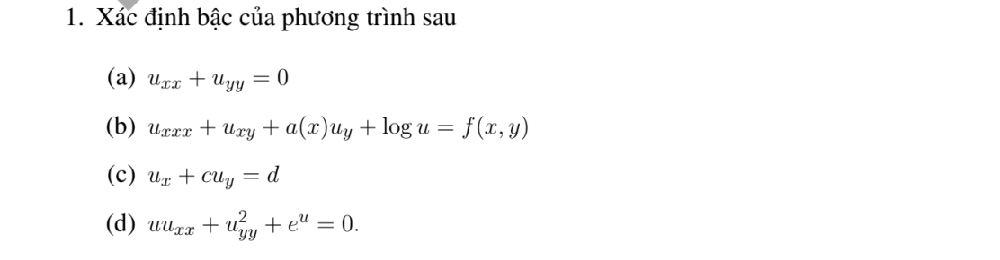

# Bài tập thực hành 1 — Mục 1.2.3

**Mã:** `BT_1_2_3_01` · **Trang sách:** 7–7

[← Mục lục](../MUC_LUC.md) · [Bản PDF của bài](BT_1_2_3_01.pdf)

## Đề bài

## Kiến thức và trình tự giải

**Mục tiêu.** Xác định cấp và dạng của phương trình trước khi chọn cách giải. Ở mục này, từ “bậc” trong đề được hiểu theo nghĩa cấp đạo hàm của phương trình.

**Bước 1 — Liệt kê đạo hàm và đếm cấp.** Với $\partial^{i+j}u/\partial x^i\partial y^j$, cấp là $i+j$. Vì vậy $u_x$ cấp 1, $u_{xy}$ cấp 2, $u_{txx}$ cấp 3. Hạng $u$, $e^u$, $\log u$ không chứa đạo hàm, được xem là cấp 0. $(u_y)^2$ là bình phương của một đạo hàm cấp 1, không phải đạo hàm cấp 2. Lấy giá trị lớn nhất trong các cấp vừa liệt kê.

**Bước 2 — Viết rõ phần chứa đạo hàm cấp cao nhất.** Gọi cấp đó là $m$. Tạm xem từng đạo hàm cấp $m$ như một ẩn đại số độc lập. Nếu chúng bị bình phương, nhân với nhau hoặc nằm trong hàm mũ/lượng giác, biểu thức đã cho hoàn toàn phi tuyến. Nếu chúng chỉ xuất hiện tuyến tính, chuyển sang bước 3. Khi khai triển $(f(u))_x$, phải dùng $(f(u))_x=f'(u)u_x$ trước khi phân loại.

**Bước 3 — Xét hệ số và các hạng cấp thấp.** Nếu mọi hạng chứa $u$ và đạo hàm đều tuyến tính, hệ số chỉ phụ thuộc biến độc lập, phương trình tuyến tính. Nếu chỉ phần cấp $m$ tuyến tính, hệ số của phần đó phụ thuộc biến độc lập, còn phần cấp thấp phi tuyến, phương trình nửa tuyến tính. Nếu hệ số phần cấp $m$ phụ thuộc $u$ hoặc đạo hàm cấp thấp, phương trình tựa tuyến tính. Khi ghi kết luận, chỉ rõ hạng nào quyết định phân loại.

**Bước 4 — Xét thuần nhất khi phương trình tuyến tính.** Gom toàn bộ hạng chứa ẩn về một vế, viết $Lu=f(x,y)$. Nếu $f\equiv0$, phương trình thuần nhất; nếu không, không thuần nhất. Ví dụ $u_{xy}=u$ phải viết $u_{xy}-u=0$, nên là thuần nhất.

**Bước 5 — Kiểm tra miền và yêu cầu đề.** $\log u$ đòi hỏi $u>0$ đối với nghiệm thực. Một phép biến đổi như lấy log có thể cho phương trình tương đương trên một miền, nhưng cần phân biệt dạng biểu thức in trong đề và dạng đã biến đổi. Nếu đề chỉ hỏi cấp, dừng sau bước 1 và giải thích đạo hàm quyết định cấp.

## Lời giải áp dụng cho bài

**Bước 1: xác định điều cần phân loại.** Theo phần lý thuyết trong sách, “bậc” của câu này được hiểu là *cấp phương trình*: cấp cao nhất của đạo hàm riêng xuất hiện. Số mũ của đạo hàm và hàm như $\log u,e^u$ không làm tăng cấp đạo hàm.

**Bước 2: xét từng phương trình.**

**Ý (a).**  $u_{xx}+u_{yy}=0$: hai đạo hàm đều cấp 2, nên cấp 2.

**Ý (b).**  $u_{xxx}+u_{xy}+a(x)u_y+\log u=f(x,y)$: $u_{xxx}$ cấp 3, $u_{xy}$ cấp 2, $u_y$ cấp 1; $\log u$ cấp 0. Cấp cao nhất bằng 3. Nếu nghiệm thực, $\log u$ cần $u>0$ nhưng không thay đổi cấp.

**Ý (c).**  $u_x+cu_y=d$: các đạo hàm đều cấp 1, nên cấp 1.

**Ý (d).**  $uu_{xx}+u_y^2+e^u=0$: $u_{xx}$ cấp 2; $(u_y)^2$ vẫn chỉ là bình phương của đạo hàm cấp 1. Do đó cấp 2.

**Kết luận:** các cấp lần lượt là $\boxed{2,3,1,2}$.

## Đối chiếu kết quả

Khi sử dụng kết quả, kiểm tra đồng thời phương trình, dữ liệu ban đầu/biên và miền được nêu trong lời giải. Các điều kiện về tính trơn, nghiệm thực, tồn tại hoặc duy nhất là một phần của kết luận; không bỏ chúng khi ghi đáp án.
