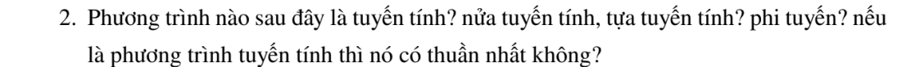
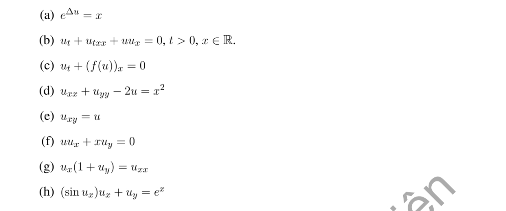

# Bài tập thực hành 2 — Mục 1.2.3

**Mã:** `BT_1_2_3_02` · **Trang sách:** 7–8

[← Mục lục](../MUC_LUC.md) · [Bản PDF của bài](BT_1_2_3_02.pdf)

## Đề bài

## Kiến thức và trình tự giải

**Mục tiêu.** Xác định cấp và dạng của phương trình trước khi chọn cách giải. Ở mục này, từ “bậc” trong đề được hiểu theo nghĩa cấp đạo hàm của phương trình.

**Bước 1 — Liệt kê đạo hàm và đếm cấp.** Với $\partial^{i+j}u/\partial x^i\partial y^j$, cấp là $i+j$. Vì vậy $u_x$ cấp 1, $u_{xy}$ cấp 2, $u_{txx}$ cấp 3. Hạng $u$, $e^u$, $\log u$ không chứa đạo hàm, được xem là cấp 0. $(u_y)^2$ là bình phương của một đạo hàm cấp 1, không phải đạo hàm cấp 2. Lấy giá trị lớn nhất trong các cấp vừa liệt kê.

**Bước 2 — Viết rõ phần chứa đạo hàm cấp cao nhất.** Gọi cấp đó là $m$. Tạm xem từng đạo hàm cấp $m$ như một ẩn đại số độc lập. Nếu chúng bị bình phương, nhân với nhau hoặc nằm trong hàm mũ/lượng giác, biểu thức đã cho hoàn toàn phi tuyến. Nếu chúng chỉ xuất hiện tuyến tính, chuyển sang bước 3. Khi khai triển $(f(u))_x$, phải dùng $(f(u))_x=f'(u)u_x$ trước khi phân loại.

**Bước 3 — Xét hệ số và các hạng cấp thấp.** Nếu mọi hạng chứa $u$ và đạo hàm đều tuyến tính, hệ số chỉ phụ thuộc biến độc lập, phương trình tuyến tính. Nếu chỉ phần cấp $m$ tuyến tính, hệ số của phần đó phụ thuộc biến độc lập, còn phần cấp thấp phi tuyến, phương trình nửa tuyến tính. Nếu hệ số phần cấp $m$ phụ thuộc $u$ hoặc đạo hàm cấp thấp, phương trình tựa tuyến tính. Khi ghi kết luận, chỉ rõ hạng nào quyết định phân loại.

**Bước 4 — Xét thuần nhất khi phương trình tuyến tính.** Gom toàn bộ hạng chứa ẩn về một vế, viết $Lu=f(x,y)$. Nếu $f\equiv0$, phương trình thuần nhất; nếu không, không thuần nhất. Ví dụ $u_{xy}=u$ phải viết $u_{xy}-u=0$, nên là thuần nhất.

**Bước 5 — Kiểm tra miền và yêu cầu đề.** $\log u$ đòi hỏi $u>0$ đối với nghiệm thực. Một phép biến đổi như lấy log có thể cho phương trình tương đương trên một miền, nhưng cần phân biệt dạng biểu thức in trong đề và dạng đã biến đổi. Nếu đề chỉ hỏi cấp, dừng sau bước 1 và giải thích đạo hàm quyết định cấp.

## Lời giải áp dụng cho bài

**Bước 1: dùng định nghĩa theo cấp cao nhất $m$.** Tuyến tính: ẩn và mọi đạo hàm xuất hiện tuyến tính, hệ số chỉ phụ thuộc biến độc lập. Nửa tuyến tính: đạo hàm cấp $m$ tuyến tính với hệ số chỉ phụ thuộc biến độc lập, nhưng các hạng cấp thấp có thể phi tuyến. Tựa tuyến tính: đạo hàm cấp $m$ tuyến tính, hệ số có thể phụ thuộc $u$ và các đạo hàm cấp thấp hơn. Hoàn toàn phi tuyến: biểu thức không tuyến tính theo đạo hàm cấp $m$. Chỉ hỏi thuần nhất khi phương trình đã tuyến tính.

**Bước 2: áp dụng từng ý.**

**Ý (a).**  $e^{\Delta u}=x$. Vì $\Delta u=u_{xx}+u_{yy}$ nằm trong hàm mũ, biểu thức đã cho hoàn toàn phi tuyến cấp 2. Tuy nhiên, nghiệm thực chỉ có trên $x>0$, và ở đó lấy log được phương trình tương đương $\Delta u=\log x$, tuyến tính không thuần nhất. Cần phân biệt phân loại *biểu thức được in* và dạng tương đương sau biến đổi.

**Ý (b).**  $u_t+u_{txx}+uu_x=0$. Đạo hàm cao nhất $u_{txx}$ cấp 3, tuyến tính với hệ số 1. Tích $uu_x$ phi tuyến ở cấp thấp. Kết luận: nửa tuyến tính cấp 3.

**Ý (c).**  $u_t+(f(u))_x=0$. Quy tắc dây chuyền cho $u_t+f'(u)u_x=0$. Hạng cấp 1 tuyến tính theo $u_t,u_x$ nhưng hệ số $f'(u)$ phụ thuộc $u$, nên tựa tuyến tính cấp 1. Ngoại lệ: nếu $f(u)=au+b$, được $u_t+au_x=0$, tuyến tính thuần nhất.

**Ý (d).**  $u_{xx}+u_{yy}-2u=x^2$. Các hạng của $u$ tuyến tính, hệ số hằng, vế phải khác 0: tuyến tính không thuần nhất cấp 2.

**Ý (e).**  $u_{xy}=u$. Chuyển vế thành $u_{xy}-u=0$: tuyến tính thuần nhất cấp 2. Việc vế phải ban đầu là $u$ không làm phương trình không thuần nhất; phải gom tất cả hạng chứa ẩn về cùng vế.

**Ý (f).**  $uu_x+xu_y=0$. Tuyến tính theo hai đạo hàm cấp 1, nhưng hệ số của $u_x$ là $u$. Kết luận: tựa tuyến tính cấp 1.

**Ý (g).**  $u_x(1+u_y)=u_{xx}$. Viết $u_{xx}-u_x-u_xu_y=0$. Đạo hàm cấp 2 $u_{xx}$ tuyến tính, hệ số 1; phi tuyến $u_xu_y$ chỉ ở cấp 1. Kết luận: nửa tuyến tính cấp 2.

**Ý (h).**  $(\sin u_x)u_x+u_y=e^x$. Đạo hàm cấp cao nhất là cấp 1 và $u_x\sin u_x$ không tuyến tính theo $u_x$. Kết luận: hoàn toàn phi tuyến cấp 1.

**Bước 3: kiểm tra cách phân biệt.** Các ý (b),(g) có phi tuyến nhưng chỉ ở cấp thấp, nên nửa tuyến tính. Các ý (c),(f) có hệ số đạo hàm cấp cao nhất phụ thuộc ẩn, nên tựa tuyến tính. Các ý (a),(h) phi tuyến ngay ở đạo hàm cấp cao nhất. Với các phương trình phi tuyến không dùng phân biệt “thuần nhất/không thuần nhất” theo định nghĩa toán tử tuyến tính.

## Đối chiếu kết quả

Khi sử dụng kết quả, kiểm tra đồng thời phương trình, dữ liệu ban đầu/biên và miền được nêu trong lời giải. Các điều kiện về tính trơn, nghiệm thực, tồn tại hoặc duy nhất là một phần của kết luận; không bỏ chúng khi ghi đáp án.
