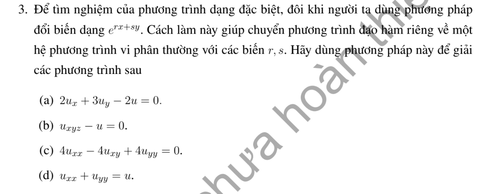

# Bài tập thực hành 3 — Mục 1.2.3

**Mã:** `BT_1_2_3_03` · **Trang sách:** 8–8

[← Mục lục](../MUC_LUC.md) · [Bản PDF của bài](BT_1_2_3_03.pdf)

## Đề bài

## Kiến thức và trình tự giải

**Mục tiêu.** Tìm nghiệm dạng mũ cho PDE tuyến tính có hệ số hằng, theo dạng thử mà đề yêu cầu.

**Bước 1 — Đặt đủ các biến trong số mũ.** Hai biến dùng $u=e^{rx+sy}$; ba biến dùng $u=e^{rx+sy+tz}$. Các tham số $r,s,t$ cần được xác định, không phải biến độc lập.

**Bước 2 — Tính các đạo hàm.** Ta có $u_x=ru$, $u_y=su$, $u_{xx}=r^2u$, $u_{xy}=rsu$, $u_{xyz}=rst\,u$. Mỗi lần lấy đạo hàm tương ứng với nhân thêm tham số của biến ấy.

**Bước 3 — Thế và giải phương trình đại số.** Vì hàm mũ không bằng 0, chia PDE cho $u$ để thu được điều kiện theo tham số. Giải hoặc tham số hóa điều kiện này. Phân biệt tham số thực và phức khi phương trình đại số không có nghiệm thực khác 0.

**Bước 4 — Kiểm tra và hiểu phạm vi kết quả.** Thế một bộ tham số cụ thể để kiểm tra. Với phương trình tuyến tính thuần nhất, tổng hữu hạn các nghiệm cũng là nghiệm. Họ nghiệm mũ chưa nhất thiết mô tả toàn bộ nghiệm; nếu muốn nghiệm tổng quát phải dùng thêm đặc trưng hoặc phương pháp phù hợp.

## Lời giải áp dụng cho bài

**Bước 1: tính đạo hàm của nghiệm thử.** Với $u=e^{rx+sy}$,

$$
u_x=ru,\quad u_y=su,\quad u_{xx}=r^2u,\quad u_{xy}=rsu,\quad u_{yy}=s^2u.
$$

Vì $u\ne0$, sau khi thế vào PDE có thể chia cho $u$ để có phương trình đại số theo $r,s$. Đề dùng nghiệm dạng đặc biệt; một họ nghiệm mũ không tự động là nghiệm tổng quát của mọi PDE.

**Ý (a).**  $2u_x+3u_y-2u=0$ cho $2r+3s-2=0$. Với mỗi $s\in\mathbb R$, chọn $r=1-3s/2$, được một nghiệm $e^{(1-3s/2)x+sy}$. Để có nghiệm tổng quát, dùng bất biến $\xi=3x-2y$, đặt $u=e^xF(\xi)$. Tính đạo hàm cho $2u_x+3u_y=2u$, nên toàn bộ nghiệm là $u=e^xF(3x-2y)$.

**Ý (b).**  Vì PDE có ba biến, dùng $u=e^{rx+sy+tz}$. Khi đó $u_{xyz}=rst\,u$, nên điều kiện là $rst=1$. Chọn $r,s\ne0$ tùy ý và $t=1/(rs)$; ví dụ $u=e^{x+y+z}$. Tuyến tính cho phép cộng hữu hạn các mode này. Không thể bỏ biến $z$ vì nghiệm không phụ thuộc $z$ có $u_{xyz}=0$.

**Ý (c).**  $4u_{xx}-4u_{xy}+4u_{yy}=0$ cho $r^2-rs+s^2=0$. Viết $(r-s/2)^2+3s^2/4=0$: với $r,s$ thực chỉ có $r=s=0$, tức mode hằng. Với số phức, $r=(1\pm i\sqrt3)s/2$; phần thực và phần ảo của mode phức cho nghiệm thực. Nghiệm mũ thực không mô tả hết nghiệm điều hòa của phương trình elliptic này.

**Ý (d).**  $u_{xx}+u_{yy}=u$ cho $r^2+s^2=1$. Tham số hóa $r=\cos\theta,s=\sin\theta$, được $u_\theta=e^{x\cos\theta+y\sin\theta}$. Các ví dụ $e^x,e^y,e^{(x+y)/\sqrt2}$ đều đúng; cộng các nghiệm do tính tuyến tính vẫn cho nghiệm. Thế các đạo hàm ở bước 1 kiểm tra trực tiếp từng công thức.

**Chi tiết tìm họ nghiệm ở (a).** Đặc trưng là $X'=2,Y'=3,U'=2U$. Tích phân từ $(x_0,y_0,u_0)$ được $X=x_0+2s,Y=y_0+3s,U=u_0e^{2s}$. Vì $3X-2Y=3x_0-2y_0$ và $e^{-X}U=e^{-x_0}u_0$, đặt giá trị bất biến thứ hai là $F(3X-2Y)$. Đổi về $x,y$ được $u=e^xF(3x-2y)$. Kiểm tra bằng các đạo hàm $u_x=e^x(F+3F')$, $u_y=-2e^xF'$: $2u_x+3u_y-2u=e^x(2F+6F'-6F'-2F)=0$.

## Đối chiếu kết quả

Khi sử dụng kết quả, kiểm tra đồng thời phương trình, dữ liệu ban đầu/biên và miền được nêu trong lời giải. Các điều kiện về tính trơn, nghiệm thực, tồn tại hoặc duy nhất là một phần của kết luận; không bỏ chúng khi ghi đáp án.
