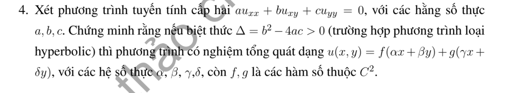

# Bài tập thực hành 4 — Mục 1.2.3

**Mã:** `BT_1_2_3_04` · **Trang sách:** 8–8

[← Mục lục](../MUC_LUC.md) · [Bản PDF của bài](BT_1_2_3_04.pdf)

## Đề bài

## Kiến thức và trình tự giải

**Mục tiêu của bài.** Đưa $au_{xx}+bu_{xy}+cu_{yy}=0$ với $\Delta=b^2-4ac>0$ về phương trình có thể tích phân. Ở đây hệ số hỗn hợp là $b$, không phải $2b$.

**Bước 1 — Tìm hướng đặc trưng.** Thử tọa độ $\xi=y-mx$. Hệ số của $v_{\xi\xi}$ sau đổi biến là $am^2-bm+c$. Giải $am^2-bm+c=0$; nếu $a\ne0$, $\Delta>0$ cho hai nghiệm thực phân biệt $m_1,m_2$. Nếu $a=0$, xét trực tiếp vì khi đó $b\ne0$.

**Bước 2 — Đổi biến và kiểm tra Jacobian.** Đặt $\xi=y-m_1x$, $\eta=y-m_2x$, $u=v(\xi,\eta)$. Jacobian là $m_2-m_1\ne0$. Viết $\partial_x=-m_1\partial_\xi-m_2\partial_\eta$, $\partial_y=\partial_\xi+\partial_\eta$, rồi áp dụng hai lần để tính $u_{xx},u_{xy},u_{yy}$.

**Bước 3 — Thế toàn bộ đạo hàm vào PDE.** Hai hệ số thuần bằng 0 theo phương trình của $m_i$. Hệ số hỗn hợp khác 0, nên chia được để có $v_{\xi\eta}=0$. Với đổi biến không tuyến tính trong bài khác, phải giữ cả các hạng đạo hàm cấp 1 phát sinh.

**Bước 4 — Tích phân hai lần.** $\partial_\eta(v_\xi)=0$ cho $v_\xi=A(\xi)$; tích phân theo $\xi$ cho $v=F(\xi)+G(\eta)$. Đổi về $x,y$ và thế lại PDE để kiểm tra. Các hàm $F,G$ cần đủ trơn, thường $C^2$.

## Lời giải áp dụng cho bài

**Bước 1: tìm hai họ đặc trưng.** Nếu $a\ne0$, phương trình $am^2-bm+c=0$ có hai nghiệm thực phân biệt $m_1,m_2$ vì $\Delta=b^2-4ac>0$. Ta có $m_1+m_2=b/a$, $m_1m_2=c/a$.

**Bước 2: đổi biến.** Đặt $\xi=y-m_1x,\eta=y-m_2x,u=v(\xi,\eta)$. Jacobian bằng $m_2-m_1\ne0$, nên phép đổi không suy biến. Quy tắc dây chuyền:

$$
\begin{aligned}
u_{xx}&=m_1^2v_{\xi\xi}+2m_1m_2v_{\xi\eta}+m_2^2v_{\eta\eta},\\
u_{xy}&=-m_1v_{\xi\xi}-(m_1+m_2)v_{\xi\eta}-m_2v_{\eta\eta},\\
u_{yy}&=v_{\xi\xi}+2v_{\xi\eta}+v_{\eta\eta}.
\end{aligned}
$$

Hai hệ số của $v_{\xi\xi},v_{\eta\eta}$ bằng 0. Hệ số hỗn hợp bằng $2am_1m_2-b(m_1+m_2)+2c=-\Delta/a\ne0$. Do đó PDE tương đương $v_{\xi\eta}=0$.

**Bước 3: tích phân.** Từ $\partial_\eta(v_\xi)=0$, $v_\xi=A(\xi)$. Tích phân theo $\xi$ cho $v=F(\xi)+G(\eta)$. Suy

$$
\boxed{u=F(y-m_1x)+G(y-m_2x).}
$$

Đây là dạng yêu cầu với $\alpha=-m_1,\beta=1,\gamma=-m_2,\delta=1$.

**Trường hợp $a=0$.** Khi đó $b\ne0$, PDE là $\partial_y(bu_x+cu_y)=0$. Đặt $\xi=x,\eta=y-(c/b)x$, tính được $bu_{xy}+cu_{yy}=b v_{\xi\eta}$. Vẫn có $u=F(x)+G(y-(c/b)x)$, hai dạng tuyến tính độc lập.

**Kiểm tra:** thế đạo hàm của $F(y-m_ix)$ cho hệ số $am_i^2-bm_i+c=0$; từng hạng giải PDE, và tổng cũng giải do tuyến tính.

## Đối chiếu kết quả

Khi sử dụng kết quả, kiểm tra đồng thời phương trình, dữ liệu ban đầu/biên và miền được nêu trong lời giải. Các điều kiện về tính trơn, nghiệm thực, tồn tại hoặc duy nhất là một phần của kết luận; không bỏ chúng khi ghi đáp án.
