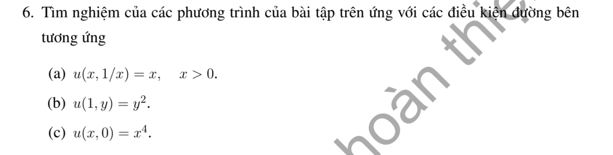

# Bài tập thực hành 6 — Mục 1.3.2.3

**Mã:** `BT_1_3_2_3_06` · **Trang sách:** 22–22

[← Mục lục](../MUC_LUC.md) · [Bản PDF của bài](BT_1_3_2_3_06.pdf)

## Đề bài

## Kiến thức và trình tự giải

**Mục tiêu.** Với $A(x,y)u_x+B(x,y)u_y+C(x,y)u=R(x,y)$, tìm các đường mà trên đó PDE trở thành một ODE. Dùng chữ $R$ cho vế phải để không nhầm với hàm tùy ý $F$.

**Bước 1 — Đọc các hệ số và lập hệ đặc trưng.** Đặt $U(s)=u(X(s),Y(s))$. Quy tắc dây chuyền cho $U'=u_xX'+u_yY'$. Chọn $X'=A$, $Y'=B$, khi đó

$$
X'=A(X,Y),\qquad Y'=B(X,Y),\qquad U'+C(X,Y)U=R(X,Y).
$$

Nếu $A\ne0$, có thể dùng $x$ làm tham số: $dy/dx=B/A$, $du/dx+(C/A)u=R/A$. Nếu $A=0$, chọn biến khác hoặc giữ hệ theo $s$; không chia cho hệ số bằng 0.

**Bước 2 — Tìm bất biến để phân biệt các đặc trưng.** Tích phân hai phương trình đầu để tìm $\rho(X,Y)$ không đổi. Kiểm tra $A\rho_x+B\rho_y=0$. Hệ số hằng cho $\rho=Bx-Ay$. Ví dụ $X'=X,Y'=-Y$ cho $(XY)'=0$; $X'=-Y,Y'=X$ cho $(X^2+Y^2)'=0$. Khi đặc trưng là vòng kín, cần kiểm tra nghiệm sau một vòng trở về cùng giá trị.

**Bước 3 — Giải ODE của ẩn trên từng đường.** Đặt $M(s)=\exp(\int C(X(s),Y(s))ds)$. Nhân phương trình của $U$ với $M$:

$$
(MU)'=MR,\qquad
U(s)=M(s)^{-1}\left[K+\int M(s)R(X(s),Y(s))ds\right].
$$

$K$ hằng trên một đường, nhưng thay đổi giữa các đường, nên viết $K=F(\rho)$. Nếu tìm được nghiệm riêng $u_p$, có thể giải phương trình thuần nhất cho $u-u_p$ để giảm tính toán. Nếu đổi biến $(\rho,z)$, phải tính Jacobian và dùng quy tắc dây chuyền để thấy PDE chỉ còn đạo hàm theo $z$.

**Bước 4 — Thế dữ liệu và tìm hàm tùy ý.** Với đường dữ liệu $(x_0(r),y_0(r))$, $u=h(r)$, thế vào nghiệm tổng quát để thu được $F(\rho_0(r))=H(r)$, trong đó $\rho_0=\rho(x_0,y_0)$. Nếu $\rho_0$ khả nghịch, đặt $r=\rho_0^{-1}(z)$ rồi viết $F(z)=H(\rho_0^{-1}(z))$. Nếu hai giá trị $r_1,r_2$ có cùng $\rho_0$, phải có $H(r_1)=H(r_2)$. Nếu đường dữ liệu chính là đặc trưng, dữ liệu phải thỏa ODE trên đường đó và thường không xác định hết $F$.

**Bước 5 — Xác định miền tồn tại và duy nhất.** Điều kiện không đặc trưng là $x_0'B-y_0'A\ne0$ trên đường dữ liệu. Nó cho khả nghịch cục bộ dưới giả thiết trơn thích hợp; không tự cho duy nhất trên cả mặt phẳng. Chỉ những đặc trưng gặp dữ liệu mới được xác định. Tại gốc, trục hoặc đường hệ số suy biến, kiểm tra riêng và ghép các biểu thức đủ trơn.

**Bước 6 — Kiểm tra kết quả.** Tính $u_x,u_y$ bằng quy tắc dây chuyền, thay vào $Au_x+Bu_y+Cu$ và kiểm tra bằng $R$. Sau đó thế lại điều kiện đầu/biên. Nêu rõ nếu chỉ có nghiệm cục bộ, nghiệm từng miền hoặc không có nghiệm trong lớp trơn yêu cầu.

**Chi tiết bước tích phân ODE.** Sau khi tìm bất biến $\rho$, viết $U'+P(s,\rho)U=Q(s,\rho)$. Chọn $M=\exp(\int_{s_0}^{s}P(r,\rho)dr)$; tính $M'=PM$, nên $MU'+M'U=MQ$. Tích phân từ $s_0$: $M(s)U(s)-U(s_0)=\int_{s_0}^sM(r)Q(r)dr$. Hằng số $U(s_0)$ phụ thuộc $\rho$; thay dữ liệu để tìm nó rồi mới đổi về tọa độ gốc.

## Lời giải áp dụng cho bài

**Bước 1 — Dùng hai nghiệm tổng quát đã kiểm tra.** Bài 4: $u=e^yF(xy)$. Bài 5: $u=y+1+e^yF(xy)$. Xét dữ liệu cho từng phương trình.

**Ý (a) — $u(x,1/x)=x$, $x>0$.** Trên đường này $xy=1$. Với bài 4 phải có $F(1)=xe^{-1/x}$; đạo hàm vế phải bằng $e^{-1/x}(1+1/x)>0$, nên không thể hằng. Với bài 5 phải có $F(1)=e^{-1/x}(x-1-1/x)$; đạo hàm bằng $e^{-1/x}(1+1/x-1/x^3)$, không đồng nhất bằng 0. Cả hai đều vô nghiệm trên toàn đường dữ liệu.

**Ý (b) — $u(1,y)=y^2$.** Với bài 4, $F(y)=y^2e^{-y}$, nên

$$
u=x^2y^2e^{y-xy}.
$$

Với bài 5, $F(y)=e^{-y}(y^2-y-1)$, nên

$$
u=y+1+e^{y-xy}(x^2y^2-xy-1).
$$

Thế $x=1$ cho $y^2$ ở cả hai. Trong miền $x>0$, mọi đặc trưng gặp $x=1$ đúng một lần nên duy nhất ở miền đó; dữ liệu không tự xác định các đặc trưng trong $x<0$.

**Ý (c) — $u(x,0)=x^4$.** Với cả hai PDE, đặt $y=0$ trong phương trình gốc cho $xu_x(x,0)=0$. Dữ liệu có $u_x(x,0)=4x^3$, suy $4x^4=0$, mâu thuẫn trên mọi khoảng có $x\ne0$. Vì vậy vô nghiệm. Dùng phương trình gốc ở đường suy biến tránh chia cho $y$.

**Chi tiết hai công thức dùng ở bước 1.** Đặc trưng $X'=X,Y'=-Y$ cho $XY=\rho$. Với phương trình thuần nhất, $(e^{-Y}U)'=0$ nên $u=e^yF(\rho)$. Với phương trình có nguồn $y^2$, $(e^{-Y}U)'=Y^2e^{-Y}$; đổi $ds=-dY/Y$ và tích phân được $(Y+1)e^{-Y}+F(\rho)$, tức $u=y+1+e^yF(\rho)$. Ở (b), đường $x=1$ cho $\rho=y=s$, nên thay $s=xy$ vào $F(s)=s^2e^{-s}$ hoặc $F(s)=(s^2-s-1)e^{-s}$; đây là phép thế tạo ra hai nghiệm đã viết.

## Đối chiếu kết quả

Khi sử dụng kết quả, kiểm tra đồng thời phương trình, dữ liệu ban đầu/biên và miền được nêu trong lời giải. Các điều kiện về tính trơn, nghiệm thực, tồn tại hoặc duy nhất là một phần của kết luận; không bỏ chúng khi ghi đáp án.
