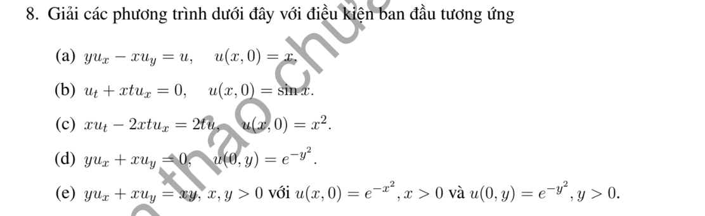

# Bài tập thực hành 8 — Mục 1.3.2.3

**Mã:** `BT_1_3_2_3_08` · **Trang sách:** 22–22

[← Mục lục](../MUC_LUC.md) · [Bản PDF của bài](BT_1_3_2_3_08.pdf)

## Đề bài

## Kiến thức và trình tự giải

**Mục tiêu.** Với $A(x,y)u_x+B(x,y)u_y+C(x,y)u=R(x,y)$, tìm các đường mà trên đó PDE trở thành một ODE. Dùng chữ $R$ cho vế phải để không nhầm với hàm tùy ý $F$.

**Bước 1 — Đọc các hệ số và lập hệ đặc trưng.** Đặt $U(s)=u(X(s),Y(s))$. Quy tắc dây chuyền cho $U'=u_xX'+u_yY'$. Chọn $X'=A$, $Y'=B$, khi đó

$$
X'=A(X,Y),\qquad Y'=B(X,Y),\qquad U'+C(X,Y)U=R(X,Y).
$$

Nếu $A\ne0$, có thể dùng $x$ làm tham số: $dy/dx=B/A$, $du/dx+(C/A)u=R/A$. Nếu $A=0$, chọn biến khác hoặc giữ hệ theo $s$; không chia cho hệ số bằng 0.

**Bước 2 — Tìm bất biến để phân biệt các đặc trưng.** Tích phân hai phương trình đầu để tìm $\rho(X,Y)$ không đổi. Kiểm tra $A\rho_x+B\rho_y=0$. Hệ số hằng cho $\rho=Bx-Ay$. Ví dụ $X'=X,Y'=-Y$ cho $(XY)'=0$; $X'=-Y,Y'=X$ cho $(X^2+Y^2)'=0$. Khi đặc trưng là vòng kín, cần kiểm tra nghiệm sau một vòng trở về cùng giá trị.

**Bước 3 — Giải ODE của ẩn trên từng đường.** Đặt $M(s)=\exp(\int C(X(s),Y(s))ds)$. Nhân phương trình của $U$ với $M$:

$$
(MU)'=MR,\qquad
U(s)=M(s)^{-1}\left[K+\int M(s)R(X(s),Y(s))ds\right].
$$

$K$ hằng trên một đường, nhưng thay đổi giữa các đường, nên viết $K=F(\rho)$. Nếu tìm được nghiệm riêng $u_p$, có thể giải phương trình thuần nhất cho $u-u_p$ để giảm tính toán. Nếu đổi biến $(\rho,z)$, phải tính Jacobian và dùng quy tắc dây chuyền để thấy PDE chỉ còn đạo hàm theo $z$.

**Bước 4 — Thế dữ liệu và tìm hàm tùy ý.** Với đường dữ liệu $(x_0(r),y_0(r))$, $u=h(r)$, thế vào nghiệm tổng quát để thu được $F(\rho_0(r))=H(r)$, trong đó $\rho_0=\rho(x_0,y_0)$. Nếu $\rho_0$ khả nghịch, đặt $r=\rho_0^{-1}(z)$ rồi viết $F(z)=H(\rho_0^{-1}(z))$. Nếu hai giá trị $r_1,r_2$ có cùng $\rho_0$, phải có $H(r_1)=H(r_2)$. Nếu đường dữ liệu chính là đặc trưng, dữ liệu phải thỏa ODE trên đường đó và thường không xác định hết $F$.

**Bước 5 — Xác định miền tồn tại và duy nhất.** Điều kiện không đặc trưng là $x_0'B-y_0'A\ne0$ trên đường dữ liệu. Nó cho khả nghịch cục bộ dưới giả thiết trơn thích hợp; không tự cho duy nhất trên cả mặt phẳng. Chỉ những đặc trưng gặp dữ liệu mới được xác định. Tại gốc, trục hoặc đường hệ số suy biến, kiểm tra riêng và ghép các biểu thức đủ trơn.

**Bước 6 — Kiểm tra kết quả.** Tính $u_x,u_y$ bằng quy tắc dây chuyền, thay vào $Au_x+Bu_y+Cu$ và kiểm tra bằng $R$. Sau đó thế lại điều kiện đầu/biên. Nêu rõ nếu chỉ có nghiệm cục bộ, nghiệm từng miền hoặc không có nghiệm trong lớp trơn yêu cầu.

**Chi tiết bước tích phân ODE.** Sau khi tìm bất biến $\rho$, viết $U'+P(s,\rho)U=Q(s,\rho)$. Chọn $M=\exp(\int_{s_0}^{s}P(r,\rho)dr)$; tính $M'=PM$, nên $MU'+M'U=MQ$. Tích phân từ $s_0$: $M(s)U(s)-U(s_0)=\int_{s_0}^sM(r)Q(r)dr$. Hằng số $U(s_0)$ phụ thuộc $\rho$; thay dữ liệu để tìm nó rồi mới đổi về tọa độ gốc.

## Lời giải áp dụng cho bài

**Ý (a).** $yu_x-xu_y=u$ cho $X'=Y,Y'=-X,U'=U$. Đường đi là vòng tròn chu kỳ $2\pi$, nhưng $U(s+2\pi)=e^{2\pi}U(s)$. Một nghiệm đơn trị phải trở lại cùng giá trị, buộc $U=0$ trên mọi vòng. Dữ liệu $u(x,0)=x$ khác 0, nên vô nghiệm toàn cục. Cục bộ trong một góc không phủ vòng kín có thể có nghiệm, nhưng không kéo dài thành nghiệm đơn trị quanh vòng.

**Ý (b).** $u_t+xtu_x=0$. Dùng $t$: $X'=tX$, $U'=0$, $X(0)=\xi$, $U(0)=\sin\xi$. Tích phân $X=\xi e^{t^2/2}$, nên $\xi=xe^{-t^2/2}$ và

$$
u=\sin(xe^{-t^2/2}).
$$

Đặt $z=xe^{-t^2/2}$, $u_t=-tz\cos z$, $xtu_x=tz\cos z$, tổng bằng 0; tại $t=0$ đúng $\sin x$.

**Ý (c) — Giữ hệ số $-2xt$ trong đề.** $xu_t-2xtu_x=2tu$, $u(x,0)=x^2$. Trên $x\ne0$, chia cho $x$: $u_t-2tu_x=(2t/x)u$. Đặc trưng $X'= -2t$ cho $X=\xi-t^2$, nên $\xi=x+t^2$. Trên đường,

$$
U'=\frac{2t}{\xi-t^2}U,\quad \frac{d}{dt}[(\xi-t^2)U]=0.
$$

Ở $t=0$, tích này bằng $\xi^3$, do đó

$$
u=\frac{(x+t^2)^3}{x}.
$$

Đối với miền từ dữ liệu $x>0$, công thức hợp lệ khi $x>0$; từ dữ liệu $x<0$, cần $\xi=x+t^2<0$. Đặt $z=x+t^2$, $u_t=6tz^2/x$, $u_x=3z^2/x-z^3/x^2$, nên $xu_t-2xtu_x=2tz^3/x=2tu$. Trên $x=0,t>0$ phương trình gốc buộc $u=0$, nhưng công thức phía $x>0$ phân kỳ khi $x\downarrow0$. Vì thế không có nghiệm $C^1$ trên toàn mặt phẳng thời gian dương thỏa toàn bộ dữ liệu.

**Ý (d).** $yu_x+xu_y=0$ có $r=x^2-y^2$ bất biến và $U'=0$. Trên $x=0$, $r=-y^2$; dữ liệu cho $F(r)=e^r$ với $r\le0$. Vì thế trên miền các đặc trưng từ trục $y$ phủ, có $u=e^{x^2-y^2}$. Công thức cũng là một nghiệm toàn mặt phẳng, nhưng miền $r>0$ chưa được dữ liệu xác định. Chẳng hạn thêm $\psi(r)$ với $\psi(r)=0$ khi $r\le0$, $\psi(r)=e^{-1/r}$ khi $r>0$, vẫn cho nghiệm trơn cùng dữ liệu và khác trên $r>0$.

**Ý (e).** Với $V=y\partial_x+x\partial_y$, $Vr=0$ và $V(y^2/2)=xy$. Do đó $u=y^2/2+H(r)$. Trên $y=0$, $H(r)=e^{-r}$ với $r\ge0$. Trên $x=0$, $r=-y^2$, nên $H(r)=e^r+r/2$ với $r\le0$. Hai giá trị bằng nhau tại 0, nhưng $H'_+(0)=-1$, $H'_-(0)=3/2$. Trên đường $x=y>0$, $\nabla r\ne0$, nên gradient của $u$ không ghép liên tục. Kết luận: công thức ghép là nghiệm liên tục từng miền, nhưng không có nghiệm $C^1$ trên toàn góc phần tư thỏa hai vết đã cho.

**Chi tiết hệ hyperbola của (d),(e).** Với $X'=Y,Y'=X$, đặt $S=X+Y,T=X-Y$. Khi đó $S'=S,T'=-T$, nên $S=S_0e^s,T=T_0e^{-s}$ và $ST=X^2-Y^2=\rho$. Ở (d), $U'=0$ nên $U$ hằng trên từng thành phần hyperbola; trên trục $x=0$ có $\rho=-y^2$ và dữ liệu $e^{-y^2}=e^\rho$, quyết định các thành phần từ trục ấy. Ở (e), $U'=XY$ và $(Y^2/2)'=YY'=XY$, nên $(U-Y^2/2)'=0$. Bởi vậy $u=y^2/2+H(\rho)$ trước khi dùng hai vết. Đạo hàm hai biểu thức của $H$ tại $0$: $(e^{-r})'|_0=-1$, $(e^r+r/2)'|_0=1+1/2=3/2$, giải thích sự không ghép $C^1$.

## Đối chiếu kết quả

Khi sử dụng kết quả, kiểm tra đồng thời phương trình, dữ liệu ban đầu/biên và miền được nêu trong lời giải. Các điều kiện về tính trơn, nghiệm thực, tồn tại hoặc duy nhất là một phần của kết luận; không bỏ chúng khi ghi đáp án.
