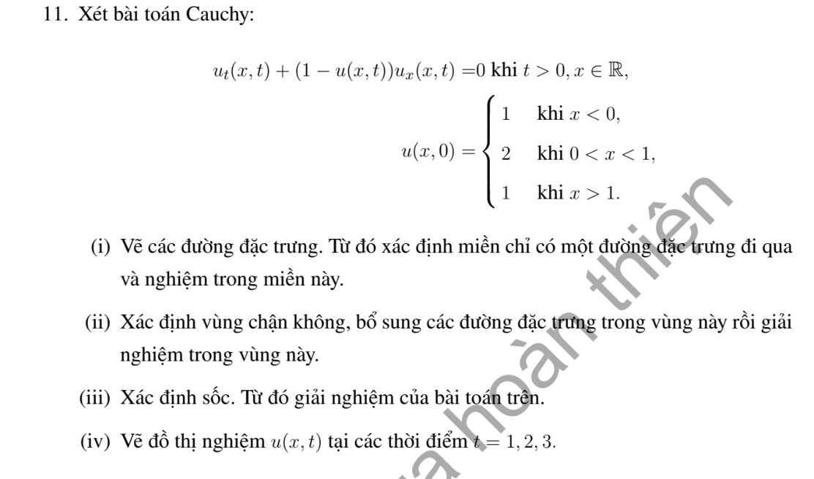

# Bài tập thực hành 11 — Mục 1.6.3

**Mã:** `BT_1_6_3_11` · **Trang sách:** 51–51

[← Mục lục](../MUC_LUC.md) · [Bản PDF của bài](BT_1_6_3_11.pdf)

## Đề bài

## Kiến thức và trình tự giải

**Mục tiêu.** Với dữ liệu gián đoạn hoặc khi đặc trưng giao nhau, tìm nghiệm yếu thỏa entropy của luật bảo toàn $u_t+(F(u))_x=0$.

**Bước 1 — Xác định thông lượng và đặc trưng.** Nếu PDE là $u_t+a(u)u_x=0$, tích phân $F'=a$. Trong vùng trơn, $u=u_0(\xi)$ và $x=\xi+F'(u_0(\xi))t$. Tính riêng tốc độ cho mỗi đoạn dữ liệu. Burgers dùng $F=u^2/2$; $u_t+u^2u_x=0$ dùng $F=u^3/3$.

**Bước 2 — Nhận diện sóng tại mỗi bước nhảy.** Gọi $u_L,u_R$ là giá trị trái, phải. So sánh $F'(u_L)$ và $F'(u_R)$. Với $F$ lồi trên khoảng trạng thái, $u_L>u_R$ tạo sốc, $u_L<u_R$ tạo quạt giãn; với $F$ lõm, thứ tự trạng thái đảo lại. Nếu độ lồi đổi dấu, phải xét thêm cấu trúc entropy, không dùng quy tắc lồi trên toàn khoảng.

**Bước 3 — Tính đường sốc từ bảo toàn.** Với $x=s(t)$,

$$
s'(t)=\frac{F(u_L)-F(u_R)}{u_L-u_R}.
$$

Nếu hai trạng thái hằng, tốc độ $\sigma$ hằng, nên $s=x_0+\sigma t$. Kiểm tra entropy bằng $F'(u_R)<\sigma<F'(u_L)$ đối với sốc nén có hai trạng thái phân biệt trong các bài này. Giá trị ngay trên đường sốc không ảnh hưởng nghiệm yếu.

**Bước 4 — Tính quạt giãn.** Từ $(x_0,0)$, đặt $z=(x-x_0)/t$, $u=V(z)$. Thế PDE cho $(F'(V)-z)V'=0$. Trong nhánh biến thiên, $F'(V)=z$, nên giải phương trình này tìm $V$. Mép quạt là $x=x_0+F'(u_L)t$ và $x=x_0+F'(u_R)t$, theo thứ tự tốc độ tăng; ghép liên tục với hai trạng thái ngoài. Chọn căn đúng dấu theo khoảng giá trị của dữ liệu.

**Bước 5 — Tìm mọi thời điểm tương tác.** Giải phương trình giao của hai sốc, sốc với mép quạt, hoặc quạt với quạt. Trước thời điểm gặp, ghép các sóng riêng. Sau khi gặp, tính lại hai trạng thái sát đường sốc. Nếu một phía nằm trong quạt, trạng thái đó phụ thuộc $s(t)$ và $t$, nên Rankine–Hugoniot trở thành ODE mới. Dùng $s(t_*)=x_*$ để tìm hằng số, rồi tiếp tục tìm lần tương tác sau.

**Bước 6 — Viết nghiệm theo từng khoảng thời gian.** Với mỗi khoảng, ghi rõ các miền $x$, thứ tự đường phân cách và công thức của $u$. Trên nửa trục, kiểm tra chiều truyền từ biên vào miền và thế điều kiện biên. Với dữ liệu trơn từng đoạn, tính $\partial x/\partial\xi$ để tìm thời điểm đầu tiên mất nghiệm cổ điển.

**Bước 7 — Kiểm tra.** Trong mỗi vùng trơn, thay vào PDE. Trên mỗi sốc, kiểm tra Rankine–Hugoniot và entropy; ở mép quạt, kiểm tra liên tục. Đối chiếu dữ liệu khi $t\downarrow0$, sự liên tục của vị trí sóng qua thời điểm gặp và khối lượng nếu dữ liệu có giá hữu hạn. Nhân PDE với một hàm của $u$ chỉ giữ tương đương cho nghiệm trơn; không tự áp luật đã nhân để tính cùng đường sốc.

**Chi tiết tích phân đường sốc nằm trong quạt.** Nếu $s'=s/(2t)$ và $s(t_*)=x_*>0$, chia cho $s$ rồi tích phân từ $t_*$ đến $t$: $\log(s/x_*)=\frac12\log(t/t_*)$, nên $s=x_*\sqrt{t/t_*}$. Nếu quạt có tâm $x_0$, thay $s$ bằng $s-x_0$ trước khi tách biến. Khi trạng thái sát sốc thay đổi tại lần gặp tiếp theo, lập ODE mới và lấy vị trí tại lần gặp làm dữ liệu; không giữ hằng số của giai đoạn trước.

## Lời giải áp dụng cho bài

**Bước 1 — Sóng trước gặp.** $F=u-u^2/2$ lõm, $F'=1-u$. Bước $1\to2$ ở 0 tạo sốc tốc độ $1-(1+2)/2=-1/2$, $s_1=-t/2$. Bước $2\to1$ ở 1 tạo quạt có mép $1-t,1$ và nhánh $u=1+(1-x)/t$.

**Bước 2 — Thời điểm gặp và nghiệm trước gặp.** $-t/2=1-t$ cho $t_*=2,x_*=-1$. Với $0<t<2$,

$$
u=\begin{cases}1,&x<s_1,\\2,&s_1<x\le1-t,\\1+(1-x)/t,&1-t<x<1,\\1,&x\ge1.\end{cases}
$$

**Bước 3 — Sốc trong quạt.** Sau gặp, trạng thái trái là 1, phải là $1+(1-s)/t$. Tốc độ

$$
s'=1-\frac{u_L+u_R}{2}=\frac{s-1}{2t}.
$$

Tích phân $(1-s)=C\sqrt t$, dùng $s(2)=-1$ cho $C=\sqrt2$, nên $s=1-\sqrt{2t}$. Với $t\ge2$, $u=1$ khi $x<s$, bằng $1+(1-x)/t$ khi $s<x<1$, bằng 1 khi $x\ge1$.

**Bước 4 — Kiểm tra.** Ở sốc, tốc độ phải $-(1-s)/t$, trái 0, còn $s'=-(1-s)/(2t)$ nằm giữa. Mép tại 1 liên tục, vị trí sốc ghép ở 2. Khối lượng phần dư $u-1$ sau gặp bằng $(1-s)^2/(2t)=1$, đúng xung ban đầu.

**Chi tiết tích phân sau tương tác.** Đặt $q=1-s>0$. Từ $s'=(s-1)/(2t)$ suy $q'=q/(2t)$. Tích phân $q'/q=1/(2t)$ từ $2$ cho $\log(q/2)=\frac12\log(t/2)$; vậy $q=\sqrt{2t}$, $s=1-\sqrt{2t}$. Phần dư khối lượng là $\int_s^1(1-x)dx/t=(1-s)^2/(2t)=1$.

## Đối chiếu kết quả

Khi sử dụng kết quả, kiểm tra đồng thời phương trình, dữ liệu ban đầu/biên và miền được nêu trong lời giải. Các điều kiện về tính trơn, nghiệm thực, tồn tại hoặc duy nhất là một phần của kết luận; không bỏ chúng khi ghi đáp án.
