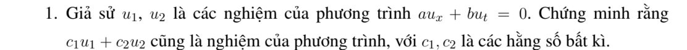

# Ví dụ 1 — Mục 1.3.1.2

**Mã:** `VD_1_3_1_2_01` · **Trang sách:** 9–10

[← Mục lục](../MUC_LUC.md) · [Bản PDF của bài](VD_1_3_1_2_01.pdf)

## Đề bài và phần trình bày có sẵn trong sách

## Kiến thức và trình tự giải

**Mục tiêu.** Chứng minh tính chồng chất của các nghiệm phương trình tuyến tính thuần nhất.

**Bước 1 — Viết toán tử.** Gọi $L$ là biểu thức lấy đạo hàm và nhân hệ số của PDE. Chẳng hạn $L=a\partial_x+b\partial_t$. Tuyến tính nghĩa là $L(c_1u_1+c_2u_2)=c_1Lu_1+c_2Lu_2$ với $c_1,c_2$ hằng.

**Bước 2 — Tính đạo hàm của tổng.** Dùng $(c_1u_1+c_2u_2)_x=c_1(u_1)_x+c_2(u_2)_x$ và tương tự theo các biến khác, rồi nhóm thành $c_1Lu_1+c_2Lu_2$. Không cho các hệ số $c_i$ phụ thuộc vị trí, vì khi đó có thêm đạo hàm của hệ số.

**Bước 3 — Thế giả thiết nghiệm.** Nếu $Lu_i=0$, tổng có $L=0$ nên cũng là nghiệm. Nếu các nghiệm có cùng dữ liệu biên, phải kiểm tra riêng dữ liệu của tổng; tính chồng chất của PDE chưa tự giữ nguyên dữ liệu.

**Bước 4 — Mở rộng cho phương trình có nguồn.** Nếu $Lu_i=f$, hiệu $u_1-u_2$ thỏa thuần nhất, nhưng tổng có nguồn $2f$. Để giải $Lu=f$, dùng một nghiệm riêng $u_p$ cộng mọi nghiệm thuần nhất $u_h$.

## Lời giải áp dụng cho bài

**Bước 1 — Xác định toán tử.** Đặt $L=a\partial_x+b\partial_t$. Do lấy đạo hàm và nhân hệ số là các phép tuyến tính, với $c_1,c_2$ hằng,

$$
L(c_1u_1+c_2u_2)=c_1Lu_1+c_2Lu_2.
$$

**Bước 2 — Dùng giả thiết.** Nếu $Lu_1=Lu_2=0$, vế phải bằng 0, nên $c_1u_1+c_2u_2$ cũng là nghiệm. Điều này đúng cho mọi tổng hữu hạn các nghiệm.

**Bước 3 — Phạm vi chồng chất.** Với PDE có nguồn $Lu=f\ne0$, tổng hai nghiệm cùng nguồn có nguồn $2f$. Khi đó dùng $u=u_p+u_h$ với $Lu_p=f$, $Lu_h=0$; hiệu hai nghiệm cùng nguồn là nghiệm thuần nhất.

