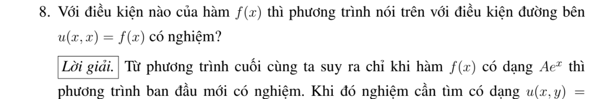
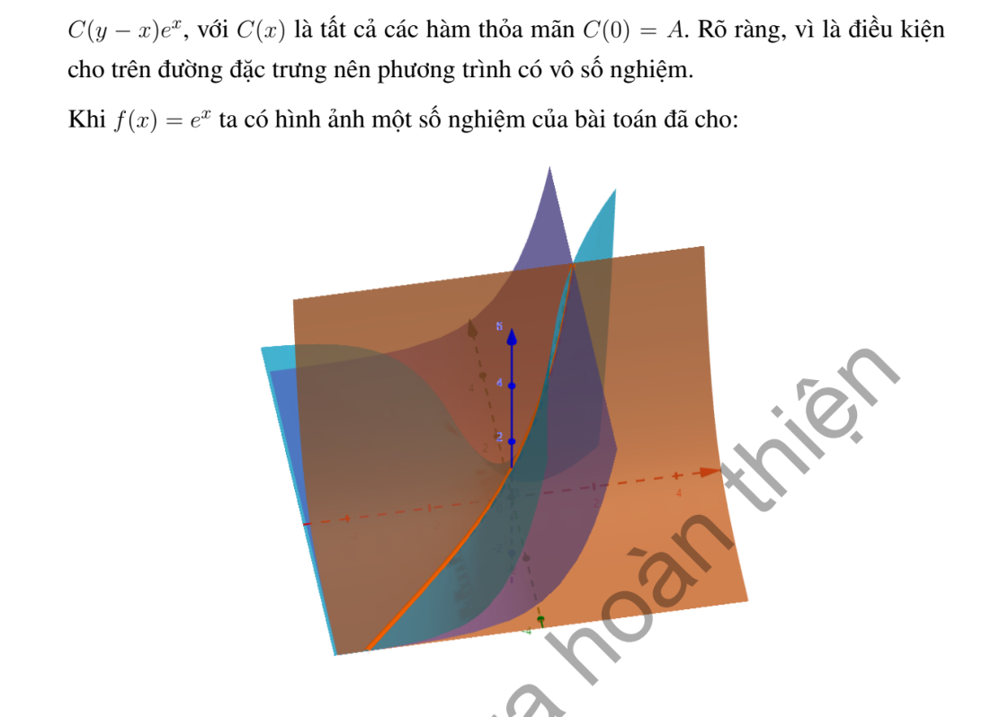

# Ví dụ 8 — Mục 1.3.1.2

**Mã:** `VD_1_3_1_2_08` · **Trang sách:** 13–14

[← Mục lục](../MUC_LUC.md) · [Bản PDF của bài](VD_1_3_1_2_08.pdf)

## Đề bài và phần trình bày có sẵn trong sách

## Kiến thức và trình tự giải

**Mục tiêu.** Với $A(x,y)u_x+B(x,y)u_y+C(x,y)u=R(x,y)$, tìm các đường mà trên đó PDE trở thành một ODE. Dùng chữ $R$ cho vế phải để không nhầm với hàm tùy ý $F$.

**Bước 1 — Đọc các hệ số và lập hệ đặc trưng.** Đặt $U(s)=u(X(s),Y(s))$. Quy tắc dây chuyền cho $U'=u_xX'+u_yY'$. Chọn $X'=A$, $Y'=B$, khi đó

$$
X'=A(X,Y),\qquad Y'=B(X,Y),\qquad U'+C(X,Y)U=R(X,Y).
$$

Nếu $A\ne0$, có thể dùng $x$ làm tham số: $dy/dx=B/A$, $du/dx+(C/A)u=R/A$. Nếu $A=0$, chọn biến khác hoặc giữ hệ theo $s$; không chia cho hệ số bằng 0.

**Bước 2 — Tìm bất biến để phân biệt các đặc trưng.** Tích phân hai phương trình đầu để tìm $\rho(X,Y)$ không đổi. Kiểm tra $A\rho_x+B\rho_y=0$. Hệ số hằng cho $\rho=Bx-Ay$. Ví dụ $X'=X,Y'=-Y$ cho $(XY)'=0$; $X'=-Y,Y'=X$ cho $(X^2+Y^2)'=0$. Khi đặc trưng là vòng kín, cần kiểm tra nghiệm sau một vòng trở về cùng giá trị.

**Bước 3 — Giải ODE của ẩn trên từng đường.** Đặt $M(s)=\exp(\int C(X(s),Y(s))ds)$. Nhân phương trình của $U$ với $M$:

$$
(MU)'=MR,\qquad
U(s)=M(s)^{-1}\left[K+\int M(s)R(X(s),Y(s))ds\right].
$$

$K$ hằng trên một đường, nhưng thay đổi giữa các đường, nên viết $K=F(\rho)$. Nếu tìm được nghiệm riêng $u_p$, có thể giải phương trình thuần nhất cho $u-u_p$ để giảm tính toán. Nếu đổi biến $(\rho,z)$, phải tính Jacobian và dùng quy tắc dây chuyền để thấy PDE chỉ còn đạo hàm theo $z$.

**Bước 4 — Thế dữ liệu và tìm hàm tùy ý.** Với đường dữ liệu $(x_0(r),y_0(r))$, $u=h(r)$, thế vào nghiệm tổng quát để thu được $F(\rho_0(r))=H(r)$, trong đó $\rho_0=\rho(x_0,y_0)$. Nếu $\rho_0$ khả nghịch, đặt $r=\rho_0^{-1}(z)$ rồi viết $F(z)=H(\rho_0^{-1}(z))$. Nếu hai giá trị $r_1,r_2$ có cùng $\rho_0$, phải có $H(r_1)=H(r_2)$. Nếu đường dữ liệu chính là đặc trưng, dữ liệu phải thỏa ODE trên đường đó và thường không xác định hết $F$.

**Bước 5 — Xác định miền tồn tại và duy nhất.** Điều kiện không đặc trưng là $x_0'B-y_0'A\ne0$ trên đường dữ liệu. Nó cho khả nghịch cục bộ dưới giả thiết trơn thích hợp; không tự cho duy nhất trên cả mặt phẳng. Chỉ những đặc trưng gặp dữ liệu mới được xác định. Tại gốc, trục hoặc đường hệ số suy biến, kiểm tra riêng và ghép các biểu thức đủ trơn.

**Bước 6 — Kiểm tra kết quả.** Tính $u_x,u_y$ bằng quy tắc dây chuyền, thay vào $Au_x+Bu_y+Cu$ và kiểm tra bằng $R$. Sau đó thế lại điều kiện đầu/biên. Nêu rõ nếu chỉ có nghiệm cục bộ, nghiệm từng miền hoặc không có nghiệm trong lớp trơn yêu cầu.

**Chi tiết bước tích phân ODE.** Sau khi tìm bất biến $\rho$, viết $U'+P(s,\rho)U=Q(s,\rho)$. Chọn $M=\exp(\int_{s_0}^{s}P(r,\rho)dr)$; tính $M'=PM$, nên $MU'+M'U=MQ$. Tích phân từ $s_0$: $M(s)U(s)-U(s_0)=\int_{s_0}^sM(r)Q(r)dr$. Hằng số $U(s_0)$ phụ thuộc $\rho$; thay dữ liệu để tìm nó rồi mới đổi về tọa độ gốc.

## Lời giải áp dụng cho bài

**Bước 1 — Dùng nghiệm tổng quát.** Như ví dụ trước, $u=e^xF(y-x)$. Trên $y=x$, chỉ số đặc trưng bằng 0, nên dữ liệu phải là $f(x)=e^xF(0)$.

**Bước 2 — Điều kiện cần và đủ.** Đặt $A=F(0)$, ta có $f(x)=Ae^x$. Ngược lại, nếu $f$ có dạng này, mọi hàm $F$ đủ trơn thỏa $F(0)=A$ đều cho nghiệm.

**Bước 3 — Giải thích không duy nhất.** Chọn $F_1(s)=A$ và $F_2(s)=A+s$ cho $u_1=Ae^x$, $u_2=e^x(A+y-x)$. Hai hàm cùng thỏa PDE và dữ liệu, nhưng khác nhau ngoài $y=x$. Dữ liệu trên một đặc trưng chỉ xác định giá trị của $F$ tại một điểm.

**Chi tiết dựng nghiệm tổng quát trước khi dùng vết.** Với $u_x+u_y=u$, chọn $x$ làm tham số: $Y'=1$, $U'=U$. Tích phân $Y=x+\rho$ và $(e^{-x}U)'=0$ cho $e^{-x}U=F(\rho)$. Vì $\rho=y-x$, thu $u=e^xF(y-x)$. Như vậy công thức dùng ở bước 1 xuất phát từ chính hệ đặc trưng của bài này.

