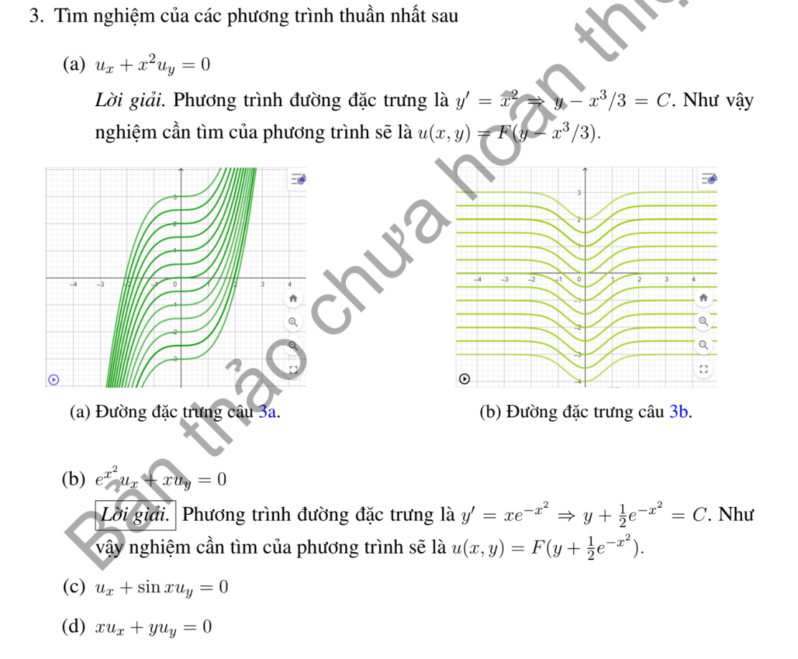

# Ví dụ 3 — Mục 1.3.2.2

**Mã:** `VD_1_3_2_2_03` · **Trang sách:** 18–18

[← Mục lục](../MUC_LUC.md) · [Bản PDF của bài](VD_1_3_2_2_03.pdf)

## Đề bài và phần trình bày có sẵn trong sách

## Kiến thức và trình tự giải

**Mục tiêu.** Với $A(x,y)u_x+B(x,y)u_y+C(x,y)u=R(x,y)$, tìm các đường mà trên đó PDE trở thành một ODE. Dùng chữ $R$ cho vế phải để không nhầm với hàm tùy ý $F$.

**Bước 1 — Đọc các hệ số và lập hệ đặc trưng.** Đặt $U(s)=u(X(s),Y(s))$. Quy tắc dây chuyền cho $U'=u_xX'+u_yY'$. Chọn $X'=A$, $Y'=B$, khi đó

$$
X'=A(X,Y),\qquad Y'=B(X,Y),\qquad U'+C(X,Y)U=R(X,Y).
$$

Nếu $A\ne0$, có thể dùng $x$ làm tham số: $dy/dx=B/A$, $du/dx+(C/A)u=R/A$. Nếu $A=0$, chọn biến khác hoặc giữ hệ theo $s$; không chia cho hệ số bằng 0.

**Bước 2 — Tìm bất biến để phân biệt các đặc trưng.** Tích phân hai phương trình đầu để tìm $\rho(X,Y)$ không đổi. Kiểm tra $A\rho_x+B\rho_y=0$. Hệ số hằng cho $\rho=Bx-Ay$. Ví dụ $X'=X,Y'=-Y$ cho $(XY)'=0$; $X'=-Y,Y'=X$ cho $(X^2+Y^2)'=0$. Khi đặc trưng là vòng kín, cần kiểm tra nghiệm sau một vòng trở về cùng giá trị.

**Bước 3 — Giải ODE của ẩn trên từng đường.** Đặt $M(s)=\exp(\int C(X(s),Y(s))ds)$. Nhân phương trình của $U$ với $M$:

$$
(MU)'=MR,\qquad
U(s)=M(s)^{-1}\left[K+\int M(s)R(X(s),Y(s))ds\right].
$$

$K$ hằng trên một đường, nhưng thay đổi giữa các đường, nên viết $K=F(\rho)$. Nếu tìm được nghiệm riêng $u_p$, có thể giải phương trình thuần nhất cho $u-u_p$ để giảm tính toán. Nếu đổi biến $(\rho,z)$, phải tính Jacobian và dùng quy tắc dây chuyền để thấy PDE chỉ còn đạo hàm theo $z$.

**Bước 4 — Thế dữ liệu và tìm hàm tùy ý.** Với đường dữ liệu $(x_0(r),y_0(r))$, $u=h(r)$, thế vào nghiệm tổng quát để thu được $F(\rho_0(r))=H(r)$, trong đó $\rho_0=\rho(x_0,y_0)$. Nếu $\rho_0$ khả nghịch, đặt $r=\rho_0^{-1}(z)$ rồi viết $F(z)=H(\rho_0^{-1}(z))$. Nếu hai giá trị $r_1,r_2$ có cùng $\rho_0$, phải có $H(r_1)=H(r_2)$. Nếu đường dữ liệu chính là đặc trưng, dữ liệu phải thỏa ODE trên đường đó và thường không xác định hết $F$.

**Bước 5 — Xác định miền tồn tại và duy nhất.** Điều kiện không đặc trưng là $x_0'B-y_0'A\ne0$ trên đường dữ liệu. Nó cho khả nghịch cục bộ dưới giả thiết trơn thích hợp; không tự cho duy nhất trên cả mặt phẳng. Chỉ những đặc trưng gặp dữ liệu mới được xác định. Tại gốc, trục hoặc đường hệ số suy biến, kiểm tra riêng và ghép các biểu thức đủ trơn.

**Bước 6 — Kiểm tra kết quả.** Tính $u_x,u_y$ bằng quy tắc dây chuyền, thay vào $Au_x+Bu_y+Cu$ và kiểm tra bằng $R$. Sau đó thế lại điều kiện đầu/biên. Nêu rõ nếu chỉ có nghiệm cục bộ, nghiệm từng miền hoặc không có nghiệm trong lớp trơn yêu cầu.

**Chi tiết bước tích phân ODE.** Sau khi tìm bất biến $\rho$, viết $U'+P(s,\rho)U=Q(s,\rho)$. Chọn $M=\exp(\int_{s_0}^{s}P(r,\rho)dr)$; tính $M'=PM$, nên $MU'+M'U=MQ$. Tích phân từ $s_0$: $M(s)U(s)-U(s_0)=\int_{s_0}^sM(r)Q(r)dr$. Hằng số $U(s_0)$ phụ thuộc $\rho$; thay dữ liệu để tìm nó rồi mới đổi về tọa độ gốc.

## Lời giải áp dụng cho bài

**Ý (a) — $u_x+x^2u_y=0$.** Giải $dy/dx=x^2$ cho $\rho=y-x^3/3$, rồi $U'=0$ cho $u=F(y-x^3/3)$. Kiểm tra $u_x=-x^2F'$, $u_y=F'$, hai hạng triệt tiêu.

**Ý (b) — $e^{x^2}u_x+xu_y=0$.** Vì hệ số $e^{x^2}>0$, giải $dy/dx=xe^{-x^2}$, được $\rho=y+e^{-x^2}/2$. Do $U'=0$, $u=F(\rho)$. Kiểm tra $u_x=-xe^{-x^2}F'$, $u_y=F'$, nên PDE bằng 0. Bất biến có thể nhân 2 và đổi tên $F$ để được dạng ở ví dụ 2.

**Ý (c) — $u_x+\sin x\,u_y=0$.** $dy/dx=\sin x$ cho $y=-\cos x+\rho$. Dọc đường $U'=0$, nên $u=F(y+\cos x)$. Đạo hàm $u_x=-\sin x F'$, $u_y=F'$ kiểm tra PDE.

**Ý (d) — $xu_x+yu_y=0$.** Giải hệ $X'=X,Y'=Y$: $X=x_0e^s,Y=y_0e^s$. Đặc trưng là các tia, không phải toàn đường thẳng qua gốc; chiều co giãn không đổi dấu của tọa độ. Trên mỗi nửa mặt phẳng $x\ne0$, $Y/X$ không đổi, nên $u=F(y/x)$; trên các miền $y\ne0$, dùng $u=G(x/y)$ để phủ các trục. Các hàm ở các miền cần ghép đủ trơn.

**Tại gốc.** Nếu yêu cầu nghiệm liên tục trên cả mặt phẳng, với mỗi $(x,y)$ ta có $u(x,y)=u(e^{-s}x,e^{-s}y)$. Cho $s\to\infty$, vế phải tiến tới $u(0,0)$, nên mọi điểm có cùng giá trị. Vì vậy nghiệm toàn mặt phẳng liên tục phải hằng.

