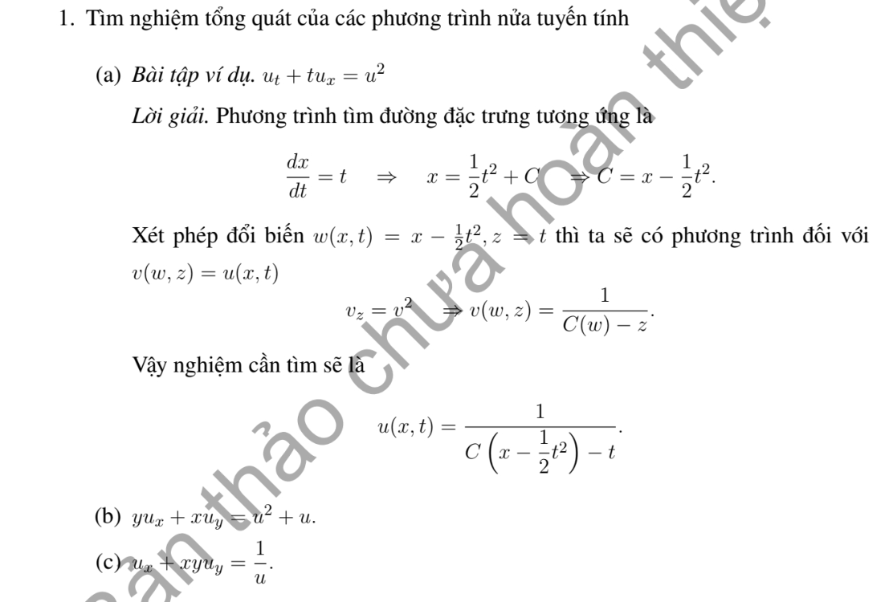

# Ví dụ 1 — Mục 1.4.2

**Mã:** `VD_1_4_2_01` · **Trang sách:** 23–23

[← Mục lục](../MUC_LUC.md) · [Bản PDF của bài](VD_1_4_2_01.pdf)

## Đề bài và phần trình bày có sẵn trong sách

## Kiến thức và trình tự giải

**Mục tiêu.** Với $u_t+a(x,t,u)u_x=b(x,t,u)$, đặc trưng phụ thuộc cả giá trị nghiệm nên phải giải đồng thời đường đi và ẩn.

**Bước 1 — Gắn nhãn điểm xuất phát.** Gọi $\xi$ là tọa độ ở $t=0$, đặt $X(0;\xi)=\xi$, $U(0;\xi)=f(\xi)$. Dọc đường, $U(t;\xi)=u(X(t;\xi),t)$.

**Bước 2 — Lập và giải hệ.** Quy tắc dây chuyền cho

$$
X'=a(X,t,U),\qquad U'=b(X,t,U).
$$

Nếu ODE của $U$ giải được trước, thế kết quả vào $X'$ rồi tích phân từ 0 đến $t$, giữ đúng điều kiện $X(0)=\xi$. Chẳng hạn $U'=\lambda U$ cho $U=e^{\lambda t}f(\xi)$. Nếu chia cho $U$ hoặc $U+1$, xét riêng các nghiệm hằng bị loại.

**Bước 3 — Khử nhãn $\xi$.** Giải $x=X(t;\xi)$ để tìm $\xi=\xi(x,t)$ rồi thay vào $u=U(t;\xi)$. Khi không khử được bằng công thức đơn giản, ghi nghiệm tham số và phương trình xác định $\xi$.

**Bước 4 — Tìm miền còn nghiệm cổ điển.** Tính $X_\xi$. Khi $X_\xi\ne0$, có thể khử nhãn cục bộ. Vì $u_x=U_\xi/X_\xi$, mẫu số tiến về 0 có thể gây đạo hàm vô hạn. Với $u_t+a(u)u_x=0$, ta có $X=\xi+a(f(\xi))t$, $X_\xi=1+a'(f(\xi))f'(\xi)t$. Tìm thời điểm dương đầu tiên mẫu này bằng 0.

**Bước 5 — Nếu dữ liệu có bước nhảy.** Viết $F'(u)=a(u)$ để có dạng bảo toàn $u_t+(F(u))_x=0$. Đặc trưng hội tụ dẫn đến sốc, tách xa dẫn đến quạt giãn; dùng Rankine–Hugoniot và điều kiện entropy như phần kiến thức về sốc. Giá trị ở chỗ đặc trưng giao nhau không được chọn tùy ý.

**Bước 6 — Thử lại.** Kiểm tra phương trình trong vùng trơn, dữ liệu ở $t=0$, miền khả nghịch và mọi đường ghép. Với dữ liệu chỉ trên một đoạn, giữ điều kiện nhãn $\xi$ nằm trong đoạn đó.

## Lời giải áp dụng cho bài

**Ý (a) — $u_t+tu_x=u^2$.** Bước 1: $X'=t$ cho $\rho=x-t^2/2$. Bước 2: $U'=U^2$. Nếu $U\ne0$, $(1/U)'=-1$, nên $u=1/[F(\rho)-t]$, ở nơi mẫu khác 0. Phải thêm nghiệm $u=0$ bị mất khi chia. Một dạng từ vết $f(\rho)$ tại $t=0$ giữ cả điểm $f=0$ là $u=f(\rho)/[1-tf(\rho)]$. Dọc đặc trưng công thức có đạo hàm bằng $U^2$, nên kiểm tra được PDE.

**Ý (b) — $yu_x+xu_y=u^2+u$.** $V=y\partial_x+x\partial_y$ có bất biến $r=x^2-y^2$. Trên $x+y\ne0$, đặt $s=\log|x+y|$; $Vs=1$. ODE là $U'=U(U+1)$. Nếu $U\ne0,-1$, tích phân $dU/[U(U+1)]=ds$ cho $\log|U/(U+1)|=s+\text{hằng}$. Suy

$$
u=\frac{A(r)e^s}{1-A(r)e^s}.
$$

$u=0$ nằm trong họ khi $A=0$; thêm $u=-1$. Công thức trên mỗi biểu đồ có mẫu khác 0; trên $x+y=0$ dùng biểu đồ khác nếu trường không triệt tiêu, tại gốc PDE cho $u=0$ hoặc $-1$. Ghép đủ trơn trước khi kết luận toàn cục.

**Ý (c) — $u_x+xyu_y=1/u$.** $dy/dx=xy$ cho $r=ye^{-x^2/2}$. Dọc đường, $U'=1/U$, nên $(U^2)'=2$, $U^2=2x+A(r)$. Suy $u=\pm\sqrt{2x+A(ye^{-x^2/2})}$. Chọn miền trong căn dương và dấu liên tục. Kiểm tra bằng cách đạo hàm $u^2$: $(\partial_x+xy\partial_y)u^2=2$, suy PDE vì $u\ne0$. Không thêm $u=0$ vì phương trình gốc chứa $1/u$.

**Chi tiết phân thức ở (b).** $\frac1{U(U+1)}=\frac1U-\frac1{U+1}$, nên $\int dU/[U(U+1)]=\log|U|-\log|U+1|$. Sau khi tích phân theo $s$, viết $U/(U+1)=A(r)e^s$ với dấu được gộp vào $A$. Nhân chéo: $U=Ae^sU+Ae^s$, tức $(1-Ae^s)U=Ae^s$; chia khi mẫu khác $0$ được công thức. Hai giá trị cân bằng $0,-1$ phải được xét trước phép chia.

