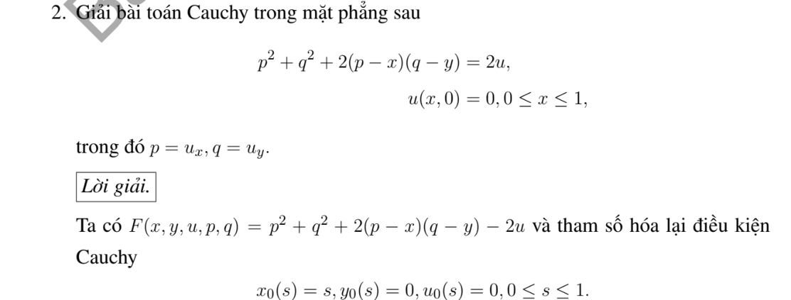
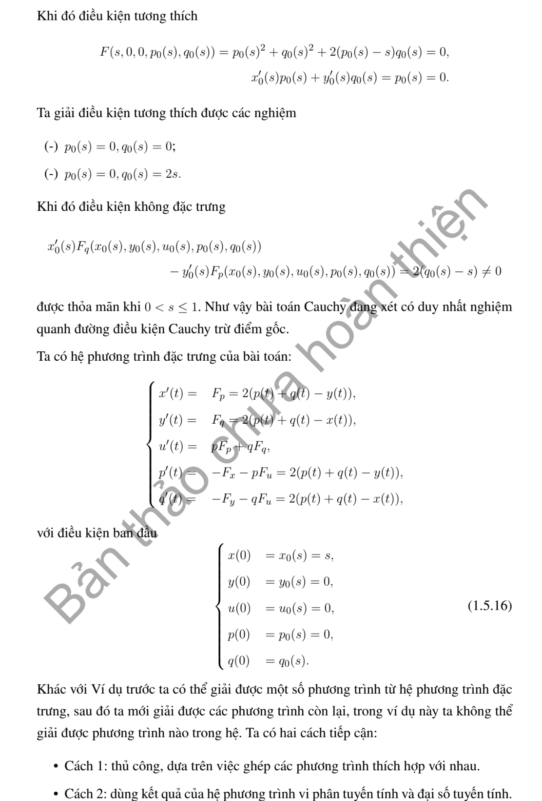
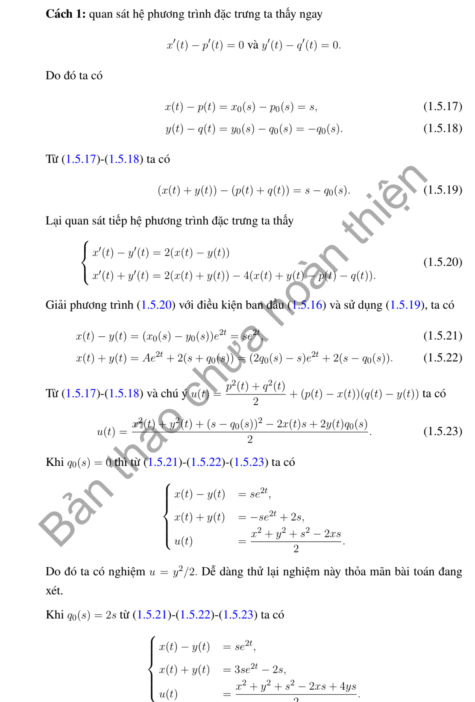
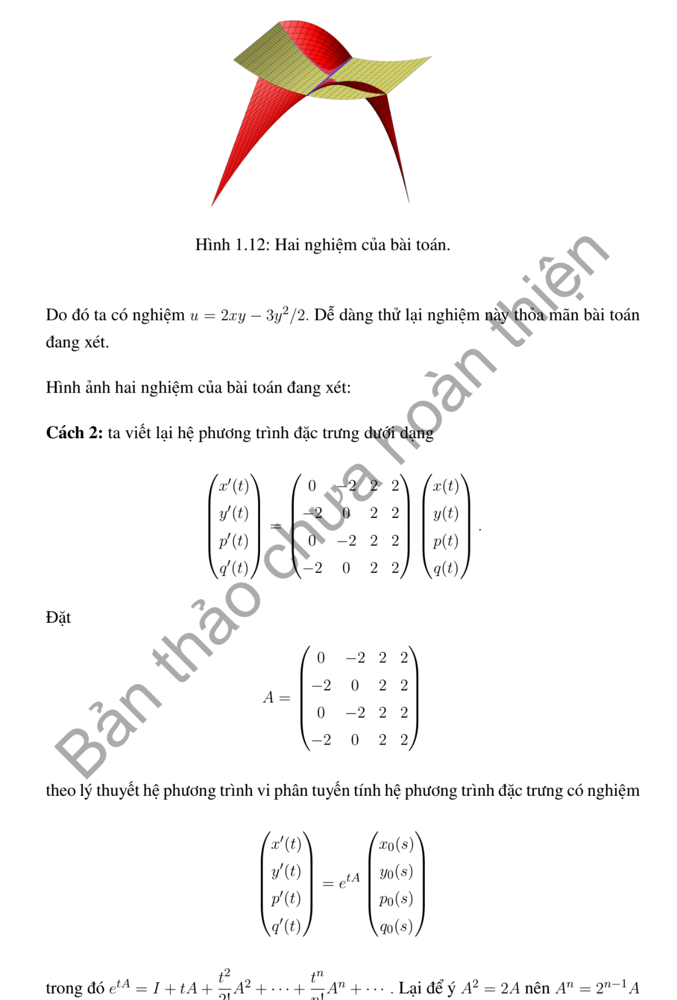
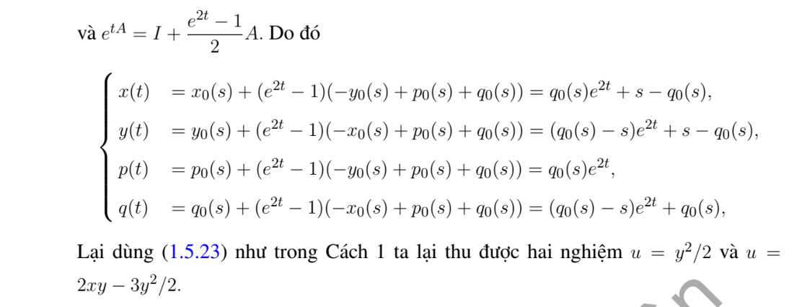

# Ví dụ 2 — Mục 1.5.2

**Mã:** `VD_1_5_2_02` · **Trang sách:** 31–35

[← Mục lục](../MUC_LUC.md) · [Bản PDF của bài](VD_1_5_2_02.pdf)

## Đề bài và phần trình bày có sẵn trong sách

## Kiến thức và trình tự giải

**Mục tiêu.** Giải PDE cấp 1 phi tuyến $F(x,y,u,p,q)=0$, với $p=u_x,q=u_y$. Chọn $s$ để gắn nhãn đường dữ liệu, $\tau$ là tham số chạy dọc đặc trưng; hai tham số này có vai trò khác nhau.

**Bước 1 — Viết đúng $F$ và tham số hóa dữ liệu.** Chuyển PDE về một vế, giữ mọi hệ số chứa $x,y,u$. Viết $X(s,0)=x_0(s)$, $Y(s,0)=y_0(s)$, $U(s,0)=h(s)$. Đạo hàm điều kiện theo $s$ cho

$$
p_0x_0'(s)+q_0y_0'(s)=h'(s),\qquad
F(x_0,y_0,h,p_0,q_0)=0.
$$

Giải hai phương trình này tìm tất cả nhánh thực $(p_0,q_0)$. Trên $y=0$, $p_0=h'$; trên $x=0$, $q_0=h'$; trên $y=x$, $p_0+q_0=h'$. Điều kiện dưới căn phải không âm. Các nhánh khác nhau có thể cho các nghiệm khác nhau cùng dữ liệu.

**Bước 2 — Kiểm tra không đặc trưng.** Tính $J_0=x_0'F_q-y_0'F_p$ ở dữ liệu của từng nhánh. Khi $J_0\ne0$ và các hàm đủ trơn, phép chuyển từ $(s,\tau)$ sang $(x,y)$ khả nghịch cục bộ. Khi $J_0=0$, cần xét riêng; không kết luận ngay vô nghiệm hoặc duy nhất.

**Bước 3 — Tính các đạo hàm riêng của $F$ rồi lập hệ Charpit.** Khi tính $F_x,F_y,F_u,F_p,F_q$, tạm coi năm đối số độc lập. Hệ là

$$
\begin{aligned}
X_\tau&=F_p,&Y_\tau&=F_q,&U_\tau&=pF_p+qF_q,\\
p_\tau&=-F_x-pF_u,&q_\tau&=-F_y-qF_u.
\end{aligned}
$$

Trong bài cụ thể phải thay các đạo hàm của $F$ vào hệ. Ví dụ $F=pq-1$ cho $X_\tau=q,Y_\tau=p,U_\tau=2,p_\tau=q_\tau=0$.

**Bước 4 — Tích phân hệ với điều kiện ban đầu.** Tìm phương trình giải được trước: $p'=0$, $q'=0$, hoặc tổ hợp như $(X-p)'=0$. Thế chúng vào phương trình còn lại. Nếu hệ tuyến tính $Z'=MZ$, dùng $Z=e^{\tau M}Z_0$; để tính cụ thể, tìm các tổ hợp tách hệ hoặc quan hệ $M^2, M^3$ giúp rút gọn chuỗi mũ. Ghi các phép tích phân và hằng số được dữ liệu xác định.

**Bước 5 — Khử tham số hoặc trình bày nghiệm tham số đã giải.** Từ $X(s,\tau),Y(s,\tau)$ tìm $s,\tau$ theo $x,y$ rồi thay vào $U$. Nếu giữ dạng tham số, phải có công thức $X,Y,U$ đã tích phân và miền $\det\partial(X,Y)/\partial(s,\tau)\ne0$; chỉ ghi hệ ODE chưa phải lời giải hoàn tất.

**Bước 6 — Dùng phép đổi ẩn khi thuận lợi.** Gần dữ liệu $u>0$, $p^2+q^2=u$ đổi $v=2\sqrt u$ cho $|\nabla v|^2=1$; $p^2+q^2=u^2$ đổi $v=\log u$ cũng cho eikonal. Phải tính $v_x,v_y$ để chứng minh phép đổi, đổi cả dữ liệu và giữ điều kiện dấu. Với dữ liệu hằng trên vòng tròn, đạo hàm tiếp tuyến bằng 0 nên gradient pháp tuyến có hai lựa chọn dấu.

**Bước 7 — Kiểm tra từng nhánh và miền.** Tính $p,q$ của công thức cuối, thế vào PDE và dữ liệu. Phân biệt một nghiệm đã tìm được, các nhánh không đặc trưng cục bộ và toàn bộ nghiệm toàn cục. Giữ điều kiện của nhãn dữ liệu nếu đề chỉ cho $0\le s\le1$; kiểm tra gốc, điểm căn bằng 0 và đường làm mẫu số bằng 0.

**Chi tiết tích phân và khử sau khi lập hệ.** Trong lúc tích phân theo $\tau$, nhãn $s$ và các gradient ban đầu $p_0(s),q_0(s)$ được giữ cố định. Với $p'=cp$, viết $p=p_0e^{c\tau}$; nếu $X'=dp$ thì $X=x_0+dp_0(e^{c\tau}-1)/c$ khi $c\ne0$, hoặc $X=x_0+dp_0\tau$ khi $c=0$. Với $Y'+cY=R(\tau)$, nhân $e^{c\tau}$ cho $(e^{c\tau}Y)'=e^{c\tau}R$, rồi dùng $Y(0)$ để xác định hằng số. Khử từ hai phương trình $x=X(s,\tau),y=Y(s,\tau)$; ghi rõ tổ hợp nào loại $\tau$ hoặc $s$. Nếu chỉ cho nghiệm tham số, vẫn phải có các tích phân đã tính và điều kiện Jacobian để khử cục bộ.

## Lời giải áp dụng cho bài

**Bước 1 — Tương thích.** $F=p^2+q^2+2(p-x)(q-y)-2u$, dữ liệu $(s,0,0)$ cho $p_0=0$ và $q_0(q_0-2s)=0$. Có hai nhánh $q_0=0,2s$; $J_0=2(q_0-s)$ khác 0 khi $s>0$.

**Bước 2 — Hệ và các bất biến.** Tính đạo hàm của $F$:

$$
X'=2(p+q-Y),\quad Y'=2(p+q-X),\quad p'=X',\quad q'=Y'.
$$

Do đó $X-p=s$, $Y-q=-q_0$. Thế $p=X-s,q=Y+q_0$ vào hệ đường đi, được $X'=2X+2(q_0-s)$, $Y'=2Y+2(q_0-s)$. Tích phân với dữ liệu:

$$
X=q_0e^{2\tau}+s-q_0,\qquad Y=(q_0-s)(e^{2\tau}-1).
$$

Từ $F=0$,

$$
U=\frac{X^2+Y^2+s^2-2Xs+2Yq_0-2sq_0+q_0^2}{2}.
$$

**Bước 3 — Khử hai nhánh.** Nếu $q_0=0$, $X=s$, $Y=s(1-e^{2\tau})$, suy $p=0,q=Y$ và $u=y^2/2$. Nếu $q_0=2s$, $X=2se^{2\tau}-s$, $Y=s(e^{2\tau}-1)$, nên $s=X-2Y$, $p=2Y,q=2X-3Y$, suy $u=2xy-3y^2/2$.

**Bước 4 — Kiểm tra và miền.** Với $u=y^2/2$, $p=0,q=y$ cho vế trái $y^2=2u$. Với $u=2xy-3y^2/2$, $p=2y,q=2x-3y$ cho vế trái $4xy-3y^2=2u$. Cả hai có $u(x,0)=0$. Từ đoạn dữ liệu $0\le s\le1$, nhánh thứ nhất cần $s=x$ và $e^{2\tau}=1-y/x>0$; nhánh thứ hai cần $s=x-2y$ và $e^{2\tau}=(x-y)/(x-2y)>0$. Các đa thức là nghiệm kéo dài toàn cục, nhưng dữ liệu chỉ bảo đảm duy nhất cục bộ trên mỗi nhánh ở $s>0$; gốc suy biến. Lời giải sách nói duy nhất khi đã chọn gradient ban đầu; nếu chưa chọn nhánh thì có hai nghiệm.

**Chi tiết giải hai ODE tuyến tính.** Đặt $c=q_0-s$, hằng theo $\tau$. Từ $X'-2X=2c$, nhân $e^{-2\tau}$ và tích phân từ $0$:

$$
e^{-2\tau}X-s=c(1-e^{-2\tau}),\quad X=(s+c)e^{2\tau}-c.
$$

Tương tự $e^{-2\tau}Y=c(1-e^{-2\tau})$, nên $Y=c(e^{2\tau}-1)$. Vì $s+c=q_0$, đây đúng các công thức ở bước 2. Nhánh $q_0=2s$ cho $X-2Y=s$, $p=X-s=2Y$, $q=Y+2s=2X-3Y$. Tích phân $u_x=2y$ cho $u=2xy+C(y)$; phương trình $u_y=2x-3y$ cho $C'=-3y$, rồi $C=-3y^2/2$ nhờ vết ban đầu.

