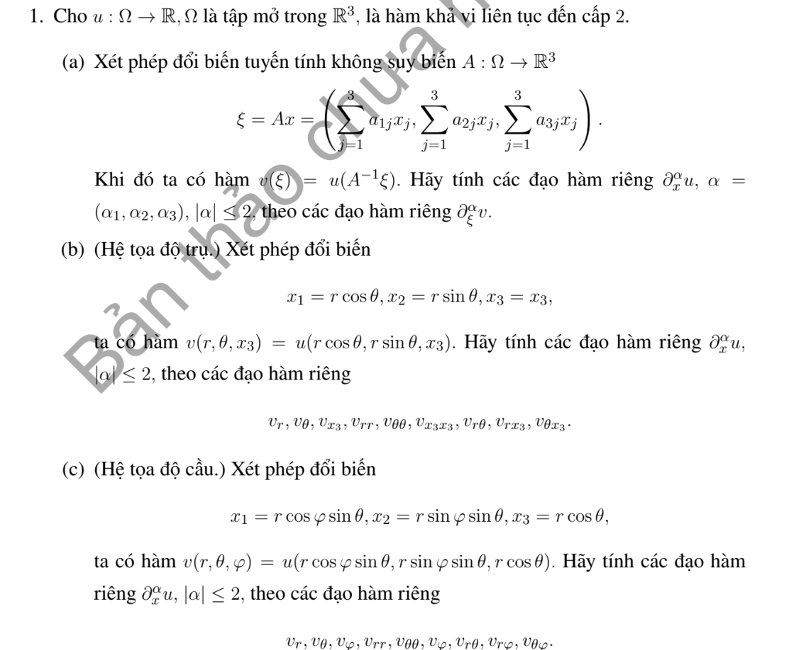
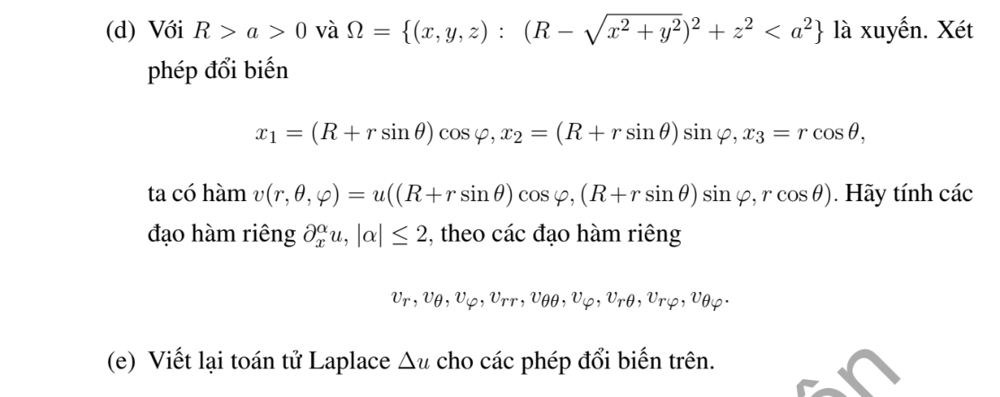

# Bài tập thực hành 1 — Mục 2.3

**Mã:** `BT_2_3_01` · **Trang sách:** 84–85

[← Mục lục](../MUC_LUC.md) · [Bản PDF của bài](BT_2_3_01.pdf)

## Đề bài

## Kiến thức và trình tự giải

**Mục tiêu.** Tính đạo hàm khi đổi tọa độ rồi thay vào PDE. Đổi tọa độ của điểm và đổi biểu thức của hàm là hai việc cần làm cùng nhau: đặt $q=q(x)$ và $v(q)=u(x(q))$.

**Bước 1 — Kiểm tra phép đổi biến.** Tính $J=\det(\partial q/\partial x)$. Chỉ dùng các công thức trên miền $J\ne0$ và chọn một nhánh liên tục cho các góc. Tọa độ cực/trụ loại trục $r=0$; tọa độ cầu còn loại $\sin\theta=0$. Đây là suy biến của tọa độ, chưa phải kết luận rằng hàm $u$ không tồn tại ở đó.

**Bước 2 — Tính đạo hàm cấp một bằng quy tắc dây chuyền.** Nếu $b_{ik}=\partial q_k/\partial x_i$, thì

$$
u_{x_i}=\sum_k b_{ik}v_{q_k},\qquad D_i=\sum_k b_{ik}\partial_{q_k}.
$$

Với $q=Ax$, $b_{ik}=a_{ki}$ là hằng số. Với tọa độ cong, lấy nghịch đảo ma trận $\partial x/\partial q$ để tìm $b_{ik}$.

**Bước 3 — Lấy đạo hàm cấp hai cả hàm lẫn hệ số.** Áp dụng đạo hàm tích cho từng hạng:

$$
u_{x_ix_j}=\sum_{k,l}b_{ik}b_{jl}v_{q_kq_l}
+\sum_{k,l}b_{ik}(\partial_{q_k}b_{jl})v_{q_l}.
$$

Hạng thứ hai chỉ mất đi khi phép đổi biến tuyến tính. Ví dụ $\partial_x=\cos\theta\,\partial_r-(\sin\theta/r)\partial_\theta$ thì lần đạo hàm tiếp theo phải tác động lên cả $\cos\theta$ và $\sin\theta/r$.

**Bước 4 — Thu gọn toán tử.** Gom hệ số của từng $v_{q_kq_l}$ và $v_{q_k}$ trước khi cộng. Với Laplace, lấy tổng các đạo hàm $u_{x_ix_i}$. Trong hệ trực giao có hệ số độ dài $h_1,h_2,h_3$, có thể đối chiếu bằng

$$
\Delta u=\frac1{h_1h_2h_3}\sum_{k=1}^3
\partial_{q_k}\left(\frac{h_1h_2h_3}{h_k^2}v_{q_k}\right).
$$

**Bước 5 — Kiểm tra bằng hàm đơn giản.** Thử $u=1$, $u=x_i$ và $u=x_1^2+x_2^2+x_3^2$. Công thức Laplace phải lần lượt cho $0$, $0$, $6$. Với Hessian biểu diễn trong cơ sở trực chuẩn, đổi lại cơ sở Descartes bằng $H_x=E H_q E^T$, không nhầm Hessian với ma trận chỉ gồm các đạo hàm $v_{q_kq_l}$.

## Lời giải áp dụng cho bài

**(a) Phép đổi biến tuyến tính.** Đặt $\xi=Ax$, $\det A\ne0$, $v(\xi)=u(A^{-1}\xi)$. Vì $\partial\xi_k/\partial x_i=a_{ki}$ là hằng,

$$
u=v,\qquad u_{x_i}=\sum_{k=1}^3a_{ki}v_{\xi_k},\qquad
u_{x_ix_j}=\sum_{k,l=1}^3a_{ki}a_{lj}v_{\xi_k\xi_l}.
$$

Đây cho đủ mọi đa chỉ số $|\alpha|\le2$, gồm cả sáu đạo hàm cấp hai độc lập. Viết ma trận: $\nabla_xu=A^T\nabla_\xi v$, $H_xu=A^T H_\xi v A$.

**(b) Tọa độ trụ.** Viết $c=\cos\theta$, $s=\sin\theta$, $z=x_3$. Nghịch đảo vi phân $x_1=rc$, $x_2=rs$ cho

$$
D_1=c\partial_r-s\partial_\theta/r,\quad D_2=s\partial_r+c\partial_\theta/r,\quad D_3=\partial_z.
$$

Suy ra $u_1=cv_r-sv_\theta/r$, $u_2=sv_r+cv_\theta/r$, $u_3=v_z$. Đạo hàm tích thêm một lần:

$$
\begin{aligned}
u_{11}&=c^2v_{rr}-2scv_{r\theta}/r+s^2v_{\theta\theta}/r^2+s^2v_r/r+2scv_\theta/r^2,\\
u_{22}&=s^2v_{rr}+2scv_{r\theta}/r+c^2v_{\theta\theta}/r^2+c^2v_r/r-2scv_\theta/r^2,\\
u_{12}&=scv_{rr}+(c^2-s^2)v_{r\theta}/r-scv_{\theta\theta}/r^2-scv_r/r-(c^2-s^2)v_\theta/r^2,\\
u_{13}&=cv_{rz}-sv_{\theta z}/r,\quad
u_{23}=sv_{rz}+cv_{\theta z}/r,\quad u_{33}=v_{zz}.
\end{aligned}
$$

**(c), (d) Công thức tường minh chung cho cầu và xuyến.** Dùng $s=\sin\theta$, $c=\cos\theta$, $p=\cos\varphi$, $q=\sin\varphi$. Đặt $\rho=r s$ ở hệ cầu; đặt $\rho=R+rs$ ở hệ xuyến. Các đạo hàm cấp một là

$$
u_1=spv_r+\frac{cp}{r}v_\theta-\frac q\rho v_\varphi,\quad
u_2=sqv_r+\frac{cq}{r}v_\theta+\frac p\rho v_\varphi,\quad
u_3=cv_r-\frac sr v_\theta.
$$

Để trình bày đủ sáu đạo hàm cấp hai mà không lặp các biểu thức dài, đặt sáu tổ hợp đã tính hết hệ số:

$$
\begin{aligned}
H_{rr}&=v_{rr},& H_{r\theta}&=v_{r\theta}/r-v_\theta/r^2,\\
H_{r\varphi}&=v_{r\varphi}/\rho-sv_\varphi/\rho^2,&
H_{\theta\theta}&=v_{\theta\theta}/r^2+v_r/r,\\
H_{\theta\varphi}&=v_{\theta\varphi}/(r\rho)-cv_\varphi/\rho^2,&
H_{\varphi\varphi}&=v_{\varphi\varphi}/\rho^2+sv_r/\rho+cv_\theta/(r\rho).
\end{aligned}
$$

Đây là các thành phần Hessian trong cơ sở trực chuẩn

$$
e_r=(sp,sq,c),\quad e_\theta=(cp,cq,-s),\quad e_\varphi=(-q,p,0).
$$

Có thể suy ra, chẳng hạn, $H_{r\theta}=\partial_r(v_\theta/r)$ và $H_{r\varphi}=\partial_r(v_\varphi/\rho)$ vì cơ sở không đổi theo $r$. Với $H_{\varphi\varphi}$, đạo hàm của $e_\varphi$ theo cung tròn là $-(se_r+ce_\theta)/\rho$, tạo ra hai hạng cấp một. Đổi lại cơ sở Descartes cho các công thức cụ thể:

$$
\begin{aligned}
u_{11}&=s^2p^2H_{rr}+c^2p^2H_{\theta\theta}+q^2H_{\varphi\varphi}
+2scp^2H_{r\theta}-2spqH_{r\varphi}-2cpqH_{\theta\varphi},\\
u_{22}&=s^2q^2H_{rr}+c^2q^2H_{\theta\theta}+p^2H_{\varphi\varphi}
+2scq^2H_{r\theta}+2spqH_{r\varphi}+2cpqH_{\theta\varphi},\\
u_{33}&=c^2H_{rr}+s^2H_{\theta\theta}-2scH_{r\theta},\\
u_{12}&=s^2pqH_{rr}+c^2pqH_{\theta\theta}-pqH_{\varphi\varphi}
+2scpqH_{r\theta}+s(p^2-q^2)H_{r\varphi}+c(p^2-q^2)H_{\theta\varphi},\\
u_{13}&=scp(H_{rr}-H_{\theta\theta})+(c^2-s^2)pH_{r\theta}-cqH_{r\varphi}+sqH_{\theta\varphi},\\
u_{23}&=scq(H_{rr}-H_{\theta\theta})+(c^2-s^2)qH_{r\theta}+cpH_{r\varphi}-spH_{\theta\varphi}.
\end{aligned}
$$

Thế $\rho=rs$ hoặc $\rho=R+rs$ vào sáu $H$ cho đúng từng hệ tọa độ; không còn hệ số đạo hàm nào chưa tính. Ở hệ cầu, ví dụ $H_{\varphi\varphi}=v_{\varphi\varphi}/(r^2s^2)+v_r/r+\cot\theta\,v_\theta/r^2$.

**(e) Laplace và miền hợp lệ.** Lấy tổng $u_{11}+u_{22}+u_{33}$:

$$
\begin{aligned}
\Delta u\ \text{(tuyến tính)}&=\sum_{k,l}(AA^T)_{kl}v_{\xi_k\xi_l},\\
\Delta u\ \text{(trụ)}&=v_{rr}+v_r/r+v_{\theta\theta}/r^2+v_{zz},\\
\Delta u\ \text{(cầu)}&=v_{rr}+2v_r/r+(v_{\theta\theta}+\cot\theta\,v_\theta)/r^2+v_{\varphi\varphi}/(r^2\sin^2\theta),\\
\Delta u\ \text{(xuyến)}&=v_{rr}+\left(\frac1r+\frac{\sin\theta}{\rho}\right)v_r
+\frac{v_{\theta\theta}}{r^2}+\frac{\cos\theta}{r\rho}v_\theta+\frac{v_{\varphi\varphi}}{\rho^2}.
\end{aligned}
$$

Ở xuyến, cùng công thức viết dạng phân kỳ là $\Delta u=(r\rho)^{-1}[\partial_r(r\rho v_r)+\partial_\theta(\rho v_\theta/r)+\partial_\varphi(rv_\varphi/\rho)]$, do hệ số độ dài là $(1,r,\rho)$. Trụ cần $r>0$, cầu cần $r>0$, $\sin\theta\ne0$, xuyến cần $r>0$, $\rho>0$; do $r<a<R$, $\rho\ge R-r>0$. Chọn các nhánh góc trên từng miền tọa độ. Kiểm tra $u=x_i$ cho Hessian bằng $0$, và $u=|x|^2$ cho $\Delta u=6$ ở cả ba hệ.

**Chi tiết tạo Hessian và lấy vết.** Trong hệ trụ, $D_1c=s^2/r$, $D_1(-s/r)=2sc/r^2$, $D_2c=-sc/r$, $D_2(-s/r)=-(c^2-s^2)/r^2$. Thế các hệ số này vào $D_i(cv_r-sv_\theta/r)$ cho $u_{11},u_{12}$; làm tương tự với $sv_r+cv_\theta/r$ cho $u_{22}$. $D_3$ không tác động lên $r,\theta$, nên $u_{13},u_{23}$ chỉ lấy thêm đạo hàm $z$.

Với cầu và xuyến, lấy $e_r=(sp,sq,c)$, $e_\theta=(cp,cq,-s)$, $e_\varphi=(-q,p,0)$. Có $\partial_\theta e_r=e_\theta$, $\partial_\theta e_\theta=-e_r$ và $\partial_\varphi e_r=s e_\varphi$, $\partial_\varphi e_\theta=c e_\varphi$, $\partial_\varphi e_\varphi=-s e_r-c e_\theta$. Gradient là $v_re_r+(v_\theta/r)e_\theta+(v_\varphi/\rho)e_\varphi$. Đạo hàm gradient theo ba hướng $\partial_r,r^{-1}\partial_\theta,\rho^{-1}\partial_\varphi$ rồi chiếu lên cơ sở cho sáu $H$ đã ghi. Chẳng hạn

$$
e_\theta\cdot(r^{-1}\partial_\theta\nabla u)=v_r/r+v_{\theta\theta}/r^2,\quad
e_\varphi\cdot(\rho^{-1}\partial_\varphi\nabla u)
=sv_r/\rho+cv_\theta/(r\rho)+v_{\varphi\varphi}/\rho^2.
$$

Khi cộng $u_{11}+u_{22}+u_{33}$, hệ số của mỗi $H_{rr},H_{\theta\theta},H_{\varphi\varphi}$ là $1$, các hệ số ngoài đường chéo bằng $0$ bởi trực chuẩn. Vậy

$$
\Delta u=v_{rr}+\left(\frac1r+\frac s\rho\right)v_r+
\frac{v_{\theta\theta}}{r^2}+\frac c{r\rho}v_\theta+\frac{v_{\varphi\varphi}}{\rho^2}.
$$

Thế $\rho=rs$ cho $1/r+s/\rho=2/r$, $c/(r\rho)=\cot\theta/r^2$; thế $\rho=R+rs$ cho dạng xuyến.

## Đối chiếu kết quả

Khi sử dụng kết quả, kiểm tra đồng thời phương trình, dữ liệu ban đầu/biên và miền được nêu trong lời giải. Các điều kiện về tính trơn, nghiệm thực, tồn tại hoặc duy nhất là một phần của kết luận; không bỏ chúng khi ghi đáp án.
