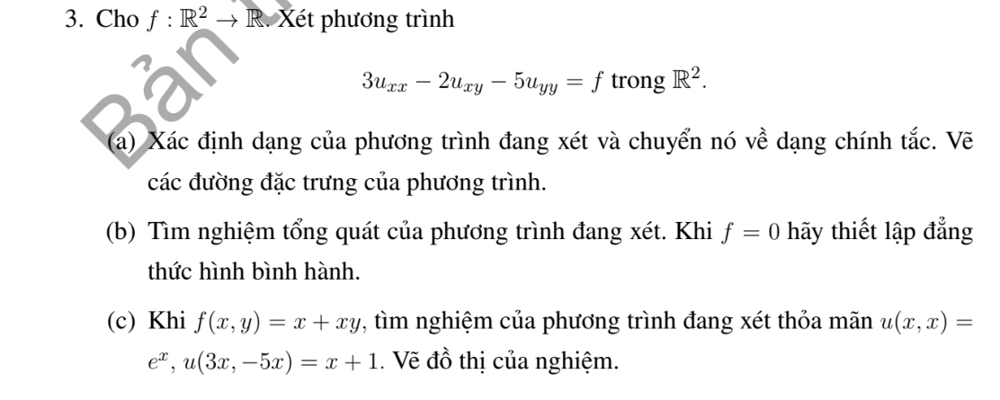
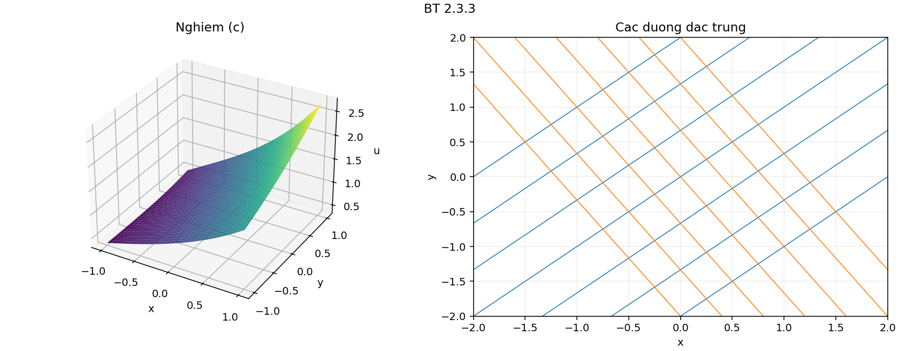

# Bài tập thực hành 3 — Mục 2.3

**Mã:** `BT_2_3_03` · **Trang sách:** 85–85

[← Mục lục](../MUC_LUC.md) · [Bản PDF của bài](BT_2_3_03.pdf)

## Đề bài

## Kiến thức và trình tự giải

**Mục tiêu.** Giải phương trình hyperbolic sau khi đã tìm hai tọa độ đặc trưng độc lập.

**Bước 1 — Phân loại, tìm đặc trưng và thay đạo hàm.** Làm đủ các bước của phép đưa về chính tắc. Viết cả phép đổi ngược để biểu diễn vế phải $\widetilde f(\xi,\eta)=f(x(\xi,\eta),y(\xi,\eta))$.

**Bước 2 — Tích phân phương trình chính tắc.** Với $v_{\xi\eta}=g$, giữ biến kia cố định khi tích phân:

$$
v=F(\xi)+G(\eta)+\int_{\xi_0}^{\xi}\int_{\eta_0}^{\eta}g(a,b)\,db\,da.
$$

Nếu tìm được một nghiệm riêng $P(x,y)$ dễ hơn, viết $u=P+F(\xi)+G(\eta)$. Với $v_{\xi\eta}+\alpha v_\eta=0$, đặt $w=v_\eta$, giải $w_\xi+\alpha w=0$ rồi tích phân theo $\eta$; thu được $v=F(\xi)+e^{-\alpha\xi}G(\eta)$.

**Bước 3 — Đổi cả dữ liệu.** Thế tọa độ đường dữ liệu vào $\xi,\eta$, dùng quy tắc dây chuyền cho đạo hàm được cho. Trên đường không đặc trưng, hai dữ liệu thường xác định hai hàm $F,G$. Trên đường đặc trưng, có biến không thay đổi, nên dữ liệu chỉ xác định giá trị hoặc đạo hàm của một hàm tại một điểm; phải tìm điều kiện tương thích và nêu phần tùy ý còn lại.

**Bước 4 — Lập đẳng thức hình bình hành.** Với $v=F(\xi)+G(\eta)$, bốn đỉnh theo hai họ đặc trưng thỏa $v_{11}+v_{22}=v_{12}+v_{21}$. Nếu có số hạng mũ, trước hết nhân trọng số để được tổng hai hàm một biến. Với vế phải $g$, hiệu bốn đỉnh bằng tích phân kép của $g$ trên hình chữ nhật trong tọa độ mới.

**Bước 5 — Xác định miền được dữ liệu quyết định.** Hai đặc trưng đi qua điểm đang xét phải gặp đoạn dữ liệu phù hợp. Với phương trình sóng $v_{tt}=v_{zz}$ trên $z>0$, dữ liệu lúc $t=0$ xác định duy nhất miền $z>t$; ở $0<z<t$, cần thêm dữ liệu biên $z=0$. Với đặc trưng cong, dùng miền trong các tọa độ mới rồi đổi lại.

**Bước 6 — Kiểm tra.** Thế nghiệm vào cả PDE và từng điều kiện. Nếu đề yêu cầu hai nghiệm, chỉ rõ hai lựa chọn khác nhau cho hàm tùy ý và chứng minh phần chênh lệch thỏa phương trình thuần nhất, đồng thời triệt tiêu trên đường dữ liệu.

## Lời giải áp dụng cho bài

**(a) Phân loại và đặc trưng.** $A=3$, $B=-1$, $C=-5$, $\delta=16>0$: hyperbolic. Phương trình đặc trưng $3(dy)^2+2dxdy-5(dx)^2=(dy-dx)(3dy+5dx)=0$ cho các đường $y-x=c_1$, $5x+3y=c_2$. Đặt $\xi=y-x$, $\eta=5x+3y$, $J=-8$; đổi ngược $x=(\eta-3\xi)/8$, $y=(\eta+5\xi)/8$. Có $\partial_x=-\partial_\xi+5\partial_\eta$, $\partial_y=\partial_\xi+3\partial_\eta$, nên

$$
3u_{xx}-2u_{xy}-5u_{yy}=-64v_{\xi\eta}=\widetilde f.
$$

Các đường đặc trưng cần vẽ là hai chùm thẳng có hệ số góc $1$ và $-5/3$.

**(b) Tích phân.** Giữ lần lượt $\xi,\eta$ cố định:

$$
v=F(\xi)+G(\eta)-\frac1{64}\int_{\xi_0}^{\xi}\int_{\eta_0}^{\eta}\widetilde f(a,b)dbda.
$$

Nếu $f=0$, $v=F+G$ và $v_{11}+v_{22}=v_{12}+v_{21}$ cho bốn đỉnh $(\xi_i,\eta_j)$, tức hình bình hành có cạnh theo hai họ đặc trưng trong mặt phẳng gốc.

**(c) Nghiệm riêng và dữ liệu.** Với $f=x+xy$, thử đa thức; lấy

$$
P(x,y)=\frac{x^3(1+y)}{18}+\frac{x^4}{108}.
$$

Ta có $P_{xx}=x(1+y)/3+x^2/9$, $P_{xy}=x^2/6$, $P_{yy}=0$, nên $3P_{xx}-2P_{xy}-5P_{yy}=x+xy$. Viết $u=P+F(\xi)+G(\eta)$. Trên $(r,r)$: $\xi=0$, $\eta=8r$, $F(0)+G(8r)=e^r-P(r,r)$. Trên $(3r,-5r)$: $\xi=-8r$, $\eta=0$, $F(-8r)+G(0)=r+1-P(3r,-5r)$. Hai dữ liệu tại gốc đều bằng $1$, nên tương thích. Lấy $F(0)=0$, $G(0)=1$ được

$$
F(\xi)=-\xi/8-P(-3\xi/8,5\xi/8),\quad
G(\eta)=e^{\eta/8}-P(\eta/8,\eta/8).
$$

Kết quả

$$
\boxed{u=P(x,y)-\frac\xi8-P(-3\xi/8,5\xi/8)+e^{\eta/8}-P(\eta/8,\eta/8).}
$$

Thế hai đường dữ liệu vào công thức lần lượt cho $e^r$ và $r+1$; phần $F+G$ có đạo hàm hỗn hợp bằng $0$, nên kiểm tra PDE qua $LP=f$. Hai đường là hai đặc trưng giao nhau, dữ liệu trên toàn bộ chúng xác định nghiệm duy nhất trên $\mathbb R^2$. Đồ thị kèm theo biểu diễn công thức này.

**Chi tiết thế ba đạo hàm cấp hai.** Với tọa độ đã chọn,

$$
u_{xx}=v_{\xi\xi}-10v_{\xi\eta}+25v_{\eta\eta},\quad u_{xy}=-v_{\xi\xi}+2v_{\xi\eta}+15v_{\eta\eta},\quad u_{yy}=v_{\xi\xi}+6v_{\xi\eta}+9v_{\eta\eta}.
$$

Nhân lần lượt với $3$,$-2$,$-5$, hệ số theo thứ tự $v_{\xi\xi},v_{\xi\eta},v_{\eta\eta}$ là

$$
3+2-5=0,\qquad -30-4-30=-64,\qquad 75-30-45=0.
$$

## Đồ thị minh họa

## Đối chiếu kết quả

Khi sử dụng kết quả, kiểm tra đồng thời phương trình, dữ liệu ban đầu/biên và miền được nêu trong lời giải. Các điều kiện về tính trơn, nghiệm thực, tồn tại hoặc duy nhất là một phần của kết luận; không bỏ chúng khi ghi đáp án.
