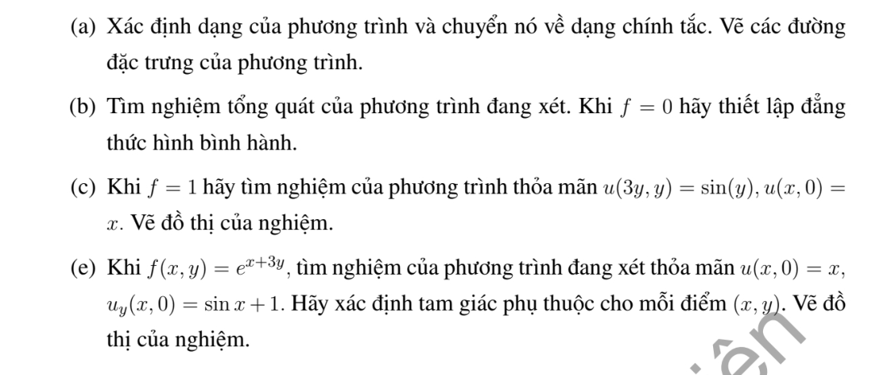
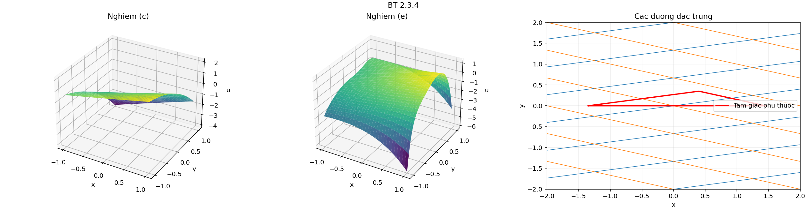

# Bài tập thực hành 4 — Mục 2.3

**Mã:** `BT_2_3_04` · **Trang sách:** 85–86

[← Mục lục](../MUC_LUC.md) · [Bản PDF của bài](BT_2_3_04.pdf)

## Đề bài

## Kiến thức và trình tự giải

**Mục tiêu.** Giải phương trình hyperbolic sau khi đã tìm hai tọa độ đặc trưng độc lập.

**Bước 1 — Phân loại, tìm đặc trưng và thay đạo hàm.** Làm đủ các bước của phép đưa về chính tắc. Viết cả phép đổi ngược để biểu diễn vế phải $\widetilde f(\xi,\eta)=f(x(\xi,\eta),y(\xi,\eta))$.

**Bước 2 — Tích phân phương trình chính tắc.** Với $v_{\xi\eta}=g$, giữ biến kia cố định khi tích phân:

$$
v=F(\xi)+G(\eta)+\int_{\xi_0}^{\xi}\int_{\eta_0}^{\eta}g(a,b)\,db\,da.
$$

Nếu tìm được một nghiệm riêng $P(x,y)$ dễ hơn, viết $u=P+F(\xi)+G(\eta)$. Với $v_{\xi\eta}+\alpha v_\eta=0$, đặt $w=v_\eta$, giải $w_\xi+\alpha w=0$ rồi tích phân theo $\eta$; thu được $v=F(\xi)+e^{-\alpha\xi}G(\eta)$.

**Bước 3 — Đổi cả dữ liệu.** Thế tọa độ đường dữ liệu vào $\xi,\eta$, dùng quy tắc dây chuyền cho đạo hàm được cho. Trên đường không đặc trưng, hai dữ liệu thường xác định hai hàm $F,G$. Trên đường đặc trưng, có biến không thay đổi, nên dữ liệu chỉ xác định giá trị hoặc đạo hàm của một hàm tại một điểm; phải tìm điều kiện tương thích và nêu phần tùy ý còn lại.

**Bước 4 — Lập đẳng thức hình bình hành.** Với $v=F(\xi)+G(\eta)$, bốn đỉnh theo hai họ đặc trưng thỏa $v_{11}+v_{22}=v_{12}+v_{21}$. Nếu có số hạng mũ, trước hết nhân trọng số để được tổng hai hàm một biến. Với vế phải $g$, hiệu bốn đỉnh bằng tích phân kép của $g$ trên hình chữ nhật trong tọa độ mới.

**Bước 5 — Xác định miền được dữ liệu quyết định.** Hai đặc trưng đi qua điểm đang xét phải gặp đoạn dữ liệu phù hợp. Với phương trình sóng $v_{tt}=v_{zz}$ trên $z>0$, dữ liệu lúc $t=0$ xác định duy nhất miền $z>t$; ở $0<z<t$, cần thêm dữ liệu biên $z=0$. Với đặc trưng cong, dùng miền trong các tọa độ mới rồi đổi lại.

**Bước 6 — Kiểm tra.** Thế nghiệm vào cả PDE và từng điều kiện. Nếu đề yêu cầu hai nghiệm, chỉ rõ hai lựa chọn khác nhau cho hàm tùy ý và chứng minh phần chênh lệch thỏa phương trình thuần nhất, đồng thời triệt tiêu trên đường dữ liệu.

## Lời giải áp dụng cho bài

**(a) Phân loại và chính tắc.** $A=15$, $B=-1$, $C=-1$, $\delta=16>0$. Đặc trưng $(5dy-dx)(3dy+dx)=0$ cho $x-5y=c_1$, $x+3y=c_2$. Chọn $\xi=x-5y$, $\eta=x+3y$, $J=8$, $x=(3\xi+5\eta)/8$, $y=(\eta-\xi)/8$. Với $\partial_x=\partial_\xi+\partial_\eta$, $\partial_y=-5\partial_\xi+3\partial_\eta$, phần chính là $64v_{\xi\eta}$. Dạng mới $64v_{\xi\eta}=\widetilde f$; hai chùm đặc trưng có hệ số góc $1/5$, $-1/3$.

**(b) Nghiệm tổng quát và bốn đỉnh.**

$$
v=F(\xi)+G(\eta)+\frac1{64}\int_{\xi_0}^{\xi}\int_{\eta_0}^{\eta}\widetilde f(a,b)dbda.
$$

Khi $f=0$, tổng ở hai đỉnh đối diện bằng tổng ở hai đỉnh còn lại, do mỗi $F(\xi_i)$ và $G(\eta_j)$ xuất hiện một lần ở mỗi vế.

**(c) $f=1$: dữ liệu trên hai đường không cùng là đặc trưng.** Chọn $P=x^2/30$ vì $15P_{xx}=1$. Dữ liệu $y=0$ cho $F(s)+G(s)=s-s^2/30$. Trên $(3t,t)$, $\xi=-2t$, $\eta=6t$; đặt $s=-2t$ rồi thay $G(-3s)=-3s-9s^2/30-F(-3s)$, được

$$
F(s)-F(-3s)=R(s),\qquad R(s)=\sin(-s/2)+3s+\frac{9s^2}{40}.
$$

Đặt $q=-1/3$. Vì $R(0)=0$, lặp ở $qs,q^2s,\ldots$ cho

$$
F(s)=F(0)-\sum_{j=1}^{\infty}R(q^js).
$$

Lấy $F(0)=0$ và $G(s)=s-s^2/30-F(s)$. Chuỗi hội tụ cùng hai đạo hàm trên mọi đoạn hữu hạn: mỗi lần đạo hàm thêm một hệ số $q^j$, còn $R(q^js)=O(|q|^j)$ ở gần $0$. Vì vậy

$$
\boxed{u_c(x,y)=\frac{x^2}{30}+F(x-5y)+G(x+3y).}
$$

Tính $F(s)-F(-3s)=R(s)$ bằng cách dịch chỉ số chuỗi kiểm tra dữ liệu thứ hai. Nếu hai nghiệm khác nhau, phần chênh $H$ thỏa $H(s)=H(-3s)$; lặp $s\mapsto qs$ và dùng liên tục ở $0$ cho $H$ hằng, rồi triệt tiêu với $G$. Do đó nghiệm liên tục, $C^2$ ở đây, là duy nhất.

**(e) $f=e^{x+3y}$: dữ liệu Cauchy trên $y=0$.** Bản gốc đánh số chuyển từ (c) sang (e), không có ý (d). Chọn $P=xe^{x+3y}/24$: trong tọa độ mới $P=(3\xi+5\eta)e^\eta/192$, nên $64P_{\xi\eta}=e^\eta$. Viết $u=P+F(\xi)+G(\eta)$ và đặt

$$
H(s)=s-\frac{se^s}{24},\qquad K(s)=\sin s+1-\frac{se^s}{8}.
$$

Hai dữ liệu cho $F+G=H$, $-5F'+3G'=K$. Lấy đạo hàm phương trình thứ nhất: $F'+G'=H'$. Giải hệ:

$$
F'=\frac{3H'-K}{8},\quad G'=\frac{5H'+K}{8}.
$$

Vậy chọn $F(s)=\int_0^s(3H'(r)-K(r))dr/8=s/4+(\cos s-1)/8-(e^s-1)/64$, $G=H-F$, được

$$
\boxed{u_e=\frac{xe^{x+3y}}{24}+F(x-5y)+G(x+3y).}
$$

Thế $y=0$ cho $u=x$, $u_y=\sin x+1$. Hai đặc trưng qua $(x,y)$ gặp trục ở $A=(x-5y,0)$, $B=(x+3y,0)$; tam giác phụ thuộc có ba đỉnh $A,B,(x,y)$. Công thức chỉ cần dữ liệu trên đoạn giữa $A$ và $B$. Các đồ thị kèm theo phân biệt nghiệm của (c) và (e).

**Chi tiết phương trình hàm ở (c).** Trên $(3t,t)$, $P=3t^2/10$, nên $F(-2t)+G(6t)=\sin t-3t^2/10$. Với $s=-2t$, $t=-s/2$, $6t=-3s$, ta có

$$
F(s)+G(-3s)=\sin(-s/2)-3s^2/40.
$$

Thế $G(-3s)=-3s-3s^2/10-F(-3s)$ rồi chuyển vế cho $R(s)$ đã ghi. Đặt $q=-1/3$, phương trình tại $qs$ là $F(qs)-F(s)=R(qs)$; lặp $N$ lần:

$$
F(s)=F(q^Ns)-\sum_{j=1}^{N}R(q^js).
$$

Cho $N\to\infty$ và dùng liên tục của $F$ tại $0$ được chuỗi.

**Chi tiết tích phân ở (e).** $H'=1-(1+s)e^s/24$, nên

$$
3H'-K=2-\sin s-e^s/8,\qquad F'=1/4-\sin s/8-e^s/64.
$$

Tích phân từ $0$ đến $s$ được $F=s/4+(\cos s-1)/8-(e^s-1)/64$, đúng biểu thức sử dụng.

**Chi tiết thế ba đạo hàm cấp hai.** Với tọa độ đã chọn,

$$
u_{xx}=v_{\xi\xi}+2v_{\xi\eta}+v_{\eta\eta},\quad u_{xy}=-5v_{\xi\xi}-2v_{\xi\eta}+3v_{\eta\eta},\quad u_{yy}=25v_{\xi\xi}-30v_{\xi\eta}+9v_{\eta\eta}.
$$

Nhân lần lượt với $15$,$-2$,$-1$, hệ số theo thứ tự $v_{\xi\xi},v_{\xi\eta},v_{\eta\eta}$ là

$$
15+10-25=0,\qquad 30+4+30=64,\qquad 15-6-9=0.
$$

## Đồ thị minh họa

## Đối chiếu kết quả

Khi sử dụng kết quả, kiểm tra đồng thời phương trình, dữ liệu ban đầu/biên và miền được nêu trong lời giải. Các điều kiện về tính trơn, nghiệm thực, tồn tại hoặc duy nhất là một phần của kết luận; không bỏ chúng khi ghi đáp án.
