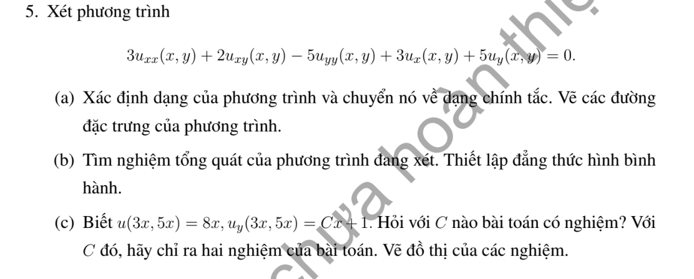
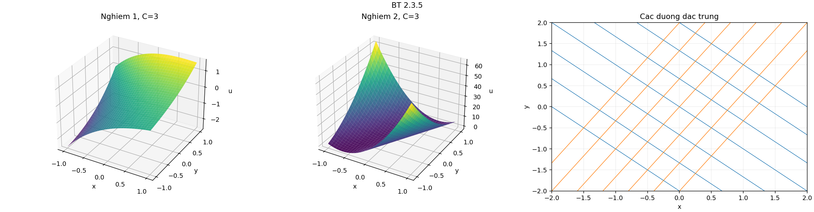

# Bài tập thực hành 5 — Mục 2.3

**Mã:** `BT_2_3_05` · **Trang sách:** 86–86

[← Mục lục](../MUC_LUC.md) · [Bản PDF của bài](BT_2_3_05.pdf)

## Đề bài

## Kiến thức và trình tự giải

**Mục tiêu.** Giải phương trình hyperbolic sau khi đã tìm hai tọa độ đặc trưng độc lập.

**Bước 1 — Phân loại, tìm đặc trưng và thay đạo hàm.** Làm đủ các bước của phép đưa về chính tắc. Viết cả phép đổi ngược để biểu diễn vế phải $\widetilde f(\xi,\eta)=f(x(\xi,\eta),y(\xi,\eta))$.

**Bước 2 — Tích phân phương trình chính tắc.** Với $v_{\xi\eta}=g$, giữ biến kia cố định khi tích phân:

$$
v=F(\xi)+G(\eta)+\int_{\xi_0}^{\xi}\int_{\eta_0}^{\eta}g(a,b)\,db\,da.
$$

Nếu tìm được một nghiệm riêng $P(x,y)$ dễ hơn, viết $u=P+F(\xi)+G(\eta)$. Với $v_{\xi\eta}+\alpha v_\eta=0$, đặt $w=v_\eta$, giải $w_\xi+\alpha w=0$ rồi tích phân theo $\eta$; thu được $v=F(\xi)+e^{-\alpha\xi}G(\eta)$.

**Bước 3 — Đổi cả dữ liệu.** Thế tọa độ đường dữ liệu vào $\xi,\eta$, dùng quy tắc dây chuyền cho đạo hàm được cho. Trên đường không đặc trưng, hai dữ liệu thường xác định hai hàm $F,G$. Trên đường đặc trưng, có biến không thay đổi, nên dữ liệu chỉ xác định giá trị hoặc đạo hàm của một hàm tại một điểm; phải tìm điều kiện tương thích và nêu phần tùy ý còn lại.

**Bước 4 — Lập đẳng thức hình bình hành.** Với $v=F(\xi)+G(\eta)$, bốn đỉnh theo hai họ đặc trưng thỏa $v_{11}+v_{22}=v_{12}+v_{21}$. Nếu có số hạng mũ, trước hết nhân trọng số để được tổng hai hàm một biến. Với vế phải $g$, hiệu bốn đỉnh bằng tích phân kép của $g$ trên hình chữ nhật trong tọa độ mới.

**Bước 5 — Xác định miền được dữ liệu quyết định.** Hai đặc trưng đi qua điểm đang xét phải gặp đoạn dữ liệu phù hợp. Với phương trình sóng $v_{tt}=v_{zz}$ trên $z>0$, dữ liệu lúc $t=0$ xác định duy nhất miền $z>t$; ở $0<z<t$, cần thêm dữ liệu biên $z=0$. Với đặc trưng cong, dùng miền trong các tọa độ mới rồi đổi lại.

**Bước 6 — Kiểm tra.** Thế nghiệm vào cả PDE và từng điều kiện. Nếu đề yêu cầu hai nghiệm, chỉ rõ hai lựa chọn khác nhau cho hàm tùy ý và chứng minh phần chênh lệch thỏa phương trình thuần nhất, đồng thời triệt tiêu trên đường dữ liệu.

## Lời giải áp dụng cho bài

**(a) Phân loại, đặc trưng, đổi biến.** $A=3$, $B=1$, $C=-5$, $\delta=16>0$. Đặc trưng $(dy+dx)(3dy-5dx)=0$: $x+y=c_1$, $5x-3y=c_2$. Đặt $\xi=x+y$, $\eta=5x-3y$, $J=-8$; $x=(3\xi+\eta)/8$, $y=(5\xi-\eta)/8$. Có $\partial_x=\partial_\xi+5\partial_\eta$, $\partial_y=\partial_\xi-3\partial_\eta$, nên

$$
3u_{xx}+2u_{xy}-5u_{yy}=64v_{\xi\eta},\quad 3u_x+5u_y=8v_\xi.
$$

Dạng chính tắc $64v_{\xi\eta}+8v_\xi=0$.

**(b) Giải và hình bình hành.** Đặt $w=v_\xi$; ODE $w_\eta+w/8=0$ cho $w=e^{-\eta/8}A(\xi)$. Tích phân theo $\xi$:

$$
\boxed{u=e^{-(5x-3y)/8}F(x+y)+G(5x-3y).}
$$

Với $v_{ij}=v(\xi_i,\eta_j)$,

$$
v_{22}-v_{12}=e^{-(\eta_2-\eta_1)/8}(v_{21}-v_{11}).
$$

Thật vậy, lấy hiệu hai giá trị cùng $\eta_j$ làm $G$ triệt tiêu và chỉ còn trọng số mũ nhân $F(\xi_2)-F(\xi_1)$.

**(c) Điều kiện tương thích.** Trên $(3t,5t)$: $\xi=8t$, $\eta=0$. Dữ liệu giá trị cho $F(8t)+G(0)=8t$, nên $F(s)=s-g_0$, $g_0=G(0)$, $F'=1$. Từ

$$
u_y=e^{-\eta/8}\left(F'+\frac38F\right)-3G'(\eta)
$$

suy ra $u_y(3t,5t)=1+3t-3g_0/8-3G'(0)$. So với $Ct+1$ cho

$$
\boxed{C=3,\qquad G'(0)=-g_0/8.}
$$

Chỉ hai giá trị tại $0$ của $G$ bị ràng buộc, nên có vô số nghiệm. Chọn $G=0$ và $G(s)=s^2$, cùng $g_0=0$, cho

$$
u_1=(x+y)e^{-(5x-3y)/8},\qquad u_2=u_1+(5x-3y)^2.
$$

Phần chênh chỉ phụ thuộc $\eta$, nên thỏa PDE; nó và đạo hàm theo $y$ bằng $0$ khi $\eta=0$. Vì vậy cả hai thỏa đầy đủ dữ liệu. Đặc trưng cần vẽ có hệ số góc $-1$ và $5/3$.

**Chi tiết thế ba đạo hàm cấp hai.** Với tọa độ đã chọn,

$$
u_{xx}=v_{\xi\xi}+10v_{\xi\eta}+25v_{\eta\eta},\quad u_{xy}=v_{\xi\xi}+2v_{\xi\eta}-15v_{\eta\eta},\quad u_{yy}=v_{\xi\xi}-6v_{\xi\eta}+9v_{\eta\eta}.
$$

Nhân lần lượt với $3$,$2$,$-5$, hệ số theo thứ tự $v_{\xi\xi},v_{\xi\eta},v_{\eta\eta}$ là

$$
3+2-5=0,\qquad 30+4+30=64,\qquad 75-30-45=0.
$$

## Đồ thị minh họa

## Đối chiếu kết quả

Khi sử dụng kết quả, kiểm tra đồng thời phương trình, dữ liệu ban đầu/biên và miền được nêu trong lời giải. Các điều kiện về tính trơn, nghiệm thực, tồn tại hoặc duy nhất là một phần của kết luận; không bỏ chúng khi ghi đáp án.
