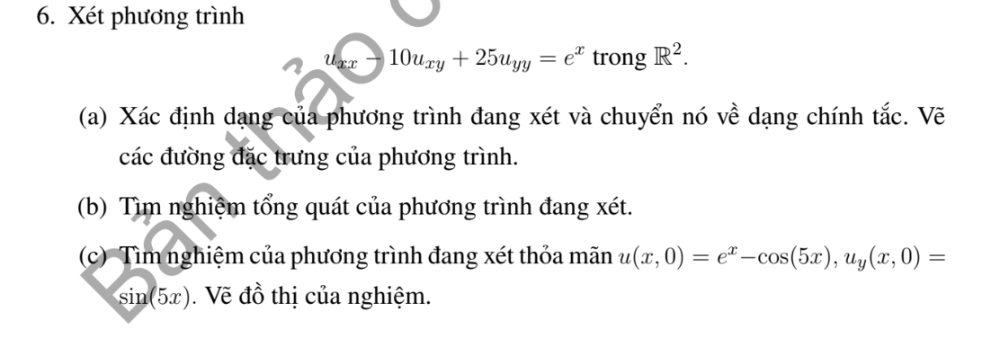
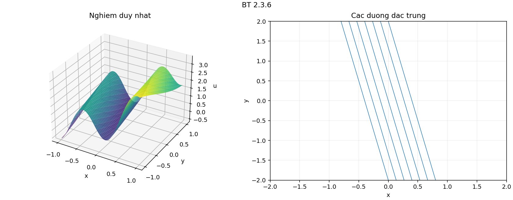

# Bài tập thực hành 6 — Mục 2.3

**Mã:** `BT_2_3_06` · **Trang sách:** 86–86

[← Mục lục](../MUC_LUC.md) · [Bản PDF của bài](BT_2_3_06.pdf)

## Đề bài

## Kiến thức và trình tự giải

**Mục tiêu.** Tận dụng phần cấp hai có dạng bình phương một đạo hàm theo hướng để giảm PDE thành ODE có tham số.

**Bước 1 — Nhận ra hướng đạo hàm.** Nếu $D=a\partial_x+b\partial_y$ có hệ số hằng, $D^2u=a^2u_{xx}+2ab u_{xy}+b^2u_{yy}$. Với hệ số biến thiên phải dùng

$$
D^2u=a^2u_{xx}+2ab u_{xy}+b^2u_{yy}+(Da)u_x+(Db)u_y.
$$

So sánh cả hạng cấp một trước khi kết luận PDE bằng $D^2u+\lambda Du+\mu u=f$.

**Bước 2 — Tìm bất biến $s$ và biến tiến $z$.** Giải $Ds=0$, chọn $Dz=k\ne0$. Kiểm tra $J=\partial(s,z)/\partial(x,y)\ne0$. Khi $k$ hằng, $D=k\partial_z$; PDE trở thành ODE theo $z$, trong đó $s$ là tham số. Nếu còn $v_s$, phải giữ lại, chỉ các trường hợp nó triệt tiêu mới giải trực tiếp như ODE.

**Bước 3 — Giải ODE.** Với $v_{zz}=g(s,z)$, tích phân hai lần cho $v=zF(s)+G(s)+\int_{z_0}^z(z-t)g(s,t)dt$. Với $a v_{zz}+b v_z+c v=g$, giải đa thức $a\lambda^2+b\lambda+c=0$, giữ hai hàm tùy ý theo $s$. Nghiệm kép có thêm hệ số $z$; có thể tìm nghiệm riêng dạng mũ hoặc đa thức.

**Bước 4 — Dùng dữ liệu đúng biến.** Tính $u_x=s_xv_s+z_xv_z$ và $u_y=s_yv_s+z_yv_z$. Nếu dữ liệu ở $s=0$, chỉ biết $F(0),G(0)$ hoặc đạo hàm của chúng; không suy ra toàn bộ các hàm. So sánh hệ số của $e^z$, $z$, $z^2$ để tìm các hằng số tương thích.

**Bước 5 — Kiểm tra tính duy nhất và nghiệm cụ thể.** Khi đường dữ liệu gặp tất cả đặc trưng một cách độc lập, giải hệ cho $F,G$. Khi đường dữ liệu là một đặc trưng, mô tả các hàm còn tùy ý và đưa hai lựa chọn rõ ràng. Cuối cùng thế lại phương trình gốc, không chỉ ODE mới.

## Lời giải áp dụng cho bài

**(a) Phân loại và đổi biến.** $A=1$, $B=-5$, $C=25$ cho $\delta=0$; phần chính là $D^2$, $D=\partial_x-5\partial_y$. Đặc trưng $5x+y=s$. Đặt $s=5x+y$, $z=x$, $J=-1$. Do $Ds=0$, $Dz=1$, ta có $D=\partial_z$, dạng chính tắc $v_{zz}=e^z$.

**(b) Tích phân hai lần.** Giữ $s$ cố định: $v_z=e^z+F(s)$, rồi $v=e^z+zF(s)+G(s)$. Vậy

$$
u=e^x+xF(5x+y)+G(5x+y).
$$

**(c) Xác định các hàm.** Dữ liệu $y=0$ và $u_y=xF'(s)+G'(s)$ cho

$$
xF(5x)+G(5x)=-\cos5x,\qquad xF'(5x)+G'(5x)=\sin5x.
$$

Lấy đạo hàm dòng đầu theo $x$ được $F(5x)+5xF'(5x)+5G'(5x)=5\sin5x$. Trừ $5$ lần dòng thứ hai, còn $F(5x)=0$ với mọi $x$. Suy ra $F=0$, $G(s)=-\cos s$:

$$
\boxed{u=e^x-\cos(5x+y).}
$$

Kiểm tra: $D(5x+y)=0$ nên $D^2[-\cos(5x+y)]=0$, $D^2e^x=e^x$. Thế $y=0$ cho đúng $u=e^x-\cos5x$, $u_y=\sin5x$. Toàn bộ $s\in\mathbb R$ đều xuất hiện trên dữ liệu, nên $F,G$ được xác định duy nhất. Đặc trưng là các đường thẳng hệ số góc $-5$.

**Chi tiết thế ba đạo hàm cấp hai.** Với tọa độ đã chọn,

$$
u_{xx}=25v_{ss}+10v_{sz}+v_{zz},\quad u_{xy}=5v_{ss}+v_{sz},\quad u_{yy}=v_{ss}.
$$

Nhân lần lượt với $1$,$-10$,$25$, hệ số theo thứ tự $v_{ss},v_{sz},v_{zz}$ là

$$
25-50+25=0,\qquad 10-10+0=0,\qquad 1+0+0=1.
$$

## Đồ thị minh họa

## Đối chiếu kết quả

Khi sử dụng kết quả, kiểm tra đồng thời phương trình, dữ liệu ban đầu/biên và miền được nêu trong lời giải. Các điều kiện về tính trơn, nghiệm thực, tồn tại hoặc duy nhất là một phần của kết luận; không bỏ chúng khi ghi đáp án.
