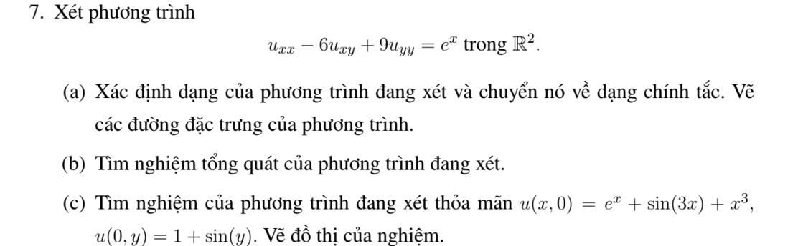
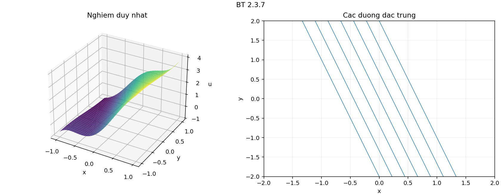

# Bài tập thực hành 7 — Mục 2.3

**Mã:** `BT_2_3_07` · **Trang sách:** 86–87

[← Mục lục](../MUC_LUC.md) · [Bản PDF của bài](BT_2_3_07.pdf)

## Đề bài

## Kiến thức và trình tự giải

**Mục tiêu.** Tận dụng phần cấp hai có dạng bình phương một đạo hàm theo hướng để giảm PDE thành ODE có tham số.

**Bước 1 — Nhận ra hướng đạo hàm.** Nếu $D=a\partial_x+b\partial_y$ có hệ số hằng, $D^2u=a^2u_{xx}+2ab u_{xy}+b^2u_{yy}$. Với hệ số biến thiên phải dùng

$$
D^2u=a^2u_{xx}+2ab u_{xy}+b^2u_{yy}+(Da)u_x+(Db)u_y.
$$

So sánh cả hạng cấp một trước khi kết luận PDE bằng $D^2u+\lambda Du+\mu u=f$.

**Bước 2 — Tìm bất biến $s$ và biến tiến $z$.** Giải $Ds=0$, chọn $Dz=k\ne0$. Kiểm tra $J=\partial(s,z)/\partial(x,y)\ne0$. Khi $k$ hằng, $D=k\partial_z$; PDE trở thành ODE theo $z$, trong đó $s$ là tham số. Nếu còn $v_s$, phải giữ lại, chỉ các trường hợp nó triệt tiêu mới giải trực tiếp như ODE.

**Bước 3 — Giải ODE.** Với $v_{zz}=g(s,z)$, tích phân hai lần cho $v=zF(s)+G(s)+\int_{z_0}^z(z-t)g(s,t)dt$. Với $a v_{zz}+b v_z+c v=g$, giải đa thức $a\lambda^2+b\lambda+c=0$, giữ hai hàm tùy ý theo $s$. Nghiệm kép có thêm hệ số $z$; có thể tìm nghiệm riêng dạng mũ hoặc đa thức.

**Bước 4 — Dùng dữ liệu đúng biến.** Tính $u_x=s_xv_s+z_xv_z$ và $u_y=s_yv_s+z_yv_z$. Nếu dữ liệu ở $s=0$, chỉ biết $F(0),G(0)$ hoặc đạo hàm của chúng; không suy ra toàn bộ các hàm. So sánh hệ số của $e^z$, $z$, $z^2$ để tìm các hằng số tương thích.

**Bước 5 — Kiểm tra tính duy nhất và nghiệm cụ thể.** Khi đường dữ liệu gặp tất cả đặc trưng một cách độc lập, giải hệ cho $F,G$. Khi đường dữ liệu là một đặc trưng, mô tả các hàm còn tùy ý và đưa hai lựa chọn rõ ràng. Cuối cùng thế lại phương trình gốc, không chỉ ODE mới.

## Lời giải áp dụng cho bài

**(a) Phân loại và tọa độ.** $A=1$, $B=-3$, $C=9$, $\delta=0$. Đặt $D=\partial_x-3\partial_y$, $s=3x+y$, $z=x$, $J=-1$. Vì $Ds=0$, $Dz=1$, PDE parabolic trở thành $v_{zz}=e^z$. Đặc trưng $y=-3x+s$.

**(b) Nghiệm tổng quát.** Tích phân theo $z$ hai lần:

$$
u=e^x+xF(3x+y)+G(3x+y).
$$

**(c) Dùng lần lượt hai đường dữ liệu.** Trên $x=0$, $s=y$, nên $1+G(y)=1+\sin y$: $G(s)=\sin s$. Trên $y=0$,

$$
e^x+xF(3x)+\sin3x=e^x+\sin3x+x^3
$$

cho $F(3x)=x^2$ khi $x\ne0$; tính liên tục xác định cả $F(0)=0$. Vì vậy $F(s)=s^2/9$ và

$$
\boxed{u=e^x+\frac{x(3x+y)^2}{9}+\sin(3x+y).}
$$

Giữ $s$ cố định thì $v_{zz}=e^z$, nên công thức thỏa PDE. Thế $y=0$ và $x=0$ kiểm tra đúng hai dữ liệu; chúng cùng bằng $1$ tại gốc. Hai đường dữ liệu đã xác định toàn bộ $F,G$, nên nghiệm là duy nhất trong lớp $C^2$ trên $\mathbb R^2$.

**Chi tiết tích phân theo biến còn lại.** Với $s=3x+y,z=x$, $u_x=3v_s+v_z,u_y=v_s$,

$$
u_{xx}=9v_{ss}+6v_{sz}+v_{zz},\quad u_{xy}=3v_{ss}+v_{sz},\quad u_{yy}=v_{ss}.
$$

Phần chính $u_{xx}-6u_{xy}+9u_{yy}$ có các hệ số $9-18+9=0$, $6-6=0$, còn $v_{zz}$. Tích phân $v_{zz}=e^z$ lần đầu được $v_z=e^z+F(s)$, lần sau $v=e^z+zF(s)+G(s)$.

## Đồ thị minh họa

## Đối chiếu kết quả

Khi sử dụng kết quả, kiểm tra đồng thời phương trình, dữ liệu ban đầu/biên và miền được nêu trong lời giải. Các điều kiện về tính trơn, nghiệm thực, tồn tại hoặc duy nhất là một phần của kết luận; không bỏ chúng khi ghi đáp án.
