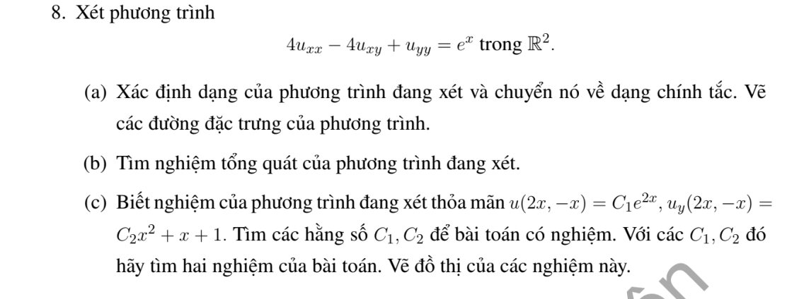
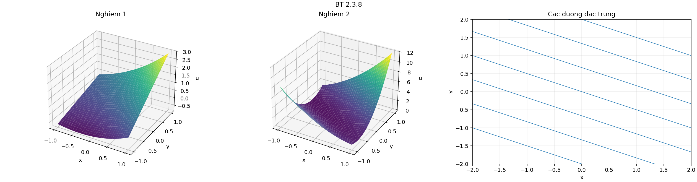

# Bài tập thực hành 8 — Mục 2.3

**Mã:** `BT_2_3_08` · **Trang sách:** 87–87

[← Mục lục](../MUC_LUC.md) · [Bản PDF của bài](BT_2_3_08.pdf)

## Đề bài

## Kiến thức và trình tự giải

**Mục tiêu.** Tận dụng phần cấp hai có dạng bình phương một đạo hàm theo hướng để giảm PDE thành ODE có tham số.

**Bước 1 — Nhận ra hướng đạo hàm.** Nếu $D=a\partial_x+b\partial_y$ có hệ số hằng, $D^2u=a^2u_{xx}+2ab u_{xy}+b^2u_{yy}$. Với hệ số biến thiên phải dùng

$$
D^2u=a^2u_{xx}+2ab u_{xy}+b^2u_{yy}+(Da)u_x+(Db)u_y.
$$

So sánh cả hạng cấp một trước khi kết luận PDE bằng $D^2u+\lambda Du+\mu u=f$.

**Bước 2 — Tìm bất biến $s$ và biến tiến $z$.** Giải $Ds=0$, chọn $Dz=k\ne0$. Kiểm tra $J=\partial(s,z)/\partial(x,y)\ne0$. Khi $k$ hằng, $D=k\partial_z$; PDE trở thành ODE theo $z$, trong đó $s$ là tham số. Nếu còn $v_s$, phải giữ lại, chỉ các trường hợp nó triệt tiêu mới giải trực tiếp như ODE.

**Bước 3 — Giải ODE.** Với $v_{zz}=g(s,z)$, tích phân hai lần cho $v=zF(s)+G(s)+\int_{z_0}^z(z-t)g(s,t)dt$. Với $a v_{zz}+b v_z+c v=g$, giải đa thức $a\lambda^2+b\lambda+c=0$, giữ hai hàm tùy ý theo $s$. Nghiệm kép có thêm hệ số $z$; có thể tìm nghiệm riêng dạng mũ hoặc đa thức.

**Bước 4 — Dùng dữ liệu đúng biến.** Tính $u_x=s_xv_s+z_xv_z$ và $u_y=s_yv_s+z_yv_z$. Nếu dữ liệu ở $s=0$, chỉ biết $F(0),G(0)$ hoặc đạo hàm của chúng; không suy ra toàn bộ các hàm. So sánh hệ số của $e^z$, $z$, $z^2$ để tìm các hằng số tương thích.

**Bước 5 — Kiểm tra tính duy nhất và nghiệm cụ thể.** Khi đường dữ liệu gặp tất cả đặc trưng một cách độc lập, giải hệ cho $F,G$. Khi đường dữ liệu là một đặc trưng, mô tả các hàm còn tùy ý và đưa hai lựa chọn rõ ràng. Cuối cùng thế lại phương trình gốc, không chỉ ODE mới.

## Lời giải áp dụng cho bài

**(a) Phân loại và chính tắc.** $A=4$, $B=-2$, $C=1$, $\delta=0$. Phần chính $D^2$, $D=2\partial_x-\partial_y$. Bất biến $s=x+2y$; chọn $z=x$, $J=-2$. Khi đó $D=2\partial_z$, PDE trở thành $4v_{zz}=e^z$. Đặc trưng $y=-x/2+s/2$.

**(b) Tích phân.** Nghiệm riêng $e^z/4$; hai lần tích phân cho

$$
u=e^x/4+xF(s)+G(s),\qquad s=x+2y.
$$

**(c) Tương thích trên một đặc trưng.** Trên $(2t,-t)$, $s=0$:

$$
e^{2t}/4+2tF(0)+G(0)=C_1e^{2t}.
$$

Hàm mũ không thể bằng đa thức bậc nhất trên cả trục trừ khi các hệ số chênh đều bằng $0$; có thể lấy đạo hàm hai lần để thấy ngay $C_1=1/4$. Suy ra $F(0)=G(0)=0$. Đạo hàm theo $y$ là $u_y=2xF'(s)+2G'(s)$, nên

$$
4tF'(0)+2G'(0)=C_2t^2+t+1.
$$

So sánh ba hệ số cho

$$
\boxed{C_1=1/4,\quad C_2=0,\quad F'(0)=1/4,\quad G'(0)=1/2.}
$$

Chọn $F(s)=s/4$, $G(s)=s/2$ hoặc $G(s)=s/2+s^2$:

$$
u_1=e^x/4+\frac{x(x+2y)}4+\frac{x+2y}2,\qquad u_2=u_1+(x+2y)^2.
$$

Tại đường dữ liệu, $u_j=e^{2t}/4$ và $(u_j)_y=t+1$. Cả hai thỏa PDE vì $D(s)=0$, $D^2(xF(s)+G(s))=0$. Có vô số nghiệm: thêm các hàm $F,G$ với giá trị và đạo hàm tại $0$ giữ như trên.

**Chi tiết tích phân và so hệ số.** $4v_{zz}=e^z$ cho $v_z=e^z/4+F(s)$ rồi $v=e^z/4+zF(s)+G(s)$. Từ $(1/4-C_1)e^{2t}+2tF(0)+G(0)=0$, đạo hàm hai lần cho $4(1/4-C_1)e^{2t}=0$, suy $C_1=1/4$; còn $2tF(0)+G(0)=0$ cho $F(0)=G(0)=0$. Với $4tF'(0)+2G'(0)=C_2t^2+t+1$, so hệ số $t^2,t,1$ lần lượt cho $C_2=0,F'(0)=1/4,G'(0)=1/2$.

**Chi tiết thế ba đạo hàm cấp hai.** Với tọa độ đã chọn,

$$
u_{xx}=v_{ss}+2v_{sz}+v_{zz},\quad u_{xy}=2v_{ss}+2v_{sz},\quad u_{yy}=4v_{ss}.
$$

Nhân lần lượt với $4$,$-4$,$1$, hệ số theo thứ tự $v_{ss},v_{sz},v_{zz}$ là

$$
4-8+4=0,\qquad 8-8+0=0,\qquad 4+0+0=4.
$$

## Đồ thị minh họa

## Đối chiếu kết quả

Khi sử dụng kết quả, kiểm tra đồng thời phương trình, dữ liệu ban đầu/biên và miền được nêu trong lời giải. Các điều kiện về tính trơn, nghiệm thực, tồn tại hoặc duy nhất là một phần của kết luận; không bỏ chúng khi ghi đáp án.
