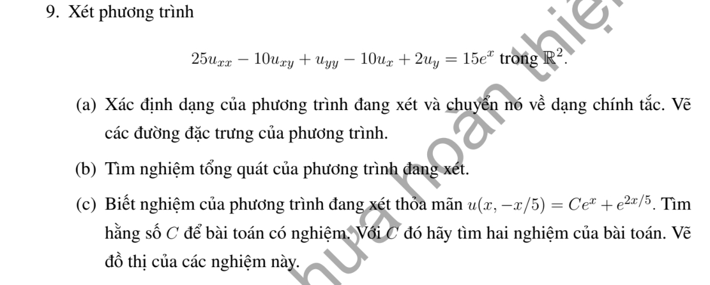
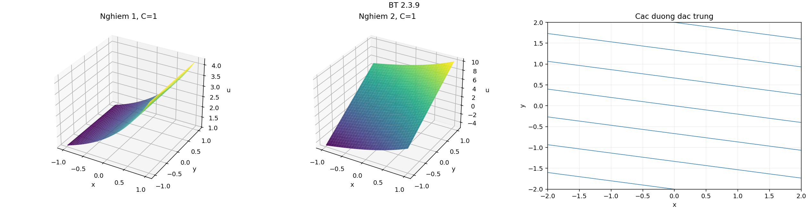

# Bài tập thực hành 9 — Mục 2.3

**Mã:** `BT_2_3_09` · **Trang sách:** 87–87

[← Mục lục](../MUC_LUC.md) · [Bản PDF của bài](BT_2_3_09.pdf)

## Đề bài

## Kiến thức và trình tự giải

**Mục tiêu.** Tận dụng phần cấp hai có dạng bình phương một đạo hàm theo hướng để giảm PDE thành ODE có tham số.

**Bước 1 — Nhận ra hướng đạo hàm.** Nếu $D=a\partial_x+b\partial_y$ có hệ số hằng, $D^2u=a^2u_{xx}+2ab u_{xy}+b^2u_{yy}$. Với hệ số biến thiên phải dùng

$$
D^2u=a^2u_{xx}+2ab u_{xy}+b^2u_{yy}+(Da)u_x+(Db)u_y.
$$

So sánh cả hạng cấp một trước khi kết luận PDE bằng $D^2u+\lambda Du+\mu u=f$.

**Bước 2 — Tìm bất biến $s$ và biến tiến $z$.** Giải $Ds=0$, chọn $Dz=k\ne0$. Kiểm tra $J=\partial(s,z)/\partial(x,y)\ne0$. Khi $k$ hằng, $D=k\partial_z$; PDE trở thành ODE theo $z$, trong đó $s$ là tham số. Nếu còn $v_s$, phải giữ lại, chỉ các trường hợp nó triệt tiêu mới giải trực tiếp như ODE.

**Bước 3 — Giải ODE.** Với $v_{zz}=g(s,z)$, tích phân hai lần cho $v=zF(s)+G(s)+\int_{z_0}^z(z-t)g(s,t)dt$. Với $a v_{zz}+b v_z+c v=g$, giải đa thức $a\lambda^2+b\lambda+c=0$, giữ hai hàm tùy ý theo $s$. Nghiệm kép có thêm hệ số $z$; có thể tìm nghiệm riêng dạng mũ hoặc đa thức.

**Bước 4 — Dùng dữ liệu đúng biến.** Tính $u_x=s_xv_s+z_xv_z$ và $u_y=s_yv_s+z_yv_z$. Nếu dữ liệu ở $s=0$, chỉ biết $F(0),G(0)$ hoặc đạo hàm của chúng; không suy ra toàn bộ các hàm. So sánh hệ số của $e^z$, $z$, $z^2$ để tìm các hằng số tương thích.

**Bước 5 — Kiểm tra tính duy nhất và nghiệm cụ thể.** Khi đường dữ liệu gặp tất cả đặc trưng một cách độc lập, giải hệ cho $F,G$. Khi đường dữ liệu là một đặc trưng, mô tả các hàm còn tùy ý và đưa hai lựa chọn rõ ràng. Cuối cùng thế lại phương trình gốc, không chỉ ODE mới.

## Lời giải áp dụng cho bài

**(a) Phân loại và chính tắc.** $A=25$, $B=-5$, $C=1$, $\delta=0$. Đặt $D=5\partial_x-\partial_y$. PDE là $D^2u-2Du=15e^x$. Chọn $s=x+5y$, $z=x$, $J=-5$; $Ds=0$, $Dz=5$, nên

$$
25v_{zz}-10v_z=15e^z.
$$

Đặc trưng là $y=-x/5+s/5$.

**(b) Giải ODE.** Đa thức đặc trưng $25\lambda^2-10\lambda=5\lambda(5\lambda-2)$ có nghiệm $0$, $2/5$. Nghiệm riêng $v_p=e^z$ vì $25-10=15$. Vì vậy

$$
u=e^x+e^{2x/5}F(x+5y)+G(x+5y).
$$

**(c) Tìm $C$ và hai nghiệm.** Trên $y=-x/5$, $s=0$, phương trình dữ liệu là

$$
(1-C)e^x+(F(0)-1)e^{2x/5}+G(0)=0.
$$

Ba hàm $e^x$, $e^{2x/5}$, $1$ độc lập tuyến tính, nên

$$
\boxed{C=1,\qquad F(0)=1,\qquad G(0)=0.}
$$

Lấy $F=1$, $G=0$ và $F=1$, $G(s)=s$ cho

$$
u_1=e^x+e^{2x/5},\qquad u_2=e^x+e^{2x/5}+x+5y.
$$

Kiểm tra: $D^2e^x-2De^x=15e^x$; $De^{2x/5}=2e^{2x/5}$ nên phần mũ thứ hai thỏa thuần nhất; $D(x+5y)=0$. Hai công thức bằng nhau trên đường dữ liệu nhưng khác ngoài nó. Dữ liệu trên một đặc trưng chỉ quy định hai giá trị $F(0),G(0)$, nên không duy nhất.

**Chi tiết tính độc lập của ba hàm.** Đặt $a=1-C,b=F(0)-1,c=G(0)$. Từ $ae^x+be^{2x/5}+c=0$, đạo hàm lần thứ nhất và thứ hai:

$$
ae^x+\tfrac25be^{2x/5}=0,\quad ae^x+\tfrac4{25}be^{2x/5}=0.
$$

Trừ hai dòng cho $(6/25)be^{2x/5}=0$, suy $b=0$; thế ngược cho $a=0$, rồi $c=0$. Do đó $C=1,F(0)=1,G(0)=0$ như kết luận.

**Chi tiết thế ba đạo hàm cấp hai.** Với tọa độ đã chọn,

$$
u_{xx}=v_{ss}+2v_{sz}+v_{zz},\quad u_{xy}=5v_{ss}+5v_{sz},\quad u_{yy}=25v_{ss}.
$$

Nhân lần lượt với $25$,$-10$,$1$, hệ số theo thứ tự $v_{ss},v_{sz},v_{zz}$ là

$$
25-50+25=0,\qquad 50-50+0=0,\qquad 25+0+0=25.
$$

## Đồ thị minh họa

## Đối chiếu kết quả

Khi sử dụng kết quả, kiểm tra đồng thời phương trình, dữ liệu ban đầu/biên và miền được nêu trong lời giải. Các điều kiện về tính trơn, nghiệm thực, tồn tại hoặc duy nhất là một phần của kết luận; không bỏ chúng khi ghi đáp án.
