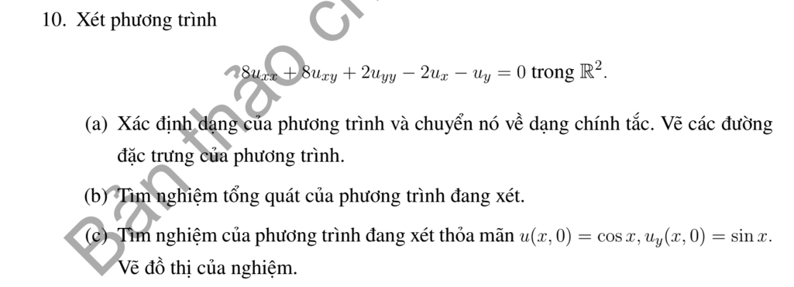
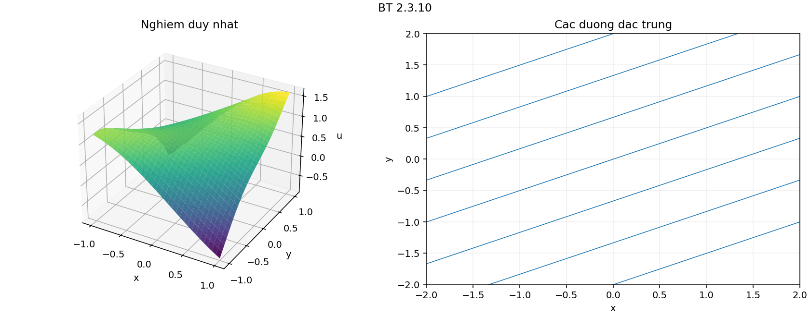

# Bài tập thực hành 10 — Mục 2.3

**Mã:** `BT_2_3_10` · **Trang sách:** 87–87

[← Mục lục](../MUC_LUC.md) · [Bản PDF của bài](BT_2_3_10.pdf)

## Đề bài

## Kiến thức và trình tự giải

**Mục tiêu.** Tận dụng phần cấp hai có dạng bình phương một đạo hàm theo hướng để giảm PDE thành ODE có tham số.

**Bước 1 — Nhận ra hướng đạo hàm.** Nếu $D=a\partial_x+b\partial_y$ có hệ số hằng, $D^2u=a^2u_{xx}+2ab u_{xy}+b^2u_{yy}$. Với hệ số biến thiên phải dùng

$$
D^2u=a^2u_{xx}+2ab u_{xy}+b^2u_{yy}+(Da)u_x+(Db)u_y.
$$

So sánh cả hạng cấp một trước khi kết luận PDE bằng $D^2u+\lambda Du+\mu u=f$.

**Bước 2 — Tìm bất biến $s$ và biến tiến $z$.** Giải $Ds=0$, chọn $Dz=k\ne0$. Kiểm tra $J=\partial(s,z)/\partial(x,y)\ne0$. Khi $k$ hằng, $D=k\partial_z$; PDE trở thành ODE theo $z$, trong đó $s$ là tham số. Nếu còn $v_s$, phải giữ lại, chỉ các trường hợp nó triệt tiêu mới giải trực tiếp như ODE.

**Bước 3 — Giải ODE.** Với $v_{zz}=g(s,z)$, tích phân hai lần cho $v=zF(s)+G(s)+\int_{z_0}^z(z-t)g(s,t)dt$. Với $a v_{zz}+b v_z+c v=g$, giải đa thức $a\lambda^2+b\lambda+c=0$, giữ hai hàm tùy ý theo $s$. Nghiệm kép có thêm hệ số $z$; có thể tìm nghiệm riêng dạng mũ hoặc đa thức.

**Bước 4 — Dùng dữ liệu đúng biến.** Tính $u_x=s_xv_s+z_xv_z$ và $u_y=s_yv_s+z_yv_z$. Nếu dữ liệu ở $s=0$, chỉ biết $F(0),G(0)$ hoặc đạo hàm của chúng; không suy ra toàn bộ các hàm. So sánh hệ số của $e^z$, $z$, $z^2$ để tìm các hằng số tương thích.

**Bước 5 — Kiểm tra tính duy nhất và nghiệm cụ thể.** Khi đường dữ liệu gặp tất cả đặc trưng một cách độc lập, giải hệ cho $F,G$. Khi đường dữ liệu là một đặc trưng, mô tả các hàm còn tùy ý và đưa hai lựa chọn rõ ràng. Cuối cùng thế lại phương trình gốc, không chỉ ODE mới.

## Lời giải áp dụng cho bài

**(a) Phân loại và phép đổi biến.** $A=8$, $B=4$, $C=2$ cho $\delta=0$. Đặt $D=2\partial_x+\partial_y$; PDE là $2D^2u-Du=0$. Bất biến $s=x-2y$, chọn $z=x$, $J=2$. Do $D=2\partial_z$, dạng mới $8v_{zz}-2v_z=0$. Đặc trưng $y=x/2-s/2$.

**(b) Nghiệm tổng quát.** Phương trình đặc trưng $8\lambda^2-2\lambda=0$ cho $\lambda=0,1/4$, nên

$$
u=e^{x/4}F(s)+G(s).
$$

**(c) Dùng Cauchy.** Trên $y=0$, $s=x$:

$$
e^{x/4}F(x)+G(x)=\cos x,\qquad
-2[e^{x/4}F'(x)+G'(x)]=\sin x.
$$

Lấy đạo hàm phương trình thứ nhất: $e^{x/4}F/4+e^{x/4}F'+G'=-\sin x$. Dòng thứ hai cho $e^{x/4}F'+G'=-\sin x/2$, nên $F(x)=-2e^{-x/4}\sin x$, $G(x)=\cos x+2\sin x$. Thế lại:

$$
\boxed{u=\cos(x-2y)+2(1-e^{y/2})\sin(x-2y).}
$$

Để kiểm tra PDE, giữ $s$ cố định: phần biến thiên theo $z$ chỉ là một hằng cộng một bội của $e^{z/4}$, đúng ODE. Tại $y=0$, $u=\cos x$; tính $u_y$ cho $2\sin x-\sin x=\sin x$. Hai hàm $F,G$ được xác định trên toàn trục nên nghiệm duy nhất trên $\mathbb R^2$.

**Chi tiết thế ba đạo hàm cấp hai.** Với tọa độ đã chọn,

$$
u_{xx}=v_{ss}+2v_{sz}+v_{zz},\quad u_{xy}=-2v_{ss}-2v_{sz},\quad u_{yy}=4v_{ss}.
$$

Nhân lần lượt với $8$,$8$,$2$, hệ số theo thứ tự $v_{ss},v_{sz},v_{zz}$ là

$$
8-16+8=0,\qquad 16-16+0=0,\qquad 8+0+0=8.
$$

## Đồ thị minh họa

## Đối chiếu kết quả

Khi sử dụng kết quả, kiểm tra đồng thời phương trình, dữ liệu ban đầu/biên và miền được nêu trong lời giải. Các điều kiện về tính trơn, nghiệm thực, tồn tại hoặc duy nhất là một phần của kết luận; không bỏ chúng khi ghi đáp án.
