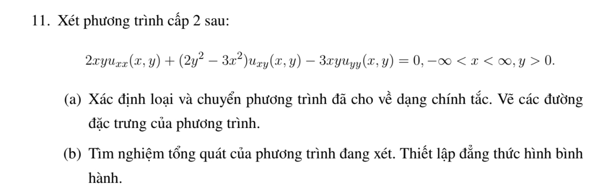
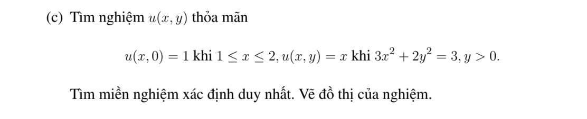
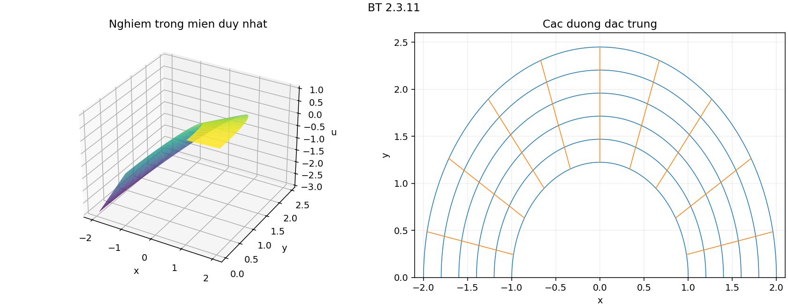

# Bài tập thực hành 11 — Mục 2.3

**Mã:** `BT_2_3_11` · **Trang sách:** 87–88

[← Mục lục](../MUC_LUC.md) · [Bản PDF của bài](BT_2_3_11.pdf)

## Đề bài

## Kiến thức và trình tự giải

**Mục tiêu.** Giải phương trình hyperbolic sau khi đã tìm hai tọa độ đặc trưng độc lập.

**Bước 1 — Phân loại, tìm đặc trưng và thay đạo hàm.** Làm đủ các bước của phép đưa về chính tắc. Viết cả phép đổi ngược để biểu diễn vế phải $\widetilde f(\xi,\eta)=f(x(\xi,\eta),y(\xi,\eta))$.

**Bước 2 — Tích phân phương trình chính tắc.** Với $v_{\xi\eta}=g$, giữ biến kia cố định khi tích phân:

$$
v=F(\xi)+G(\eta)+\int_{\xi_0}^{\xi}\int_{\eta_0}^{\eta}g(a,b)\,db\,da.
$$

Nếu tìm được một nghiệm riêng $P(x,y)$ dễ hơn, viết $u=P+F(\xi)+G(\eta)$. Với $v_{\xi\eta}+\alpha v_\eta=0$, đặt $w=v_\eta$, giải $w_\xi+\alpha w=0$ rồi tích phân theo $\eta$; thu được $v=F(\xi)+e^{-\alpha\xi}G(\eta)$.

**Bước 3 — Đổi cả dữ liệu.** Thế tọa độ đường dữ liệu vào $\xi,\eta$, dùng quy tắc dây chuyền cho đạo hàm được cho. Trên đường không đặc trưng, hai dữ liệu thường xác định hai hàm $F,G$. Trên đường đặc trưng, có biến không thay đổi, nên dữ liệu chỉ xác định giá trị hoặc đạo hàm của một hàm tại một điểm; phải tìm điều kiện tương thích và nêu phần tùy ý còn lại.

**Bước 4 — Lập đẳng thức hình bình hành.** Với $v=F(\xi)+G(\eta)$, bốn đỉnh theo hai họ đặc trưng thỏa $v_{11}+v_{22}=v_{12}+v_{21}$. Nếu có số hạng mũ, trước hết nhân trọng số để được tổng hai hàm một biến. Với vế phải $g$, hiệu bốn đỉnh bằng tích phân kép của $g$ trên hình chữ nhật trong tọa độ mới.

**Bước 5 — Xác định miền được dữ liệu quyết định.** Hai đặc trưng đi qua điểm đang xét phải gặp đoạn dữ liệu phù hợp. Với phương trình sóng $v_{tt}=v_{zz}$ trên $z>0$, dữ liệu lúc $t=0$ xác định duy nhất miền $z>t$; ở $0<z<t$, cần thêm dữ liệu biên $z=0$. Với đặc trưng cong, dùng miền trong các tọa độ mới rồi đổi lại.

**Bước 6 — Kiểm tra.** Thế nghiệm vào cả PDE và từng điều kiện. Nếu đề yêu cầu hai nghiệm, chỉ rõ hai lựa chọn khác nhau cho hàm tùy ý và chứng minh phần chênh lệch thỏa phương trình thuần nhất, đồng thời triệt tiêu trên đường dữ liệu.

**Biến đổi riêng của bài.** Dùng tọa độ cực (hoặc cực sau khi co giãn trục). Khi thu được $r v_{r\theta}-v_\theta=0$, đặt $w=v/r$ thì $w_{r\theta}=0$. Vì vậy $v=rF(\theta)+G(r)$; phải chia nghiệm cho $r$ trước khi lập đẳng thức bốn đỉnh.

## Lời giải áp dụng cho bài

**(a) Phân loại và đặc trưng cong.** $A=2xy$, $B=(2y^2-3x^2)/2$, $C=-3xy$ cho

$$
\delta=(2y^2+3x^2)^2/4>0\quad(y>0).
$$

Đặc trưng phân tích thành $(xdy-ydx)(2ydy+3xdx)=0$: các tia qua gốc và các nửa ellipse $3x^2+2y^2=\mathrm{const}$. Đặt

$$
X=\sqrt3x,\quad Y=\sqrt2y,\quad r=\sqrt{3x^2+2y^2},\quad
X=r\cos\theta,\ Y=r\sin\theta,\quad0<\theta<\pi.
$$

Trong biến $X,Y$, toán tử gốc bằng $\sqrt6[XY\partial_X^2+(Y^2-X^2)\partial_X\partial_Y-XY\partial_Y^2]$. Công thức cực ở Ví dụ 9 cho $-\sqrt6(r v_{r\theta}-v_\theta)$. Vì thế dạng chính tắc là $r v_{r\theta}-v_\theta=0$.

**(b) Giải và hình bình hành.** Đặt $w=v/r$ thì $w_{r\theta}=0$, suy ra

$$
u=rF(\theta)+G(r).
$$

Đẳng thức bốn đỉnh áp dụng cho $w$: $v(r_1,\theta_1)/r_1+v(r_2,\theta_2)/r_2=v(r_1,\theta_2)/r_1+v(r_2,\theta_1)/r_2$. Trong mặt phẳng gốc, bốn cạnh là hai tia và hai cung ellipse; đó là hình chữ nhật trong tọa độ $(r,\theta)$, không phải hình bình hành thẳng thông thường.

**(c) Dữ liệu và miền duy nhất.** Trên $r=\sqrt3$, dữ liệu $u=x$ cho

$$
\sqrt3F(\theta)+G(\sqrt3)=\cos\theta.
$$

Vì vậy $F(\theta)=\cos\theta/\sqrt3-k/\sqrt3$, $k=G(\sqrt3)$. Trên $y=0$, $1\le x\le2$, có $\theta=0$, $r=\sqrt3x$, dữ liệu $u=1$ cho $G(r)=1-rF(0)$ ở $\sqrt3\le r\le2\sqrt3$. Thế $F,G$ và rút gọn, mọi hằng $k$ triệt tiêu:

$$
\boxed{u=x+1-\sqrt{x^2+\frac23y^2}.}
$$

Công thức này xác định trên $y>0$ và có thể dùng như một nghiệm cụ thể ở toàn miền; nó được dữ liệu quyết định duy nhất trên

$$
\boxed{y>0,\qquad3<3x^2+2y^2<12.}
$$

Giá trị ở hai ellipse biên cũng được quyết định bằng liên tục. Ngoài khoảng bán kính này, $G$ chưa bị dữ liệu quy định. Kiểm tra: trên $r=\sqrt3$, căn bằng $1$, nên $u=x$; trên $y=0$, $x\in[1,2]$, căn bằng $x$, nên $u=1$. Nghiệm có dạng $rF(\theta)+G(r)$, do đó thỏa PDE.

**Chi tiết đổi tỉ lệ và khử hằng số.** Vì $\partial_x=\sqrt3\partial_X,\partial_y=\sqrt2\partial_Y$, $xy=XY/\sqrt6$, phần chính biến thành $\sqrt6[XYu_{XX}+(Y^2-X^2)u_{XY}-XYu_{YY}]$. Viết $X=rc,Y=rs$, thế đạo hàm cực: các hệ số $v_{rr},v_{\theta\theta},v_r$ bằng $0$; hệ số $v_{r\theta}$ là $-r[4c^2s^2+(c^2-s^2)^2]=-r$, hệ số $v_\theta$ là $1$. Với $w=v/r$, $v_\theta=rw_\theta$, $v_{r\theta}=w_\theta+rw_{r\theta}$, nên $rv_{r\theta}-v_\theta=r^2w_{r\theta}$.

Trong (c), $F=(\cos\theta-k)/\sqrt3$, $F(0)=(1-k)/\sqrt3$, $G=1-r(1-k)/\sqrt3$. Cộng:

$$
rF+G=\frac r{\sqrt3}\cos\theta-\frac{rk}{\sqrt3}+1-\frac r{\sqrt3}+\frac{rk}{\sqrt3}
=x+1-\frac r{\sqrt3}.
$$

Vì $r/\sqrt3=\sqrt{x^2+2y^2/3}$, thu nghiệm đã nêu.

## Đồ thị minh họa

## Đối chiếu kết quả

Khi sử dụng kết quả, kiểm tra đồng thời phương trình, dữ liệu ban đầu/biên và miền được nêu trong lời giải. Các điều kiện về tính trơn, nghiệm thực, tồn tại hoặc duy nhất là một phần của kết luận; không bỏ chúng khi ghi đáp án.
