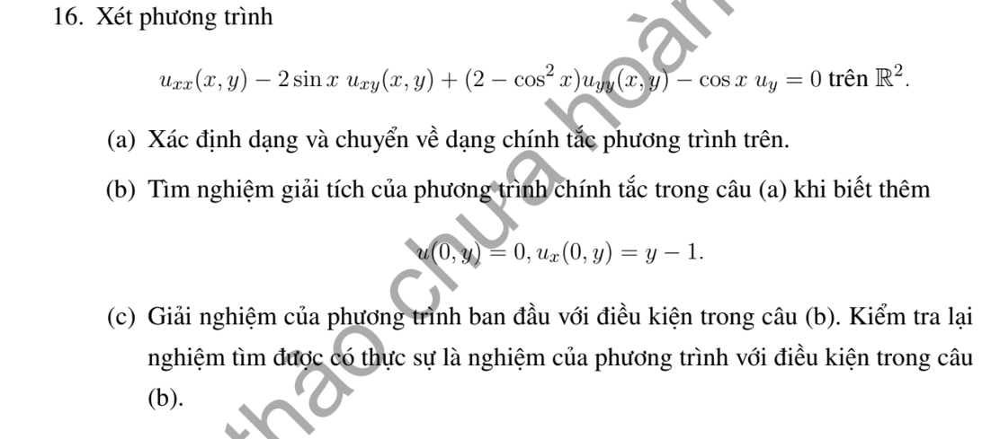
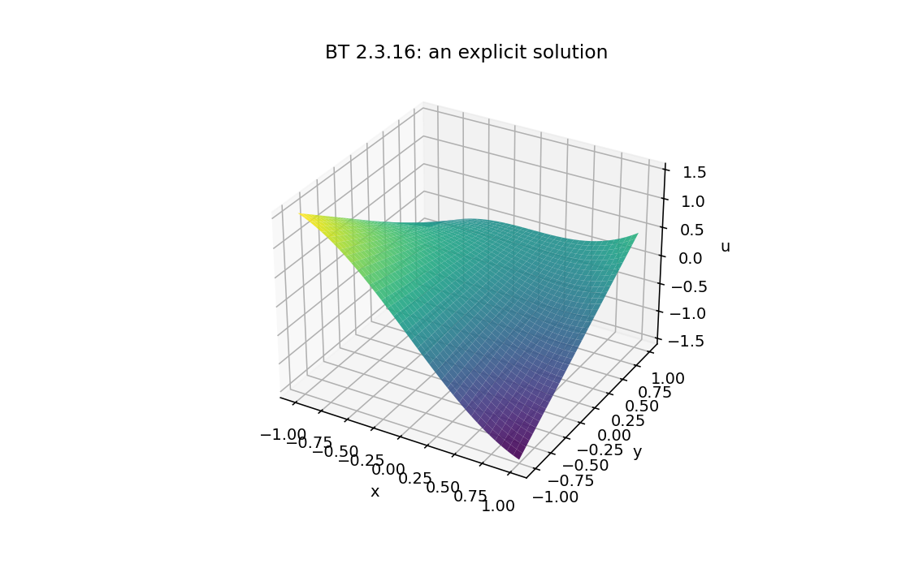

# Bài tập thực hành 16 — Mục 2.3

**Mã:** `BT_2_3_16` · **Trang sách:** 89–89

[← Mục lục](../MUC_LUC.md) · [Bản PDF của bài](BT_2_3_16.pdf)

## Đề bài

## Kiến thức và trình tự giải

**Mục tiêu.** Đưa phương trình elliptic về dạng đơn giản, rồi tìm nghiệm giải tích từ dữ liệu Cauchy mà bài yêu cầu.

**Bước 1 — Loại hạng hỗn hợp và hạng cấp một do đổi biến.** Tính $\delta<0$, chọn $\xi,\eta$ thực có Jacobian khác $0$. Thay đầy đủ đạo hàm cấp hai; các đạo hàm của tọa độ có thể triệt tiêu với hạng cấp một trong đề. Kết quả thường là $v_{\xi\xi}+v_{\eta\eta}+c v=0$.

**Bước 2 — Chuyển dữ liệu sang đường tọa độ mới.** Nếu đường dữ liệu trở thành $\xi=0$, đặt $v(0,\eta)=f(\eta)$ và tính $v_\xi(0,\eta)=g(\eta)$ từ đạo hàm được cho. Nếu đường là $\eta=\eta_0$, đổi vai trò hai biến. Không lấy nguyên dữ liệu đạo hàm cũ làm dữ liệu mới khi hệ số dây chuyền khác $1$.

**Bước 3 — Khai triển và lập truy hồi.** Viết

$$
v(\xi,\eta)=\sum_{n=0}^{\infty}\frac{\xi^n}{n!}a_n(\eta),\qquad
a_0=f,\quad a_1=g,\quad a_{n+2}=-a_n''-c a_n.
$$

Tính từng $a_2,a_3,\ldots$. Nếu các hệ số sau một bậc đều bằng $0$, chuỗi kết thúc và cho một đa thức chính xác. Nếu không, cần xét hội tụ trong miền dữ liệu giải tích; chuỗi hình thức chưa tự là nghiệm.

**Bước 4 — Đổi ngược và kiểm tra.** Thế $\xi(x,y),\eta(x,y)$ vào nghiệm. Tính đạo hàm hoặc dùng toán tử đã được chứng minh tương đương để kiểm tra PDE, đồng thời kiểm tra từng dữ liệu gốc. Kết luận duy nhất trong lớp nghiệm giải tích trên miền liên thông mà phép đổi biến hợp lệ; dữ liệu Cauchy elliptic nói chung có thể không ổn định, nên không suy ra tồn tại cho dữ liệu tùy ý chỉ từ cách lập chuỗi.

## Lời giải áp dụng cho bài

**(a) Phân loại và đổi biến.** $A=1$, $B=-\sin x$, $C=2-\cos^2x=1+\sin^2x$, nên $\delta=-1<0$: elliptic trên toàn mặt phẳng. Đặt $\xi=x$, $\eta=y-\cos x$, $J=1$. Tính

$$
\begin{aligned}
u_x&=v_\xi+\sin x\,v_\eta,\quad u_y=v_\eta,\\
u_{xx}&=v_{\xi\xi}+2\sin x\,v_{\xi\eta}+\sin^2x\,v_{\eta\eta}+\cos x\,v_\eta,\\
u_{xy}&=v_{\xi\eta}+\sin x\,v_{\eta\eta},\quad u_{yy}=v_{\eta\eta}.
\end{aligned}
$$

Thế vào PDE, hạng hỗn hợp và hạng $v_\eta$ triệt tiêu; hệ số $v_{\eta\eta}$ bằng $\sin^2x-2\sin^2x+1+\sin^2x=1$. Dạng chính tắc $v_{\xi\xi}+v_{\eta\eta}=0$.

**(b) Nghiệm giải tích từ dữ liệu.** Tại $x=0$, $\xi=0$, $\eta=y-1$, $u_x=v_\xi$ vì $\sin0=0$. Vì vậy

$$
v(0,\eta)=0,\qquad v_\xi(0,\eta)=\eta.
$$

Viết $v=\sum_{n\ge0}a_n(\eta)\xi^n/n!$. PDE cho $a_{n+2}=-a_n''$, dữ liệu cho $a_0=0$, $a_1=\eta$. Do $a_0''=a_1''=0$, mọi $a_n$ với $n\ge2$ bằng $0$. Chuỗi kết thúc, nên $v=\xi\eta$, là nghiệm giải tích duy nhất.

**(c) Đổi ngược và kiểm tra trực tiếp.**

$$
\boxed{u=x(y-\cos x).}
$$

Tính $u_x=y-\cos x+x\sin x$, $u_{xx}=2\sin x+x\cos x$, $u_{xy}=1$, $u_{yy}=0$, $u_y=x$. Vế trái PDE bằng $(2\sin x+x\cos x)-2\sin x-x\cos x=0$. Trên $x=0$, $u=0$, $u_x=y-1$. Công thức giải tích trên $\mathbb R^2$ và duy nhất trong lớp giải tích trên miền liên thông chứa đường dữ liệu.

## Đồ thị minh họa

## Đối chiếu kết quả

Khi sử dụng kết quả, kiểm tra đồng thời phương trình, dữ liệu ban đầu/biên và miền được nêu trong lời giải. Các điều kiện về tính trơn, nghiệm thực, tồn tại hoặc duy nhất là một phần của kết luận; không bỏ chúng khi ghi đáp án.
