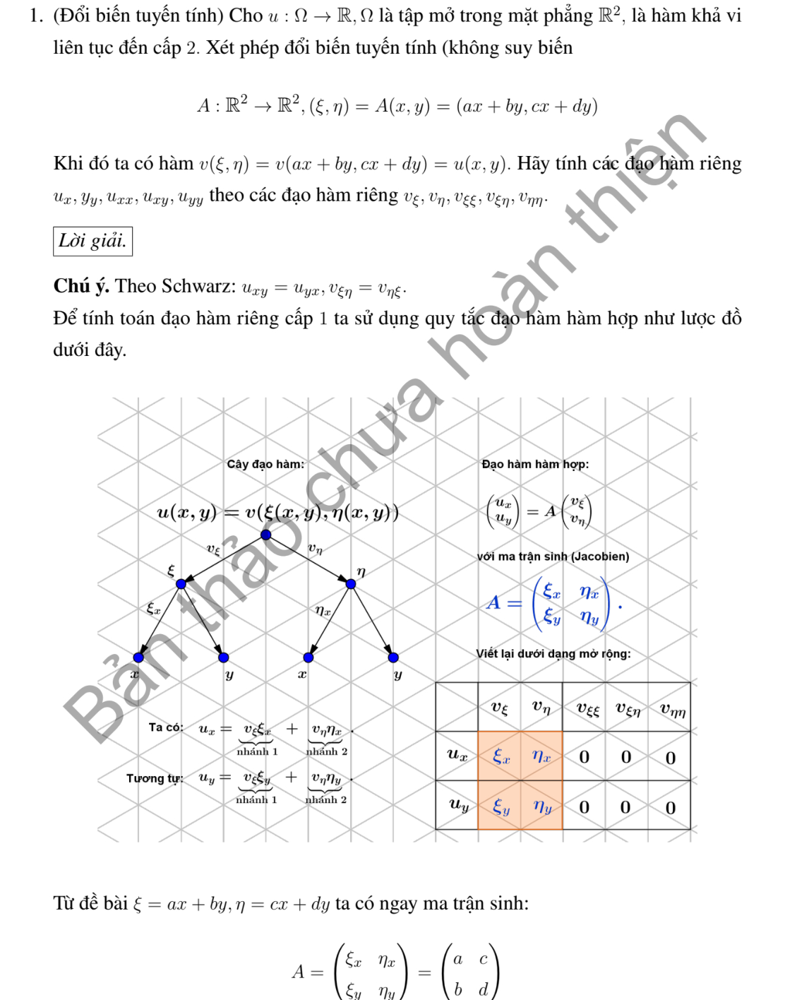
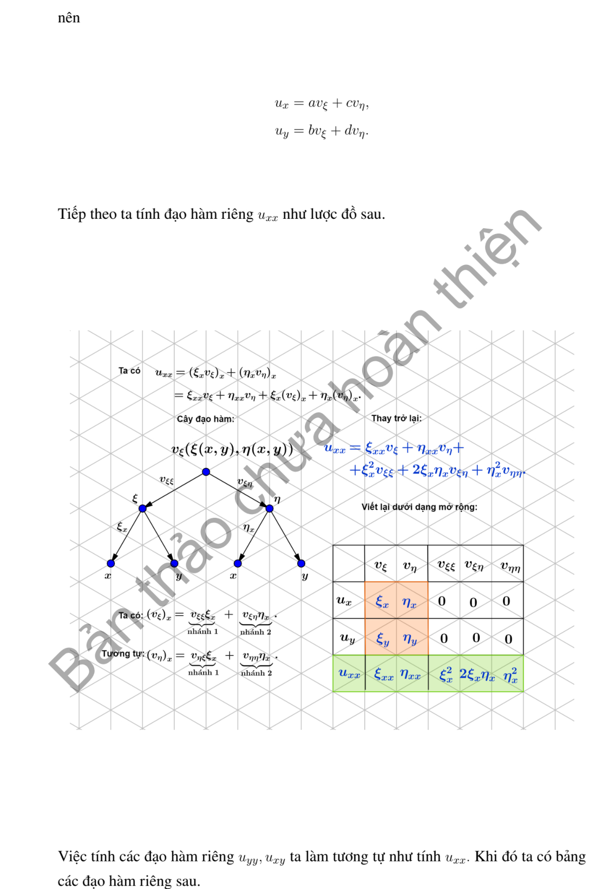
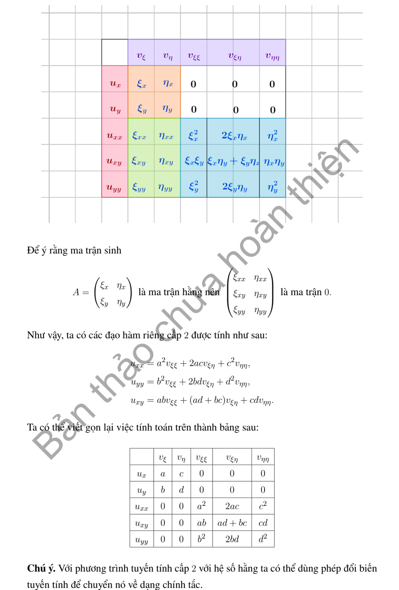

# Ví dụ 1 — Mục 2.2

**Mã:** `VD_2_2_01` · **Trang sách:** 56–59

[← Mục lục](../MUC_LUC.md) · [Bản PDF của bài](VD_2_2_01.pdf)

## Đề bài và phần trình bày có sẵn trong sách

## Kiến thức và trình tự giải

**Mục tiêu.** Tính đạo hàm khi đổi tọa độ rồi thay vào PDE. Đổi tọa độ của điểm và đổi biểu thức của hàm là hai việc cần làm cùng nhau: đặt $q=q(x)$ và $v(q)=u(x(q))$.

**Bước 1 — Kiểm tra phép đổi biến.** Tính $J=\det(\partial q/\partial x)$. Chỉ dùng các công thức trên miền $J\ne0$ và chọn một nhánh liên tục cho các góc. Tọa độ cực/trụ loại trục $r=0$; tọa độ cầu còn loại $\sin\theta=0$. Đây là suy biến của tọa độ, chưa phải kết luận rằng hàm $u$ không tồn tại ở đó.

**Bước 2 — Tính đạo hàm cấp một bằng quy tắc dây chuyền.** Nếu $b_{ik}=\partial q_k/\partial x_i$, thì

$$
u_{x_i}=\sum_k b_{ik}v_{q_k},\qquad D_i=\sum_k b_{ik}\partial_{q_k}.
$$

Với $q=Ax$, $b_{ik}=a_{ki}$ là hằng số. Với tọa độ cong, lấy nghịch đảo ma trận $\partial x/\partial q$ để tìm $b_{ik}$.

**Bước 3 — Lấy đạo hàm cấp hai cả hàm lẫn hệ số.** Áp dụng đạo hàm tích cho từng hạng:

$$
u_{x_ix_j}=\sum_{k,l}b_{ik}b_{jl}v_{q_kq_l}
+\sum_{k,l}b_{ik}(\partial_{q_k}b_{jl})v_{q_l}.
$$

Hạng thứ hai chỉ mất đi khi phép đổi biến tuyến tính. Ví dụ $\partial_x=\cos\theta\,\partial_r-(\sin\theta/r)\partial_\theta$ thì lần đạo hàm tiếp theo phải tác động lên cả $\cos\theta$ và $\sin\theta/r$.

**Bước 4 — Thu gọn toán tử.** Gom hệ số của từng $v_{q_kq_l}$ và $v_{q_k}$ trước khi cộng. Với Laplace, lấy tổng các đạo hàm $u_{x_ix_i}$. Trong hệ trực giao có hệ số độ dài $h_1,h_2,h_3$, có thể đối chiếu bằng

$$
\Delta u=\frac1{h_1h_2h_3}\sum_{k=1}^3
\partial_{q_k}\left(\frac{h_1h_2h_3}{h_k^2}v_{q_k}\right).
$$

**Bước 5 — Kiểm tra bằng hàm đơn giản.** Thử $u=1$, $u=x_i$ và $u=x_1^2+x_2^2+x_3^2$. Công thức Laplace phải lần lượt cho $0$, $0$, $6$. Với Hessian biểu diễn trong cơ sở trực chuẩn, đổi lại cơ sở Descartes bằng $H_x=E H_q E^T$, không nhầm Hessian với ma trận chỉ gồm các đạo hàm $v_{q_kq_l}$.

## Lời giải áp dụng cho bài

**Bước 1. Đặt hàm mới và kiểm tra khả nghịch.** Với

$$
\xi=ax+by,\quad\eta=cx+dy,\quad J=ad-bc\ne0,
$$

ta có $x=(d\xi-b\eta)/J$, $y=(-c\xi+a\eta)/J$. Đặt $v(\xi,\eta)=u(x,y)$, tức $u(x,y)=v(ax+by,cx+dy)$.

**Bước 2. Đạo hàm cấp một.** Quy tắc dây chuyền cho

$$
u_x=a v_\xi+c v_\eta,\qquad u_y=b v_\xi+d v_\eta.
$$

Tương đương $\partial_x=a\partial_\xi+c\partial_\eta$, $\partial_y=b\partial_\xi+d\partial_\eta$ khi tác động lên hàm đã đổi biến.

**Bước 3. Đạo hàm cấp hai.** Các hệ số $a,b,c,d$ là hằng số, nên

$$
\begin{aligned}
u_{xx}&=a(av_{\xi\xi}+cv_{\xi\eta})+c(av_{\eta\xi}+cv_{\eta\eta})
=a^2v_{\xi\xi}+2acv_{\xi\eta}+c^2v_{\eta\eta},\\
u_{xy}&=a(bv_{\xi\xi}+dv_{\xi\eta})+c(bv_{\eta\xi}+dv_{\eta\eta})
=abv_{\xi\xi}+(ad+bc)v_{\xi\eta}+cdv_{\eta\eta},\\
u_{yy}&=b^2v_{\xi\xi}+2bdv_{\xi\eta}+d^2v_{\eta\eta}.
\end{aligned}
$$

Đã dùng $v_{\xi\eta}=v_{\eta\xi}$ vì $v\in C^2$. Nếu cần đổi một PDE, nhân ba dòng này với hệ số tương ứng rồi gom theo từng đạo hàm mới. Ma trận phần chính $M$ được biến thành $TMT^T$, với $T=\left(\begin{smallmatrix}a&b\\c&d\end{smallmatrix}\right)$.

**Kiểm tra.** Chọn $v=\xi\eta$, thì $u=(ax+by)(cx+dy)$. Lấy đạo hàm trực tiếp cho $u_{xx}=2ac$, $u_{xy}=ad+bc$, $u_{yy}=2bd$, đúng với ba công thức trên.

