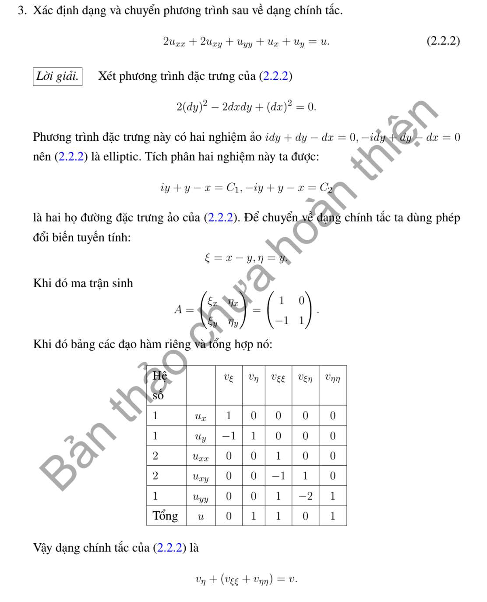

# Ví dụ 3 — Mục 2.2

**Mã:** `VD_2_2_03` · **Trang sách:** 60–60

[← Mục lục](../MUC_LUC.md) · [Bản PDF của bài](VD_2_2_03.pdf)

## Đề bài và phần trình bày có sẵn trong sách

## Kiến thức và trình tự giải

**Mục tiêu.** Phân loại và đưa phương trình tuyến tính cấp hai về dạng chính tắc, có giữ đầy đủ các hạng cấp thấp.

**Bước 1 — Chuẩn hóa hệ số.** Viết

$$
A u_{xx}+2B u_{xy}+C u_{yy}+D u_x+E u_y+K u=f.
$$

Hệ số $B$ bằng một nửa hệ số in trước $u_{xy}$. Tính $\delta=B^2-AC$: dương là hyperbolic, âm là elliptic, bằng $0$ là parabolic nếu phần cấp hai còn khác $0$. Phải xét theo từng miền khi hệ số thay đổi hoặc suy biến.

**Bước 2 — Chọn biến mới.** Với hyperbolic, giải $A(dy)^2-2Bdxdy+C(dx)^2=0$ để tìm hai bất biến $\xi,\eta$ của hai họ đặc trưng. Với parabolic, chỉ có một họ: lấy bất biến $s$ và một biến $z$ độc lập. Với elliptic, không có hai họ đặc trưng thực; hoàn thành bình phương của phần chính để loại hạng hỗn hợp rồi cân bằng hai hệ số dương. Mọi trường hợp đều kiểm tra Jacobian khác $0$.

**Bước 3 — Viết công thức thay đạo hàm.** Nếu $u(x,y)=v(\xi,\eta)$ thì

$$
\begin{aligned}
u_x&=\xi_xv_\xi+\eta_xv_\eta,\\
u_{xx}&=\xi_x^2v_{\xi\xi}+2\xi_x\eta_xv_{\xi\eta}
+\eta_x^2v_{\eta\eta}+\xi_{xx}v_\xi+\eta_{xx}v_\eta.
\end{aligned}
$$

Làm tương tự cho $u_{xy},u_{yy}$. Có thể dùng toán tử $\partial_x,\partial_y$ để rút ngắn, nhưng phải nêu các đạo hàm của hệ số nếu đổi biến phi tuyến.

**Bước 4 — Gom hệ số và chia hợp lệ.** Hệ số mới của $v_{\xi\xi}$ là $A\xi_x^2+2B\xi_x\xi_y+C\xi_y^2$; hệ số của $v_{\xi\eta}$ là $2[A\xi_x\eta_x+B(\xi_x\eta_y+\xi_y\eta_x)+C\xi_y\eta_y]$. Hệ số mới của $v_\xi$ là $A\xi_{xx}+2B\xi_{xy}+C\xi_{yy}+D\xi_x+E\xi_y$. Chỉ chia cho hệ số khác $0$ trên miền đang xét.

**Bước 5 — Với ba biến.** Lập ma trận đối xứng $M$ của phần cấp hai; hệ số hỗn hợp được chia đôi. Dùng hoàn thành bình phương để tìm số hướng dương, âm và bằng $0$. Nếu $\xi=T x$, ma trận mới là $TMT^T$. Cho rõ ma trận $T$ và kiểm tra nó khả nghịch; chỉ ghi dấu của dạng toàn phương chưa đủ để thực hiện phép đổi biến.

**Chi tiết gom hệ số sau đổi biến.** Với $Lu=Au_{xx}+2Bu_{xy}+Cu_{yy}+Du_x+Eu_y+Ku$, tính riêng

$$
\begin{aligned}
a&=A\xi_x^2+2B\xi_x\xi_y+C\xi_y^2,\\
2b&=2[A\xi_x\eta_x+B(\xi_x\eta_y+\xi_y\eta_x)+C\xi_y\eta_y],\\
c&=A\eta_x^2+2B\eta_x\eta_y+C\eta_y^2,\\
d&=A\xi_{xx}+2B\xi_{xy}+C\xi_{yy}+D\xi_x+E\xi_y,\\
e&=A\eta_{xx}+2B\eta_{xy}+C\eta_{yy}+D\eta_x+E\eta_y.
\end{aligned}
$$

Khi đó $Lu=av_{\xi\xi}+2bv_{\xi\eta}+cv_{\eta\eta}+dv_\xi+ev_\eta+Kv$. Trong lời giải từng ý, thế các số hoặc hàm hệ số vào từng dòng trước khi rút gọn. Với ba biến, tính $TM$ trước, rồi lấy tích vô hướng mỗi hàng của $TM$ với mỗi hàng của $T$ để có $TMT^T$.

## Lời giải áp dụng cho bài

**Bước 1. Phân loại.** Viết $2u_{xx}+2u_{xy}+u_{yy}+u_x+u_y-u=0$. Với $A=2$, $B=1$, $C=1$, $\delta=-1<0$, phương trình elliptic. Không có hai họ đặc trưng thực.

**Bước 2. Hoàn thành bình phương.** Phần chính có thể viết $(\partial_x+\partial_y)^2+\partial_x^2$. Chọn $\xi=x-y$, $\eta=y$, $J=1$. Khi đó $x=\xi+\eta$, $y=\eta$ và

$$
\partial_x=\partial_\xi,\qquad\partial_y=-\partial_\xi+\partial_\eta.
$$

**Bước 3. Thế cụ thể.**

$$
u_{xx}=v_{\xi\xi},\quad u_{xy}=-v_{\xi\xi}+v_{\xi\eta},\quad
u_{yy}=v_{\xi\xi}-2v_{\xi\eta}+v_{\eta\eta}.
$$

Do đó $2u_{xx}+2u_{xy}+u_{yy}=v_{\xi\xi}+v_{\eta\eta}$ và $u_x+u_y=v_\eta$.

**Kết quả.**

$$
\boxed{v_{\xi\xi}+v_{\eta\eta}+v_\eta-v=0.}
$$

Hai hệ số cấp hai đã bằng nhau và không còn đạo hàm hỗn hợp. Nếu muốn bỏ hạng $v_\eta$, đặt $v=e^{-\eta/2}w$; đạo hàm tích cho $w_{\xi\xi}+w_{\eta\eta}-\tfrac54w=0$. Đây là phép biến đổi phụ, không cần để hoàn thành yêu cầu đưa về chính tắc.

**Chi tiết gom hệ số và đổi ẩn phụ.** Ba hệ số cấp hai là $2-2+1=1$ của $v_{\xi\xi}$, $2-2=0$ của $v_{\xi\eta}$, và $1$ của $v_{\eta\eta}$. Với $v=e^{-\eta/2}w$,

$$
v_{\xi\xi}=e^{-\eta/2}w_{\xi\xi},\quad v_\eta=e^{-\eta/2}(w_\eta-w/2),\quad
v_{\eta\eta}=e^{-\eta/2}(w_{\eta\eta}-w_\eta+w/4).
$$

Thế rồi chia $e^{-\eta/2}$: hai hạng $w_\eta$ triệt tiêu, hệ số $w$ là $1/4-1/2-1=-5/4$.

