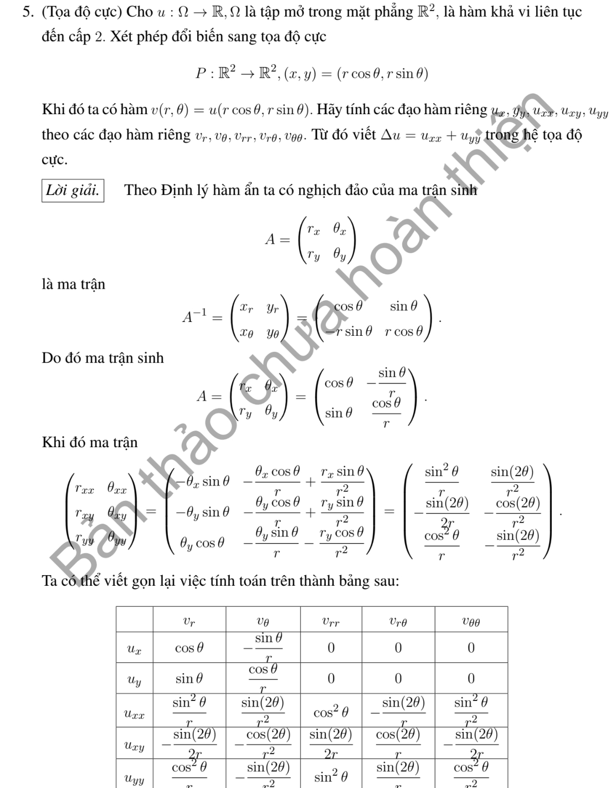
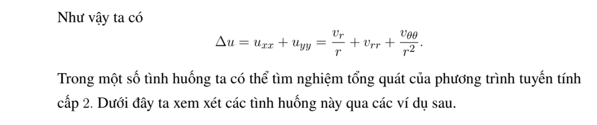

# Ví dụ 5 — Mục 2.2

**Mã:** `VD_2_2_05` · **Trang sách:** 62–63

[← Mục lục](../MUC_LUC.md) · [Bản PDF của bài](VD_2_2_05.pdf)

## Đề bài và phần trình bày có sẵn trong sách

## Kiến thức và trình tự giải

**Mục tiêu.** Tính đạo hàm khi đổi tọa độ rồi thay vào PDE. Đổi tọa độ của điểm và đổi biểu thức của hàm là hai việc cần làm cùng nhau: đặt $q=q(x)$ và $v(q)=u(x(q))$.

**Bước 1 — Kiểm tra phép đổi biến.** Tính $J=\det(\partial q/\partial x)$. Chỉ dùng các công thức trên miền $J\ne0$ và chọn một nhánh liên tục cho các góc. Tọa độ cực/trụ loại trục $r=0$; tọa độ cầu còn loại $\sin\theta=0$. Đây là suy biến của tọa độ, chưa phải kết luận rằng hàm $u$ không tồn tại ở đó.

**Bước 2 — Tính đạo hàm cấp một bằng quy tắc dây chuyền.** Nếu $b_{ik}=\partial q_k/\partial x_i$, thì

$$
u_{x_i}=\sum_k b_{ik}v_{q_k},\qquad D_i=\sum_k b_{ik}\partial_{q_k}.
$$

Với $q=Ax$, $b_{ik}=a_{ki}$ là hằng số. Với tọa độ cong, lấy nghịch đảo ma trận $\partial x/\partial q$ để tìm $b_{ik}$.

**Bước 3 — Lấy đạo hàm cấp hai cả hàm lẫn hệ số.** Áp dụng đạo hàm tích cho từng hạng:

$$
u_{x_ix_j}=\sum_{k,l}b_{ik}b_{jl}v_{q_kq_l}
+\sum_{k,l}b_{ik}(\partial_{q_k}b_{jl})v_{q_l}.
$$

Hạng thứ hai chỉ mất đi khi phép đổi biến tuyến tính. Ví dụ $\partial_x=\cos\theta\,\partial_r-(\sin\theta/r)\partial_\theta$ thì lần đạo hàm tiếp theo phải tác động lên cả $\cos\theta$ và $\sin\theta/r$.

**Bước 4 — Thu gọn toán tử.** Gom hệ số của từng $v_{q_kq_l}$ và $v_{q_k}$ trước khi cộng. Với Laplace, lấy tổng các đạo hàm $u_{x_ix_i}$. Trong hệ trực giao có hệ số độ dài $h_1,h_2,h_3$, có thể đối chiếu bằng

$$
\Delta u=\frac1{h_1h_2h_3}\sum_{k=1}^3
\partial_{q_k}\left(\frac{h_1h_2h_3}{h_k^2}v_{q_k}\right).
$$

**Bước 5 — Kiểm tra bằng hàm đơn giản.** Thử $u=1$, $u=x_i$ và $u=x_1^2+x_2^2+x_3^2$. Công thức Laplace phải lần lượt cho $0$, $0$, $6$. Với Hessian biểu diễn trong cơ sở trực chuẩn, đổi lại cơ sở Descartes bằng $H_x=E H_q E^T$, không nhầm Hessian với ma trận chỉ gồm các đạo hàm $v_{q_kq_l}$.

## Lời giải áp dụng cho bài

**Bước 1. Nghịch đảo vi phân tọa độ cực.** Viết $c=\cos\theta$, $s=\sin\theta$, $x=rc$, $y=rs$, $r>0$. Từ $dx=c\,dr-rs\,d\theta$, $dy=s\,dr+rc\,d\theta$ suy ra

$$
dr=c\,dx+s\,dy,\qquad d\theta=-\frac{s}{r}dx+\frac{c}{r}dy.
$$

Vì vậy $D_x=c\partial_r-s\partial_\theta/r$, $D_y=s\partial_r+c\partial_\theta/r$.

**Bước 2. Đạo hàm cấp một.**

$$
u_x=cv_r-\frac{s}{r}v_\theta,\qquad u_y=sv_r+\frac{c}{r}v_\theta.
$$

**Bước 3. Tính cả đạo hàm của hệ số.** Ta có $D_xc=s^2/r$, $D_x(-s/r)=2sc/r^2$, $D_yc=-sc/r$, $D_y(-s/r)=-(c^2-s^2)/r^2$. Ví dụ

$$
u_{xx}=(D_xc)v_r+cD_xv_r+D_x(-s/r)v_\theta-(s/r)D_xv_\theta.
$$

Khai triển cho cả ba đạo hàm:

$$
\begin{aligned}
u_{xx}&=c^2v_{rr}-\frac{2sc}{r}v_{r\theta}+\frac{s^2}{r^2}v_{\theta\theta}
+\frac{s^2}{r}v_r+\frac{2sc}{r^2}v_\theta,\\
u_{xy}&=scv_{rr}+\frac{c^2-s^2}{r}v_{r\theta}-\frac{sc}{r^2}v_{\theta\theta}
-\frac{sc}{r}v_r-\frac{c^2-s^2}{r^2}v_\theta,\\
u_{yy}&=s^2v_{rr}+\frac{2sc}{r}v_{r\theta}+\frac{c^2}{r^2}v_{\theta\theta}
+\frac{c^2}{r}v_r-\frac{2sc}{r^2}v_\theta.
\end{aligned}
$$

**Bước 4. Cộng để được Laplace.** Dùng $c^2+s^2=1$, các hạng $v_{r\theta}$ và $v_\theta$ triệt tiêu:

$$
\boxed{\Delta u=v_{rr}+\frac1r v_r+\frac1{r^2}v_{\theta\theta}.}
$$

Kiểm tra với $u=x$, tức $v=r\cos\theta$: kết quả bằng $0$. Với $u=x^2+y^2$, $v=r^2$, kết quả bằng $4$. Tại $r=0$, phải xét hàm gốc hoặc giới hạn trơn, không thế trực tiếp vào hệ số $1/r$.

**Chi tiết đạo hàm tích cho hai dòng còn lại.** Ngoài các hệ số đã tính, $D_ys=c^2/r$, $D_y(c/r)=-2sc/r^2$. Vì $D_yv_r=sv_{rr}+cv_{r\theta}/r$, $D_yv_\theta=sv_{r\theta}+cv_{\theta\theta}/r$,

$$
\begin{aligned}
u_{xy}&=-scv_r/r+c(sv_{rr}+cv_{r\theta}/r)
-(c^2-s^2)v_\theta/r^2-(s/r)(sv_{r\theta}+cv_{\theta\theta}/r),\\
u_{yy}&=c^2v_r/r+s(sv_{rr}+cv_{r\theta}/r)
-2scv_\theta/r^2+(c/r)(sv_{r\theta}+cv_{\theta\theta}/r).
\end{aligned}
$$

Gom các hạng cùng đạo hàm cho đúng hai dòng ở bước 3.

