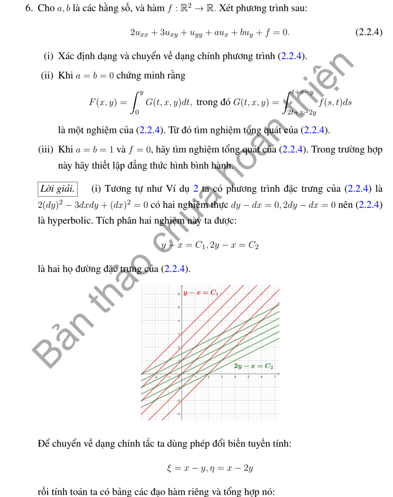
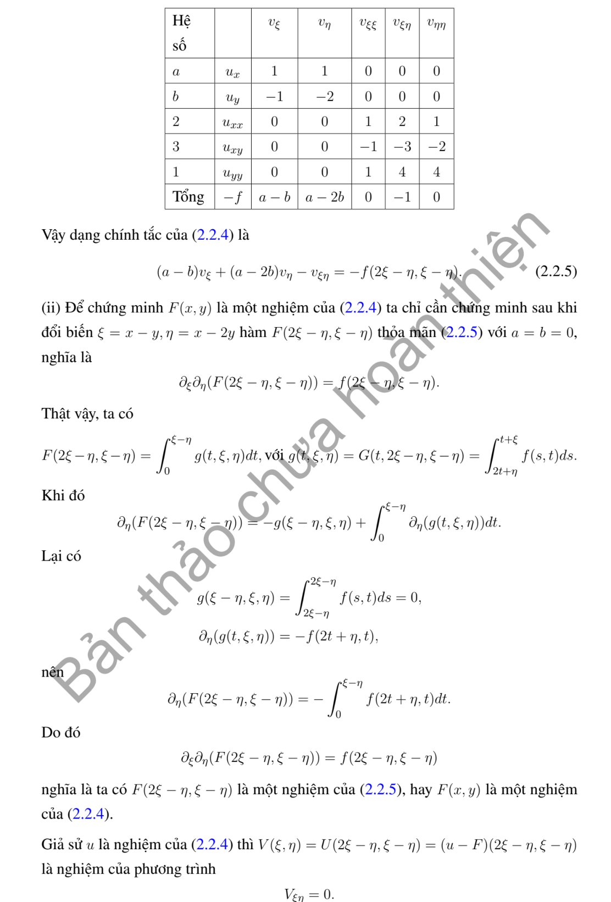
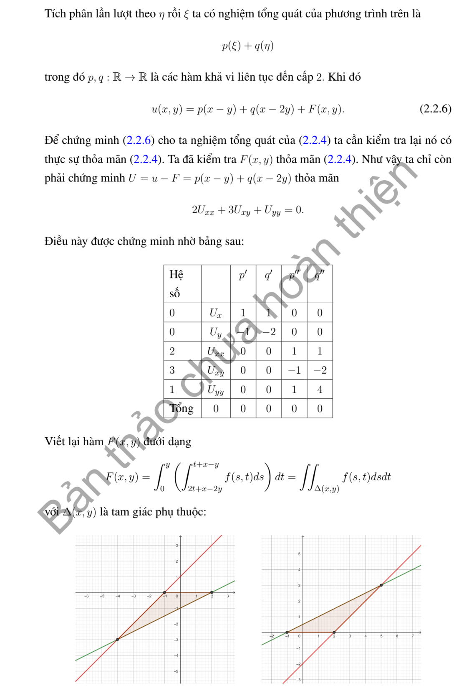
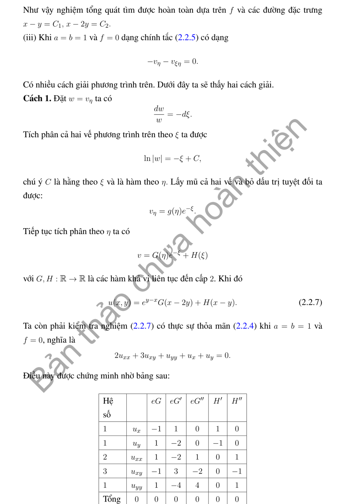
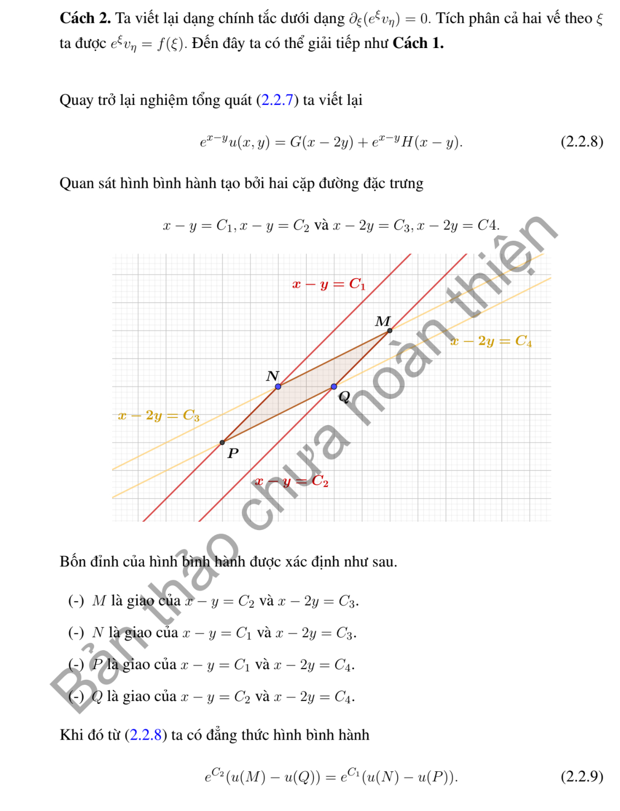

# Ví dụ 6 — Mục 2.2

**Mã:** `VD_2_2_06` · **Trang sách:** 63–67

[← Mục lục](../MUC_LUC.md) · [Bản PDF của bài](VD_2_2_06.pdf)

## Đề bài và phần trình bày có sẵn trong sách

## Kiến thức và trình tự giải

**Mục tiêu.** Giải phương trình hyperbolic sau khi đã tìm hai tọa độ đặc trưng độc lập.

**Bước 1 — Phân loại, tìm đặc trưng và thay đạo hàm.** Làm đủ các bước của phép đưa về chính tắc. Viết cả phép đổi ngược để biểu diễn vế phải $\widetilde f(\xi,\eta)=f(x(\xi,\eta),y(\xi,\eta))$.

**Bước 2 — Tích phân phương trình chính tắc.** Với $v_{\xi\eta}=g$, giữ biến kia cố định khi tích phân:

$$
v=F(\xi)+G(\eta)+\int_{\xi_0}^{\xi}\int_{\eta_0}^{\eta}g(a,b)\,db\,da.
$$

Nếu tìm được một nghiệm riêng $P(x,y)$ dễ hơn, viết $u=P+F(\xi)+G(\eta)$. Với $v_{\xi\eta}+\alpha v_\eta=0$, đặt $w=v_\eta$, giải $w_\xi+\alpha w=0$ rồi tích phân theo $\eta$; thu được $v=F(\xi)+e^{-\alpha\xi}G(\eta)$.

**Bước 3 — Đổi cả dữ liệu.** Thế tọa độ đường dữ liệu vào $\xi,\eta$, dùng quy tắc dây chuyền cho đạo hàm được cho. Trên đường không đặc trưng, hai dữ liệu thường xác định hai hàm $F,G$. Trên đường đặc trưng, có biến không thay đổi, nên dữ liệu chỉ xác định giá trị hoặc đạo hàm của một hàm tại một điểm; phải tìm điều kiện tương thích và nêu phần tùy ý còn lại.

**Bước 4 — Lập đẳng thức hình bình hành.** Với $v=F(\xi)+G(\eta)$, bốn đỉnh theo hai họ đặc trưng thỏa $v_{11}+v_{22}=v_{12}+v_{21}$. Nếu có số hạng mũ, trước hết nhân trọng số để được tổng hai hàm một biến. Với vế phải $g$, hiệu bốn đỉnh bằng tích phân kép của $g$ trên hình chữ nhật trong tọa độ mới.

**Bước 5 — Xác định miền được dữ liệu quyết định.** Hai đặc trưng đi qua điểm đang xét phải gặp đoạn dữ liệu phù hợp. Với phương trình sóng $v_{tt}=v_{zz}$ trên $z>0$, dữ liệu lúc $t=0$ xác định duy nhất miền $z>t$; ở $0<z<t$, cần thêm dữ liệu biên $z=0$. Với đặc trưng cong, dùng miền trong các tọa độ mới rồi đổi lại.

**Bước 6 — Kiểm tra.** Thế nghiệm vào cả PDE và từng điều kiện. Nếu đề yêu cầu hai nghiệm, chỉ rõ hai lựa chọn khác nhau cho hàm tùy ý và chứng minh phần chênh lệch thỏa phương trình thuần nhất, đồng thời triệt tiêu trên đường dữ liệu.

## Lời giải áp dụng cho bài

**(i) Phân loại và đổi biến.** $A=2$, $B=3/2$, $C=1$ cho $\delta=1/4>0$. Hai họ đặc trưng là $x-y=\mathrm{const}$, $x-2y=\mathrm{const}$. Đặt $\xi=x-y$, $\eta=x-2y$, $x=2\xi-\eta$, $y=\xi-\eta$. Như Ví dụ 2, phần chính bằng $-v_{\xi\eta}$; $au_x+bu_y=(a-b)v_\xi+(a-2b)v_\eta$. Dạng chính tắc là

$$
-v_{\xi\eta}+(a-b)v_\xi+(a-2b)v_\eta+\widetilde f=0.
$$

**(ii) Khi $a=b=0$: kiểm tra dấu của công thức trong đề.** Gọi $L=2\partial_x^2+3\partial_x\partial_y+\partial_y^2=(2\partial_x+\partial_y)(\partial_x+\partial_y)$. Với

$$
F(x,y)=\int_0^y\int_{2t+x-2y}^{t+x-y}f(s,t)\,ds\,dt,
$$

quy tắc Leibniz cho

$$
(\partial_x+\partial_y)F=\int_0^y f(2t+x-2y,t)dt.
$$

Ở đây hạng tại cận $t=y$ của tích phân ban đầu bằng $0$, vì hai cận trong đều bằng $x$. Tác động tiếp $2\partial_x+\partial_y$ lên dòng trên: đối số $2t+x-2y$ có đạo hàm theo hướng này bằng $0$, còn cận $y$ cho $f(x,y)$. Do đó $LF=f$.

**Lưu ý dấu in trong sách.** Phương trình được in là $Lu+f=0$, nên nghiệm riêng phải là $-F$, không phải $F$. Chẳng hạn $f=1$ cho $F=y^2/2$ và $LF+f=2$. Nếu viết PDE thành $Lu=f$ thì $F$ đúng. Giữ phương trình in ở đầu bài, nghiệm tổng quát là

$$
\boxed{u=-F(x,y)+P(x-y)+Q(x-2y).}
$$

Tương đương, từ $v_{\xi\eta}=\widetilde f$ có thể dùng tích phân kép trong tọa độ mới. Giả sử $f$ đủ trơn để các đạo hàm và tích phân vừa dùng có nghĩa.

**(iii) Khi $a=b=1$, $f=0$.** Phương trình thành $v_{\xi\eta}+v_\eta=0$. Đặt $w=v_\eta$, giải $w_\xi+w=0$ được $w=e^{-\xi}H(\eta)$. Tích phân theo $\eta$:

$$
\boxed{u=P(x-y)+e^{-(x-y)}Q(x-2y).}
$$

Nhân $v$ với $e^\xi$ để có $e^\xi v=e^\xi P(\xi)+Q(\eta)$. Vì là tổng hai hàm một biến, bốn đỉnh hình bình hành đặc trưng thỏa

$$
e^{\xi_1}v_{11}+e^{\xi_2}v_{22}=e^{\xi_1}v_{12}+e^{\xi_2}v_{21},
$$

với $v_{ij}=v(\xi_i,\eta_j)$. Thế lại $v_{\xi\eta}=-v_\eta$ kiểm tra ngay PDE.

**Chi tiết thế đạo hàm ở (i).** $u_{xx}=v_{\xi\xi}+2v_{\xi\eta}+v_{\eta\eta}$, $u_{xy}=-v_{\xi\xi}-3v_{\xi\eta}-2v_{\eta\eta}$, $u_{yy}=v_{\xi\xi}+4v_{\xi\eta}+4v_{\eta\eta}$. Phần chính có hệ số $2-3+1=0$, $4-9+4=-1$, $2-6+4=0$, lần lượt theo $v_{\xi\xi},v_{\xi\eta},v_{\eta\eta}$.

**Chi tiết Leibniz ở (ii).** Đặt $\ell=2t+x-2y$, $h=t+x-y$. Vì tích phân trong bằng $0$ tại $t=y$,

$$
F_x=\int_0^y[f(h,t)-f(\ell,t)]dt,\quad
F_y=\int_0^y[-f(h,t)+2f(\ell,t)]dt.
$$

Vậy $F_x+F_y=\int_0^yf(\ell,t)dt=:I$. Lấy $I_x=\int_0^yf_x(\ell,t)dt$ và $I_y=f(x,y)-2\int_0^yf_x(\ell,t)dt$, suy $2I_x+I_y=f(x,y)$. Đây là phép triệt tiêu tạo ra $LF=f$.

