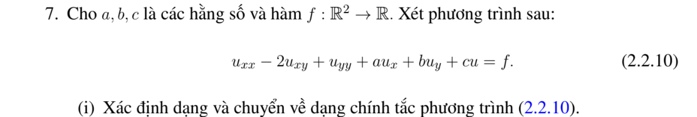
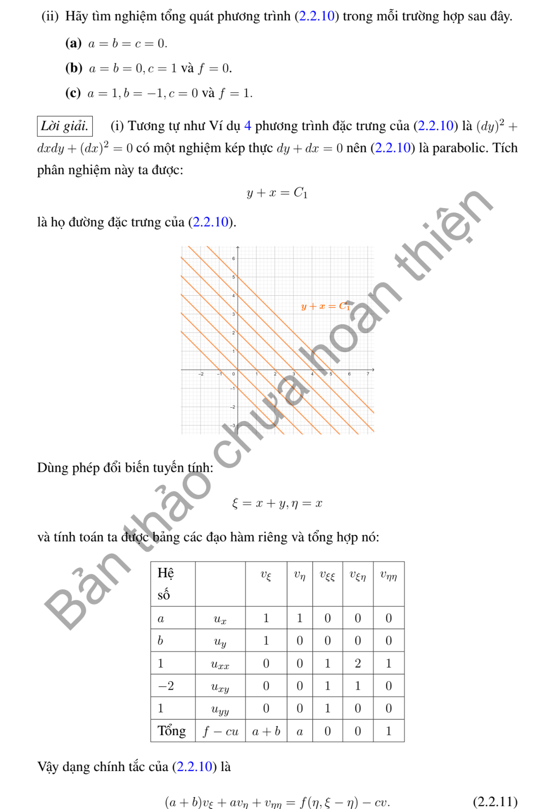
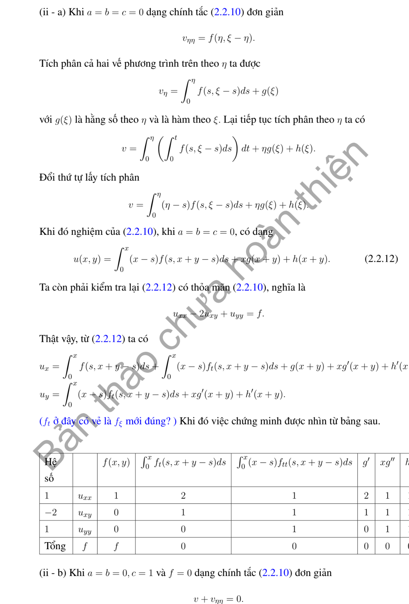
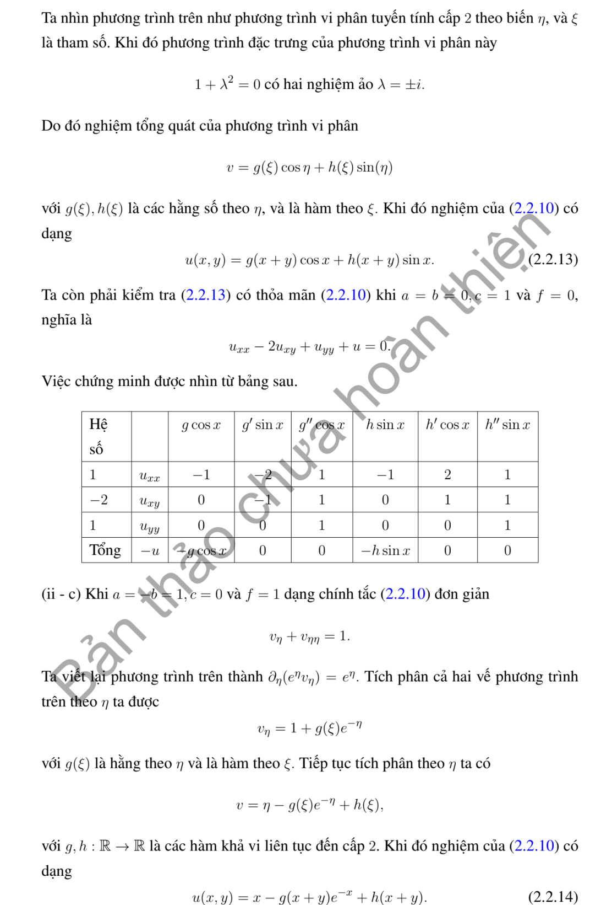
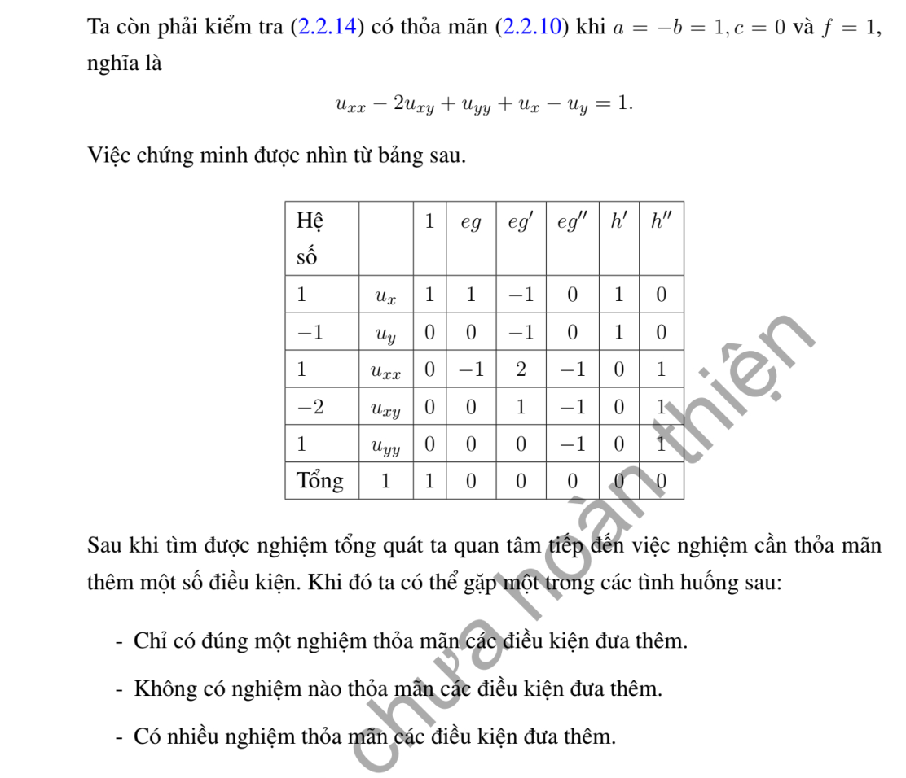

# Ví dụ 7 — Mục 2.2

**Mã:** `VD_2_2_07` · **Trang sách:** 67–71

[← Mục lục](../MUC_LUC.md) · [Bản PDF của bài](VD_2_2_07.pdf)

## Đề bài và phần trình bày có sẵn trong sách

## Kiến thức và trình tự giải

**Mục tiêu.** Tận dụng phần cấp hai có dạng bình phương một đạo hàm theo hướng để giảm PDE thành ODE có tham số.

**Bước 1 — Nhận ra hướng đạo hàm.** Nếu $D=a\partial_x+b\partial_y$ có hệ số hằng, $D^2u=a^2u_{xx}+2ab u_{xy}+b^2u_{yy}$. Với hệ số biến thiên phải dùng

$$
D^2u=a^2u_{xx}+2ab u_{xy}+b^2u_{yy}+(Da)u_x+(Db)u_y.
$$

So sánh cả hạng cấp một trước khi kết luận PDE bằng $D^2u+\lambda Du+\mu u=f$.

**Bước 2 — Tìm bất biến $s$ và biến tiến $z$.** Giải $Ds=0$, chọn $Dz=k\ne0$. Kiểm tra $J=\partial(s,z)/\partial(x,y)\ne0$. Khi $k$ hằng, $D=k\partial_z$; PDE trở thành ODE theo $z$, trong đó $s$ là tham số. Nếu còn $v_s$, phải giữ lại, chỉ các trường hợp nó triệt tiêu mới giải trực tiếp như ODE.

**Bước 3 — Giải ODE.** Với $v_{zz}=g(s,z)$, tích phân hai lần cho $v=zF(s)+G(s)+\int_{z_0}^z(z-t)g(s,t)dt$. Với $a v_{zz}+b v_z+c v=g$, giải đa thức $a\lambda^2+b\lambda+c=0$, giữ hai hàm tùy ý theo $s$. Nghiệm kép có thêm hệ số $z$; có thể tìm nghiệm riêng dạng mũ hoặc đa thức.

**Bước 4 — Dùng dữ liệu đúng biến.** Tính $u_x=s_xv_s+z_xv_z$ và $u_y=s_yv_s+z_yv_z$. Nếu dữ liệu ở $s=0$, chỉ biết $F(0),G(0)$ hoặc đạo hàm của chúng; không suy ra toàn bộ các hàm. So sánh hệ số của $e^z$, $z$, $z^2$ để tìm các hằng số tương thích.

**Bước 5 — Kiểm tra tính duy nhất và nghiệm cụ thể.** Khi đường dữ liệu gặp tất cả đặc trưng một cách độc lập, giải hệ cho $F,G$. Khi đường dữ liệu là một đặc trưng, mô tả các hàm còn tùy ý và đưa hai lựa chọn rõ ràng. Cuối cùng thế lại phương trình gốc, không chỉ ODE mới.

## Lời giải áp dụng cho bài

**(i) Phân loại và chính tắc.** $A=C=1$, $B=-1$, $\delta=0$: parabolic. Đặc trưng $x+y=\mathrm{const}$. Đặt $s=x+y$, $z=x$; $\partial_x=\partial_s+\partial_z$, $\partial_y=\partial_s$. Suy ra

$$
u_{xx}-2u_{xy}+u_{yy}=v_{zz},\quad au_x+bu_y=(a+b)v_s+av_z.
$$

Với $x=z$, $y=s-z$, phương trình mới là

$$
\boxed{v_{zz}+av_z+(a+b)v_s+cv=f(z,s-z).}
$$

Chỉ khi $a+b=0$ mới không còn đạo hàm theo tham số $s$.

**(ii.a) $a=b=c=0$.** Giữ $s$ cố định, tích phân $v_{zz}=f(z,s-z)$ hai lần. Với mốc $z=0$,

$$
v=zP(s)+Q(s)+\int_0^z(z-t)f(t,s-t)dt.
$$

Vì đạo hàm lần thứ nhất của tích phân là $\int_0^z f(t,s-t)dt$ và lần thứ hai là $f(z,s-z)$, công thức thỏa PDE. Đổi lại:

$$
u=xP(x+y)+Q(x+y)+\int_0^x(x-t)f(t,x+y-t)dt.
$$

**(ii.b) $a=b=0$, $c=1$, $f=0$.** ODE $v_{zz}+v=0$ có hai nghiệm độc lập $\cos z$, $\sin z$. Hằng số tích phân phụ thuộc $s$:

$$
\boxed{u=P(x+y)\cos x+Q(x+y)\sin x.}
$$

**(ii.c) $a=1$, $b=-1$, $c=0$, $f=1$.** ODE $v_{zz}+v_z=1$. Đặt $p=v_z$: $(e^zp)'=e^z$, nên $p=1+C(s)e^{-z}$. Tích phân lần nữa và đổi tên hàm tùy ý:

$$
\boxed{u=x+P(x+y)+e^{-x}Q(x+y).}
$$

Thật vậy, $v_z=1-e^{-z}Q$, $v_{zz}=e^{-z}Q$, tổng bằng $1$. Các hàm tùy ý lấy đủ trơn, chẳng hạn $C^2$.

**Chi tiết thế và hai lần tích phân.** Với $s=x+y,z=x$,

$$
u_{xx}=v_{ss}+2v_{sz}+v_{zz},\quad u_{xy}=v_{ss}+v_{sz},\quad u_{yy}=v_{ss}.
$$

Vậy $u_{xx}-2u_{xy}+u_{yy}=(1-2+1)v_{ss}+(2-2)v_{sz}+v_{zz}$. Ở (ii.a), lần đầu $v_z=P(s)+\int_0^zf(t,s-t)dt$; lần sau

$$
v=Q(s)+zP(s)+\int_0^z\int_0^r f(t,s-t)dt\,dr.
$$

Đổi thứ tự trên tam giác $0\le t\le r\le z$ được $\int_0^z(z-t)f(t,s-t)dt$ khi $z\ge0$. Với $z<0$, cùng công thức suy trực tiếp bằng hai đạo hàm và hai vết tại $z=0$, nên vẫn đúng với tích phân có hướng.

