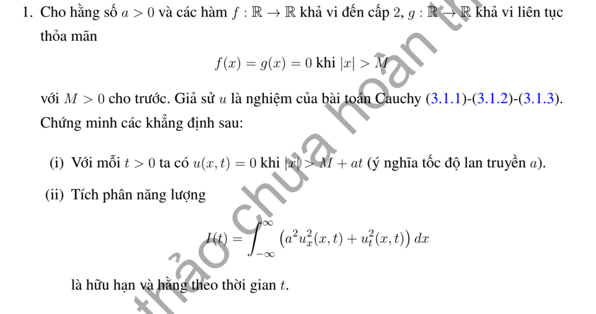

# Bài tập thực hành 1 — Mục 3.1.3

**Mã:** `BT_3_1_3_01` · **Trang sách:** 102–102

[← Mục lục](../MUC_LUC.md) · [Bản PDF của bài](BT_3_1_3_01.pdf)

## Đề bài

## Kiến thức và trình tự giải

**Bước 1 — Chọn năng lượng theo toán tử.** Với sóng dùng $E=\frac12\int(u_t^2+a^2u_x^2)dx$. Với Klein–Gordon có thêm $u$, thêm $\frac12\int u^2dx$. Với dầm $u_{tt}=-a^2u_{xxxx}$ dùng $E=\frac12\int(u_t^2+a^2u_{xx}^2)dx$, không thay $u_{xx}$ bằng $u_x$.

**Bước 2 — Đạo hàm và tích phân từng phần.** Với $u_{tt}-a^2u_{xx}+\gamma u_t+\kappa u=F$, năng lượng có hạng $\kappa u^2$ cho

$$
E'=a^2[u_tu_x]_0^L-\gamma\int u_t^2dx+\int Fu_tdx.
$$

Với dầm, tích phân hai lần cho $E'=a^2[u_{tx}u_{xx}-u_tu_{xxx}]_0^L$. Viết riêng từng hạng biên rồi dùng điều kiện biên và đạo hàm theo thời gian của điều kiện đó để cho chúng bằng không.

**Bước 3 — Suy hệ quả.** Không cản, không nguồn thì $E$ bảo toàn. Có cản $\gamma>0$ thì $E'\le0$; nếu $E$ không có hệ số $1/2$, $E'=-2\gamma\int u_t^2\ge-2\gamma E$, suy $e^{-2\gamma t}E(0)\le E(t)\le E(0)$. Với hiệu hai nghiệm cùng dữ liệu, $E(0)=0$ nên có duy nhất.

**Bước 4 — Tách biến nếu phải tìm nghiệm cụ thể.** Sóng có cản $\gamma=1$ cho $T''+T'+a^2\lambda T=0$. Đặt $T=e^{-t/2}Y$, thu $Y''+(a^2\lambda-1/4)Y=0$, $Y(0)=A$, $Y'(0)=B+A/2$. Phân biệt dao động, nghiệm kép và hàm hyperbolic. Dầm cho $X''''=k^4X$, $T''+a^2k^4T=0$; dùng đủ bốn điều kiện biên để tìm phương trình của $kL$.

**Bước 5 — Kiểm tra hệ số và khẳng định của đề.** Năng lượng đầu chứa cả $g^2$ và các đạo hàm của $f$. Thử $f=0$, $g\ne0$ để phát hiện công thức bỏ vận tốc. Với dầm, nghiệm $k=0$ phải giải trực tiếp bằng đa thức bậc ba; nghiệm $0$ của phương trình lượng giác–hyperbolic có thể chỉ là nghiệm giả do cơ sở suy biến.

**Chi tiết phép triệt tiêu tích phân.** Đạo hàm động năng cho $\int u_tu_{tt}$; dùng PDE thay $u_{tt}$. Với sóng, $\int u_tu_{xx}=[u_tu_x]-\int u_{tx}u_x$, và tích phân cuối triệt tiêu đạo hàm thế năng $\int u_xu_{xt}$. Với dầm,

$$
\int u_tu_{xxxx}=[u_tu_{xxx}-u_{tx}u_{xx}]+\int u_{txx}u_{xx}.
$$

Tích phân cuối triệt tiêu đạo hàm $\frac12\int u_{xx}^2$ sau khi nhân hệ số và giữ đúng dấu PDE. Viết hạng biên trước, sau đó mới dùng điều kiện của từng đầu.

## Lời giải áp dụng cho bài

**Bước 1. Miền hỗ trợ.** Nếu $|x|>M+at$, hai cận $x\pm at$ và toàn đoạn giữa chúng cùng nằm ngoài $[-M,M]$. D'Alembert cho $u=0$; các đạo hàm cũng bằng không ngoài miền ấy khi dữ liệu đủ trơn.

**Bước 2. Đạo hàm năng lượng.** Đặt $I(t)=\int_{\mathbb R}(a^2u_x^2+u_t^2)dx$. Trên mỗi khoảng thời gian hữu hạn có thể tích phân trên một đoạn cố định đủ lớn, vì sóng có hỗ trợ hữu hạn. Dùng PDE:

$$
I'=2a^2\int(u_xu_{xt}+u_tu_{xx})dx=2a^2[u_tu_x]_{-\infty}^{+\infty}=0.
$$

**Bước 3. Giá trị đầu.** Tại $t=0$, $u_x=f'$, $u_t=g$, nên

$$
I(t)=I(0)=\int_{\mathbb R}(a^2(f')^2+g^2)dx.
$$

Điều kiện hỗ trợ bảo đảm hạng biên bằng không, không phải chỉ vì ký hiệu cận là vô hạn. Với dữ liệu năng lượng, kết quả tiếp tục đúng bằng xấp xỉ dữ liệu trơn.

**Chi tiết tích phân từng phần trong đạo hàm năng lượng.** Đặt $E=\frac12\int_{-R}^R(u_t^2+a^2u_x^2+\kappa u^2)dx$. Với $u_{tt}-a^2u_{xx}+\gamma u_t+\kappa u=F$,

$$
\begin{aligned}
E'&=\int_{-R}^R(u_tu_{tt}+a^2u_xu_{xt}+\kappa uu_t)dx\\
&=\int_{-R}^Ru_t(a^2u_{xx}-\gamma u_t-\kappa u+F)dx
+a^2\int_{-R}^Ru_xu_{xt}dx+\kappa\int_{-R}^Ruu_tdx\\
&=a^2[u_tu_x]_{-R}^R-a^2\int_{-R}^Ru_{tx}u_xdx
+a^2\int_{-R}^Ru_xu_{xt}dx-\gamma\int_{-R}^Ru_t^2dx+\int_{-R}^RFu_tdx\\
&=a^2[u_tu_x]_{-R}^R-\gamma\int_{-R}^Ru_t^2dx+\int_{-R}^RFu_tdx.
\end{aligned}
$$

Hai hạng $\kappa uu_t$ triệt tiêu ngay khi thế PDE; hai tích phân $u_xu_{xt}$ triệt tiêu sau tích phân từng phần. Chọn $R$ lớn hơn miền hỗ trợ trên khoảng thời gian xét, nên $u_t=u_x=0$ ở $x=\pm R$. Với $I=2E$, nhân đẳng thức đạo hàm với $2$ để có $I'=0$.

## Đối chiếu kết quả

Khi sử dụng kết quả, kiểm tra đồng thời phương trình, dữ liệu ban đầu/biên và miền được nêu trong lời giải. Các điều kiện về tính trơn, nghiệm thực, tồn tại hoặc duy nhất là một phần của kết luận; không bỏ chúng khi ghi đáp án.
