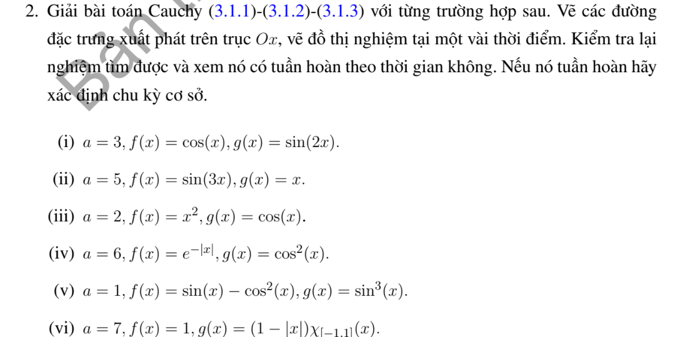
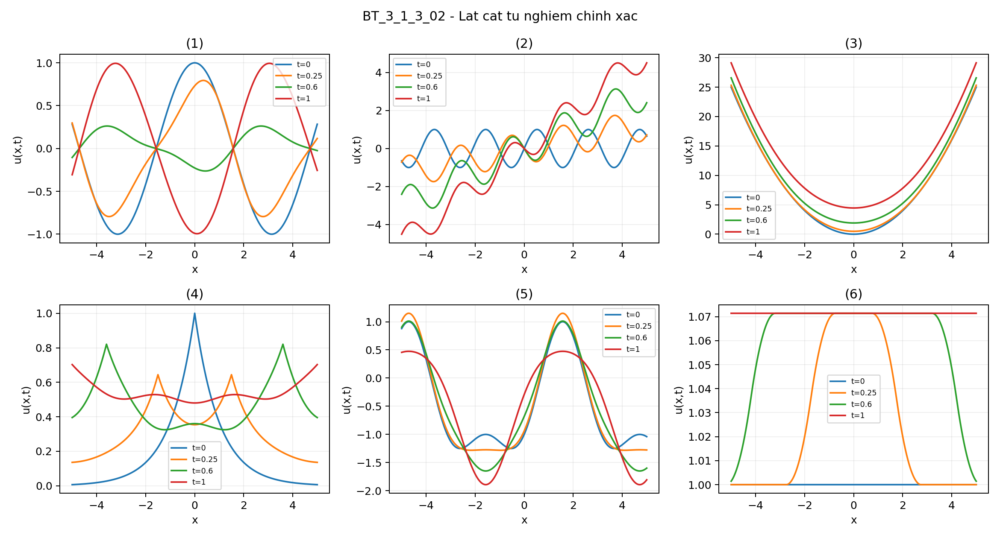
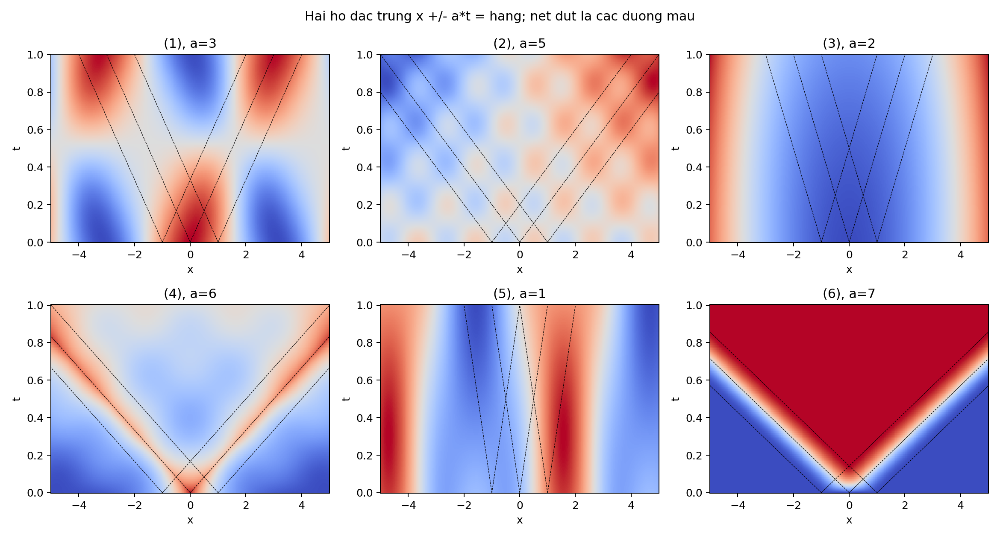

# Bài tập thực hành 2 — Mục 3.1.3

**Mã:** `BT_3_1_3_02` · **Trang sách:** 102–103

[← Mục lục](../MUC_LUC.md) · [Bản PDF của bài](BT_3_1_3_02.pdf)

## Đề bài

## Kiến thức và trình tự giải

**Bước 1 — Nhận dạng dữ liệu và tốc độ.** Viết $u_{tt}-a^2u_{xx}=F$, $u(x,0)=f(x)$, $u_t(x,0)=g(x)$; tốc độ là $a>0$, không phải $a^2$. Với dữ liệu trơn, cần $f\in C^2$, $g\in C^1$. Nếu dữ liệu có góc hoặc bước nhảy, công thức vẫn mô tả sóng từng miền nhưng phải xác định nơi mất tính trơn.

**Bước 2 — Tìm hai sóng chạy.** Đặt $\xi=x-at$, $\eta=x+at$. Quy tắc dây chuyền cho $u_{tt}-a^2u_{xx}=-4a^2u_{\xi\eta}$, nên khi $F=0$, $u=A(\xi)+B(\eta)$. Tại $t=0$, $A+B=f$, $a(B'-A')=g$. Chọn một nguyên hàm $H'=g$ rồi lấy $A=f/2-H/(2a)$, $B=f/2+H/(2a)$; hằng số của $H$ sẽ triệt tiêu.

$$
u_0(x,t)=\frac{f(x-at)+f(x+at)}2+\frac{H(x+at)-H(x-at)}{2a}.
$$

**Bước 3 — Tính tích phân theo dữ liệu thật.** Tìm nguyên hàm trên từng khoảng, nối liên tục nếu $g$ có bước nhảy; thay hai cận $x\pm at$. Dùng công thức cộng lượng giác trước khi kết luận chu kỳ. Với dữ liệu chỉ thị, tích phân bằng độ dài giao của $[x-at,x+at]$ với đoạn hỗ trợ, nhân hệ số của $g$.

**Bước 4 — Nếu có nguồn, thêm Duhamel.** Nghiệm riêng có dữ liệu đầu bằng không là

$$
u_F(x,t)=\frac1{2a}\int_0^t\int_{x-a(t-s)}^{x+a(t-s)}F(y,s)\,dy\,ds.
$$

Tính tích phân trong trước. Nếu $F$ là đa thức hoặc một mode lượng giác, có thể đoán $u_F$ rồi giải ODE theo $t$, nhưng vẫn phải buộc $u_F(x,0)=(u_F)_t(x,0)=0$. Nghiệm cuối là $u_0+u_F$.

**Bước 5 — Kiểm tra và đọc ý nghĩa.** Đạo hàm công thức: $u_x=(f'(\xi)+f'(\eta))/2+(g(\eta)-g(\xi))/(2a)$, $u_t=a(f'(\eta)-f'(\xi))/2+(g(\eta)+g(\xi))/2$. Tại $t=0$ thu lại $f,g$; đạo hàm tiếp cho PDE. Các điểm gãy $s=b$ phát sinh đường $x\pm at=b$. Chu kỳ phải đúng cho mọi $x,t$, không chỉ sau khi một mặt sóng đi qua một điểm cố định.

## Lời giải áp dụng cho bài

**Bước 1. Tính sóng bằng nguyên hàm.** Dùng $H'=g$ và half-sum của $f$. Công thức tổng quát trong phần kiến thức cho cách kiểm tra $u_t(x,0)=g(x)$; dưới đây ghi rõ nguyên hàm và kết quả từng câu.

**Ý (i).**  $a=3$, $H=-\cos2s/2$. Hiệu hai cos bằng $2\sin2x\sin6t$, nên

$$
u=\cos x\cos3t+\tfrac16\sin2x\sin6t,\qquad T=2\pi/3.
$$

**Ý (ii).**  $a=5$, $H=s^2/2$. Hiệu bình phương bằng $20xt$, cho $u=\sin3x\cos15t+xt$, không tuần hoàn.

**Ý (iii).**  $a=2$, $H=\sin s$. Half-sum của bình phương bằng $x^2+4t^2$, nên $u=x^2+4t^2+\cos x\sin2t/2$, không tuần hoàn.

**Ý (iv).**  $a=6$, $H=s/2+\sin2s/4$ vì $\cos^2s=(1+\cos2s)/2$:

$$
u=\tfrac12(e^{-|x-6t|}+e^{-|x+6t|})+t/2+\cos2x\sin12t/24.
$$

Hạng $t/2$ ngăn tuần hoàn; li độ có góc tại $0$ nên không $C^1$ trên $x=\pm6t$.

**Ý (v).**  $a=1$, $g=(3\sin s-\sin3s)/4$, $H=-3\cos s/4+\cos3s/12$. Suy

$$
u=\sin x\cos t-\tfrac12-\tfrac12\cos2x\cos2t+\tfrac34\sin x\sin t-\tfrac1{12}\sin3x\sin3t.
$$

Mode tần số $1$ khác không, nên chu kỳ cơ bản là $2\pi$.

**Ý (vi).**  $a=7$, $f=1$. Nguyên hàm của xung tam giác được nối liên tục:

$$
H(s)=\begin{cases}0&s\le-1,\\(s+1)^2/2&-1<s\le0,\\1-(1-s)^2/2&0<s<1,\\1&s\ge1.\end{cases}\quad
u=1+\frac{H(x+7t)-H(x-7t)}{14}.
$$

Tại mỗi $x$ cố định, sau khi cả hai cận ra ngoài hỗ trợ, $u=15/14$, khác giá trị đầu $1$; vì thế không tuần hoàn. Nghiệm $C^1$, các đạo hàm cấp hai gãy trên $x\pm7t=-1,0,1$.

**Bước 2. Dựng đồ thị.** Sóng phải $A=f/2-H/(2a)$ được dịch sang phải $at$, sóng trái $B=f/2+H/(2a)$ sang trái $at$. Các hình kèm theo gồm lát cắt thời gian; những vị trí gãy được suy từ các cận chạm điểm gãy của dữ liệu. Với các câu trơn, đạo hàm từng mode xác nhận PDE; với câu (iv), (vi), chỉ khẳng định cổ điển ngoài các đường gãy đã chỉ ra.

**Chi tiết phép thế nguyên hàm và lượng giác.** Ở (i),

$$
\frac{H(x+3t)-H(x-3t)}6
=\frac{\cos(2x-6t)-\cos(2x+6t)}{12}
=\frac{\sin2x\sin6t}{6}.
$$

Ở (ii), $[(x+5t)^2-(x-5t)^2]/20=xt$. Ở (iii), $[\sin(x+2t)-\sin(x-2t)]/4=\cos x\sin2t/2$. Ở (iv), phần tuyến tính của $H$ cho $(12t/2)/12=t/2$; phần $\sin2s/4$ cho $2\cos2x\sin12t/48=\cos2x\sin12t/24$.

Ở (v), $f(s)=\sin s-\cos^2s=\sin s-1/2-\cos2s/2$, nên half-sum là $\sin x\cos t-1/2-\cos2x\cos2t/2$. Từ $\sin^3s=(3\sin s-\sin3s)/4$, nguyên hàm đã ghi cho

$$
\frac{H(x+t)-H(x-t)}2=\frac34\sin x\sin t-\frac1{12}\sin3x\sin3t.
$$

Ở (vi), trên $-1<s<0$, $H=\int_{-1}^s(r+1)dr=(s+1)^2/2$; trên $0<s<1$, $H=H(0)+\int_0^s(1-r)dr=1/2+s-s^2/2=1-(1-s)^2/2$. Sau $1$ giữ $H(1)=1$, bảo đảm không có bước nhảy của nguyên hàm.

## Đồ thị minh họa

## Đối chiếu kết quả

Khi sử dụng kết quả, kiểm tra đồng thời phương trình, dữ liệu ban đầu/biên và miền được nêu trong lời giải. Các điều kiện về tính trơn, nghiệm thực, tồn tại hoặc duy nhất là một phần của kết luận; không bỏ chúng khi ghi đáp án.
