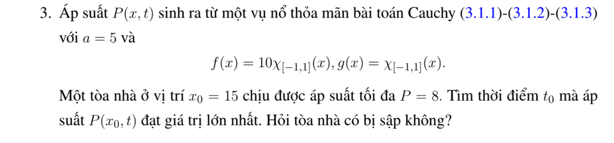
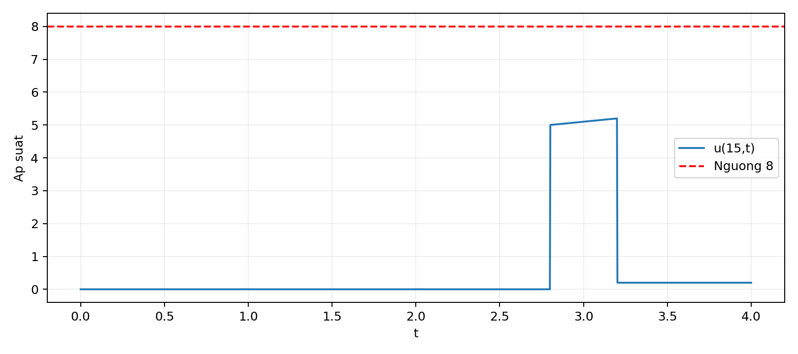

# Bài tập thực hành 3 — Mục 3.1.3

**Mã:** `BT_3_1_3_03` · **Trang sách:** 103–103

[← Mục lục](../MUC_LUC.md) · [Bản PDF của bài](BT_3_1_3_03.pdf)

## Đề bài

## Kiến thức và trình tự giải

**Bước 1 — Nhận dạng dữ liệu và tốc độ.** Viết $u_{tt}-a^2u_{xx}=F$, $u(x,0)=f(x)$, $u_t(x,0)=g(x)$; tốc độ là $a>0$, không phải $a^2$. Với dữ liệu trơn, cần $f\in C^2$, $g\in C^1$. Nếu dữ liệu có góc hoặc bước nhảy, công thức vẫn mô tả sóng từng miền nhưng phải xác định nơi mất tính trơn.

**Bước 2 — Tìm hai sóng chạy.** Đặt $\xi=x-at$, $\eta=x+at$. Quy tắc dây chuyền cho $u_{tt}-a^2u_{xx}=-4a^2u_{\xi\eta}$, nên khi $F=0$, $u=A(\xi)+B(\eta)$. Tại $t=0$, $A+B=f$, $a(B'-A')=g$. Chọn một nguyên hàm $H'=g$ rồi lấy $A=f/2-H/(2a)$, $B=f/2+H/(2a)$; hằng số của $H$ sẽ triệt tiêu.

$$
u_0(x,t)=\frac{f(x-at)+f(x+at)}2+\frac{H(x+at)-H(x-at)}{2a}.
$$

**Bước 3 — Tính tích phân theo dữ liệu thật.** Tìm nguyên hàm trên từng khoảng, nối liên tục nếu $g$ có bước nhảy; thay hai cận $x\pm at$. Dùng công thức cộng lượng giác trước khi kết luận chu kỳ. Với dữ liệu chỉ thị, tích phân bằng độ dài giao của $[x-at,x+at]$ với đoạn hỗ trợ, nhân hệ số của $g$.

**Bước 4 — Nếu có nguồn, thêm Duhamel.** Nghiệm riêng có dữ liệu đầu bằng không là

$$
u_F(x,t)=\frac1{2a}\int_0^t\int_{x-a(t-s)}^{x+a(t-s)}F(y,s)\,dy\,ds.
$$

Tính tích phân trong trước. Nếu $F$ là đa thức hoặc một mode lượng giác, có thể đoán $u_F$ rồi giải ODE theo $t$, nhưng vẫn phải buộc $u_F(x,0)=(u_F)_t(x,0)=0$. Nghiệm cuối là $u_0+u_F$.

**Bước 5 — Kiểm tra và đọc ý nghĩa.** Đạo hàm công thức: $u_x=(f'(\xi)+f'(\eta))/2+(g(\eta)-g(\xi))/(2a)$, $u_t=a(f'(\eta)-f'(\xi))/2+(g(\eta)+g(\xi))/2$. Tại $t=0$ thu lại $f,g$; đạo hàm tiếp cho PDE. Các điểm gãy $s=b$ phát sinh đường $x\pm at=b$. Chu kỳ phải đúng cho mọi $x,t$, không chỉ sau khi một mặt sóng đi qua một điểm cố định.

## Lời giải áp dụng cho bài

**Bước 1. Tách sóng li độ và vận tốc.** $a=5$, $f=10\chi_{[-1,1]}$, $g=\chi_{[-1,1]}$. Tại $x=15$, cận phải $15+5t$ luôn ngoài hỗ trợ. Cận trái $15-5t$ nằm trong đoạn khi $14/5\le t\le16/5$. Đặt $\ell(t)=|[15-5t,15+5t]\cap[-1,1]|$.

**Bước 2. Viết áp suất theo từng giai đoạn.**

$$
u(15,t)=\begin{cases}0&0\le t<14/5,\\5+(5t-14)/10&14/5\le t\le16/5,\\1/5&t>16/5.\end{cases}
$$

Hạng $5$ là một nửa của li độ $10$; hạng thứ hai là $\ell/(2a)$. Ở hai đầu mút, giá trị phụ thuộc quy ước chỉ thị đóng; các vết một phía vẫn như trên.

**Bước 3. So sánh ngưỡng.** Trong khoảng giữa, hàm tăng, lớn nhất $5+2/10=26/5=5.2$, thấp hơn ngưỡng $8$. Sau xung chỉ còn $1/5$. Do đó áp suất không vượt ngưỡng. Không thể chỉ xét tích phân vận tốc mà bỏ sóng li độ gây bước nhảy $5$.

## Đồ thị minh họa

## Đối chiếu kết quả

Khi sử dụng kết quả, kiểm tra đồng thời phương trình, dữ liệu ban đầu/biên và miền được nêu trong lời giải. Các điều kiện về tính trơn, nghiệm thực, tồn tại hoặc duy nhất là một phần của kết luận; không bỏ chúng khi ghi đáp án.
