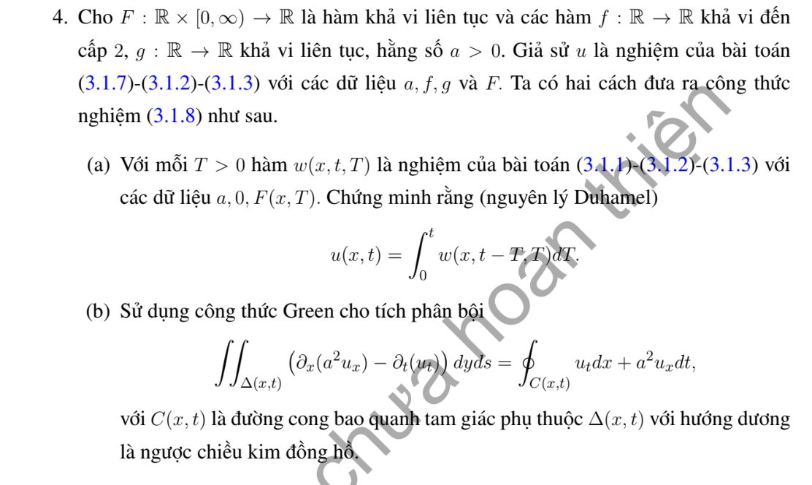

# Bài tập thực hành 4 — Mục 3.1.3

**Mã:** `BT_3_1_3_04` · **Trang sách:** 103–103

[← Mục lục](../MUC_LUC.md) · [Bản PDF của bài](BT_3_1_3_04.pdf)

## Đề bài

## Kiến thức và trình tự giải

**Bước 1 — Nhận dạng dữ liệu và tốc độ.** Viết $u_{tt}-a^2u_{xx}=F$, $u(x,0)=f(x)$, $u_t(x,0)=g(x)$; tốc độ là $a>0$, không phải $a^2$. Với dữ liệu trơn, cần $f\in C^2$, $g\in C^1$. Nếu dữ liệu có góc hoặc bước nhảy, công thức vẫn mô tả sóng từng miền nhưng phải xác định nơi mất tính trơn.

**Bước 2 — Tìm hai sóng chạy.** Đặt $\xi=x-at$, $\eta=x+at$. Quy tắc dây chuyền cho $u_{tt}-a^2u_{xx}=-4a^2u_{\xi\eta}$, nên khi $F=0$, $u=A(\xi)+B(\eta)$. Tại $t=0$, $A+B=f$, $a(B'-A')=g$. Chọn một nguyên hàm $H'=g$ rồi lấy $A=f/2-H/(2a)$, $B=f/2+H/(2a)$; hằng số của $H$ sẽ triệt tiêu.

$$
u_0(x,t)=\frac{f(x-at)+f(x+at)}2+\frac{H(x+at)-H(x-at)}{2a}.
$$

**Bước 3 — Tính tích phân theo dữ liệu thật.** Tìm nguyên hàm trên từng khoảng, nối liên tục nếu $g$ có bước nhảy; thay hai cận $x\pm at$. Dùng công thức cộng lượng giác trước khi kết luận chu kỳ. Với dữ liệu chỉ thị, tích phân bằng độ dài giao của $[x-at,x+at]$ với đoạn hỗ trợ, nhân hệ số của $g$.

**Bước 4 — Nếu có nguồn, thêm Duhamel.** Nghiệm riêng có dữ liệu đầu bằng không là

$$
u_F(x,t)=\frac1{2a}\int_0^t\int_{x-a(t-s)}^{x+a(t-s)}F(y,s)\,dy\,ds.
$$

Tính tích phân trong trước. Nếu $F$ là đa thức hoặc một mode lượng giác, có thể đoán $u_F$ rồi giải ODE theo $t$, nhưng vẫn phải buộc $u_F(x,0)=(u_F)_t(x,0)=0$. Nghiệm cuối là $u_0+u_F$.

**Bước 5 — Kiểm tra và đọc ý nghĩa.** Đạo hàm công thức: $u_x=(f'(\xi)+f'(\eta))/2+(g(\eta)-g(\xi))/(2a)$, $u_t=a(f'(\eta)-f'(\xi))/2+(g(\eta)+g(\xi))/2$. Tại $t=0$ thu lại $f,g$; đạo hàm tiếp cho PDE. Các điểm gãy $s=b$ phát sinh đường $x\pm at=b$. Chu kỳ phải đúng cho mọi $x,t$, không chỉ sau khi một mặt sóng đi qua một điểm cố định.

## Lời giải áp dụng cho bài

**Bước 1. Xung của nguồn tại thời điểm $T$.** Gọi $w(x,\tau;T)$ là nghiệm thuần nhất với $w(x,0;T)=0$, $w_\tau(x,0;T)=F(x,T)$. D'Alembert cho

$$
w(x,\tau;T)=\frac1{2a}\int_{x-a\tau}^{x+a\tau}F(y,T)dy.
$$

**Bước 2. Cộng các xung.** Với $V=\int_0^t w(x,t-T;T)dT$, Leibniz cho $V_{tt}=F(x,t)+\int_0^t w_{\tau\tau}dT$, còn $a^2V_{xx}=\int_0^ta^2w_{xx}dT$. Suy $V_{tt}-a^2V_{xx}=F$ và dữ liệu đầu bằng không.

**Bước 3. Khôi phục dữ liệu đầu.** Nếu đề có $f,g\ne0$ thì $\int w$ chỉ là phần nguồn; phải thêm $u_0$ của d'Alembert. Miền tích phân là tam giác ngược $0\le T\le t$, $|y-x|\le a(t-T)$; đổi thứ tự tích phân trên miền này cho dạng tích phân Green tương đương.

**Bước 4. Dạng Green trực tiếp.** Trên tam giác đó, đặt $p=u_T$, $q=-a^2u_y$, nên $p_T+q_y=F$. Tích phân và lấy thông lượng hai cạnh đặc trưng, trên đó $du/dT=u_T\mp au_y$, cho

$$
\int_0^t\int_{x-a(t-T)}^{x+a(t-T)}F\,dy\,dT
=2au(x,t)-a[f(x-at)+f(x+at)]-\int_{x-at}^{x+at}g(y)dy.
$$

Chia $2a$ thu đúng công thức. Công thức này đồng thời chỉ ra dấu và hệ số của từng dữ liệu.

**Chi tiết thông lượng trên từng cạnh tam giác Green.** Đặt $\ell(T)=x-a(t-T)$, $r(T)=x+a(t-T)$ và $M(T)=\int_{\ell(T)}^{r(T)}u_T(y,T)dy$. Quy tắc Leibniz cho

$$
M'=\int_\ell^r u_{TT}dy-a u_T(r,T)-a u_T(\ell,T).
$$

Tích phân $u_{TT}-a^2u_{yy}=F$ theo $y$, rồi thay dòng trên:

$$
\int_\ell^r Fdy=M'+a(u_T+a u_y)(\ell,T)+a(u_T-a u_y)(r,T).
$$

Cạnh trái có $\ell'=a$, nên $(u_T+a u_y)(\ell,T)=d[u(\ell(T),T)]/dT$; cạnh phải có $r'=-a$, nên $(u_T-a u_y)(r,T)=d[u(r(T),T)]/dT$. Tích phân mỗi cạnh từ $0$ đến $t$ cho

$$
a[u(x,t)-f(x-at)],\qquad a[u(x,t)-f(x+at)].
$$

Mặt đáy cho $M(t)-M(0)=0-\int_{x-at}^{x+at}g(y)dy$, vì ở đỉnh đoạn tích phân co về độ dài $0$. Cộng ba đóng góp được đẳng thức Green ở bước 4, rồi chia $2a$ thu half-sum, tích phân vận tốc và tích phân nguồn.

## Đối chiếu kết quả

Khi sử dụng kết quả, kiểm tra đồng thời phương trình, dữ liệu ban đầu/biên và miền được nêu trong lời giải. Các điều kiện về tính trơn, nghiệm thực, tồn tại hoặc duy nhất là một phần của kết luận; không bỏ chúng khi ghi đáp án.
