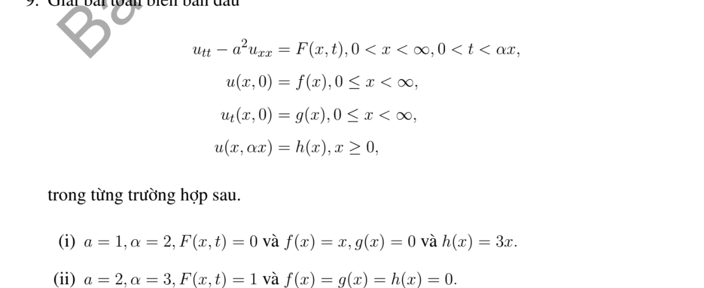

# Bài tập thực hành 9 — Mục 3.1.3

**Mã:** `BT_3_1_3_09` · **Trang sách:** 104–105

[← Mục lục](../MUC_LUC.md) · [Bản PDF của bài](BT_3_1_3_09.pdf)

## Đề bài

## Kiến thức và trình tự giải

**Bước 1 — Đọc đúng điều kiện biên.** Biên $u(0,t)=0$ dùng mở rộng lẻ; biên $u_x(0,t)=0$ dùng mở rộng chẵn. Với dữ liệu trên $x\ge0$, đặt $\widetilde f(-s)=-f(s)$ hoặc $f(s)$ tương ứng, làm tương tự cho $g$. Mở rộng lẻ là $C^2$ nếu $f(0)=f''(0)=0$, và mở rộng lẻ của $g$ là $C^1$ nếu $g(0)=0$. Mở rộng chẵn đòi $f'(0)=g'(0)=0$ cho mức trơn ấy.

**Bước 2 — Lập nguyên hàm sau khi phản xạ.** Đặt $H(s)=\int_0^s\widetilde g(r)dr$. Nếu $\widetilde g$ lẻ thì $H$ chẵn; nếu $\widetilde g$ chẵn thì $H$ lẻ. Chính nguyên hàm, chứ không phải vận tốc, xuất hiện trong

$$
u=\frac{\widetilde f(x-at)+\widetilde f(x+at)}2+\frac{H(x+at)-H(x-at)}{2a}.
$$

**Bước 3 — Tách miền trước và sau khi chạm biên.** Với $u(0,t)=h(t)$, ở $x\ge at$ dùng d'Alembert với dữ liệu gốc. Ở $0<x<at$:

$$
u=h(t-x/a)+\frac{f(x+at)-f(at-x)}2+\frac1{2a}\int_{at-x}^{at+x}g(s)ds.
$$

Với $u_x(0,t)=h(t)$, dùng nghiệm của các mở rộng chẵn rồi trừ $a\int_0^{t-x/a}h(s)ds$ trên miền $x<at$. Tính riêng đạo hàm theo $x$ của hạng này để kiểm tra biên.

**Bước 4 — Trên đoạn hữu hạn, phản xạ ở cả hai đầu.** Dirichlet ở hai đầu cho mở rộng lẻ tại $0,L$, chu kỳ không gian $2L$. Neumann ở hai đầu cho mở rộng chẵn tại $0,L$, cũng chu kỳ $2L$. Một đầu lẻ, một đầu chẵn cho $\widetilde f(s+2L)=-\widetilde f(s)$ và chu kỳ $4L$, tương tự $g$. Vì thế chu kỳ thời gian thường là $2L/a$ hoặc $4L/a$. Với Neumann hai đầu còn phải xét trung bình $g$: trung bình khác không sinh hạng tuyến tính theo $t$, nên nghiệm không tuần hoàn.

**Bước 5 — Kiểm tra góc và đường ghép.** Biên Dirichlet không thuần nhất cần $h(0)=f(0)$, $h'(0)=g(0)$, $h''(0)=a^2f''(0)$ để có nghiệm $C^2$ cho phương trình thuần nhất. So sánh hai vết trên $x=at$, gồm $u,u_x,u_t$ rồi đạo hàm cấp hai. Nếu không tương thích, nêu rõ mức trơn còn lại thay vì khẳng định nghiệm cổ điển trên toàn miền.

## Lời giải áp dụng cho bài

**Bước 1. Tìm các hàm sóng ở hai miền.** Biên nghiêng là $t=\alpha x$, không phải $x=0$. Viết $u=p+A(x+at)+B(x-at)$, trong đó $p$ là nghiệm riêng. Dữ liệu ở $t=0$ xác định $A,B$ trên đối số dương; dữ liệu biên xác định $B$ ở đối số âm.

**Ý (i).**  $a=1$, $\alpha=2$, $F=0$, $f=x$, $g=0$, vết biên $3x$. Trên $s>0$, $A(s)=B(s)=s/2$ (bỏ hai hằng số triệt tiêu). Tại $t=2x$, $A(3x)+B(-x)=3x$, nên $B(-x)=3x/2$, tức $B(s)=-3s/2$ khi $s<0$. Suy

$$
u=\begin{cases}x&0\le t\le x,\\2t-x&x<t<2x.\end{cases}
$$

Hai vết giá trị bằng nhau, nhưng $u_t$ đổi từ $0$ sang $2$; không có nghiệm $C^1$ trên toàn tam giác thỏa mọi dữ liệu này.

**Ý (ii).**  $a=2$, $\alpha=3$, $F=1$, $f=g=0$, biên bằng không. Chọn $p=-x^2/8$, vì $p_{tt}-4p_{xx}=1$. Dữ liệu đầu cho $A=B=s^2/16$ trên $s>0$. Tại $t=3x$, $A(7x)+B(-5x)-x^2/8=0$, suy $B(s)=-47s^2/400$ khi $s<0$:

$$
u=\begin{cases}t^2/2&0\le t\le x/2,\\-x^2/8+(x+2t)^2/16-47(x-2t)^2/400&x/2<t<3x.\end{cases}
$$

**Bước 2. Kiểm tra.** Tại đường $x=2t$, $B$ và $B'$ nối bằng không nên nghiệm $C^1$, nhưng $B''$ đổi từ $1/8$ sang $-47/200$, nên không $C^2$. Mỗi nhánh thỏa PDE; tại $t=3x$ đa thức triệt tiêu đúng. Hai kết quả phải hiểu từng miền khi đề yêu cầu mức trơn cao hơn mức dữ liệu cho phép.

## Đối chiếu kết quả

Khi sử dụng kết quả, kiểm tra đồng thời phương trình, dữ liệu ban đầu/biên và miền được nêu trong lời giải. Các điều kiện về tính trơn, nghiệm thực, tồn tại hoặc duy nhất là một phần của kết luận; không bỏ chúng khi ghi đáp án.
