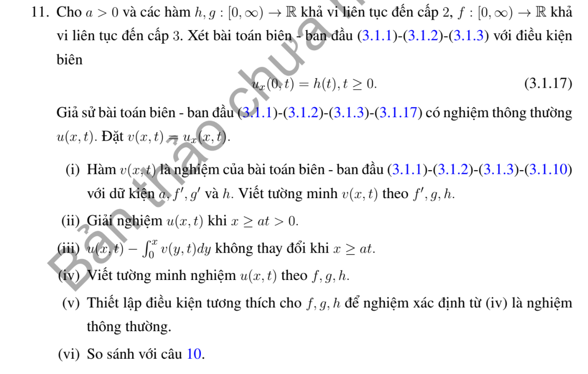

# Bài tập thực hành 11 — Mục 3.1.3

**Mã:** `BT_3_1_3_11` · **Trang sách:** 105–105

[← Mục lục](../MUC_LUC.md) · [Bản PDF của bài](BT_3_1_3_11.pdf)

## Đề bài

## Kiến thức và trình tự giải

**Bước 1 — Đọc đúng điều kiện biên.** Biên $u(0,t)=0$ dùng mở rộng lẻ; biên $u_x(0,t)=0$ dùng mở rộng chẵn. Với dữ liệu trên $x\ge0$, đặt $\widetilde f(-s)=-f(s)$ hoặc $f(s)$ tương ứng, làm tương tự cho $g$. Mở rộng lẻ là $C^2$ nếu $f(0)=f''(0)=0$, và mở rộng lẻ của $g$ là $C^1$ nếu $g(0)=0$. Mở rộng chẵn đòi $f'(0)=g'(0)=0$ cho mức trơn ấy.

**Bước 2 — Lập nguyên hàm sau khi phản xạ.** Đặt $H(s)=\int_0^s\widetilde g(r)dr$. Nếu $\widetilde g$ lẻ thì $H$ chẵn; nếu $\widetilde g$ chẵn thì $H$ lẻ. Chính nguyên hàm, chứ không phải vận tốc, xuất hiện trong

$$
u=\frac{\widetilde f(x-at)+\widetilde f(x+at)}2+\frac{H(x+at)-H(x-at)}{2a}.
$$

**Bước 3 — Tách miền trước và sau khi chạm biên.** Với $u(0,t)=h(t)$, ở $x\ge at$ dùng d'Alembert với dữ liệu gốc. Ở $0<x<at$:

$$
u=h(t-x/a)+\frac{f(x+at)-f(at-x)}2+\frac1{2a}\int_{at-x}^{at+x}g(s)ds.
$$

Với $u_x(0,t)=h(t)$, dùng nghiệm của các mở rộng chẵn rồi trừ $a\int_0^{t-x/a}h(s)ds$ trên miền $x<at$. Tính riêng đạo hàm theo $x$ của hạng này để kiểm tra biên.

**Bước 4 — Trên đoạn hữu hạn, phản xạ ở cả hai đầu.** Dirichlet ở hai đầu cho mở rộng lẻ tại $0,L$, chu kỳ không gian $2L$. Neumann ở hai đầu cho mở rộng chẵn tại $0,L$, cũng chu kỳ $2L$. Một đầu lẻ, một đầu chẵn cho $\widetilde f(s+2L)=-\widetilde f(s)$ và chu kỳ $4L$, tương tự $g$. Vì thế chu kỳ thời gian thường là $2L/a$ hoặc $4L/a$. Với Neumann hai đầu còn phải xét trung bình $g$: trung bình khác không sinh hạng tuyến tính theo $t$, nên nghiệm không tuần hoàn.

**Bước 5 — Kiểm tra góc và đường ghép.** Biên Dirichlet không thuần nhất cần $h(0)=f(0)$, $h'(0)=g(0)$, $h''(0)=a^2f''(0)$ để có nghiệm $C^2$ cho phương trình thuần nhất. So sánh hai vết trên $x=at$, gồm $u,u_x,u_t$ rồi đạo hàm cấp hai. Nếu không tương thích, nêu rõ mức trơn còn lại thay vì khẳng định nghiệm cổ điển trên toàn miền.

## Lời giải áp dụng cho bài

**Bước 1. Chuyển đạo hàm thành bài Dirichlet.** Đặt $v=u_x$. Khi dữ liệu đủ trơn, $v_{tt}=a^2v_{xx}$, $v(0,t)=h(t)$, $v(x,0)=f'(x)$, $v_t(x,0)=g'(x)$. Tương thích cấp hai cho bài này là $h(0)=f'(0)$, $h'(0)=g'(0)$, $h''(0)=a^2f'''(0)$.

**Bước 2. Tích phân lại và giữ hằng số theo thời gian.** $u(x,t)=C(t)+\int_0^xv(s,t)ds$. Thế vào PDE cho $C''(t)=a^2v_x(0,t)$, $C(0)=f(0)$, $C'(0)=g(0)$. Không được bỏ $C$ chỉ vì đã biết $u_x$.

**Bước 3. Công thức tiện dụng tương đương.** Gọi $u_e$ là nghiệm d'Alembert của các mở rộng chẵn $f,g$. Đặt

$$
u=u_e-a\int_0^{(t-x/a)_+}h(s)ds.
$$

Ở $x<at$, đạo hàm không gian của hạng cuối là $h(t-x/a)$, cho đúng $u_x(0,t)=h(t)$; hạng đó là sóng chạy nên thỏa PDE. Nếu $h(0)\ne0$, góc của $u_e$ do $f'(0)$ được hạng biên bù khi tương thích đúng.

**Bước 4. Viết hai nhánh.** Ngoài mặt sóng dùng d'Alembert với dữ liệu dương. Trong mặt sóng dùng công thức Bài 10 rồi trừ $a\int_0^{t-x/a}h$. Hai dữ liệu đầu giữ nguyên vì hạng bổ sung chưa đến $x>0$ tại $t=0$. Nếu chỉ cần $u\in C^2$, hai tương thích đầu đủ với mức trơn phù hợp; điều kiện thứ ba ở trên phục vụ $v\in C^2$, tức mức trơn cao hơn của $u$.

## Đối chiếu kết quả

Khi sử dụng kết quả, kiểm tra đồng thời phương trình, dữ liệu ban đầu/biên và miền được nêu trong lời giải. Các điều kiện về tính trơn, nghiệm thực, tồn tại hoặc duy nhất là một phần của kết luận; không bỏ chúng khi ghi đáp án.
