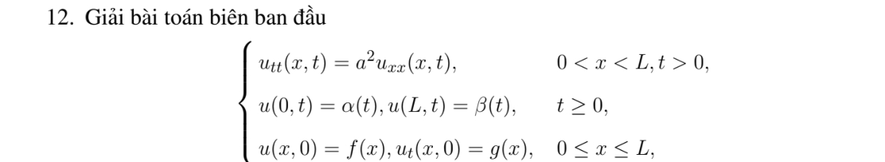
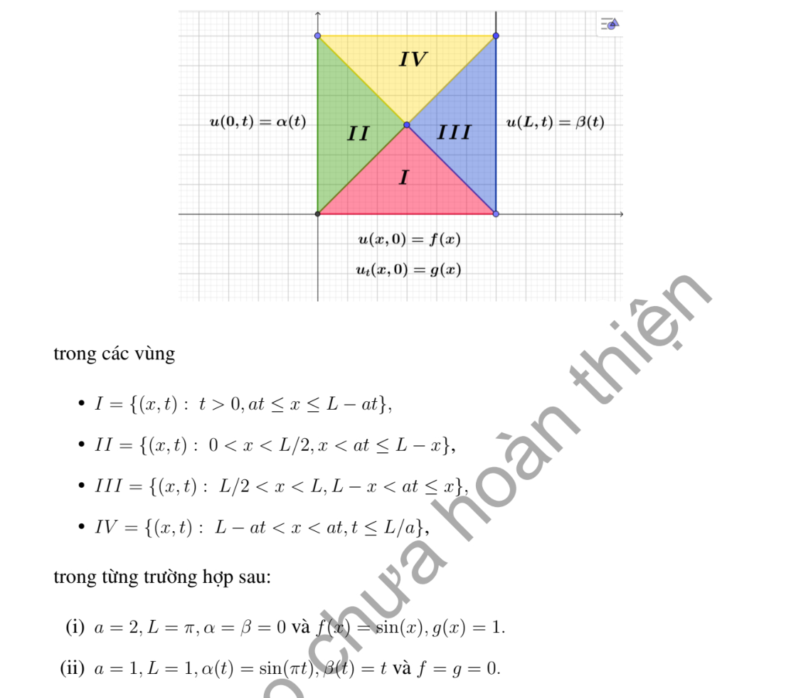

# Bài tập thực hành 12 — Mục 3.1.3

**Mã:** `BT_3_1_3_12` · **Trang sách:** 105–106

[← Mục lục](../MUC_LUC.md) · [Bản PDF của bài](BT_3_1_3_12.pdf)

## Đề bài

## Kiến thức và trình tự giải

**Bước 1 — Đọc đúng điều kiện biên.** Biên $u(0,t)=0$ dùng mở rộng lẻ; biên $u_x(0,t)=0$ dùng mở rộng chẵn. Với dữ liệu trên $x\ge0$, đặt $\widetilde f(-s)=-f(s)$ hoặc $f(s)$ tương ứng, làm tương tự cho $g$. Mở rộng lẻ là $C^2$ nếu $f(0)=f''(0)=0$, và mở rộng lẻ của $g$ là $C^1$ nếu $g(0)=0$. Mở rộng chẵn đòi $f'(0)=g'(0)=0$ cho mức trơn ấy.

**Bước 2 — Lập nguyên hàm sau khi phản xạ.** Đặt $H(s)=\int_0^s\widetilde g(r)dr$. Nếu $\widetilde g$ lẻ thì $H$ chẵn; nếu $\widetilde g$ chẵn thì $H$ lẻ. Chính nguyên hàm, chứ không phải vận tốc, xuất hiện trong

$$
u=\frac{\widetilde f(x-at)+\widetilde f(x+at)}2+\frac{H(x+at)-H(x-at)}{2a}.
$$

**Bước 3 — Tách miền trước và sau khi chạm biên.** Với $u(0,t)=h(t)$, ở $x\ge at$ dùng d'Alembert với dữ liệu gốc. Ở $0<x<at$:

$$
u=h(t-x/a)+\frac{f(x+at)-f(at-x)}2+\frac1{2a}\int_{at-x}^{at+x}g(s)ds.
$$

Với $u_x(0,t)=h(t)$, dùng nghiệm của các mở rộng chẵn rồi trừ $a\int_0^{t-x/a}h(s)ds$ trên miền $x<at$. Tính riêng đạo hàm theo $x$ của hạng này để kiểm tra biên.

**Bước 4 — Trên đoạn hữu hạn, phản xạ ở cả hai đầu.** Dirichlet ở hai đầu cho mở rộng lẻ tại $0,L$, chu kỳ không gian $2L$. Neumann ở hai đầu cho mở rộng chẵn tại $0,L$, cũng chu kỳ $2L$. Một đầu lẻ, một đầu chẵn cho $\widetilde f(s+2L)=-\widetilde f(s)$ và chu kỳ $4L$, tương tự $g$. Vì thế chu kỳ thời gian thường là $2L/a$ hoặc $4L/a$. Với Neumann hai đầu còn phải xét trung bình $g$: trung bình khác không sinh hạng tuyến tính theo $t$, nên nghiệm không tuần hoàn.

**Bước 5 — Kiểm tra góc và đường ghép.** Biên Dirichlet không thuần nhất cần $h(0)=f(0)$, $h'(0)=g(0)$, $h''(0)=a^2f''(0)$ để có nghiệm $C^2$ cho phương trình thuần nhất. So sánh hai vết trên $x=at$, gồm $u,u_x,u_t$ rồi đạo hàm cấp hai. Nếu không tương thích, nêu rõ mức trơn còn lại thay vì khẳng định nghiệm cổ điển trên toàn miền.

## Lời giải áp dụng cho bài

**Bước 1. Tách hai sóng trên dữ liệu gốc.** Đặt $H(s)=\int_0^sg$, $A=f/2-H/(2a)$, $B=f/2+H/(2a)$ trên $0\le s\le L$. Hai biên là $u(0,t)=\alpha(t)$ và $u(L,t)=\beta(t)$. Chỉ xét $t\le L/a$, nên mỗi chân đặc trưng phản xạ tối đa một lần.

**Bước 2. Viết đủ bốn miền.** Đặt $\xi=x-at$, $\eta=x+at$:

$$
u=\begin{cases}
A(\xi)+B(\eta)&\xi\ge0,\ \eta\le L,\\
\alpha(t-x/a)-B(at-x)+B(x+at)&\xi<0,\ \eta\le L,\\
A(x-at)+\beta(t-(L-x)/a)-A(2L-x-at)&\xi\ge0,\ \eta>L,\\
\alpha(t-x/a)+\beta(t-(L-x)/a)-B(at-x)-A(2L-x-at)&\xi<0,\ \eta>L.
\end{cases}
$$

Hai công thức phản xạ suy từ $A(-s)=\alpha(s/a)-B(s)$ và $B(L+s)=\beta(s/a)-A(L-s)$; mọi đối số của $A,B$ còn lại đều trong $[0,L]$.

**Bước 3. Trường hợp (i).** $a=2$, $L=\pi$, $f=\sin x$, $g=1$, $\alpha=\beta=0$. $A=\sin s/2-s/4$, $B=\sin s/2+s/4$. Trong bốn miền theo đúng thứ tự trên:

$$
u=\sin x\cos2t+\begin{cases}t&\text{miền I},\\x/2&\text{miền II},\\(\pi-x)/2&\text{miền III},\\\pi/2-t&\text{miền IV}.\end{cases}
$$

Phần vận tốc liên tục, nhưng có góc trên hai mặt sóng vì $g$ không tương thích với biên không.

**Bước 4. Trường hợp (ii).** $a=L=1$, $f=g=0$, $\alpha(t)=\sin\pi t$, $\beta(t)=t$. Vì $A=B=0$, bốn nhánh là $0$, $\sin\pi(t-x)$, $t-1+x$, và $\sin\pi(t-x)+t-1+x$. Thế $x=0,1$ trong khoảng $0\le t\le1$ cho đúng hai biên. Vận tốc góc không tương thích ($\alpha'(0)=\pi$, $\beta'(0)=1$), nên không có nghiệm $C^1$ trên toàn miền; các nhánh và đường ghép đã mô tả chính xác sự mất trơn.

**Chi tiết thế vào miền cả hai mặt sóng đã phản xạ ở (i).** Đặt $p=2t-x$, $q=2\pi-x-2t$. Khi $\xi<0,\eta>\pi$, $p,q\in[0,\pi]$ và $u=-B(p)-A(q)$:

$$
u=-\frac{\sin(2t-x)}2-\frac{\sin(2\pi-x-2t)}2+\frac{q-p}{4}
=\frac{\sin(x+2t)+\sin(x-2t)}2+\frac{2\pi-4t}{4}.
$$

Tổng sine bằng $2\sin x\cos2t$, hạng tuyến tính bằng $\pi/2-t$. Ở miền chỉ phản xạ trái, $-B(2t-x)+B(x+2t)$ cho hạng tuyến tính $[(x+2t)-(2t-x)]/4=x/2$. Ở miền chỉ phản xạ phải, $A(x-2t)-A(2\pi-x-2t)$ cho $[-(x-2t)+(2\pi-x-2t)]/4=(\pi-x)/2$.

## Đối chiếu kết quả

Khi sử dụng kết quả, kiểm tra đồng thời phương trình, dữ liệu ban đầu/biên và miền được nêu trong lời giải. Các điều kiện về tính trơn, nghiệm thực, tồn tại hoặc duy nhất là một phần của kết luận; không bỏ chúng khi ghi đáp án.
