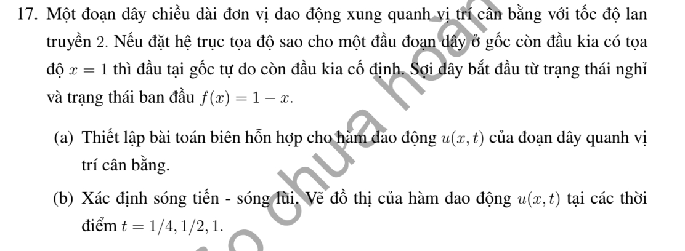
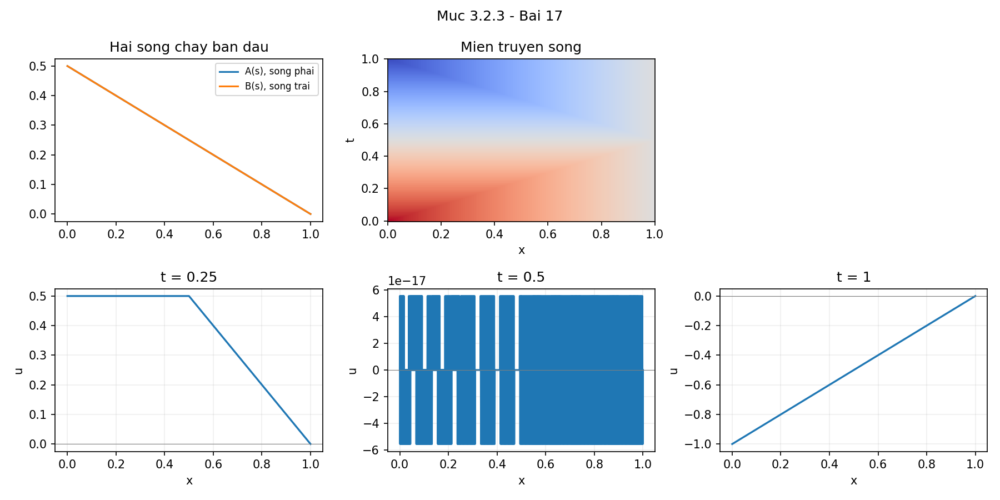

# Bài tập thực hành 17 — Mục 3.2.3

**Mã:** `BT_3_2_3_17` · **Trang sách:** 132–132

[← Mục lục](../MUC_LUC.md) · [Bản PDF của bài](BT_3_2_3_17.pdf)

## Đề bài

## Kiến thức và trình tự giải

**Bước 1 — Liệt kê các khoảng của dữ liệu.** Ghi đủ điểm đầu, điểm cuối hỗ trợ, điểm gãy và bước nhảy của $f,g$. Nếu có biên, phản xạ chẵn hoặc lẻ trước khi tích phân; trên đoạn hữu hạn tiếp tục phản xạ đến một chu kỳ hoàn chỉnh.

**Bước 2 — Tính nguyên hàm liên tục.** Lấy $H'=\widetilde g$ trên từng khoảng và chọn hằng số để hai vết của $H$ bằng nhau. Viết $[s]_p^q=\min(q,\max(p,s))$ hoặc $(s)_+=\max(s,0)$ khi cần gộp nhiều nhánh. Một nguyên hàm liên tục tránh tạo ra bước nhảy giả trong nghiệm.

**Bước 3 — Xác định sóng phải và sóng trái.** Đặt $A(s)=\widetilde f(s)/2-H(s)/(2a)$, $B(s)=\widetilde f(s)/2+H(s)/(2a)$; khi đó $u=A(x-at)+B(x+at)$. Với từng $t$ được yêu cầu, dịch đồ thị $A$ sang phải $at$ và $B$ sang trái $at$, rồi cộng tung độ. Các đường $x-at=b$ và $x+at=b$ chia mặt phẳng thành các miền có công thức đơn giản.

**Bước 4 — Xét liên tục, đạo hàm và giao của các mặt sóng.** Nếu $f$ có bước nhảy, $u$ thường có bước nhảy; nếu $f$ liên tục và $g$ bị chặn thì $u$ liên tục. Tại thời điểm cố định,

$$
u_x=\frac{\widetilde f'(x-at)+\widetilde f'(x+at)}2+\frac{\widetilde g(x+at)-\widetilde g(x-at)}{2a}.
$$

Tính giới hạn trái/phải của biểu thức này tại từng vị trí ứng viên. Có thể có triệt tiêu khi hai đường gặp nhau, nên không chỉ liệt kê đường rồi khẳng định mọi đạo hàm đều mất. Với tính $C^1$ theo cả $x,t$, còn kiểm tra $u_t$. Với $C^2$, xét tiếp các góc của $g$ và đạo hàm cấp hai của $f$.

**Bước 5 — Tính thời điểm đến, giới hạn và ngưỡng.** Sóng ở $(x,t)$ chỉ nhận dữ liệu trong $[x-at,x+at]$. Giải bất đẳng thức giao hỗ trợ để tìm thời điểm đến và đi qua. Nếu $H$ hằng ngoài đoạn hỗ trợ, dùng các giá trị hằng này để tính giới hạn khi $t\to\infty$. Nếu hỏi áp suất cực đại, viết hàm từng khoảng thời gian và so sánh cực trị, bước nhảy cùng hai giá trị một phía.

**Bước 1 — Đọc đúng điều kiện biên.** Biên $u(0,t)=0$ dùng mở rộng lẻ; biên $u_x(0,t)=0$ dùng mở rộng chẵn. Với dữ liệu trên $x\ge0$, đặt $\widetilde f(-s)=-f(s)$ hoặc $f(s)$ tương ứng, làm tương tự cho $g$. Mở rộng lẻ là $C^2$ nếu $f(0)=f''(0)=0$, và mở rộng lẻ của $g$ là $C^1$ nếu $g(0)=0$. Mở rộng chẵn đòi $f'(0)=g'(0)=0$ cho mức trơn ấy.

**Bước 2 — Lập nguyên hàm sau khi phản xạ.** Đặt $H(s)=\int_0^s\widetilde g(r)dr$. Nếu $\widetilde g$ lẻ thì $H$ chẵn; nếu $\widetilde g$ chẵn thì $H$ lẻ. Chính nguyên hàm, chứ không phải vận tốc, xuất hiện trong

$$
u=\frac{\widetilde f(x-at)+\widetilde f(x+at)}2+\frac{H(x+at)-H(x-at)}{2a}.
$$

**Bước 3 — Tách miền trước và sau khi chạm biên.** Với $u(0,t)=h(t)$, ở $x\ge at$ dùng d'Alembert với dữ liệu gốc. Ở $0<x<at$:

$$
u=h(t-x/a)+\frac{f(x+at)-f(at-x)}2+\frac1{2a}\int_{at-x}^{at+x}g(s)ds.
$$

Với $u_x(0,t)=h(t)$, dùng nghiệm của các mở rộng chẵn rồi trừ $a\int_0^{t-x/a}h(s)ds$ trên miền $x<at$. Tính riêng đạo hàm theo $x$ của hạng này để kiểm tra biên.

**Bước 4 — Trên đoạn hữu hạn, phản xạ ở cả hai đầu.** Dirichlet ở hai đầu cho mở rộng lẻ tại $0,L$, chu kỳ không gian $2L$. Neumann ở hai đầu cho mở rộng chẵn tại $0,L$, cũng chu kỳ $2L$. Một đầu lẻ, một đầu chẵn cho $\widetilde f(s+2L)=-\widetilde f(s)$ và chu kỳ $4L$, tương tự $g$. Vì thế chu kỳ thời gian thường là $2L/a$ hoặc $4L/a$. Với Neumann hai đầu còn phải xét trung bình $g$: trung bình khác không sinh hạng tuyến tính theo $t$, nên nghiệm không tuần hoàn.

**Bước 5 — Kiểm tra góc và đường ghép.** Biên Dirichlet không thuần nhất cần $h(0)=f(0)$, $h'(0)=g(0)$, $h''(0)=a^2f''(0)$ để có nghiệm $C^2$ cho phương trình thuần nhất. So sánh hai vết trên $x=at$, gồm $u,u_x,u_t$ rồi đạo hàm cấp hai. Nếu không tương thích, nêu rõ mức trơn còn lại thay vì khẳng định nghiệm cổ điển trên toàn miền.

## Lời giải áp dụng cho bài

**Bước 1. Đọc dữ liệu và chọn phản xạ.** Đoạn $(0,1)$, Neumann tại $0$, Dirichlet tại $1$, $a=2$, $f=1-x$, $g=0$.

**Bước 2. Tính từng nhánh và nối nguyên hàm.** Phản xạ chẵn tại $0$, lẻ tại $1$ cho trên $[0,4]$ hai nhánh $1-s$ ở $[0,2]$, $s-3$ ở $[2,4]$. Vì thế có công thức chính xác $f_e(s)=|\operatorname{mod}(s,4)-2|-1$.

$$
f_e(s)=|\operatorname{mod}(s,4)-2|-1,\qquad H(s)=0.
$$

Ở đây $\operatorname{clip}(s,p,q)=\min(q,\max(p,s))$; $\operatorname{mod}(s,L)\in[0,L)$ kể cả với $s<0$.

**Bước 3. Xác định hai sóng chạy và ghép nghiệm.** $A=f_e/2-H/(2a)$, $B=f_e/2+H/(2a)$. Thay hai cận:

$$
u(x,t)=\frac{f_e(x-2t)+f_e(x+2t)}2+\frac{H(x+2t)-H(x-2t)}{4}.
$$

**Bước 4. Trả lời các yêu cầu và kiểm tra.** $f_e(s+2)=-f_e(s)$ nên $u(t+1)=-u(t)$, chu kỳ $2$. Với $k_n=(n+1/2)\pi$, tích phân $2\int_0^1(1-x)\cos(k_nx)dx=2/k_n^2$ cho chuỗi. Góc tại phản xạ đầu $0$ xuất phát từ $f'(0)=-1$ không tương thích.

Mô hình $u_{tt}=4u_{xx}$, $u_x(0,t)=0,u(1,t)=0$, $f=1-x,g=0$. Với $k_n=(n+1/2)\pi$, nghiệm $u=\sum_{n\ge0}2\cos(2k_nt)\cos(k_nx)/k_n^2$. Chu kỳ 2; dữ liệu không tương thích đạo hàm tại đầu tự do.

Tại $t=0$, hiệu nguyên hàm bằng $0$ và đạo hàm thời gian cho $H'(x)=g(x)$ trong miền dữ liệu; half-sum cho đúng li độ. Mỗi hạng là sóng của $x\pm at$, nên thỏa PDE ngoài các mặt gãy và theo nghĩa phân phối trên toàn miền. Đồ thị hai sóng ban đầu và các lát cắt thời gian được tính trực tiếp từ các nhánh trên.

**Chi tiết chiếu li độ lên hệ cos nửa nguyên.** $k_n=(n+1/2)\pi$, $\cos k_n=0$, chuẩn $\int_0^1\cos^2k_nx\,dx=1/2$. Tích phân từng phần:

$$
\int_0^1(1-x)\cos k_nx\,dx=\left[\frac{(1-x)\sin k_nx}{k_n}\right]_0^1+\frac1{k_n}\int_0^1\sin k_nx\,dx
=\frac{1-\cos k_n}{k_n^2}=\frac1{k_n^2}.
$$

Chia chuẩn $1/2$ cho hệ số $2/k_n^2$; vận tốc đầu bằng $0$ nên không có phần sine theo thời gian.

## Đồ thị minh họa

## Đối chiếu kết quả

Khi sử dụng kết quả, kiểm tra đồng thời phương trình, dữ liệu ban đầu/biên và miền được nêu trong lời giải. Các điều kiện về tính trơn, nghiệm thực, tồn tại hoặc duy nhất là một phần của kết luận; không bỏ chúng khi ghi đáp án.
