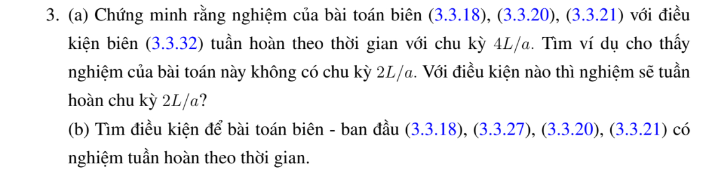

# Bài tập thực hành 3 — Mục 3.3.3

**Mã:** `BT_3_3_3_03` · **Trang sách:** 145–145

[← Mục lục](../MUC_LUC.md) · [Bản PDF của bài](BT_3_3_3_03.pdf)

## Đề bài

## Kiến thức và trình tự giải

**Bước 1 — Tách biến và chọn bài toán trị riêng theo biên.** Đặt $u=X(x)T(t)$ trong $u_{tt}=a^2u_{xx}$, suy $X''+\lambda X=0$, $T''+a^2\lambda T=0$. Tích phân từng phần cho $\lambda\int X^2=\int (X')^2$ khi hạng biên bằng không; do đó $\lambda\ge0$. Giải cả trường hợp $\lambda=0$ trước khi xét $\lambda=k^2>0$.

**Bước 2 — Tìm hệ hàm riêng.** Trên $(0,L)$: Dirichlet hai đầu dùng $\sin(n\pi x/L)$, $n\ge1$; Neumann hai đầu dùng $1$ và $\cos(n\pi x/L)$; Dirichlet–Neumann dùng $\sin((n+1/2)\pi x/L)$, $n\ge0$; Neumann–Dirichlet dùng cos của các tần số nửa nguyên ấy. Chuẩn bình phương của mode khác không là $L/2$, của mode hằng là $L$.

**Bước 3 — Chiếu cả hai dữ liệu.** Với mode khác không đặt

$$
A_n=\frac2L\int_0^L fX_n\,dx,\quad B_n=\frac2L\int_0^L gX_n\,dx,\quad \omega_n=ak_n.
$$

Tích phân từng khoảng nếu dữ liệu chia đoạn; dùng tích phân từng phần hoặc công thức tích–tổng khi là đa thức/lượng giác. Hệ số $B_n$ là hệ số của vận tốc, nên hệ số đứng trước $\sin\omega_nt$ phải là $B_n/\omega_n$.

**Bước 4 — Ghép nghiệm và xét mode hằng.**

$$
u=\sum_n\left(A_n\cos\omega_nt+\frac{B_n}{\omega_n}\sin\omega_nt\right)X_n.
$$

Với Neumann hai đầu, thêm $A_0+B_0t$, trong đó $A_0=L^{-1}\int f$, $B_0=L^{-1}\int g$. Với tần số bị thay đổi bởi hạng $u$ hoặc cản $u_t$, giải lại ODE của từng mode; không dùng nguyên tần số $ak_n$.

**Bước 5 — Kiểm tra biên, dữ liệu và hội tụ.** Mỗi mode thỏa biên; tại $t=0$ hai chuỗi cho khai triển của $f,g$. Nếu dữ liệu không tương thích ở góc, giải theo nghĩa năng lượng hoặc từng miền và nêu đường mất tính trơn; không đạo hàm một chuỗi yếu tùy ý. Chu kỳ được suy từ tất cả mode có hệ số khác không, kể cả mode hằng; hai tần số có tỷ số vô tỷ ngăn một chu kỳ chung.

**Chi tiết tính tích phân hệ số.** Với $k=n\pi/L$, hai nguyên hàm thường dùng là

$$
\int x\sin kx\,dx=-x\cos kx/k+\sin kx/k^2,\qquad
\int x\cos kx\,dx=x\sin kx/k+\cos kx/k^2.
$$

Với đa thức $P$, ghi cả hai lần tích phân:

$$
\int_0^L P\sin kx\,dx
=\left[-P\cos kx/k\right]_0^L+
\left[P'\sin kx/k^2\right]_0^L-
\frac1{k^2}\int_0^L P''\sin kx\,dx.
$$

Chỉ bỏ hạng biên sau khi thế $0,L$ và điều kiện thực sự của $P$. Nếu dữ liệu chia đoạn, áp dụng công thức trên từng đoạn, rồi cộng các hạng tại điểm chia. Cuối cùng nhân nghịch đảo chuẩn của hàm riêng; nếu hệ số là của vận tốc, chia thêm tần số khi ghép nghiệm. Với mẫu số bằng $0$ trong tích–tổng, quay lại tích phân gốc để tính riêng.

## Lời giải áp dụng cho bài

**Bước 1. Biên Dirichlet–Neumann.** Tách biến cho $k_n=(n+1/2)\pi/L$. Khi dịch $2L/a$, pha tăng $(2n+1)\pi$; cos và sin đều đổi dấu, nên $u(t+2L/a)=-u(t)$. Dịch thêm lần nữa cho chu kỳ $4L/a$.

**Bước 2. Kiểm tra khẳng định chu kỳ ngắn.** Nếu còn $u(t+2L/a)=u(t)$ thì $u=-u$, suy $u=0$. Lấy $f=\sin(\pi x/(2L))$, $g=0$ cho $u=f\cos(a\pi t/(2L))$ là phản ví dụ rõ ràng với chu kỳ cơ bản $4L/a$. Vì vậy chu kỳ $2L/a$ trong câu (a) không đúng cho nghiệm khác không.

**Bước 3. Biên Neumann hai đầu.** Tích phân PDE theo $x$ cho trung bình $\bar u''=(a^2/L)[u_x]_0^L=0$, nên $\bar u=\bar f+t\bar g$. Phần còn lại gồm các tần số $an\pi/L$, tất cả có chu kỳ $2L/a$. Nếu $\bar g=0$ thì nghiệm tuần hoàn; nếu $\bar g\ne0$, trung bình tăng tuyến tính và không thể tuần hoàn. Điều kiện cần và đủ là $\int_0^Lg=0$. Nghiệm hằng theo thời gian có mọi chu kỳ dương.

## Đối chiếu kết quả

Khi sử dụng kết quả, kiểm tra đồng thời phương trình, dữ liệu ban đầu/biên và miền được nêu trong lời giải. Các điều kiện về tính trơn, nghiệm thực, tồn tại hoặc duy nhất là một phần của kết luận; không bỏ chúng khi ghi đáp án.
