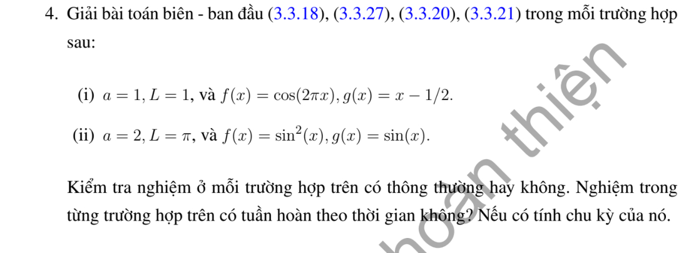

# Bài tập thực hành 4 — Mục 3.3.3

**Mã:** `BT_3_3_3_04` · **Trang sách:** 145–145

[← Mục lục](../MUC_LUC.md) · [Bản PDF của bài](BT_3_3_3_04.pdf)

## Đề bài

## Kiến thức và trình tự giải

**Bước 1 — Tách biến và chọn bài toán trị riêng theo biên.** Đặt $u=X(x)T(t)$ trong $u_{tt}=a^2u_{xx}$, suy $X''+\lambda X=0$, $T''+a^2\lambda T=0$. Tích phân từng phần cho $\lambda\int X^2=\int (X')^2$ khi hạng biên bằng không; do đó $\lambda\ge0$. Giải cả trường hợp $\lambda=0$ trước khi xét $\lambda=k^2>0$.

**Bước 2 — Tìm hệ hàm riêng.** Trên $(0,L)$: Dirichlet hai đầu dùng $\sin(n\pi x/L)$, $n\ge1$; Neumann hai đầu dùng $1$ và $\cos(n\pi x/L)$; Dirichlet–Neumann dùng $\sin((n+1/2)\pi x/L)$, $n\ge0$; Neumann–Dirichlet dùng cos của các tần số nửa nguyên ấy. Chuẩn bình phương của mode khác không là $L/2$, của mode hằng là $L$.

**Bước 3 — Chiếu cả hai dữ liệu.** Với mode khác không đặt

$$
A_n=\frac2L\int_0^L fX_n\,dx,\quad B_n=\frac2L\int_0^L gX_n\,dx,\quad \omega_n=ak_n.
$$

Tích phân từng khoảng nếu dữ liệu chia đoạn; dùng tích phân từng phần hoặc công thức tích–tổng khi là đa thức/lượng giác. Hệ số $B_n$ là hệ số của vận tốc, nên hệ số đứng trước $\sin\omega_nt$ phải là $B_n/\omega_n$.

**Bước 4 — Ghép nghiệm và xét mode hằng.**

$$
u=\sum_n\left(A_n\cos\omega_nt+\frac{B_n}{\omega_n}\sin\omega_nt\right)X_n.
$$

Với Neumann hai đầu, thêm $A_0+B_0t$, trong đó $A_0=L^{-1}\int f$, $B_0=L^{-1}\int g$. Với tần số bị thay đổi bởi hạng $u$ hoặc cản $u_t$, giải lại ODE của từng mode; không dùng nguyên tần số $ak_n$.

**Bước 5 — Kiểm tra biên, dữ liệu và hội tụ.** Mỗi mode thỏa biên; tại $t=0$ hai chuỗi cho khai triển của $f,g$. Nếu dữ liệu không tương thích ở góc, giải theo nghĩa năng lượng hoặc từng miền và nêu đường mất tính trơn; không đạo hàm một chuỗi yếu tùy ý. Chu kỳ được suy từ tất cả mode có hệ số khác không, kể cả mode hằng; hai tần số có tỷ số vô tỷ ngăn một chu kỳ chung.

**Chi tiết tính tích phân hệ số.** Với $k=n\pi/L$, hai nguyên hàm thường dùng là

$$
\int x\sin kx\,dx=-x\cos kx/k+\sin kx/k^2,\qquad
\int x\cos kx\,dx=x\sin kx/k+\cos kx/k^2.
$$

Với đa thức $P$, ghi cả hai lần tích phân:

$$
\int_0^L P\sin kx\,dx
=\left[-P\cos kx/k\right]_0^L+
\left[P'\sin kx/k^2\right]_0^L-
\frac1{k^2}\int_0^L P''\sin kx\,dx.
$$

Chỉ bỏ hạng biên sau khi thế $0,L$ và điều kiện thực sự của $P$. Nếu dữ liệu chia đoạn, áp dụng công thức trên từng đoạn, rồi cộng các hạng tại điểm chia. Cuối cùng nhân nghịch đảo chuẩn của hàm riêng; nếu hệ số là của vận tốc, chia thêm tần số khi ghép nghiệm. Với mẫu số bằng $0$ trong tích–tổng, quay lại tích phân gốc để tính riêng.

## Lời giải áp dụng cho bài

**Bước 1. Hệ cos và mode hằng.** $A_0,B_0$ là trung bình dữ liệu; mode khác không có chuẩn $L/2$. Không được dùng công thức sine của biên cố định.

**Bước 2. Câu (i).** $a=L=1$, $f=\cos2\pi x$, $g=x-1/2$. $A_2=1$, $B_0=0$. Tích phân từng phần cho

$$
B_n=2\int_0^1(x-1/2)\cos(n\pi x)dx=\frac{2((-1)^n-1)}{n^2\pi^2}.
$$

Do đó $u=\cos2\pi x\cos2\pi t-\sum_{n\text{ lẻ}}4\sin(n\pi t)\cos(n\pi x)/(n^3\pi^3)$. Mode $1$ khác không cho chu kỳ cơ bản $2$. $g'=1$ ở hai đầu trái đạo hàm thời gian của biên Neumann, nên không $C^2$ qua các mặt sóng góc.

**Bước 3. Câu (ii).** $a=2$, $L=\pi$, $f=\sin^2x=(1-\cos2x)/2$, $g=\sin x$. $A_0=1/2$, $A_2=-1/2$, $B_0=2/\pi$. Tích–tổng cho $B_n=2(1+(-1)^n)/(\pi(1-n^2))$ nếu $n\ne1$, và $B_1=0$ tính riêng. Suy

$$
u=\tfrac12-\tfrac12\cos2x\cos4t+2t/\pi+\sum_{n\ge1}\frac{B_n}{2n}\sin2nt\cos nx.
$$

**Bước 4. Kiểm tra.** Mode hằng đảm bảo vận tốc trung bình đúng; bỏ nó sẽ làm sai $g$. Nó cũng khiến câu (ii) không tuần hoàn. Biên đúng theo mỗi cos; tại $t=0$ hai chuỗi khôi phục dữ liệu. $g'(0),g'(\pi)$ khác không nên vẫn có vấn đề tương thích cấp hai.

**Chi tiết tích phân câu (i).** Đặt $k=n\pi$:

$$
\begin{aligned}
B_n&=2\left[\frac{(x-1/2)\sin kx}{k}\right]_0^1-\frac2k\int_0^1\sin kx\,dx\\
&=-\frac2k\left[-\frac{\cos kx}{k}\right]_0^1
=\frac{2((-1)^n-1)}{k^2}.
\end{aligned}
$$

Vì $\sin0=\sin k=0$, hạng biên đầu hết. $B_0=\int_0^1(x-1/2)dx=0$. Ở (ii), trung bình $B_0=\pi^{-1}\int_0^\pi\sin x\,dx=2/\pi$; các mode khác dùng $2\sin x\cos nx=\sin((1+n)x)+\sin((1-n)x)$. Tích phân cho $B_n=2(1+(-1)^n)/[\pi(1-n^2)]$ khi $n\ne1$, còn $B_1=\pi^{-1}\int_0^\pi\sin2x\,dx=0$.

## Đối chiếu kết quả

Khi sử dụng kết quả, kiểm tra đồng thời phương trình, dữ liệu ban đầu/biên và miền được nêu trong lời giải. Các điều kiện về tính trơn, nghiệm thực, tồn tại hoặc duy nhất là một phần của kết luận; không bỏ chúng khi ghi đáp án.
