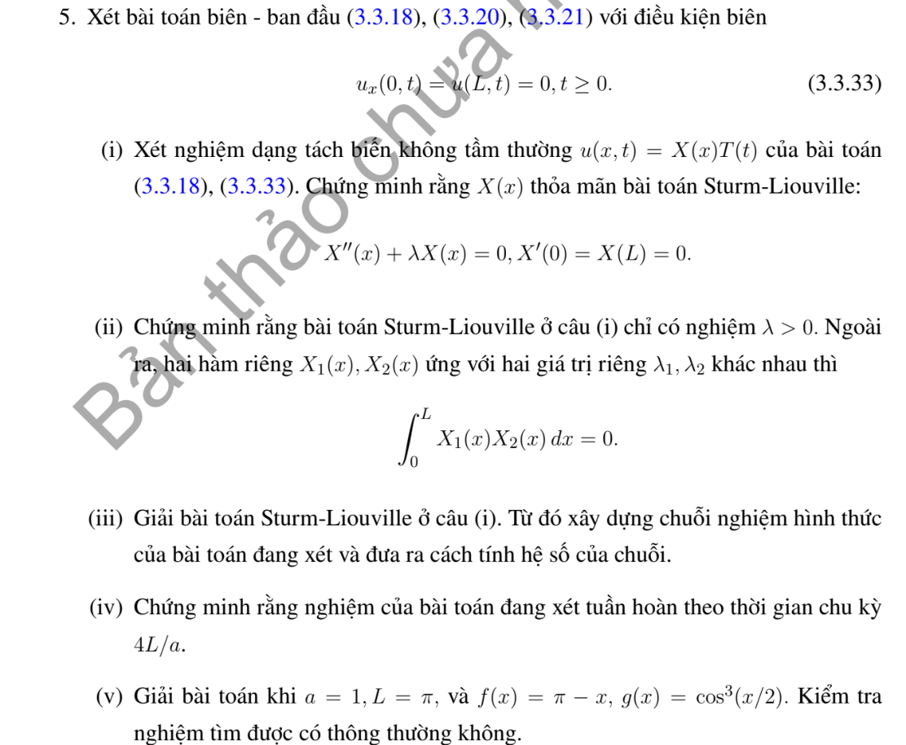

# Bài tập thực hành 5 — Mục 3.3.3

**Mã:** `BT_3_3_3_05` · **Trang sách:** 145–145

[← Mục lục](../MUC_LUC.md) · [Bản PDF của bài](BT_3_3_3_05.pdf)

## Đề bài

## Kiến thức và trình tự giải

**Bước 1 — Tách biến và chọn bài toán trị riêng theo biên.** Đặt $u=X(x)T(t)$ trong $u_{tt}=a^2u_{xx}$, suy $X''+\lambda X=0$, $T''+a^2\lambda T=0$. Tích phân từng phần cho $\lambda\int X^2=\int (X')^2$ khi hạng biên bằng không; do đó $\lambda\ge0$. Giải cả trường hợp $\lambda=0$ trước khi xét $\lambda=k^2>0$.

**Bước 2 — Tìm hệ hàm riêng.** Trên $(0,L)$: Dirichlet hai đầu dùng $\sin(n\pi x/L)$, $n\ge1$; Neumann hai đầu dùng $1$ và $\cos(n\pi x/L)$; Dirichlet–Neumann dùng $\sin((n+1/2)\pi x/L)$, $n\ge0$; Neumann–Dirichlet dùng cos của các tần số nửa nguyên ấy. Chuẩn bình phương của mode khác không là $L/2$, của mode hằng là $L$.

**Bước 3 — Chiếu cả hai dữ liệu.** Với mode khác không đặt

$$
A_n=\frac2L\int_0^L fX_n\,dx,\quad B_n=\frac2L\int_0^L gX_n\,dx,\quad \omega_n=ak_n.
$$

Tích phân từng khoảng nếu dữ liệu chia đoạn; dùng tích phân từng phần hoặc công thức tích–tổng khi là đa thức/lượng giác. Hệ số $B_n$ là hệ số của vận tốc, nên hệ số đứng trước $\sin\omega_nt$ phải là $B_n/\omega_n$.

**Bước 4 — Ghép nghiệm và xét mode hằng.**

$$
u=\sum_n\left(A_n\cos\omega_nt+\frac{B_n}{\omega_n}\sin\omega_nt\right)X_n.
$$

Với Neumann hai đầu, thêm $A_0+B_0t$, trong đó $A_0=L^{-1}\int f$, $B_0=L^{-1}\int g$. Với tần số bị thay đổi bởi hạng $u$ hoặc cản $u_t$, giải lại ODE của từng mode; không dùng nguyên tần số $ak_n$.

**Bước 5 — Kiểm tra biên, dữ liệu và hội tụ.** Mỗi mode thỏa biên; tại $t=0$ hai chuỗi cho khai triển của $f,g$. Nếu dữ liệu không tương thích ở góc, giải theo nghĩa năng lượng hoặc từng miền và nêu đường mất tính trơn; không đạo hàm một chuỗi yếu tùy ý. Chu kỳ được suy từ tất cả mode có hệ số khác không, kể cả mode hằng; hai tần số có tỷ số vô tỷ ngăn một chu kỳ chung.

**Chi tiết tính tích phân hệ số.** Với $k=n\pi/L$, hai nguyên hàm thường dùng là

$$
\int x\sin kx\,dx=-x\cos kx/k+\sin kx/k^2,\qquad
\int x\cos kx\,dx=x\sin kx/k+\cos kx/k^2.
$$

Với đa thức $P$, ghi cả hai lần tích phân:

$$
\int_0^L P\sin kx\,dx
=\left[-P\cos kx/k\right]_0^L+
\left[P'\sin kx/k^2\right]_0^L-
\frac1{k^2}\int_0^L P''\sin kx\,dx.
$$

Chỉ bỏ hạng biên sau khi thế $0,L$ và điều kiện thực sự của $P$. Nếu dữ liệu chia đoạn, áp dụng công thức trên từng đoạn, rồi cộng các hạng tại điểm chia. Cuối cùng nhân nghịch đảo chuẩn của hàm riêng; nếu hệ số là của vận tốc, chia thêm tần số khi ghép nghiệm. Với mẫu số bằng $0$ trong tích–tổng, quay lại tích phân gốc để tính riêng.

## Lời giải áp dụng cho bài

**Bước 1. Trị riêng và trực giao.** $X'(0)=0$, $X(L)=0$. Tích phân từng phần cho $\lambda\int X^2=\int X'^2$. Nếu $\lambda=0$, $X$ hằng rồi $X(L)=0$ nên chỉ có nghiệm không; vì vậy $\lambda>0$. Với $\lambda=k^2$, điều kiện đầu cho $X=C\cos kx$, điều kiện cuối cho $\cos kL=0$. Suy $k_n=(n+1/2)\pi/L$. Trừ hai phương trình của $X_m,X_n$ và tích phân; các hạng biên bằng không, chứng minh trực giao.

**Bước 2. Chiếu dữ liệu và ghép.** $A_n=(2/L)\int f\cos k_nx$, $B_n=(2/L)\int g\cos k_nx$; $u=\sum(A_n\cos ak_nt+B_n\sin ak_nt/(ak_n))\cos k_nx$. Mọi mode có chu kỳ $4L/a$ và đổi dấu sau $2L/a$.

**Bước 3. Trường hợp cụ thể.** $a=1$, $L=\pi$, $f=\pi-x$, $g=\cos^3(x/2)$. Tích phân từng phần cho $\int_0^\pi(\pi-x)\cos k_nx=1/k_n^2$, nên $A_n=2/(\pi k_n^2)$. Công thức cos lập phương cho $B_0=3/4$, $B_1=1/4$. Vì vậy

$$
u=\sum_{n\ge0}\frac2{\pi k_n^2}\cos k_nt\cos k_nx
+\tfrac32\sin(t/2)\cos(x/2)+\tfrac16\sin(3t/2)\cos(3x/2).
$$

**Bước 4. Kết luận.** Mode đầu khác không nên chu kỳ cơ bản $4\pi$. $f'(0)=-1$ không tương thích Neumann, nên nghiệm không $C^1$ qua mặt phản xạ từ góc trái. Hai chuỗi vẫn đúng dữ liệu trong miền và từng mode thỏa PDE/biên; tính duy nhất trong lớp năng lượng theo năng lượng của hiệu.

**Chi tiết điều kiện biên và tích phân dữ liệu.** $X=A\cos kx+B\sin kx$, $X'(0)=Bk=0$ cho $B=0$ khi $k>0$; $X(L)=A\cos kL=0$ cho $\cos kL=0$. Chuẩn $\int_0^L\cos^2k_nx\,dx=L/2$ vì $\sin(2k_nL)=0$. Với $L=\pi$,

$$
\begin{aligned}
\int_0^\pi(\pi-x)\cos k_nx\,dx
&=\left[\frac{(\pi-x)\sin k_nx}{k_n}\right]_0^\pi
+\frac1{k_n}\int_0^\pi\sin k_nx\,dx\\
&=\frac{1-\cos(k_n\pi)}{k_n^2}=1/k_n^2.
\end{aligned}
$$

Chiếu $g=(3\cos(x/2)+\cos(3x/2))/4$ lên hệ cos trực giao cho $B_0=3/4,B_1=1/4$, rồi chia tần số $k_0=1/2,k_1=3/2$ khi ghép nghiệm.

**Chi tiết trực giao và dấu trị riêng.** Nhân $-X''=\lambda X$ bởi $X$, tích phân:

$$
\lambda\int_0^LX^2dx=-[X'X]_0^L+\int_0^L(X')^2dx=\int_0^L(X')^2dx.
$$

Hạng biên hết vì mỗi đầu có $X=0$ hoặc $X'=0$. Nếu $\lambda=0$, $\int(X')^2=0$ cho $X$ hằng; khi có một đầu Dirichlet, hằng đó bằng $0$. Với hai trị riêng,

$$
(\lambda_m-\lambda_n)\int_0^LX_mX_n\,dx
=\int_0^L(-X_m''X_n+X_n''X_m)dx
=[-X_m'X_n+X_n'X_m]_0^L=0.
$$

Nếu $\lambda_m\ne\lambda_n$, chia hiệu trị riêng cho tích vô hướng bằng $0$.

## Đối chiếu kết quả

Khi sử dụng kết quả, kiểm tra đồng thời phương trình, dữ liệu ban đầu/biên và miền được nêu trong lời giải. Các điều kiện về tính trơn, nghiệm thực, tồn tại hoặc duy nhất là một phần của kết luận; không bỏ chúng khi ghi đáp án.
