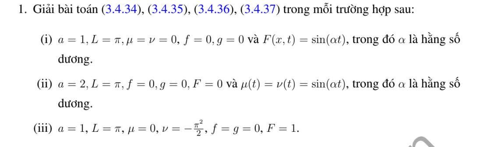

# Bài tập thực hành 1 — Mục 3.4.3

**Mã:** `BT_3_4_3_01` · **Trang sách:** 152–152

[← Mục lục](../MUC_LUC.md) · [Bản PDF của bài](BT_3_4_3_01.pdf)

## Đề bài

## Kiến thức và trình tự giải

**Bước 1 — Đưa điều kiện biên về thuần nhất.** Với $u(0,t)=\mu(t)$, $u(L,t)=\nu(t)$, đặt $b=(1-x/L)\mu+(x/L)\nu$. Với Neumann hai đầu đặt $b=\mu x+(\nu-\mu)x^2/(2L)$. Với Dirichlet–Neumann đặt $b=\mu+x\nu$. Viết $u=b+w$; khi đó $w$ có biên thuần nhất, nguồn $Q=F+a^2b_{xx}-b_{tt}$ và dữ liệu $f-b(x,0)$, $g-b_t(x,0)$.

**Bước 2 — Chiếu nguồn và dữ liệu lên cùng hệ hàm riêng.** Tính $Q_n(t)=\int QX_n/\int X_n^2$, $A_n$, $B_n$. Không bỏ các dữ liệu mới phát sinh từ hàm nâng biên; chúng có thể khác không ngay khi dữ liệu gốc bằng không.

**Bước 3 — Giải ODE có nguồn cho từng mode.**

$$
y_n''+\omega_n^2y_n=Q_n(t),\qquad
y_n=A_n\cos\omega_nt+\frac{B_n}{\omega_n}\sin\omega_nt+\frac1{\omega_n}\int_0^t\sin(\omega_n(t-s))Q_n(s)ds.
$$

Với mode hằng Neumann, thay công thức bằng $y_0=A_0+B_0t+\int_0^t(t-s)Q_0(s)ds$.

**Bước 4 — Xử lý cộng hưởng trước khi chia.** Nguồn $\cos\alpha t$ có đáp ứng dữ liệu không là $(\cos\alpha t-\cos\omega t)/(\omega^2-\alpha^2)$; tại $\alpha=\omega$ lấy $t\sin\omega t/(2\omega)$. Nguồn $\sin\alpha t$ có đáp ứng $(\sin\alpha t-(\alpha/\omega)\sin\omega t)/(\omega^2-\alpha^2)$; tại cộng hưởng là $\sin\omega t/(2\omega^2)-t\cos\omega t/(2\omega)$. Không thế vào phân số $0/0$.

**Bước 5 — Cộng lại hàm nâng và kiểm tra duy nhất.** Thế $u=b+\sum y_nX_n$ vào PDE và mọi dữ liệu. Với hiệu hai nghiệm, nguồn và biên bằng không; nhân phương trình với $w_t$, tích phân từng phần để có $E'=0$, $E(0)=0$, suy $w=0$. Các góc không tương thích phải được ghi riêng.

**Chi tiết xác nhận tích phân nguồn.** Với $D(t)=\omega^{-1}\int_0^t\sin(\omega(t-s))Q(s)ds$, lần đạo hàm đầu cho $D'=\int_0^t\cos(\omega(t-s))Q(s)ds$, vì $\sin0=0$. Lần sau cho $D''=Q(t)-\omega\int_0^t\sin(\omega(t-s))Q(s)ds=Q-\omega^2D$. Do $D(0)=D'(0)=0$, tích phân này thêm đúng nguồn mà giữ nguyên hai dữ liệu đầu.

## Lời giải áp dụng cho bài

**Bước 1. Tính hệ số và nhân đáp ứng.** Trên $(0,\pi)$, khai triển $1$ theo sine có $c_n=2(1-(-1)^n)/(\pi n)$. Đặt

$$
R_\omega(\alpha,t)=\frac{\sin\alpha t-(\alpha/\omega)\sin\omega t}{\omega^2-\alpha^2}.
$$

Nó thỏa $R''+\omega^2R=\sin\alpha t$, $R(0)=R'(0)=0$. Khi $\alpha=\omega$, dùng $R=\sin\omega t/(2\omega^2)-t\cos\omega t/(2\omega)$.

**Bước 2. Câu (i).** $a=1$, biên và dữ liệu đầu không, nguồn $\sin\alpha t$. Chiếu nguồn cho $y_n''+n^2y_n=c_n\sin\alpha t$, nên $u=\sum c_nR_n\sin nx$. Tại cộng hưởng $\alpha=m$, thay đúng mode $m$ bằng nhánh giới hạn; nếu $c_m=0$, mode ấy không được kích thích.

**Bước 3. Câu (ii).** $a=2$, nguồn không, cả hai biên bằng $\sin\alpha t$. Lấy $b=\sin\alpha t$, $w=u-b$, suy $Q=\alpha^2\sin\alpha t$, $w_0=0$, $w_{t,0}=-\alpha$. Hệ số vận tốc là $-\alpha c_n$, vì vậy

$$
u=\sin\alpha t+\sum_{n\ge1}c_n\left[-\frac\alpha{2n}\sin2nt+\alpha^2R_{2n}(\alpha,t)\right]\sin nx.
$$

Đạo hàm ban đầu của hàm nâng và chuỗi triệt tiêu trong miền. Tại góc, vận tốc biên $\alpha$ trái $g=0$, nên không có nghiệm $C^1$ trên toàn bao đóng khi $\alpha\ne0$.

**Bước 4. Câu (iii).** $a=1$, nguồn $1$, biên trái $0$, biên phải $-\pi^2/2$, dữ liệu đầu không. Chọn $P=-x^2/2$: $P_{tt}-P_{xx}=1$ và đúng biên. $w=u-P$ thuần nhất, li độ $x^2/2$, vận tốc $0$. Tích phân từng phần hai lần cho

$$
A_n=\frac1\pi\int_0^\pi x^2\sin nx\,dx
=-\frac{\pi(-1)^n}{n}+\frac{2((-1)^n-1)}{\pi n^3}.
$$

Suy $u=-x^2/2+\sum A_n\cos nt\sin nx$. Li độ đầu và biên phải mâu thuẫn ở góc; công thức là nghiệm từng miền/ yếu. Mỗi câu đã kiểm tra nguồn qua ODE và dữ liệu qua hệ số, không chỉ ghi chuỗi hình thức.

**Chi tiết đáp ứng sine và tích phân đa thức.** Không cộng hưởng, thử $R_p=A\sin\alpha t$, có $A=1/(\omega^2-\alpha^2)$. Viết $R=R_p+B\cos\omega t+D\sin\omega t$; dữ liệu $R(0)=0$ cho $B=0$, $R'(0)=0$ cho $D=-\alpha A/\omega$. Ở cộng hưởng, $-t\cos\omega t/(2\omega)$ có nguồn $\sin\omega t$ nhưng vận tốc đầu $-1/(2\omega)$; cộng $\sin\omega t/(2\omega^2)$ để bù.

Trong (iii), đặt $I=\int_0^\pi x^2\sin nx\,dx$. Hai lần tích phân:

$$
\begin{aligned}
I&=\left[-x^2\cos nx/n\right]_0^\pi+\frac2n\int_0^\pi x\cos nx\,dx,\\
\int_0^\pi x\cos nx\,dx
&=\left[x\sin nx/n+\cos nx/n^2\right]_0^\pi
=\frac{(-1)^n-1}{n^2}.
\end{aligned}
$$

Vậy $I=-\pi^2(-1)^n/n+2((-1)^n-1)/n^3$, rồi chia $\pi$ cho $A_n$.

## Đối chiếu kết quả

Khi sử dụng kết quả, kiểm tra đồng thời phương trình, dữ liệu ban đầu/biên và miền được nêu trong lời giải. Các điều kiện về tính trơn, nghiệm thực, tồn tại hoặc duy nhất là một phần của kết luận; không bỏ chúng khi ghi đáp án.
