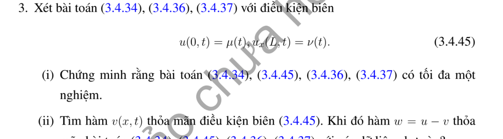

# Bài tập thực hành 3 — Mục 3.4.3

**Mã:** `BT_3_4_3_03` · **Trang sách:** 152–152

[← Mục lục](../MUC_LUC.md) · [Bản PDF của bài](BT_3_4_3_03.pdf)

## Đề bài

## Kiến thức và trình tự giải

**Bước 1 — Đưa điều kiện biên về thuần nhất.** Với $u(0,t)=\mu(t)$, $u(L,t)=\nu(t)$, đặt $b=(1-x/L)\mu+(x/L)\nu$. Với Neumann hai đầu đặt $b=\mu x+(\nu-\mu)x^2/(2L)$. Với Dirichlet–Neumann đặt $b=\mu+x\nu$. Viết $u=b+w$; khi đó $w$ có biên thuần nhất, nguồn $Q=F+a^2b_{xx}-b_{tt}$ và dữ liệu $f-b(x,0)$, $g-b_t(x,0)$.

**Bước 2 — Chiếu nguồn và dữ liệu lên cùng hệ hàm riêng.** Tính $Q_n(t)=\int QX_n/\int X_n^2$, $A_n$, $B_n$. Không bỏ các dữ liệu mới phát sinh từ hàm nâng biên; chúng có thể khác không ngay khi dữ liệu gốc bằng không.

**Bước 3 — Giải ODE có nguồn cho từng mode.**

$$
y_n''+\omega_n^2y_n=Q_n(t),\qquad
y_n=A_n\cos\omega_nt+\frac{B_n}{\omega_n}\sin\omega_nt+\frac1{\omega_n}\int_0^t\sin(\omega_n(t-s))Q_n(s)ds.
$$

Với mode hằng Neumann, thay công thức bằng $y_0=A_0+B_0t+\int_0^t(t-s)Q_0(s)ds$.

**Bước 4 — Xử lý cộng hưởng trước khi chia.** Nguồn $\cos\alpha t$ có đáp ứng dữ liệu không là $(\cos\alpha t-\cos\omega t)/(\omega^2-\alpha^2)$; tại $\alpha=\omega$ lấy $t\sin\omega t/(2\omega)$. Nguồn $\sin\alpha t$ có đáp ứng $(\sin\alpha t-(\alpha/\omega)\sin\omega t)/(\omega^2-\alpha^2)$; tại cộng hưởng là $\sin\omega t/(2\omega^2)-t\cos\omega t/(2\omega)$. Không thế vào phân số $0/0$.

**Bước 5 — Cộng lại hàm nâng và kiểm tra duy nhất.** Thế $u=b+\sum y_nX_n$ vào PDE và mọi dữ liệu. Với hiệu hai nghiệm, nguồn và biên bằng không; nhân phương trình với $w_t$, tích phân từng phần để có $E'=0$, $E(0)=0$, suy $w=0$. Các góc không tương thích phải được ghi riêng.

**Chi tiết xác nhận tích phân nguồn.** Với $D(t)=\omega^{-1}\int_0^t\sin(\omega(t-s))Q(s)ds$, lần đạo hàm đầu cho $D'=\int_0^t\cos(\omega(t-s))Q(s)ds$, vì $\sin0=0$. Lần sau cho $D''=Q(t)-\omega\int_0^t\sin(\omega(t-s))Q(s)ds=Q-\omega^2D$. Do $D(0)=D'(0)=0$, tích phân này thêm đúng nguồn mà giữ nguyên hai dữ liệu đầu.

## Lời giải áp dụng cho bài

**Bước 1. Chứng minh duy nhất.** Hiệu $v$ có nguồn và dữ liệu không, $v(0,t)=v_x(L,t)=0$. Đạo hàm năng lượng $E'=a^2[v_tv_x]_0^L$: ở đầu trái $v_t=0$ vì vết $v=0$, đầu phải $v_x=0$. Suy $E=E(0)=0$, $v$ hằng cả không gian và thời gian, rồi dữ liệu đầu buộc $v=0$.

**Bước 2. Nâng biên.** Lấy $b=\mu(t)+x\nu(t)$ để $b(0,t)=\mu$, $b_x(L,t)=\nu$. $w=u-b$ có biên hỗn hợp không, nguồn $Q=F-\mu''-x\nu''$, li độ $f-\mu(0)-x\nu(0)$, vận tốc $g-\mu'(0)-x\nu'(0)$.

**Bước 3. Chiếu nguồn cùng dữ liệu.** $k_n=(n+1/2)\pi/L$, $X_n=\sin k_nx$, chuẩn $L/2$. Tính $A_n=(2/L)\int w_0X_n$, $B_n=(2/L)\int w_{t,0}X_n$, $Q_n(s)=(2/L)\int Q(x,s)X_n(x)dx$.

**Bước 4. Giải và trả về biến gốc.**

$$
u=b+\sum_{n\ge0}\left[A_n\cos\omega_nt+\frac{B_n}{\omega_n}\sin\omega_nt+\int_0^t\frac{\sin(\omega_n(t-s))}{\omega_n}Q_n(s)ds\right]X_n,\quad\omega_n=ak_n.
$$

Với $\mu=\nu=0$, $b=0$ và dữ liệu/nguồn chiếu chính là dữ liệu gốc. Đạo hàm hai lần của tích phân mode cho $Q_n$, còn hai dữ liệu ban đầu của nó bằng không. Cộng hàm nâng xác nhận mọi biên. Cần điều kiện tương thích ở góc nếu muốn nghiệm cổ điển, chẳng hạn $f(0)=\mu(0)$, $g(0)=\mu'(0)$, $f'(L)=\nu(0)$, $g'(L)=\nu'(0)$.

**Chi tiết tích phân từng phần trong đạo hàm năng lượng.** Đặt $E=\frac12\int_0^L(u_t^2+a^2u_x^2+\kappa u^2)dx$. Với $u_{tt}-a^2u_{xx}+\gamma u_t+\kappa u=F$,

$$
\begin{aligned}
E'&=\int_0^L(u_tu_{tt}+a^2u_xu_{xt}+\kappa uu_t)dx\\
&=\int_0^Lu_t(a^2u_{xx}-\gamma u_t-\kappa u+F)dx
+a^2\int_0^Lu_xu_{xt}dx+\kappa\int_0^Luu_tdx\\
&=a^2[u_tu_x]_0^L-a^2\int_0^Lu_{tx}u_xdx
+a^2\int_0^Lu_xu_{xt}dx-\gamma\int_0^Lu_t^2dx+\int_0^LFu_tdx\\
&=a^2[u_tu_x]_0^L-\gamma\int_0^Lu_t^2dx+\int_0^LFu_tdx.
\end{aligned}
$$

Hai hạng $\kappa uu_t$ triệt tiêu ngay khi thế PDE; hai tích phân $u_xu_{xt}$ triệt tiêu sau tích phân từng phần. Với biên Dirichlet thuần nhất, đạo hàm vết theo $t$ cho $u_t=0$; với biên Neumann thuần nhất, $u_x=0$. Nếu định nghĩa năng lượng không có $1/2$, nhân cả đẳng thức đạo hàm với $2$.

**Chi tiết đạo hàm đáp ứng mode nguồn.** Đặt $D_n(t)=\omega_n^{-1}\int_0^t\sin(\omega_n(t-s))Q_n(s)ds$. Vì $\sin0=0$,

$$
D_n'=\int_0^t\cos(\omega_n(t-s))Q_n(s)ds,\quad
D_n''=Q_n(t)-\omega_n\int_0^t\sin(\omega_n(t-s))Q_n(s)ds=Q_n-\omega_n^2D_n.
$$

Tại $0$, $D_n=D_n'=0$. Vì thế tích phân vừa cho đúng nguồn, vừa giữ nguyên cả hai dữ liệu ban đầu của các hạng thuần nhất. Với mode hằng, $D_0=\int_0^t(t-s)Q_0(s)ds$, $D_0'=\int_0^tQ_0(s)ds$, $D_0''=Q_0(t)$, không chia cho $\omega_0=0$.

## Đối chiếu kết quả

Khi sử dụng kết quả, kiểm tra đồng thời phương trình, dữ liệu ban đầu/biên và miền được nêu trong lời giải. Các điều kiện về tính trơn, nghiệm thực, tồn tại hoặc duy nhất là một phần của kết luận; không bỏ chúng khi ghi đáp án.
