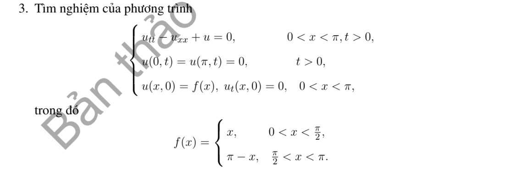

# Bài tập thực hành 3 — Mục 3.5.3

**Mã:** `BT_3_5_3_03` · **Trang sách:** 160–160

[← Mục lục](../MUC_LUC.md) · [Bản PDF của bài](BT_3_5_3_03.pdf)

## Đề bài

## Kiến thức và trình tự giải

**Bước 1 — Chọn năng lượng theo toán tử.** Với sóng dùng $E=\frac12\int(u_t^2+a^2u_x^2)dx$. Với Klein–Gordon có thêm $u$, thêm $\frac12\int u^2dx$. Với dầm $u_{tt}=-a^2u_{xxxx}$ dùng $E=\frac12\int(u_t^2+a^2u_{xx}^2)dx$, không thay $u_{xx}$ bằng $u_x$.

**Bước 2 — Đạo hàm và tích phân từng phần.** Với $u_{tt}-a^2u_{xx}+\gamma u_t+\kappa u=F$, năng lượng có hạng $\kappa u^2$ cho

$$
E'=a^2[u_tu_x]_0^L-\gamma\int u_t^2dx+\int Fu_tdx.
$$

Với dầm, tích phân hai lần cho $E'=a^2[u_{tx}u_{xx}-u_tu_{xxx}]_0^L$. Viết riêng từng hạng biên rồi dùng điều kiện biên và đạo hàm theo thời gian của điều kiện đó để cho chúng bằng không.

**Bước 3 — Suy hệ quả.** Không cản, không nguồn thì $E$ bảo toàn. Có cản $\gamma>0$ thì $E'\le0$; nếu $E$ không có hệ số $1/2$, $E'=-2\gamma\int u_t^2\ge-2\gamma E$, suy $e^{-2\gamma t}E(0)\le E(t)\le E(0)$. Với hiệu hai nghiệm cùng dữ liệu, $E(0)=0$ nên có duy nhất.

**Bước 4 — Tách biến nếu phải tìm nghiệm cụ thể.** Sóng có cản $\gamma=1$ cho $T''+T'+a^2\lambda T=0$. Đặt $T=e^{-t/2}Y$, thu $Y''+(a^2\lambda-1/4)Y=0$, $Y(0)=A$, $Y'(0)=B+A/2$. Phân biệt dao động, nghiệm kép và hàm hyperbolic. Dầm cho $X''''=k^4X$, $T''+a^2k^4T=0$; dùng đủ bốn điều kiện biên để tìm phương trình của $kL$.

**Bước 5 — Kiểm tra hệ số và khẳng định của đề.** Năng lượng đầu chứa cả $g^2$ và các đạo hàm của $f$. Thử $f=0$, $g\ne0$ để phát hiện công thức bỏ vận tốc. Với dầm, nghiệm $k=0$ phải giải trực tiếp bằng đa thức bậc ba; nghiệm $0$ của phương trình lượng giác–hyperbolic có thể chỉ là nghiệm giả do cơ sở suy biến.

**Chi tiết phép triệt tiêu tích phân.** Đạo hàm động năng cho $\int u_tu_{tt}$; dùng PDE thay $u_{tt}$. Với sóng, $\int u_tu_{xx}=[u_tu_x]-\int u_{tx}u_x$, và tích phân cuối triệt tiêu đạo hàm thế năng $\int u_xu_{xt}$. Với dầm,

$$
\int u_tu_{xxxx}=[u_tu_{xxx}-u_{tx}u_{xx}]+\int u_{txx}u_{xx}.
$$

Tích phân cuối triệt tiêu đạo hàm $\frac12\int u_{xx}^2$ sau khi nhân hệ số và giữ đúng dấu PDE. Viết hạng biên trước, sau đó mới dùng điều kiện của từng đầu.

**Bước 1 — Tách biến và chọn bài toán trị riêng theo biên.** Đặt $u=X(x)T(t)$ trong $u_{tt}=a^2u_{xx}$, suy $X''+\lambda X=0$, $T''+a^2\lambda T=0$. Tích phân từng phần cho $\lambda\int X^2=\int (X')^2$ khi hạng biên bằng không; do đó $\lambda\ge0$. Giải cả trường hợp $\lambda=0$ trước khi xét $\lambda=k^2>0$.

**Bước 2 — Tìm hệ hàm riêng.** Trên $(0,L)$: Dirichlet hai đầu dùng $\sin(n\pi x/L)$, $n\ge1$; Neumann hai đầu dùng $1$ và $\cos(n\pi x/L)$; Dirichlet–Neumann dùng $\sin((n+1/2)\pi x/L)$, $n\ge0$; Neumann–Dirichlet dùng cos của các tần số nửa nguyên ấy. Chuẩn bình phương của mode khác không là $L/2$, của mode hằng là $L$.

**Bước 3 — Chiếu cả hai dữ liệu.** Với mode khác không đặt

$$
A_n=\frac2L\int_0^L fX_n\,dx,\quad B_n=\frac2L\int_0^L gX_n\,dx,\quad \omega_n=ak_n.
$$

Tích phân từng khoảng nếu dữ liệu chia đoạn; dùng tích phân từng phần hoặc công thức tích–tổng khi là đa thức/lượng giác. Hệ số $B_n$ là hệ số của vận tốc, nên hệ số đứng trước $\sin\omega_nt$ phải là $B_n/\omega_n$.

**Bước 4 — Ghép nghiệm và xét mode hằng.**

$$
u=\sum_n\left(A_n\cos\omega_nt+\frac{B_n}{\omega_n}\sin\omega_nt\right)X_n.
$$

Với Neumann hai đầu, thêm $A_0+B_0t$, trong đó $A_0=L^{-1}\int f$, $B_0=L^{-1}\int g$. Với tần số bị thay đổi bởi hạng $u$ hoặc cản $u_t$, giải lại ODE của từng mode; không dùng nguyên tần số $ak_n$.

**Bước 5 — Kiểm tra biên, dữ liệu và hội tụ.** Mỗi mode thỏa biên; tại $t=0$ hai chuỗi cho khai triển của $f,g$. Nếu dữ liệu không tương thích ở góc, giải theo nghĩa năng lượng hoặc từng miền và nêu đường mất tính trơn; không đạo hàm một chuỗi yếu tùy ý. Chu kỳ được suy từ tất cả mode có hệ số khác không, kể cả mode hằng; hai tần số có tỷ số vô tỷ ngăn một chu kỳ chung.

**Chi tiết tính tích phân hệ số.** Với $k=n\pi/L$, hai nguyên hàm thường dùng là

$$
\int x\sin kx\,dx=-x\cos kx/k+\sin kx/k^2,\qquad
\int x\cos kx\,dx=x\sin kx/k+\cos kx/k^2.
$$

Với đa thức $P$, ghi cả hai lần tích phân:

$$
\int_0^L P\sin kx\,dx
=\left[-P\cos kx/k\right]_0^L+
\left[P'\sin kx/k^2\right]_0^L-
\frac1{k^2}\int_0^L P''\sin kx\,dx.
$$

Chỉ bỏ hạng biên sau khi thế $0,L$ và điều kiện thực sự của $P$. Nếu dữ liệu chia đoạn, áp dụng công thức trên từng đoạn, rồi cộng các hạng tại điểm chia. Cuối cùng nhân nghịch đảo chuẩn của hàm riêng; nếu hệ số là của vận tốc, chia thêm tần số khi ghép nghiệm. Với mẫu số bằng $0$ trong tích–tổng, quay lại tích phân gốc để tính riêng.

## Lời giải áp dụng cho bài

**Bước 1. Hệ sine và dữ liệu tam giác.** PDE $u_{tt}=u_{xx}-u$ trên $(0,\pi)$, biên không. $f=\min(x,\pi-x)$, $g=0$ có $A_n=4\sin(n\pi/2)/(\pi n^2)$, tính bằng tách tích phân tại $\pi/2$ như Bài 3.3.3.2.

**Bước 2. Giải đúng tần số mới.** $T_n''+(n^2+1)T_n=0$, $T_n(0)=A_n$, $T_n'(0)=0$. Do đó

$$
u=\sum_{n\ge1}\frac{4\sin(n\pi/2)}{\pi n^2}\cos(\sqrt{n^2+1}\,t)\sin nx.
$$

Hạng $+1$ dưới căn đến từ $-u$ trong PDE, không thể dùng tần số $n$.

**Bước 3. Không có chu kỳ chung.** Hệ số mode $1,3$ đều khác không. Nếu chu kỳ $T>0$ tồn tại, chiếu lên hai mode cho $\sqrt2T$ và $\sqrt{10}T$ đều là bội của $2\pi$, buộc tỷ số $\sqrt5$ hữu tỷ, mâu thuẫn. Vậy nghiệm này không tuần hoàn.

**Bước 4. Kiểm tra và mức trơn.** Mỗi mode thỏa PDE/biên và đúng dữ liệu. Tam giác có góc nên nghiệm thuộc lớp năng lượng, không cổ điển qua mặt truyền góc. Năng lượng bảo toàn phải chứa $u^2$: $\frac12\int(u_t^2+u_x^2+u^2)$.

**Chi tiết hệ số của tam giác.** Với $f(x)=\min(x,\pi-x)$, chia tại $b=\pi/2$. Đổi $y=\pi-x$ ở nửa sau cho

$$
\int_0^\pi f(x)\sin nx\,dx=(1+(-1)^{n+1})\int_0^b x\sin nx\,dx.
$$

Tích phân cuối bằng $[-x\cos nx/n+\sin nx/n^2]_0^b=-b\cos(nb)/n+\sin(nb)/n^2$. Nếu $n$ chẵn, hệ số trước tích phân bằng $0$; nếu $n$ lẻ, $\cos(nb)=0$. Nhân $2/\pi$ được $4\sin(n\pi/2)/(\pi n^2)$.

## Đối chiếu kết quả

Khi sử dụng kết quả, kiểm tra đồng thời phương trình, dữ liệu ban đầu/biên và miền được nêu trong lời giải. Các điều kiện về tính trơn, nghiệm thực, tồn tại hoặc duy nhất là một phần của kết luận; không bỏ chúng khi ghi đáp án.
