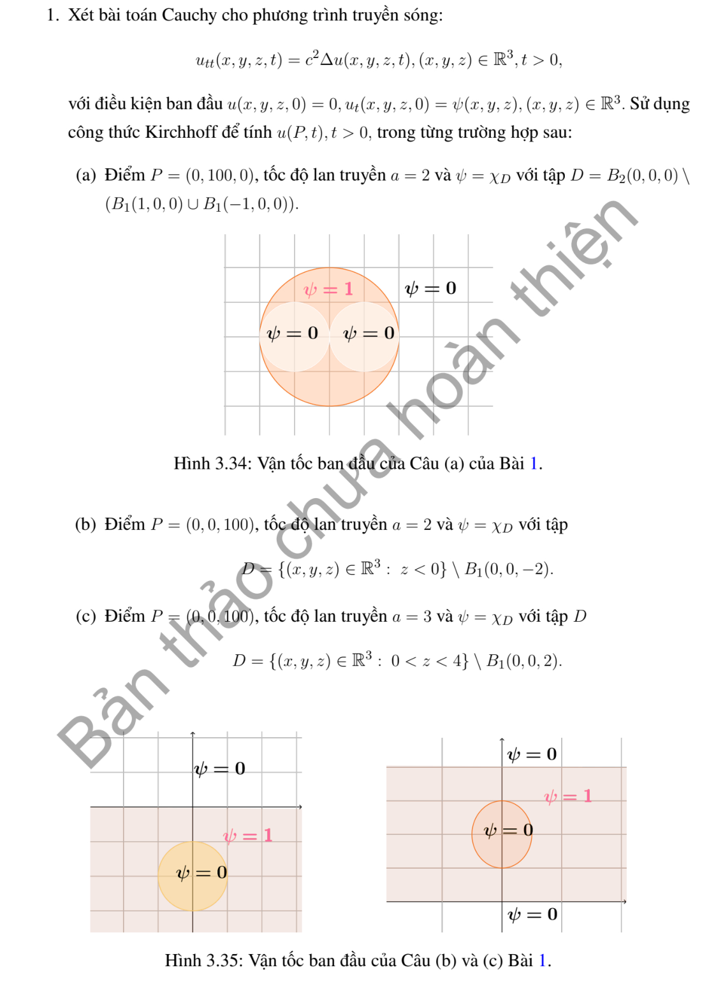
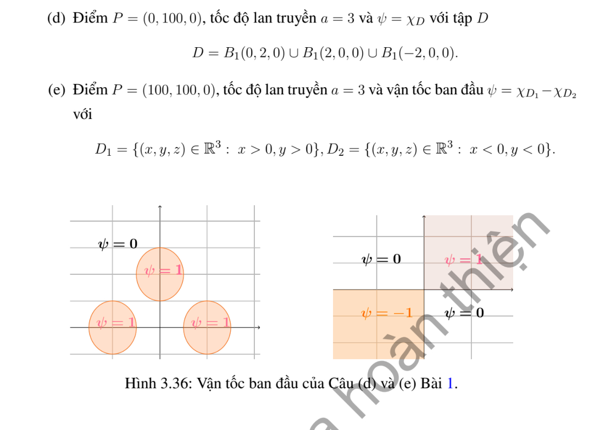

# Bài tập thực hành 1 — Mục 3.6.3

**Mã:** `BT_3_6_3_01` · **Trang sách:** 179–180

[← Mục lục](../MUC_LUC.md) · [Bản PDF của bài](BT_3_6_3_01.pdf)

## Đề bài

## Kiến thức và trình tự giải

**Bước 1 — Chọn Kirchhoff (3D) hoặc Poisson (2D).** Với li độ đầu bằng không, vận tốc $\psi$, tốc độ $c$, đặt $\rho=ct$. Trong ba chiều,

$$
u(P,t)=\frac t{4\pi}\int_{S^2}\psi(P+\rho\omega)d\omega.
$$

Trong hai chiều,

$$
u(P,t)=\frac1{2\pi c}\int_{|Q-P|<ct}\frac{\psi(Q)}{\sqrt{c^2t^2-|Q-P|^2}}dQ.
$$

Với li độ $f$ khác không, thêm đạo hàm theo $t$ của chính biểu thức tương ứng khi thay $\psi$ bằng $f$. Với nguồn và dữ liệu đầu không, tích phân theo thời gian của nghiệm có vận tốc là nguồn tại từng thời điểm (Duhamel).

**Bước 2 — Tận dụng hình học và đối xứng.** Chỉ thị miền $D$ biến Kirchhoff thành $t$ nhân tỷ lệ diện tích mặt cầu nằm trong $D$. Chọn trục qua tâm miền và $P$, đặt $\mu=\cos\theta$, $d\omega=d\mu\,d\phi$. Nếu điều kiện không phụ thuộc $\phi$, tỷ lệ là $|E|/2$ với $E\subset[-1,1]$. Mỗi nửa không gian cho một bất đẳng thức tuyến tính theo $\mu$; quả cầu cho một ngưỡng chỏm. Miền hợp/rút bỏ cho tổng/hiệu nếu các phần không chồng diện tích.

**Bước 3 — Viết chính xác các khoảng hợp lệ.** Giải bất đẳng thức gốc, sau đó mới bình phương khi có căn. Chia $[-1,1]$ ở nghiệm phương trình biên, kiểm tra dấu ở trung điểm từng khoảng, loại nghiệm ngoại lai. Nếu còn góc phương vị, dùng độ dài tập $\cos\phi<v$ rồi còn một tích phân theo $\mu$. Với Poisson, tích phân theo một tọa độ cho hiệu arcsin; cắt các cận vào đĩa trước khi tính.

**Bước 4 — Tính nguồn bằng nguyên hàm thời gian.** Với quả cầu bán kính $R$ cách $P$ khoảng $r>0$, đặt

$$
K_R(r,t)=t\left[\frac{R^2-(r-ct)^2}{4rct}\right]_0^1,\quad J_R(r,t)=\int_0^tK_R(r,s)ds.
$$

Tách ba giai đoạn: cả mặt cầu nằm trong miền, giao một chỏm, không giao. Nguồn bật trên $[0,T]$ cho $J_R(r,t)-J_R(r,(t-T)_+)$. Trường hợp $r=0$ tính trực tiếp, tránh chia cho $r$.

**Bước 5 — Kiểm tra chuẩn hóa, mặt sóng và cực đại.** Nếu $\psi=1$ trên toàn không gian thì $u=t$, dùng để kiểm tra hệ số. Với dữ liệu bước nhảy, chỉ kết luận cổ điển ngoài các mặt sóng. Cực đại phải xét cả điểm chuyển nhánh và giá trị một phía; nêu rõ supremum nếu chỉ đạt theo giới hạn. Nếu dùng tích phân số, ghi tham số và cách kiểm tra hội tụ; đồ thị không tự chứng minh một cực đại toàn cục.

## Lời giải áp dụng cho bài

**Bước 1. Quy các miền về cầu, nửa không gian và lớp.** Với vận tốc chỉ thị, Kirchhoff bằng $t$ nhân tỷ lệ diện tích mặt cầu. Các quả cầu bị bỏ ở (a),(b),(c) nằm trong miền lớn và đôi cầu ở (a) không chồng thể tích, nên được lấy hiệu các chỉ thị. Các quả cầu ở (d) rời nhau, nên cộng ba đóng góp. Đặt $\mu$ hướng về tâm cầu; điều kiện $r^2+c^2t^2-2rct\mu<R^2$ cho ngưỡng chỏm.

**Bước 2. Tính các khoảng cách đúng điểm quan sát.** (a) $P=(0,100,0)$ cách tâm lớn $100$, cách hai tâm $(\pm1,0,0)$ cùng $\sqrt{10001}$. (b) $P_z=100$, cầu bị bỏ có tâm $z=-2$, cách $102$; nửa không gian $z<0$ cho $\mu<-100/(2t)$, tỷ lệ $(1-50/t)_+/2$. (c) lớp $0<z<4$ cho $-100/(3t)<\mu<-96/(3t)$, còn cầu tâm $z=2$ cách $98$. (d) khoảng cách là $98$ tới $(0,2,0)$ và $\sqrt{10004}$ tới hai tâm $(\pm2,0,0)$. (e) hiệu hai góc phần tư là $(\operatorname{sgn}x+\operatorname{sgn}y)/2$; mỗi tọa độ của hướng cầu đều phân bố đều trên $[-1,1]$.

**Bước 3. Thay tỷ lệ diện tích vào Kirchhoff.**

Kirchhoff với li độ đầu 0: $u(P,t)=t(4\pi)^{-1}\int_{S^2}\psi(P+ct\omega)d\omega$. Đối với một quả cầu bán kính $R$ có tâm cách $P$ một khoảng $d>0$, diện tích chỏm cho

$$
K_R(d,t)=t\left[\frac{R^2-(d-ct)^2}{4dct}\right]_0^1,\quad [s]_0^1=\max(0,\min(1,s)).
$$

Nếu $d=0$, $K_R(0,t)=t\chi_{ct<R}$. Giá trị trên mặt sóng hiểu theo giới hạn; dữ liệu bước nhảy không cho nghiệm cổ điển trên mặt ấy.

**Ý (a).**  $u=K_2(100,t)-2K_1(\sqrt{10001},t)$, $c=2$.

**Ý (b).**  $u=(t-50)_+/2-K_1(102,t)$, $c=2$; hạng đầu là tỷ lệ mặt cầu ở nửa không gian $z<0$.

**Ý (c).**  Với $c=3$, tỷ lệ của lớp $0<z<4$ cho

$$
u=\frac t2\left[\left[-\frac{96}{3t}\right]_{-1}^1-\left[-\frac{100}{3t}\right]_{-1}^1\right]-K_1(98,t).
$$

Ở đây $[s]_{-1}^1=\max(-1,\min(1,s))$.

**Ý (d).**  $u=K_1(98,t)+2K_1(\sqrt{10004},t)$, $c=3$.

**Ý (e).**  $\psi=(\operatorname{sgn}x+\operatorname{sgn}y)/2$. Tọa độ mỗi hướng cầu phân bố đều trên $[-1,1]$; ở $P=(100,100,0)$ trung bình sign là $\min(1,100/(3t))$. Do đó $u=\min(t,100/3)$.

**Bước 4. Đối chiếu và kết luận.** Ở (a),(c),(d), sau khi mặt cầu ra ngoài toàn bộ các miền bị chặn, đóng góp bằng $0$; ở (b),(e), miền vận tốc không bị chặn nên không suy như vậy. Tại các điểm dữ liệu liên tục, đạo hàm đầu đúng bằng chỉ thị; chuẩn hóa $\psi=1$ cho $u=t$. Các mặt tiếp xúc với biên miền là nơi cần xét vết một phía.

## Đối chiếu kết quả

Khi sử dụng kết quả, kiểm tra đồng thời phương trình, dữ liệu ban đầu/biên và miền được nêu trong lời giải. Các điều kiện về tính trơn, nghiệm thực, tồn tại hoặc duy nhất là một phần của kết luận; không bỏ chúng khi ghi đáp án.
