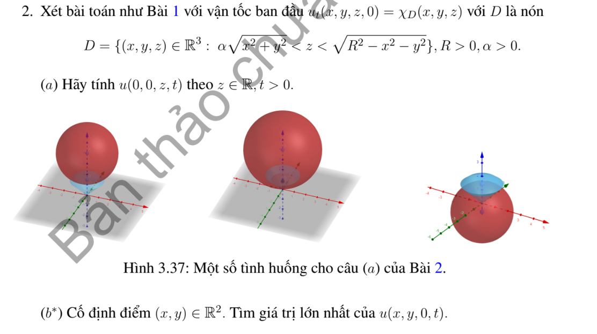
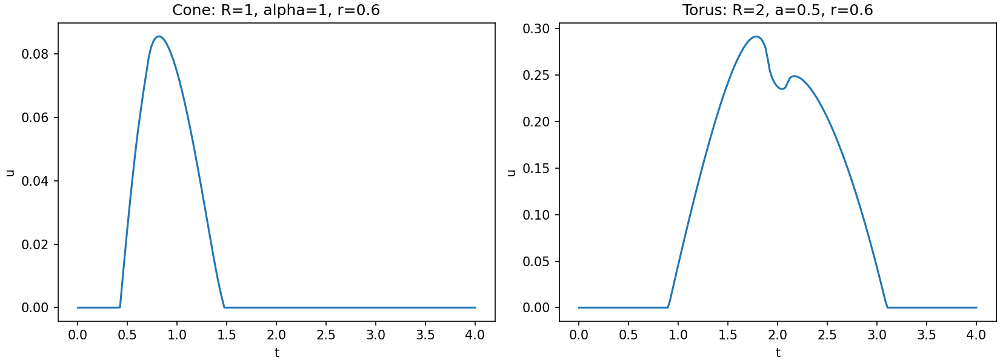

# Bài tập thực hành 2 — Mục 3.6.3

**Mã:** `BT_3_6_3_02` · **Trang sách:** 180–180

[← Mục lục](../MUC_LUC.md) · [Bản PDF của bài](BT_3_6_3_02.pdf)

## Đề bài

## Kiến thức và trình tự giải

**Bước 1 — Chọn Kirchhoff (3D) hoặc Poisson (2D).** Với li độ đầu bằng không, vận tốc $\psi$, tốc độ $c$, đặt $\rho=ct$. Trong ba chiều,

$$
u(P,t)=\frac t{4\pi}\int_{S^2}\psi(P+\rho\omega)d\omega.
$$

Trong hai chiều,

$$
u(P,t)=\frac1{2\pi c}\int_{|Q-P|<ct}\frac{\psi(Q)}{\sqrt{c^2t^2-|Q-P|^2}}dQ.
$$

Với li độ $f$ khác không, thêm đạo hàm theo $t$ của chính biểu thức tương ứng khi thay $\psi$ bằng $f$. Với nguồn và dữ liệu đầu không, tích phân theo thời gian của nghiệm có vận tốc là nguồn tại từng thời điểm (Duhamel).

**Bước 2 — Tận dụng hình học và đối xứng.** Chỉ thị miền $D$ biến Kirchhoff thành $t$ nhân tỷ lệ diện tích mặt cầu nằm trong $D$. Chọn trục qua tâm miền và $P$, đặt $\mu=\cos\theta$, $d\omega=d\mu\,d\phi$. Nếu điều kiện không phụ thuộc $\phi$, tỷ lệ là $|E|/2$ với $E\subset[-1,1]$. Mỗi nửa không gian cho một bất đẳng thức tuyến tính theo $\mu$; quả cầu cho một ngưỡng chỏm. Miền hợp/rút bỏ cho tổng/hiệu nếu các phần không chồng diện tích.

**Bước 3 — Viết chính xác các khoảng hợp lệ.** Giải bất đẳng thức gốc, sau đó mới bình phương khi có căn. Chia $[-1,1]$ ở nghiệm phương trình biên, kiểm tra dấu ở trung điểm từng khoảng, loại nghiệm ngoại lai. Nếu còn góc phương vị, dùng độ dài tập $\cos\phi<v$ rồi còn một tích phân theo $\mu$. Với Poisson, tích phân theo một tọa độ cho hiệu arcsin; cắt các cận vào đĩa trước khi tính.

**Bước 4 — Tính nguồn bằng nguyên hàm thời gian.** Với quả cầu bán kính $R$ cách $P$ khoảng $r>0$, đặt

$$
K_R(r,t)=t\left[\frac{R^2-(r-ct)^2}{4rct}\right]_0^1,\quad J_R(r,t)=\int_0^tK_R(r,s)ds.
$$

Tách ba giai đoạn: cả mặt cầu nằm trong miền, giao một chỏm, không giao. Nguồn bật trên $[0,T]$ cho $J_R(r,t)-J_R(r,(t-T)_+)$. Trường hợp $r=0$ tính trực tiếp, tránh chia cho $r$.

**Bước 5 — Kiểm tra chuẩn hóa, mặt sóng và cực đại.** Nếu $\psi=1$ trên toàn không gian thì $u=t$, dùng để kiểm tra hệ số. Với dữ liệu bước nhảy, chỉ kết luận cổ điển ngoài các mặt sóng. Cực đại phải xét cả điểm chuyển nhánh và giá trị một phía; nêu rõ supremum nếu chỉ đạt theo giới hạn. Nếu dùng tích phân số, ghi tham số và cách kiểm tra hội tụ; đồ thị không tự chứng minh một cực đại toàn cục.

## Lời giải áp dụng cho bài

**Bước 1. Tham số hóa mặt cầu và giữ dấu của nón.** Tốc độ ký hiệu $c$, $\rho=ct$. Trên trục $z$, điểm cầu có chiều cao $z+\rho\mu$, bán kính trụ $\rho\sqrt{1-\mu^2}$. Miền $D$ là giao của $z'>\alpha r'$ với quả cầu $|Q|<R$; điều kiện $z'>0$ không được bỏ khi bình phương. Tích phân phương vị cho $2\pi$, nên $u=t|E|/2$.

**Bước 2. Giải từng ngưỡng; ở mặt phẳng $z=0$ khử góc phương vị.** Nhờ đối xứng chỉ cần $P=(r,0,0)$. Đặt $\omega=(\sqrt{1-\mu^2}\cos\phi,\sqrt{1-\mu^2}\sin\phi,\mu)$. Nón đòi $\mu>0$ và $r'^2<\rho^2\mu^2/\alpha^2$; cầu đòi $r'^2+\rho^2\mu^2<R^2$. Viết $r'^2=r^2+\rho^2(1-\mu^2)+2r\rho\sqrt{1-\mu^2}\cos\phi$, được hai cận trên cho $\cos\phi$. Độ dài góc đúng là $A(\min(B,C))$, không nhân hai tỷ lệ chỏm độc lập.

**Bước 3. Công thức tính $u$ và cực trị.**

**Ý (a).**  Đặt $\rho=ct$, $\mu=\cos\theta$. Tại $P=(0,0,z)$, miền hướng hợp lệ là

$$
E=\{\mu\in[-1,1]:z+\rho\mu>\alpha\rho\sqrt{1-\mu^2},\quad z^2+\rho^2+2z\rho\mu<R^2\}.
$$

Kirchhoff cho kết quả chính xác $u(0,0,z,t)=t|E|/2$. Để tính $|E|$ bằng hữu hạn phép toán: chia $[-1,1]$ ở các nghiệm thực của

$$
(1+\alpha^2)\rho^2\mu^2+2z\rho\mu+z^2-\alpha^2\rho^2=0,
$$

và điểm $(R^2-z^2-\rho^2)/(2z\rho)$ nếu $z\ne0$, cùng điểm $-z/\rho$. Trên từng khoảng kiểm tra hai bất đẳng thức gốc tại trung điểm rồi cộng độ dài các khoảng đúng. Kiểm tra dấu $z+\rho\mu$ loại nghiệm ngoại lai do bình phương. Khi $z=0$, $u=t(1-\alpha/\sqrt{1+\alpha^2})/2$ nếu $ct<R$, và 0 nếu $ct>R$.

**Ý (b).**  Do đối xứng quay, chỉ cần $r=\sqrt{x^2+y^2}$. Với $r>0$, đặt $D=2r\rho\sqrt{1-\mu^2}$,

$$
B=\frac{R^2-r^2-\rho^2}{D},\qquad C=\frac{\rho^2\mu^2/\alpha^2-r^2-\rho^2(1-\mu^2)}D.
$$

Gọi $A(v)=0$ nếu $v\le-1$, $A(v)=2\pi-2\arccos v$ nếu $|v|<1$, $A(v)=2\pi$ nếu $v\ge1$. Khi đó

$$
U_r(t)=\frac t{4\pi}\int_0^1A(\min(B,C))d\mu.
$$

Đây là tích phân một chiều đã loại hoàn toàn tích phân mặt. $U=0$ khi $ct>r+R$; để tìm giá trị lớn nhất, tính $U$ ở các điểm chuyển nhánh và các nghiệm $U'(t)=0$ trong $0<t<(r+R)/c$, lấy giá trị lớn nhất. Kèm mã tính tích phân và tối ưu cho $r,R,\alpha,c$ bất kỳ trong file Python chung. Không có một con số duy nhất vì đề để các tham số tùy ý. Với $r=0$, supremum là $R(1-\alpha/\sqrt{1+\alpha^2})/(2c)$; dữ liệu chỉ thị gián đoạn ở mặt cầu có thể khiến supremum chỉ đạt theo giới hạn trái.

**Bước 4. Đối chiếu và kết luận.** Với $r>0$, công thức tích phân và bài toán cực trị một biến là biểu diễn chính xác theo tham số; các con số do mã tích phân/tối ưu trả về là xấp xỉ. Mã chia lưới thời gian, tinh chỉnh từng cực đại và cho phép tăng độ phân giải để kiểm tra hội tụ, nên không dùng một lần tối ưu cục bộ làm bằng chứng cực đại toàn cục. Ở $r=0$ công thức supremum nêu trên là tường minh, suy bằng lấy $t\uparrow R/c$. Điều kiện nón strict và biên cầu phải được giữ khi xét đạt cực đại.

**Chi tiết nghiệm biên nón và độ dài phương vị.** Phương trình bậc hai ở (a) có biệt thức

$$
4z^2\rho^2-4(1+\alpha^2)\rho^2(z^2-\alpha^2\rho^2)
=4\alpha^2\rho^2[(1+\alpha^2)\rho^2-z^2].
$$

Nếu biểu thức dưới căn không âm và $\rho>0$, hai nghiệm là

$$
\mu_\pm=\frac{-z\pm\alpha\sqrt{(1+\alpha^2)\rho^2-z^2}}{(1+\alpha^2)\rho}.
$$

Giữ những nghiệm thuộc $[-1,1]$, thêm các điểm cắt cầu và dấu đã nêu, rồi kiểm tra bất đẳng thức gốc trên từng khoảng. Ở (b), $\cos\phi<v$ với $-1<v<1$ cho $\arccos v<\phi<2\pi-\arccos v$; độ dài là $2\pi-2\arccos v$. Hai điều kiện cùng là cận trên nên lấy $\min(B,C)$. Khi $r=0$, nón cho $\mu>\alpha/\sqrt{1+\alpha^2}$ và cầu cho $\rho<R$, nên tỷ lệ diện tích bằng $(1-\alpha/\sqrt{1+\alpha^2})/2$.

## Đối chiếu kết quả

Khi sử dụng kết quả, kiểm tra đồng thời phương trình, dữ liệu ban đầu/biên và miền được nêu trong lời giải. Các điều kiện về tính trơn, nghiệm thực, tồn tại hoặc duy nhất là một phần của kết luận; không bỏ chúng khi ghi đáp án.
