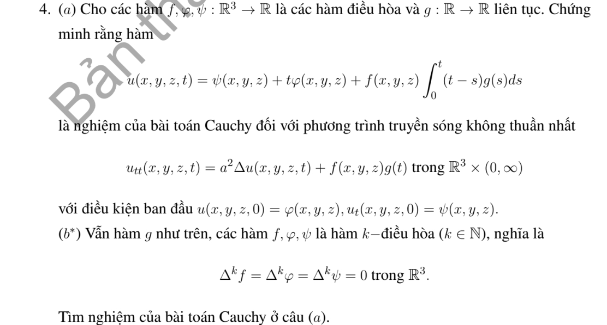

# Bài tập thực hành 4 — Mục 3.6.3

**Mã:** `BT_3_6_3_04` · **Trang sách:** 181–182

[← Mục lục](../MUC_LUC.md) · [Bản PDF của bài](BT_3_6_3_04.pdf)

## Đề bài

## Kiến thức và trình tự giải

**Bước 1 — Chọn Kirchhoff (3D) hoặc Poisson (2D).** Với li độ đầu bằng không, vận tốc $\psi$, tốc độ $c$, đặt $\rho=ct$. Trong ba chiều,

$$
u(P,t)=\frac t{4\pi}\int_{S^2}\psi(P+\rho\omega)d\omega.
$$

Trong hai chiều,

$$
u(P,t)=\frac1{2\pi c}\int_{|Q-P|<ct}\frac{\psi(Q)}{\sqrt{c^2t^2-|Q-P|^2}}dQ.
$$

Với li độ $f$ khác không, thêm đạo hàm theo $t$ của chính biểu thức tương ứng khi thay $\psi$ bằng $f$. Với nguồn và dữ liệu đầu không, tích phân theo thời gian của nghiệm có vận tốc là nguồn tại từng thời điểm (Duhamel).

**Bước 2 — Tận dụng hình học và đối xứng.** Chỉ thị miền $D$ biến Kirchhoff thành $t$ nhân tỷ lệ diện tích mặt cầu nằm trong $D$. Chọn trục qua tâm miền và $P$, đặt $\mu=\cos\theta$, $d\omega=d\mu\,d\phi$. Nếu điều kiện không phụ thuộc $\phi$, tỷ lệ là $|E|/2$ với $E\subset[-1,1]$. Mỗi nửa không gian cho một bất đẳng thức tuyến tính theo $\mu$; quả cầu cho một ngưỡng chỏm. Miền hợp/rút bỏ cho tổng/hiệu nếu các phần không chồng diện tích.

**Bước 3 — Viết chính xác các khoảng hợp lệ.** Giải bất đẳng thức gốc, sau đó mới bình phương khi có căn. Chia $[-1,1]$ ở nghiệm phương trình biên, kiểm tra dấu ở trung điểm từng khoảng, loại nghiệm ngoại lai. Nếu còn góc phương vị, dùng độ dài tập $\cos\phi<v$ rồi còn một tích phân theo $\mu$. Với Poisson, tích phân theo một tọa độ cho hiệu arcsin; cắt các cận vào đĩa trước khi tính.

**Bước 4 — Tính nguồn bằng nguyên hàm thời gian.** Với quả cầu bán kính $R$ cách $P$ khoảng $r>0$, đặt

$$
K_R(r,t)=t\left[\frac{R^2-(r-ct)^2}{4rct}\right]_0^1,\quad J_R(r,t)=\int_0^tK_R(r,s)ds.
$$

Tách ba giai đoạn: cả mặt cầu nằm trong miền, giao một chỏm, không giao. Nguồn bật trên $[0,T]$ cho $J_R(r,t)-J_R(r,(t-T)_+)$. Trường hợp $r=0$ tính trực tiếp, tránh chia cho $r$.

**Bước 5 — Kiểm tra chuẩn hóa, mặt sóng và cực đại.** Nếu $\psi=1$ trên toàn không gian thì $u=t$, dùng để kiểm tra hệ số. Với dữ liệu bước nhảy, chỉ kết luận cổ điển ngoài các mặt sóng. Cực đại phải xét cả điểm chuyển nhánh và giá trị một phía; nêu rõ supremum nếu chỉ đạt theo giới hạn. Nếu dùng tích phân số, ghi tham số và cách kiểm tra hội tụ; đồ thị không tự chứng minh một cực đại toàn cục.

## Lời giải áp dụng cho bài

**Bước 1. Kiểm tra hai dữ liệu trước khi dùng công thức in.** Tại $t=0$, công thức $\psi+t\varphi$ trong sách cho li độ $\psi$ và vận tốc $\varphi$, đảo với dữ liệu đã ghi. Vì thế cần đổi lại $\varphi+t\psi$. Đặt $I(t)=\int_0^t(t-s)g(s)ds$, ta có $I(0)=I'(0)=0$, $I''=g$.

**Bước 2. Trường hợp điều hòa.** Mọi Laplace của $f,\varphi,\psi$ đều bằng không, nên nghiệm không có đóng góp $c^2\Delta u$; chỉ cần giải ODE thời gian tại mỗi điểm. Trường hợp $k$-điều hòa dùng chuỗi Taylor chẵn/lẻ theo thời gian và chuỗi Duhamel, nhưng kết thúc vì $\Delta^k$ của từng dữ liệu bằng không.

**Bước 3. Nghiệm sửa đúng và chuỗi hữu hạn.**

**Ý (a).**  Với dữ liệu đầu $u(0)=\varphi,u_t(0)=\psi$, nghiệm đúng là

$$
u=\varphi+t\psi+f\int_0^t(t-s)g(s)ds.
$$

Do các hàm không gian điều hòa, $\Delta u=0$ và $u_{tt}=fg$. Dòng công thức trong đề đảo $\varphi,\psi$ nên không thỏa dữ liệu đã ghi; cần sửa như trên.

**Ý (b).**  Với $\Delta^kf=\Delta^k\varphi=\Delta^k\psi=0$, chuỗi hữu hạn:

$$
\begin{aligned}
u=\sum_{j=0}^{k-1}c^{2j}\bigg[&\frac{t^{2j}}{(2j)!}\Delta^j\varphi+\frac{t^{2j+1}}{(2j+1)!}\Delta^j\psi\\
&+\Delta^jf\int_0^t\frac{(t-s)^{2j+1}}{(2j+1)!}g(s)ds\bigg].
\end{aligned}
$$

Đạo hàm hai lần làm dịch chỉ số; hạng cuối hết vì $\Delta^k=0$, chứng minh phương trình và dữ liệu.

**Bước 4. Đối chiếu và kết luận.** Để kiểm tra chuỗi ở (b), đạo hàm hai lần hạng li độ chuyển $t^{2j}/(2j)!$ thành $t^{2j-2}/(2j-2)!$; Laplace hạng trước sinh cùng $\Delta^j\varphi$. Tương tự cho vận tốc và tích phân nguồn. Chỉ hạng nguồn $j=0$ sinh $fg$, các hạng cuối mất vì $\Delta^k=0$. Tại $0$ chỉ hai hạng $j=0$ có thể cho li độ/vận tốc, nên đúng $\varphi,\psi$.

## Đối chiếu kết quả

Khi sử dụng kết quả, kiểm tra đồng thời phương trình, dữ liệu ban đầu/biên và miền được nêu trong lời giải. Các điều kiện về tính trơn, nghiệm thực, tồn tại hoặc duy nhất là một phần của kết luận; không bỏ chúng khi ghi đáp án.
