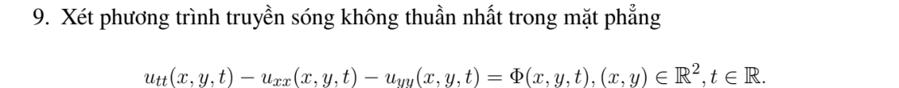
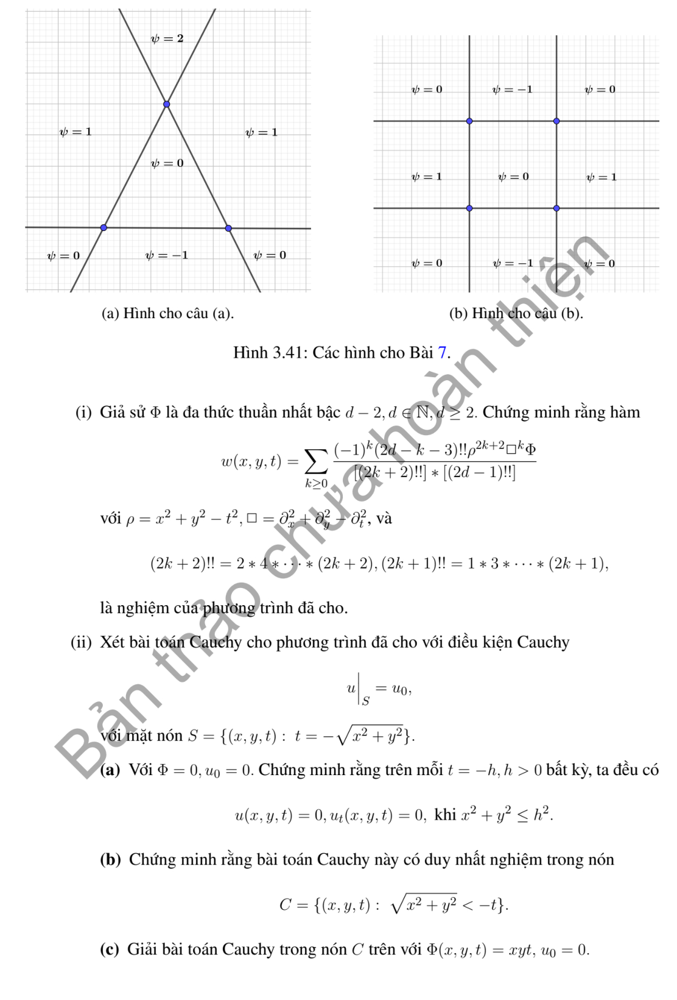
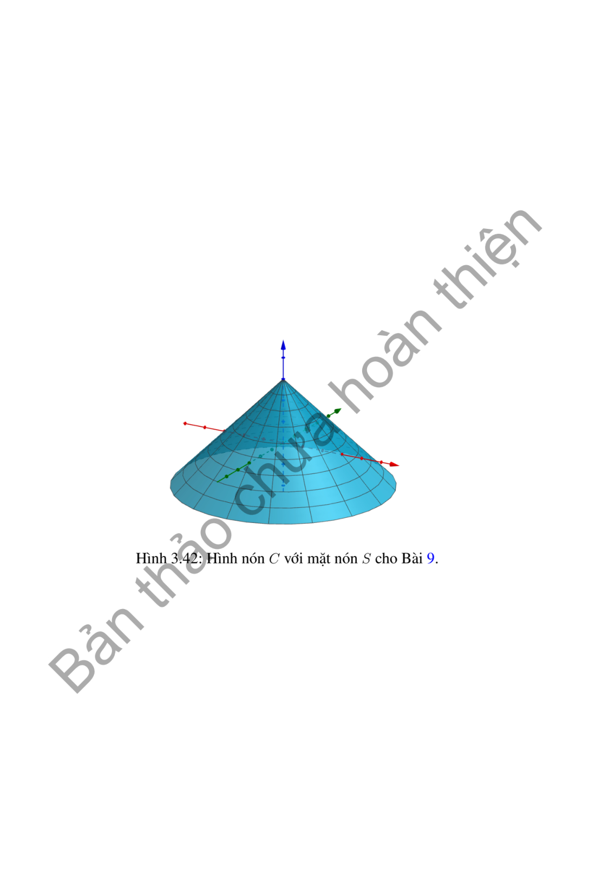

# Bài tập thực hành 9 — Mục 3.6.3

**Mã:** `BT_3_6_3_09` · **Trang sách:** 182–184

[← Mục lục](../MUC_LUC.md) · [Bản PDF của bài](BT_3_6_3_09.pdf)

## Đề bài

## Kiến thức và trình tự giải

**Bước 1 — Giữ nhất quán dấu toán tử.** Đặt $q=x^2+y^2-t^2$, $\Box=\partial_{xx}+\partial_{yy}-\partial_{tt}$. Phương trình $u_{tt}-\Delta u=\Phi$ là $-\Box u=\Phi$. Dữ liệu trên nón $q=0$ gợi ý mỗi hạng của nghiệm chứa ít nhất một thừa số $q$.

**Bước 2 — Tính quy tắc đạo hàm tích.** Với $H$ thuần nhất bậc $m$, dùng Euler $xH_x+yH_y+tH_t=mH$ để có $\Box(q^jH)=q^j\Box H+2j(2m+2j+1)q^{j-1}H$. Tính trực tiếp $\Box q=6$ để kiểm tra hệ số.

**Bước 3 — Lập truy hồi hữu hạn.** Viết $u=\sum a_kq^{k+1}\Box^k\Phi$. Vì $\Phi$ bậc $d-2$, hệ số khi áp dụng $\Box$ là $C_k=2(k+1)(2d-2k-1)$. Chọn $a_0=-1/C_0$, $a_k=-a_{k-1}/C_k$ để triệt tiêu các hạng còn lại. Các đạo hàm lặp của đa thức hết sau hữu hạn bước.

**Bước 4 — Chứng minh duy nhất bằng năng lượng trên miền co.** Với hiệu $v$ của hai nghiệm, đặt $E(t)=\frac12\int_{x^2+y^2<t^2}(v_t^2+|\nabla v|^2)dxdy$ cho $t<0$. Đạo hàm cả tích phân lẫn biên chuyển động. Vết $v(r,-r)=0$ cho $v_t=v_r$ và đạo hàm tiếp tuyến góc bằng không, nên thông lượng năng lượng bằng không. Nếu nghiệm đủ trơn đến đỉnh, $E(t)\to0$ khi $t\uparrow0$; do đó $E=0$, suy $v=0$ trong nón.

**Bước 5 — Thế lại nghiệm cụ thể.** Kiểm tra cả dấu PDE và $u|_{q=0}=0$. Với đa thức nguồn cụ thể, tính $\Box\Phi$ trước: nếu bằng không thì chỉ còn hạng $a_0q\Phi$.

## Lời giải áp dụng cho bài

**Bước 1. Đạo hàm tích và Euler.** $q=x^2+y^2-t^2$, $\Box=\Delta-\partial_{tt}$, nên $\Box q=6$. Với $H$ thuần nhất bậc $m$, hạng đạo hàm chéo bằng $4j q^{j-1}(xH_x+yH_y+tH_t)=4jm q^{j-1}H$. Cộng $\Box q^j=2j(2j+1)q^{j-1}$ cho công thức tích dưới đây.

**Bước 2. Lập hệ số thay vì chép dấu in.** Đặt $u=\sum a_kq^{k+1}\Box^k\Phi$. Hệ số hạng hạ bậc là $C_k=2(k+1)(2d-2k-1)$. Vì PDE là $-\Box u=\Phi$, cần $a_0=-1/C_0$; các hạng sau triệt tiêu khi $a_k=-a_{k-1}/C_k$. Suy biểu thức giai thừa kép, có dấu âm phía ngoài và số mũ $q^{k+1}$, không phải $q^{2k+2}$.

**Bước 3. Công thức đúng, chứng minh duy nhất và nguồn cụ thể.**

Đặt $q=x^2+y^2-t^2$, $\Box=\Delta_{x,y}-\partial_{tt}$; phương trình là $-\Box u=\Phi$. Với $H$ thuần nhất bậc $m$,

$$
\Box(q^jH)=q^j\Box H+2j(2m+2j+1)q^{j-1}H.
$$

Lấy $H=\Box^k\Phi$ bậc $d-2-2k$, $j=k+1$: hệ số là $2(k+1)(2d-2k-1)$. Quy nạp triệt tiêu các hạng cho

$$
u=-\sum_{k\ge0}\frac{(-1)^k(2d-2k-3)!!}{(2k+2)!!(2d-1)!!}\,q^{k+1}\Box^k\Phi.
$$

Tổng hữu hạn vì $\Phi$ đa thức. Đề có dấu dương và chỉ số giai thừa kép không nhất quán; công thức trên thỏa $u_{tt}-\Delta u=\Phi$ và $u=0$ trên nón.

(ii-a,b) Với hiệu hai nghiệm nguồn và vết nón 0, đặt năng lượng trên $B_{-t}$, $t<0$. Đạo hàm miền di động cho $E'=\int_{r=-t}[u_tu_r-(u_t^2+|\nabla u|^2)/2]$. Trên nón, vết 0 buộc đạo hàm tiếp tuyến $u_t=u_r$ và đạo hàm góc 0, nên thông lượng bằng 0. Nếu nghiệm đủ trơn đến đỉnh, $E(t)\to0$ khi $t\uparrow0$, vì diện tích miền co về 0. Vậy $E=0$, $u_t=\nabla u=0$ trên mọi mặt $t=-h$, suy $u=0$ và duy nhất trong nón. Điều kiện chính quy ở đỉnh cần thiết cho lập luận.

(ii-c) $\Phi=xyt$ có bậc 3 nên $d=5$, $\Box\Phi=0$:

$$
u=-\frac{(x^2+y^2-t^2)xyt}{18}.
$$

Kiểm tra $u_{tt}-u_{xx}-u_{yy}=xyt$ và vết nón 0, nên đây là nghiệm duy nhất trong lớp chính quy đã nêu.

**Bước 4. Đối chiếu và kết luận.** Đạo hàm biên chuyển động trong năng lượng ở (ii) có tốc độ bán kính $-1$, nên hạng biên mang dấu âm. Vết $u(r,-r)=0$ cho $u_r-u_t=0$; thế vào thông lượng triệt tiêu bình phương. Với $\Phi=xyt$, tính trực tiếp $u=-[x^3yt+xy^3t-xyt^3]/18$: $u_{tt}=xyt/3$, $u_{xx}=-xyt/3$, $u_{yy}=-xyt/3$, suy hiệu bằng $xyt$. Hệ số $-1/18$ và dấu đã được kiểm tra độc lập.

**Chi tiết đạo hàm tích và truy hồi hệ số.** $\nabla_{x,y}q=(2x,2y)$, $q_t=-2t$, nên $|\nabla q|^2-q_t^2=4q$ và $\Box q=6$. Quy tắc dây chuyền:

$$
\Box q^j=j q^{j-1}\Box q+j(j-1)q^{j-2}(|\nabla q|^2-q_t^2)
=[6j+4j(j-1)]q^{j-1}=2j(2j+1)q^{j-1}.
$$

Hạng chéo trong $\Box(q^jH)$ là

$$
2(\nabla q^j\cdot\nabla H-(q^j)_tH_t)
=4jq^{j-1}(xH_x+yH_y+tH_t)=4jmq^{j-1}H.
$$

Gọi $H_k=\Box^k\Phi$, $C_k=2(k+1)(2d-2k-1)$. Thế chuỗi:

$$
\Box u=a_0C_0\Phi+\sum_{k\ge1}(a_{k-1}+C_ka_k)q^kH_k,
$$

vì hạng cuối $H_{k+1}$ hết khi bậc đa thức âm. Muốn $\Box u=-\Phi$ cần $a_0C_0=-1$, $a_{k-1}+C_ka_k=0$. Do đó

$$
a_k=\frac{(-1)^{k+1}}{C_0\cdots C_k}
=\frac{(-1)^{k+1}(2d-2k-3)!!}{(2k+2)!!(2d-1)!!},
$$

vì tích các thừa số chẵn là $(2k+2)!!$, tích lẻ là $(2d-1)!!/(2d-2k-3)!!$.

## Đối chiếu kết quả

Khi sử dụng kết quả, kiểm tra đồng thời phương trình, dữ liệu ban đầu/biên và miền được nêu trong lời giải. Các điều kiện về tính trơn, nghiệm thực, tồn tại hoặc duy nhất là một phần của kết luận; không bỏ chúng khi ghi đáp án.
