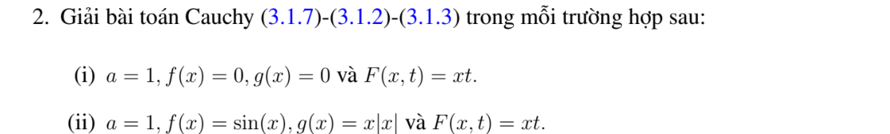
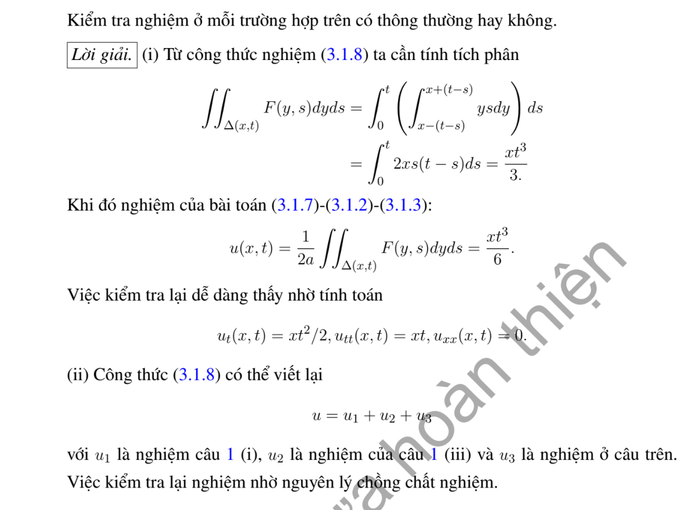

# Ví dụ 2 — Mục 3.1.2

**Mã:** `VD_3_1_2_02` · **Trang sách:** 96–97

[← Mục lục](../MUC_LUC.md) · [Bản PDF của bài](VD_3_1_2_02.pdf)

## Đề bài và phần trình bày có sẵn trong sách

## Kiến thức và trình tự giải

**Bước 1 — Nhận dạng dữ liệu và tốc độ.** Viết $u_{tt}-a^2u_{xx}=F$, $u(x,0)=f(x)$, $u_t(x,0)=g(x)$; tốc độ là $a>0$, không phải $a^2$. Với dữ liệu trơn, cần $f\in C^2$, $g\in C^1$. Nếu dữ liệu có góc hoặc bước nhảy, công thức vẫn mô tả sóng từng miền nhưng phải xác định nơi mất tính trơn.

**Bước 2 — Tìm hai sóng chạy.** Đặt $\xi=x-at$, $\eta=x+at$. Quy tắc dây chuyền cho $u_{tt}-a^2u_{xx}=-4a^2u_{\xi\eta}$, nên khi $F=0$, $u=A(\xi)+B(\eta)$. Tại $t=0$, $A+B=f$, $a(B'-A')=g$. Chọn một nguyên hàm $H'=g$ rồi lấy $A=f/2-H/(2a)$, $B=f/2+H/(2a)$; hằng số của $H$ sẽ triệt tiêu.

$$
u_0(x,t)=\frac{f(x-at)+f(x+at)}2+\frac{H(x+at)-H(x-at)}{2a}.
$$

**Bước 3 — Tính tích phân theo dữ liệu thật.** Tìm nguyên hàm trên từng khoảng, nối liên tục nếu $g$ có bước nhảy; thay hai cận $x\pm at$. Dùng công thức cộng lượng giác trước khi kết luận chu kỳ. Với dữ liệu chỉ thị, tích phân bằng độ dài giao của $[x-at,x+at]$ với đoạn hỗ trợ, nhân hệ số của $g$.

**Bước 4 — Nếu có nguồn, thêm Duhamel.** Nghiệm riêng có dữ liệu đầu bằng không là

$$
u_F(x,t)=\frac1{2a}\int_0^t\int_{x-a(t-s)}^{x+a(t-s)}F(y,s)\,dy\,ds.
$$

Tính tích phân trong trước. Nếu $F$ là đa thức hoặc một mode lượng giác, có thể đoán $u_F$ rồi giải ODE theo $t$, nhưng vẫn phải buộc $u_F(x,0)=(u_F)_t(x,0)=0$. Nghiệm cuối là $u_0+u_F$.

**Bước 5 — Kiểm tra và đọc ý nghĩa.** Đạo hàm công thức: $u_x=(f'(\xi)+f'(\eta))/2+(g(\eta)-g(\xi))/(2a)$, $u_t=a(f'(\eta)-f'(\xi))/2+(g(\eta)+g(\xi))/2$. Tại $t=0$ thu lại $f,g$; đạo hàm tiếp cho PDE. Các điểm gãy $s=b$ phát sinh đường $x\pm at=b$. Chu kỳ phải đúng cho mọi $x,t$, không chỉ sau khi một mặt sóng đi qua một điểm cố định.

## Lời giải áp dụng cho bài

**Bước 1. Giải phần có nguồn với dữ liệu không.** Nguồn $F(x,t)=xt$, $a=1$. Tích phân trong của Duhamel là

$$
\int_{x-(t-s)}^{x+(t-s)}ys\,dy=2xs(t-s).
$$

Suy $u_F=x\int_0^t s(t-s)ds=xt^3/6$.

**Bước 2. Thêm phần thuần nhất.** Ở (i), $f=g=0$, nên $u=xt^3/6$. Ở (ii), $f=\sin x$, $g=x|x|$, nguyên hàm đúng là $|x|^3/3$:

$$
u=\sin x\cos t+\frac{|x+t|^3-|x-t|^3}{6}+\frac{xt^3}{6}.
$$

**Bước 3. Kiểm tra.** $(u_F)_{tt}=xt$, $(u_F)_{xx}=0$, $u_F(x,0)=(u_F)_t(x,0)=0$. Phần còn lại thỏa phương trình thuần nhất và cho đúng $f,g$. Dữ liệu $g\in C^1$ bảo đảm nghiệm $C^2$; không cần loại hai đường $x=\pm t$ ở mức đạo hàm cấp hai.

**Chi tiết hai tích phân nguồn.** Đặt $h=t-s$. Tích phân trong bằng

$$
s\left[\frac{y^2}{2}\right]_{x-h}^{x+h}
=\frac s2[(x+h)^2-(x-h)^2]=2xsh.
$$

Nhân $1/2$ của Duhamel, tích phân ngoài là

$$
x\int_0^t(ts-s^2)ds=x\left[\frac{ts^2}{2}-\frac{s^3}{3}\right]_0^t
=x(t^3/2-t^3/3)=xt^3/6.
$$

