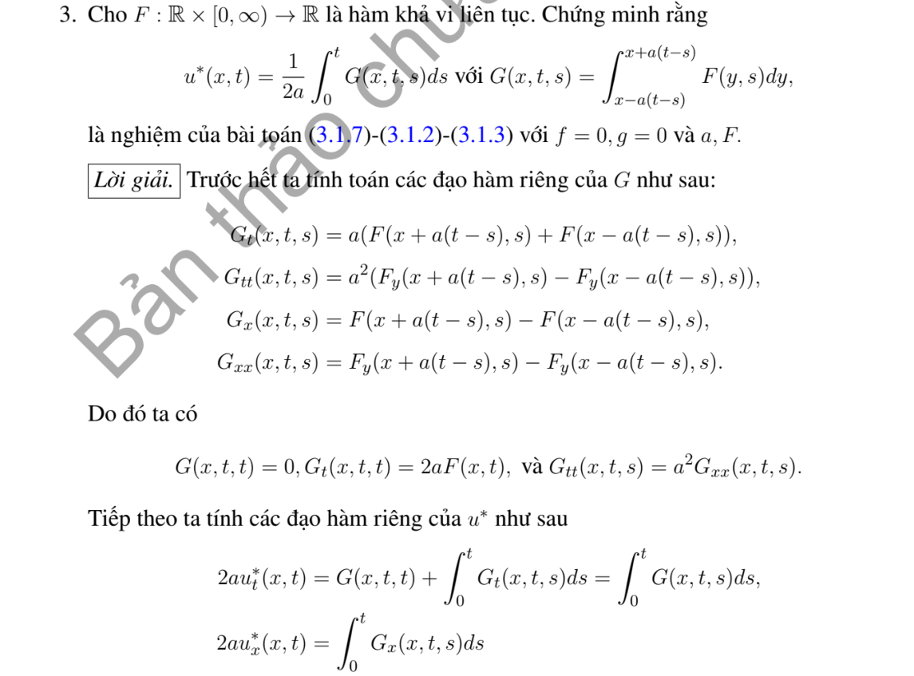
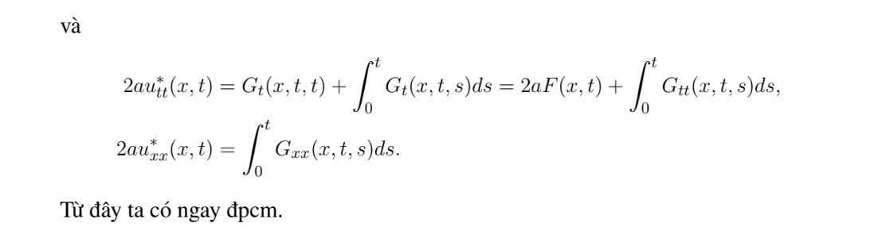

# Ví dụ 3 — Mục 3.1.2

**Mã:** `VD_3_1_2_03` · **Trang sách:** 97–98

[← Mục lục](../MUC_LUC.md) · [Bản PDF của bài](VD_3_1_2_03.pdf)

## Đề bài và phần trình bày có sẵn trong sách

## Kiến thức và trình tự giải

**Bước 1 — Nhận dạng dữ liệu và tốc độ.** Viết $u_{tt}-a^2u_{xx}=F$, $u(x,0)=f(x)$, $u_t(x,0)=g(x)$; tốc độ là $a>0$, không phải $a^2$. Với dữ liệu trơn, cần $f\in C^2$, $g\in C^1$. Nếu dữ liệu có góc hoặc bước nhảy, công thức vẫn mô tả sóng từng miền nhưng phải xác định nơi mất tính trơn.

**Bước 2 — Tìm hai sóng chạy.** Đặt $\xi=x-at$, $\eta=x+at$. Quy tắc dây chuyền cho $u_{tt}-a^2u_{xx}=-4a^2u_{\xi\eta}$, nên khi $F=0$, $u=A(\xi)+B(\eta)$. Tại $t=0$, $A+B=f$, $a(B'-A')=g$. Chọn một nguyên hàm $H'=g$ rồi lấy $A=f/2-H/(2a)$, $B=f/2+H/(2a)$; hằng số của $H$ sẽ triệt tiêu.

$$
u_0(x,t)=\frac{f(x-at)+f(x+at)}2+\frac{H(x+at)-H(x-at)}{2a}.
$$

**Bước 3 — Tính tích phân theo dữ liệu thật.** Tìm nguyên hàm trên từng khoảng, nối liên tục nếu $g$ có bước nhảy; thay hai cận $x\pm at$. Dùng công thức cộng lượng giác trước khi kết luận chu kỳ. Với dữ liệu chỉ thị, tích phân bằng độ dài giao của $[x-at,x+at]$ với đoạn hỗ trợ, nhân hệ số của $g$.

**Bước 4 — Nếu có nguồn, thêm Duhamel.** Nghiệm riêng có dữ liệu đầu bằng không là

$$
u_F(x,t)=\frac1{2a}\int_0^t\int_{x-a(t-s)}^{x+a(t-s)}F(y,s)\,dy\,ds.
$$

Tính tích phân trong trước. Nếu $F$ là đa thức hoặc một mode lượng giác, có thể đoán $u_F$ rồi giải ODE theo $t$, nhưng vẫn phải buộc $u_F(x,0)=(u_F)_t(x,0)=0$. Nghiệm cuối là $u_0+u_F$.

**Bước 5 — Kiểm tra và đọc ý nghĩa.** Đạo hàm công thức: $u_x=(f'(\xi)+f'(\eta))/2+(g(\eta)-g(\xi))/(2a)$, $u_t=a(f'(\eta)-f'(\xi))/2+(g(\eta)+g(\xi))/2$. Tại $t=0$ thu lại $f,g$; đạo hàm tiếp cho PDE. Các điểm gãy $s=b$ phát sinh đường $x\pm at=b$. Chu kỳ phải đúng cho mọi $x,t$, không chỉ sau khi một mặt sóng đi qua một điểm cố định.

## Lời giải áp dụng cho bài

**Bước 1. Đặt tích phân trong.** Viết $V=(2a)^{-1}\int_0^t G(x,t,s)ds$, với

$$
G=\int_{x-a(t-s)}^{x+a(t-s)}F(y,s)dy.
$$

Ở đây $s$ là tham số khi lấy đạo hàm theo $t$.

**Bước 2. Đạo hàm các cận.** Với $F_\pm=F(x\pm a(t-s),s)$,

$$
G_t=a(F_++F_-),\quad G_x=F_+-F_-,\quad G_{tt}=a^2(F_{x,+}-F_{x,-})=a^2G_{xx}.
$$

Khi $s=t$, $G=0$ và $G_t=2aF(x,t)$.

**Bước 3. Đạo hàm tích phân ngoài.** Quy tắc Leibniz cho

$$
V_t=\frac1{2a}\int_0^tG_tds,\qquad V_{tt}=F(x,t)+\frac1{2a}\int_0^tG_{tt}ds.
$$

Do đó $V_{tt}-a^2V_{xx}=F$. Tại $t=0$ cả $V,V_t$ bằng không. Các đạo hàm trên hợp lệ nếu $F$ có các đạo hàm liên tục cần dùng (chẳng hạn $F\in C^1$ theo không gian và liên tục theo thời gian). Thêm nghiệm d'Alembert của dữ liệu $f,g$ được nghiệm đầy đủ.

