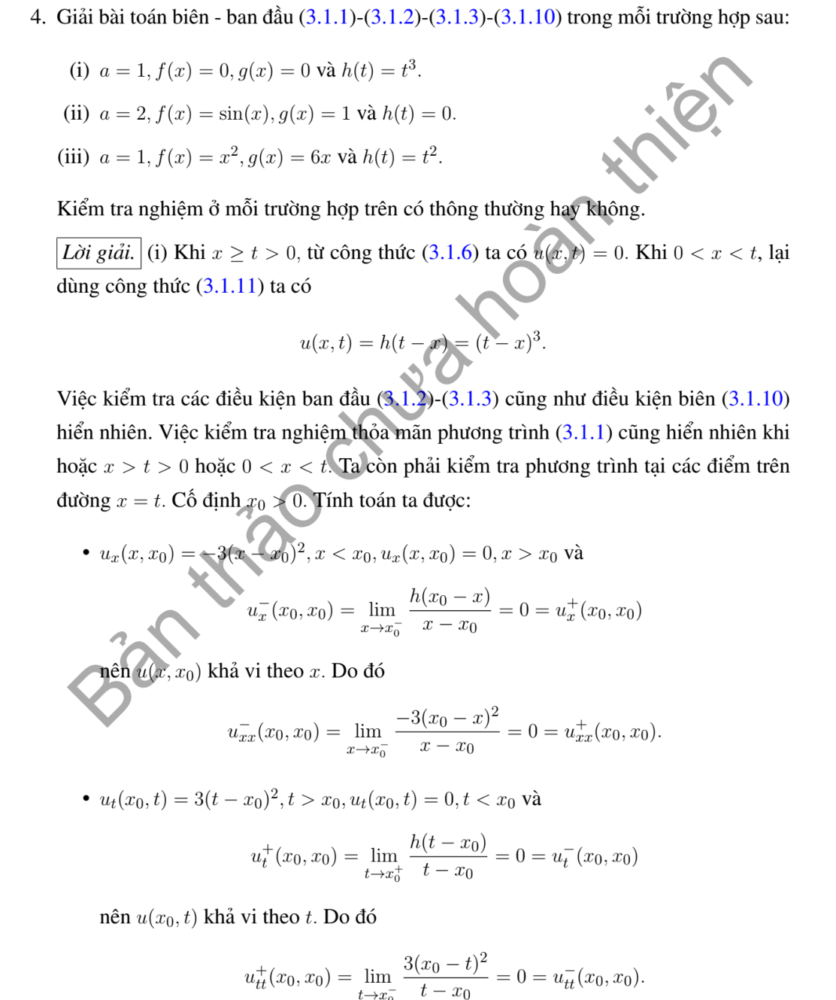
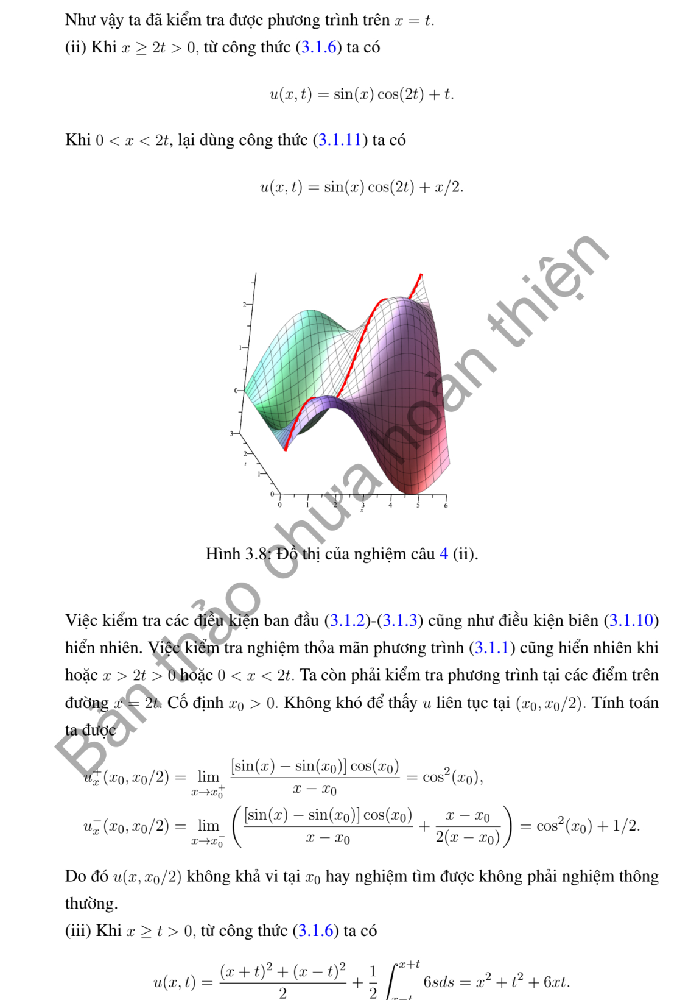
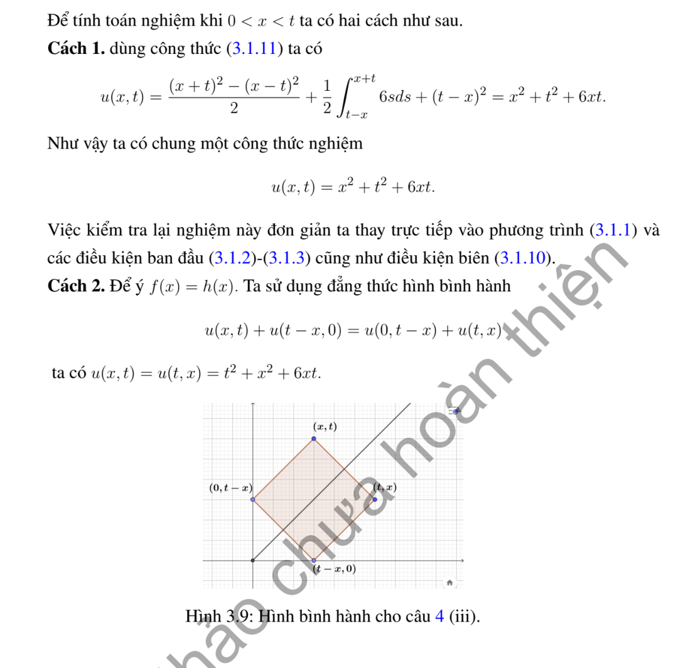

# Ví dụ 4 — Mục 3.1.2

**Mã:** `VD_3_1_2_04` · **Trang sách:** 98–100

[← Mục lục](../MUC_LUC.md) · [Bản PDF của bài](VD_3_1_2_04.pdf)

## Đề bài và phần trình bày có sẵn trong sách

## Kiến thức và trình tự giải

**Bước 1 — Đọc đúng điều kiện biên.** Biên $u(0,t)=0$ dùng mở rộng lẻ; biên $u_x(0,t)=0$ dùng mở rộng chẵn. Với dữ liệu trên $x\ge0$, đặt $\widetilde f(-s)=-f(s)$ hoặc $f(s)$ tương ứng, làm tương tự cho $g$. Mở rộng lẻ là $C^2$ nếu $f(0)=f''(0)=0$, và mở rộng lẻ của $g$ là $C^1$ nếu $g(0)=0$. Mở rộng chẵn đòi $f'(0)=g'(0)=0$ cho mức trơn ấy.

**Bước 2 — Lập nguyên hàm sau khi phản xạ.** Đặt $H(s)=\int_0^s\widetilde g(r)dr$. Nếu $\widetilde g$ lẻ thì $H$ chẵn; nếu $\widetilde g$ chẵn thì $H$ lẻ. Chính nguyên hàm, chứ không phải vận tốc, xuất hiện trong

$$
u=\frac{\widetilde f(x-at)+\widetilde f(x+at)}2+\frac{H(x+at)-H(x-at)}{2a}.
$$

**Bước 3 — Tách miền trước và sau khi chạm biên.** Với $u(0,t)=h(t)$, ở $x\ge at$ dùng d'Alembert với dữ liệu gốc. Ở $0<x<at$:

$$
u=h(t-x/a)+\frac{f(x+at)-f(at-x)}2+\frac1{2a}\int_{at-x}^{at+x}g(s)ds.
$$

Với $u_x(0,t)=h(t)$, dùng nghiệm của các mở rộng chẵn rồi trừ $a\int_0^{t-x/a}h(s)ds$ trên miền $x<at$. Tính riêng đạo hàm theo $x$ của hạng này để kiểm tra biên.

**Bước 4 — Trên đoạn hữu hạn, phản xạ ở cả hai đầu.** Dirichlet ở hai đầu cho mở rộng lẻ tại $0,L$, chu kỳ không gian $2L$. Neumann ở hai đầu cho mở rộng chẵn tại $0,L$, cũng chu kỳ $2L$. Một đầu lẻ, một đầu chẵn cho $\widetilde f(s+2L)=-\widetilde f(s)$ và chu kỳ $4L$, tương tự $g$. Vì thế chu kỳ thời gian thường là $2L/a$ hoặc $4L/a$. Với Neumann hai đầu còn phải xét trung bình $g$: trung bình khác không sinh hạng tuyến tính theo $t$, nên nghiệm không tuần hoàn.

**Bước 5 — Kiểm tra góc và đường ghép.** Biên Dirichlet không thuần nhất cần $h(0)=f(0)$, $h'(0)=g(0)$, $h''(0)=a^2f''(0)$ để có nghiệm $C^2$ cho phương trình thuần nhất. So sánh hai vết trên $x=at$, gồm $u,u_x,u_t$ rồi đạo hàm cấp hai. Nếu không tương thích, nêu rõ mức trơn còn lại thay vì khẳng định nghiệm cổ điển trên toàn miền.

## Lời giải áp dụng cho bài

**Bước 1. Xác định hai miền.** Với biên $u(0,t)=h(t)$, ở $x\ge at$ dùng dữ liệu đầu; ở $x<at$ thêm tín hiệu biên tại thời điểm trễ $t-x/a$ và lấy hiệu hai giá trị $f$.

**Bước 2. Tính cụ thể.**

**Ý (i).**  $a=1$, $f=g=0$, $h=t^3$. Trước khi sóng biên đến, $u=0$; sau đó $u=(t-x)^3$. Gộp lại $u=(t-x)_+^3$. Hàm này $C^2$ trên đường $x=t$.

**Ý (ii).**  $a=2$, $f=\sin x$, $g=1$, $h=0$. Ngoài mặt sóng, phần vận tốc là $t$. Trong mặt sóng, đoạn tích phân $[2t-x,2t+x]$ dài $2x$, cho $x/2$. Phần li độ ở cả hai miền bằng $\sin x\cos2t$. Vì vậy

$$
u=\sin x\cos2t+\min(t,x/2).
$$

Nghiệm liên tục nhưng không $C^1$ trên $x=2t$: vận tốc đầu $g(0)=1$ trái với $h'(0)=0$.

**Ý (iii).**  $a=1$, $f=x^2$, $g=6x$, $h=t^2$. Ngoài mặt sóng, half-sum bằng $x^2+t^2$, tích phân vận tốc bằng $6xt$. Trong mặt sóng,

$$
(t-x)^2+\tfrac12[(x+t)^2-(t-x)^2]+\tfrac12\int_{t-x}^{t+x}6sds=x^2+t^2+6xt.
$$

**Bước 3. Kiểm tra.** Nghiệm (iii) có $u_{tt}=u_{xx}=2$, $u(x,0)=x^2$, $u_t(x,0)=6x$, $u(0,t)=t^2$. Ba điều kiện tương thích tại góc đều đúng.

**Chi tiết rút gọn câu (iii).** Ngoài mặt sóng, half-sum là $[(x-t)^2+(x+t)^2]/2=x^2+t^2$, còn tích phân là $3[(x+t)^2-(x-t)^2]/2=6xt$. Trong mặt sóng, half-difference là $[(x+t)^2-(t-x)^2]/2=2xt$, tích phân vận tốc là $3[(t+x)^2-(t-x)^2]/2=6xt$. Cộng thêm biên $(t-x)^2=x^2-2xt+t^2$ cho cùng $x^2+t^2+6xt$.

