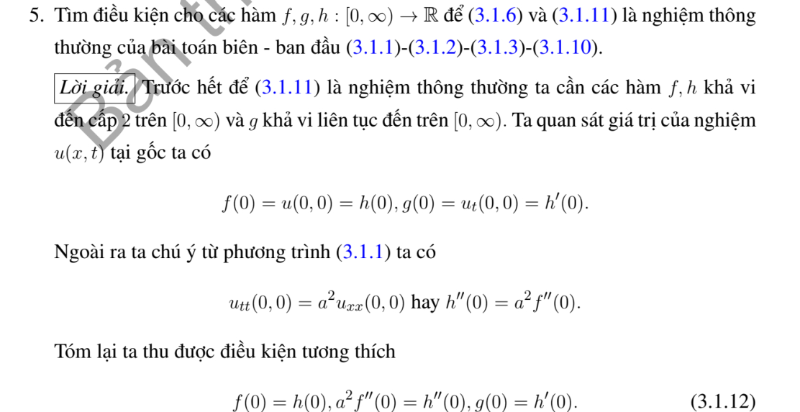
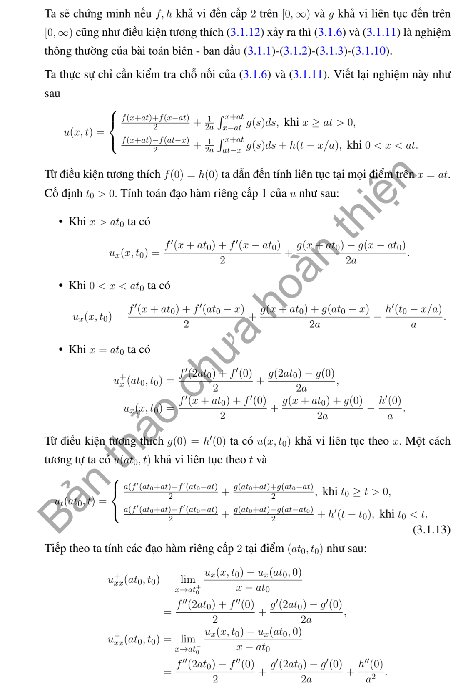
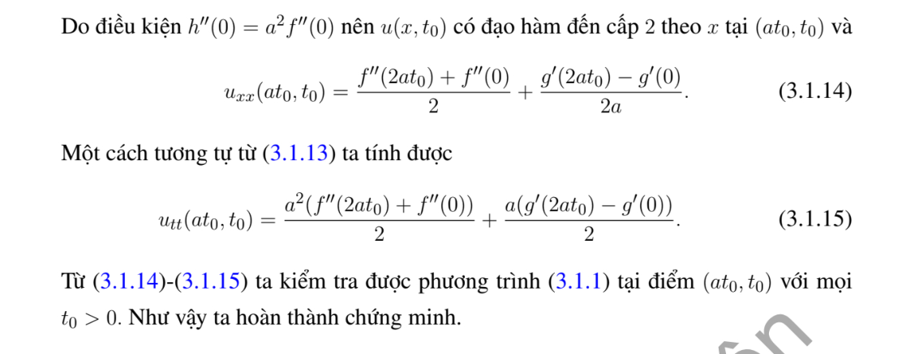

# Ví dụ 5 — Mục 3.1.2

**Mã:** `VD_3_1_2_05` · **Trang sách:** 100–102

[← Mục lục](../MUC_LUC.md) · [Bản PDF của bài](VD_3_1_2_05.pdf)

## Đề bài và phần trình bày có sẵn trong sách

## Kiến thức và trình tự giải

**Bước 1 — Đọc đúng điều kiện biên.** Biên $u(0,t)=0$ dùng mở rộng lẻ; biên $u_x(0,t)=0$ dùng mở rộng chẵn. Với dữ liệu trên $x\ge0$, đặt $\widetilde f(-s)=-f(s)$ hoặc $f(s)$ tương ứng, làm tương tự cho $g$. Mở rộng lẻ là $C^2$ nếu $f(0)=f''(0)=0$, và mở rộng lẻ của $g$ là $C^1$ nếu $g(0)=0$. Mở rộng chẵn đòi $f'(0)=g'(0)=0$ cho mức trơn ấy.

**Bước 2 — Lập nguyên hàm sau khi phản xạ.** Đặt $H(s)=\int_0^s\widetilde g(r)dr$. Nếu $\widetilde g$ lẻ thì $H$ chẵn; nếu $\widetilde g$ chẵn thì $H$ lẻ. Chính nguyên hàm, chứ không phải vận tốc, xuất hiện trong

$$
u=\frac{\widetilde f(x-at)+\widetilde f(x+at)}2+\frac{H(x+at)-H(x-at)}{2a}.
$$

**Bước 3 — Tách miền trước và sau khi chạm biên.** Với $u(0,t)=h(t)$, ở $x\ge at$ dùng d'Alembert với dữ liệu gốc. Ở $0<x<at$:

$$
u=h(t-x/a)+\frac{f(x+at)-f(at-x)}2+\frac1{2a}\int_{at-x}^{at+x}g(s)ds.
$$

Với $u_x(0,t)=h(t)$, dùng nghiệm của các mở rộng chẵn rồi trừ $a\int_0^{t-x/a}h(s)ds$ trên miền $x<at$. Tính riêng đạo hàm theo $x$ của hạng này để kiểm tra biên.

**Bước 4 — Trên đoạn hữu hạn, phản xạ ở cả hai đầu.** Dirichlet ở hai đầu cho mở rộng lẻ tại $0,L$, chu kỳ không gian $2L$. Neumann ở hai đầu cho mở rộng chẵn tại $0,L$, cũng chu kỳ $2L$. Một đầu lẻ, một đầu chẵn cho $\widetilde f(s+2L)=-\widetilde f(s)$ và chu kỳ $4L$, tương tự $g$. Vì thế chu kỳ thời gian thường là $2L/a$ hoặc $4L/a$. Với Neumann hai đầu còn phải xét trung bình $g$: trung bình khác không sinh hạng tuyến tính theo $t$, nên nghiệm không tuần hoàn.

**Bước 5 — Kiểm tra góc và đường ghép.** Biên Dirichlet không thuần nhất cần $h(0)=f(0)$, $h'(0)=g(0)$, $h''(0)=a^2f''(0)$ để có nghiệm $C^2$ cho phương trình thuần nhất. So sánh hai vết trên $x=at$, gồm $u,u_x,u_t$ rồi đạo hàm cấp hai. Nếu không tương thích, nêu rõ mức trơn còn lại thay vì khẳng định nghiệm cổ điển trên toàn miền.

## Lời giải áp dụng cho bài

**Bước 1. Điều kiện cần ở góc.** Nếu $u\in C^2$ đến $(0,0)$ thì $u(0,0)=f(0)=h(0)$, $u_t(0,0)=g(0)=h'(0)$. Từ PDE ở góc, $h''(0)=u_{tt}(0,0)=a^2f''(0)$.

**Bước 2. So sánh hai công thức trên $x=at$.** Đặt $s=x+at$, $r=at-x$. Công thức trong là $h(t-x/a)+(f(s)-f(r))/2+(2a)^{-1}\int_r^s g$. Ngoài là half-sum $f(x-at),f(s)$ cộng tích phân $g$. Tại $r=0$, chênh lệch vết trong trừ ngoài của $u$ là $h(0)-f(0)$.

**Bước 3. Đạo hàm cấp một.** Trong miền phản xạ,

$$
u_x=-h'(t-x/a)/a+\tfrac12[f'(s)+f'(r)]+\frac{g(s)+g(r)}{2a}.
$$

Ngoài miền phản xạ, $u_x=(f'(s)+f'(x-at))/2+(g(s)-g(x-at))/(2a)$. Hiệu vết là $(g(0)-h'(0))/a$; tương tự hiệu vết $u_t$ là $h'(0)-g(0)$.

**Bước 4. Đạo hàm cấp hai.** Hiệu vết $u_{xx}$ bằng $h''(0)/a^2-f''(0)$, vì các hạng $g'$ trùng nhau. Hiệu $u_{xt}$ bằng $af''(0)-h''(0)/a$; $u_{tt}$ bằng $h''(0)-a^2f''(0)$. Như vậy ba điều kiện đã nêu đủ để ghép thành $C^2$, nếu $f\in C^2,g\in C^1,h\in C^2$. Nghiệm thỏa dữ liệu và PDE theo công thức; tính duy nhất suy từ hai sóng chạy hoặc năng lượng của hiệu hai nghiệm.

**Chi tiết so các vết cấp hai.** Trong miền phản xạ,

$$
\begin{aligned}
u_{xx}&=h''(\tau)/a^2+(f''(s)-f''(r))/2+(g'(s)-g'(r))/(2a),\\
u_{xt}&=-h''(\tau)/a+a(f''(s)+f''(r))/2+(g'(s)+g'(r))/2,\\
u_{tt}&=h''(\tau)+a^2(f''(s)-f''(r))/2+a(g'(s)-g'(r))/2.
\end{aligned}
$$

Ngoài miền phản xạ, viết $\xi=x-at$, $\eta=x+at$:

$$
\begin{aligned}
u_{xx}&=(f''(\xi)+f''(\eta))/2+(g'(\eta)-g'(\xi))/(2a),\\
u_{xt}&=a(f''(\eta)-f''(\xi))/2+(g'(\eta)+g'(\xi))/2,\\
u_{tt}&=a^2(f''(\xi)+f''(\eta))/2+a(g'(\eta)-g'(\xi))/2.
\end{aligned}
$$

Trên $x=at$, $r=\xi=\tau=0$, $s=\eta=2at$. Trừ từng cặp: các hạng tại $2at$ và mọi hạng $g'$ mất, còn lần lượt $h''(0)/a^2-f''(0)$, $af''(0)-h''(0)/a$, $h''(0)-a^2f''(0)$.

